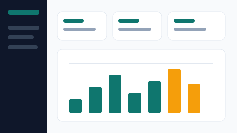

# Bab 5 — Box model dan kartu proyek

**Folder:** `bab-05-box-model/` · **Titik tolak:** `bab-04-tipografi/`
**Pratinjau:** `index.html`

## Inti bab ini

Tabel proyek diganti enam kartu. Pergantian ini memaksa box model dibahas secara
eksplisit: `box-sizing: border-box` untuk semua elemen, `padding` di dalam kartu,
`border` 1 px, `border-radius`, `box-shadow`, badge yang menempel di atas gambar dengan
`position: absolute`, dan deskripsi yang dipotong elipsis setelah dua baris.

Ini juga bab pertama yang mengubah **isi** halaman, bukan hanya gayanya.

## Yang berubah dari Bab 4

| Berkas | Perubahan |
| --- | --- |
| `index.html` | 110 → 159 baris. `section.proyek-unggulan` + tabel diganti `section.proyek` berisi enam `article.proyek-card` |
| `css/style.css` | 231 → 324 baris. Reset `box-sizing`, aturan gambar, kartu proyek, badge unggulan, kartu kontak |
| `tentang.html` | Tidak berubah |

## Rincian pekerjaan

### 1. Dari tabel ke kartu

| Sebelum (Bab 4) | Sesudah (Bab 5) |
| --- | --- |
| `section.proyek-unggulan` | `section.proyek` |
| `h2` "Proyek Unggulan" | `h2` "Proyek" + `p.section-lead` |
| `table` tiga baris | Enam `article.proyek-card` |
| Kolom Status berisi badge | Badge menempel di pojok gambar |

Setiap kartu berstruktur sama:

```html
<article class="proyek-card">
  <span class="badge badge-unggulan">Unggulan</span>
  
  <div class="proyek-body">
    <h3 class="proyek-nama">Dashboard SIAKAD</h3>
    <p class="proyek-kategori">Magang · 2025 · Bootstrap 5, CSS Grid</p>
    <p class="proyek-deskripsi">…</p>
    <p class="proyek-meta">Peran: frontend · <a href="#proyek">Lihat detail</a></p>
  </div>
</article>
```

Enam proyek yang ditampilkan: Dashboard SIAKAD (Unggulan), Katalog UMKM Sari Rasa,
Landing Kelas Online, Website Profil Desa, Form Pendaftaran Seminar, Tokosaya (Berjalan).
Setiap `` membawa `alt` yang menjelaskan isi pratinjau, bukan mengulang nama proyek.

### 2. Reset box model

```css
*, *::before, *::after { box-sizing: border-box; }
img { display: block; max-width: 100%; height: auto; }
```

Sebelum ini, `padding` menambah lebar elemen sehingga kartu meluber. Dengan `border-box`,
`width` yang ditulis sudah termasuk `padding` dan `border`.

### 3. Kartu sebagai kotak

| Aturan | Nilai | Alasan |
| --- | --- | --- |
| `position` | `relative` | Menjadi acuan badge `absolute` |
| `max-width` | `420px`, `margin: 0 auto` | Satu kolom di tengah pada layar sempit |
| `margin-bottom` | `calc(var(--space-unit) * 3)` = 24 px | Jarak antarkartu |
| `padding` | `0` | Padding dipindah ke `.proyek-body` agar gambar menempel tepi |
| `overflow` | `hidden` | Sudut gambar ikut terpotong `border-radius` |

`.proyek-body` memakai `padding: calc(var(--space-unit) * 3)` = 24 px di keempat sisi.

### 4. Badge di atas gambar

```css
.proyek-card .badge {
  position: absolute;
  top: calc(var(--space-unit) * 1.5);
  left: calc(var(--space-unit) * 1.5);
  z-index: 1;
}
```

- `absolute` menempel pada `.proyek-card` yang `relative`, bukan pada halaman.
- `z-index: 1` menaruhnya di atas gambar.
- `.badge-unggulan` ditambahkan; `.badge-berjalan` sekarang berlatar `--clr-danger`
  agar "Berjalan" tidak lagi memakai warna aksen yang sama dengan "Unggulan".

### 5. Elipsis dua baris

```css
.proyek-deskripsi {
  display: -webkit-box;
  -webkit-line-clamp: 2;
  -webkit-box-orient: vertical;
  overflow: hidden;
}
```

Tinggi kartu jadi seragam tanpa memotong teks secara manual.

### 6. Kartu kontak

`address` di bagian kontak dibungkus gaya kartu: `max-width: 52ch`, `font-style: normal`,
padding 24 px, border, dan `--radius`.

## Berkas di folder ini

| Berkas | Isi |
| --- | --- |
| `index.html` | Beranda dengan enam kartu proyek, badge absolut, `.section-lead` |
| `tentang.html` | Sama seperti Bab 4 |
| `css/style.css` | v2 lanjutan: reset `box-sizing`, `.proyek-card`, `.proyek-body`, `.proyek-meta`, `.badge-unggulan` |

## Cara memeriksa

1. DevTools › **Layout**: tiap kartu punya padding 24 px, border 1 px, dan
   `box-sizing: border-box`.
2. Periksa badge: `position: absolute` dengan induk `position: relative`. Hapus
   `position: relative` di DevTools — badge akan lompat ke sudut halaman.
3. Perkecil jendela sampai deskripsi terpotong: elipsis muncul karena
   `-webkit-line-clamp: 2`.
4. Semua kartu bertumpuk satu kolom — belum ada baris. Itu pekerjaan Bab 6.

## Yang dibawa ke Bab 6

Enam kartu masih bertumpuk vertikal karena `.proyek-card` di tengah dengan `margin: auto`.
Bab 6 mengubahnya menjadi satu baris lentur: `.proyek-list` sebagai flex container,
header dan footer juga, dan `margin-left: auto` untuk mendorong menu footer ke kanan.
