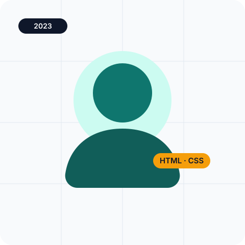

# Bab 13 — Responsif dan aksesibilitas

**Folder:** `bab-13-a11y/` · **Titik tolak:** `bab-12-design-system/`
**Pratinjau:** `index.html`, `tentang.html`, `styleguide.html`

## Inti bab ini

Bab ini menyisir **ketiga halaman** dan memperbaiki jalur masuknya, bukan menambah halaman
baru. Fokusnya pengguna keyboard dan pembaca layar: skip link sebagai elemen pertama,
cincin fokus yang dirancang ulang (bukan dihapus), penanda halaman aktif, `<picture>` untuk
art-direction, dan penghormatan pada `prefers-reduced-motion`.

## Yang berubah dari Bab 12

| Berkas | Perubahan |
| --- | --- |
| `css/style.css` | 238 → 299 baris. Enam blok aturan aksesibilitas ditambahkan |
| `index.html` | 343 → 349 baris. Skip link, `aria-current`, `main#main`, `<picture>`, `loading`/`decoding` |
| `tentang.html` | Skip link, `aria-current`, `main#main` |
| `styleguide.html` | Skip link, `main#main` |
| `img/avatar-rizky-lebar.svg` | **Aset baru** untuk art-direction |

## Rincian pekerjaan

### 1. Skip link — elemen pertama di `body`

```html
<a class="skip-link" href="#main">Langsung ke konten utama</a>
```

```css
.skip-link {
  position: absolute;
  top: -100px;
  left: calc(var(--space-unit) * 2);
  z-index: 1080;
  padding: var(--space-unit) calc(var(--space-unit) * 2);
  background-color: var(--clr-dark);
  color: #FFFFFF;
  border-radius: var(--radius);
}
.skip-link:focus { top: calc(var(--space-unit) * 2); }
```

Trik `top: -100px` → `top: 16px` membuat tautan tak terlihat sampai menerima fokus.
Ini pola yang tidak mungkin ditiru `display: none`, karena elemen tersembunyi tidak bisa
difokus.

### 2. Target lompatan yang bisa difokus

```html
<main id="main" tabindex="-1">
```

```css
#main:focus { outline: none; }
```

`tabindex="-1"` membuat `main` dapat menerima fokus programatis (tujuan skip link),
`outline: none` mencegah cincin fokus muncul pada kawasan seluas halaman. Ini
pengecualian sah terhadap aturan "jangan hapus fokus" — dan hanya berlaku untuk `main`.

### 3. Cincin fokus yang dirancang ulang

```css
a:focus-visible,
button:focus-visible,
.btn:focus-visible,
.form-control:focus-visible,
.form-select:focus-visible,
.form-check-input:focus-visible,
.nav-link:focus-visible,
.page-link:focus-visible,
.accordion-button:focus-visible {
  outline: 3px solid var(--clr-primary);
  outline-offset: 2px;
  box-shadow: none;
}
```

Sembilan selector, satu cincin: 3 px `--clr-primary` dengan jarak 2 px. `:focus-visible`
dipakai agar klik tetikus tidak memunculkan cincin, tetapi Tab selalu memunculkannya.

### 4. Penanda halaman aktif

- `index.html`: tautan Beranda mendapat `aria-current="page"`.
- `tentang.html`: tautan Tentang mendapat `aria-current="page"`.

### 5. `<picture>` untuk art-direction

```html
<picture>
  <source media="(max-width: 767.98px)" srcset="img/avatar-rizky-lebar.svg">
  
</picture>
```

Di bawah 768 px browser memuat versi **komposisi berbeda** — lebih lebar — bukan versi
yang diperkecil. Ini tujuan asli `<picture>`; `srcset` untuk resolusi tidak didemonstrasikan
karena semua aset berupa SVG.

### 6. `loading` dan `decoding`

| Gambar | Atribut |
| --- | --- |
| Avatar hero | `loading="eager" decoding="async"` — gambar pertama, jangan ditunda |
| Enam pratinjau proyek | `loading="lazy" decoding="async"` |

### 7. Navigasi menumpuk di layar sempit

```css
@media (max-width: 575.98px) {
  .site-header .nav { gap: calc(var(--space-unit) * 1.5) !important; }
  .site-header .nav-link { padding-block: 4px; }
}
```

Satu-satunya `!important` di seluruh CSS proyek, dan alasannya ditulis: menimpa utility
`gap-3` Bootstrap tanpa menambah kelas baru. Menu tetap bekerja tanpa JavaScript.

### 8. Menghormati gerak minimal

```css
@media (prefers-reduced-motion: reduce) {
  .proyek-card { transition: none; }
  .proyek-card:hover { transform: none; }
}
```

Efek angkat kartu dimatikan bagi pengguna yang meminta gerak minimal di sistem
operasinya.

## Berkas di folder ini

| Berkas | Isi |
| --- | --- |
| `index.html` | Beranda: skip link, `main#main`, `<picture>`, 1 gambar `eager` + 6 gambar `lazy` |
| `tentang.html` | Halaman tentang: skip link, `aria-current`, `main#main` |
| `styleguide.html` | Styleguide: skip link, `main#main` |
| `css/style.css` | v3 + 61 baris aksesibilitas |
| `img/avatar-rizky-lebar.svg` | Varian avatar lebar untuk layar < 768 px |

## Cara memeriksa

1. Muat ulang halaman lalu tekan **Tab** sekali: skip link muncul di atas. Tekan Enter —
   fokus pindah ke `main`.
2. Lanjutkan Tab: setiap tautan, tombol, medan form, dan item akordeon menampilkan cincin
   teal 3 px.
3. DevTools › **Lighthouse** › Accessibility: tidak ada gambar tanpa `alt`, heading
   berurutan, `main` tunggal.
4. Perkecil jendela di bawah 768 px dan cek DevTools › Network: yang dimuat adalah
   `avatar-rizky-lebar.svg`.
5. Aktifkan "reduce motion" di sistem operasi: kartu proyek tidak lagi terangkat saat
   disorot.

## Yang dibawa ke Bab 14

Ketiga halaman sudah layak pakai, tetapi belum punya tempat untuk menunjukkan satu proyek
secara mendalam. Bab 14 menerjemahkan satu frame Figma menjadi panel detail 7:5 lengkap
dengan catatan fidelity.
