<!-- _class: lead -->
<!-- _paginate: skip -->
<!-- _footer: '' -->

# Dasar-Dasar CSS

**Bab 3** · Memberi pakaian pada struktur yang udah rapi

Studi kasus: **Tokosaya**

<!--
Buka dengan pertanyaan: kalau HTML di Bab 2 udah rapi, kenapa halamannya masih
terasa kayak dokumen lama? Ingatkan bahwa bab ini fokus ke lapisan penataan,
bukan struktur. Sebutkan bahwa hasil akhirnya adalah `css/style.css` v1 Tokosaya.
-->

---

# Tujuan Pembelajaran

Setelah menyelesaikan bab ini, kamu bisa:

- Menjelaskan cara kerja CSS lewat pencocokan selector ke elemen HTML
- Membedakan tiga cara pemasangan CSS dan alasan external jadi default
- Memakai selector elemen, class, ID, grouping, dan descendant
- Menerapkan pseudo-class dasar buat keadaan interaktif tanpa JavaScript
- Menganalisis konflik gaya dengan specificity dan urutan penulisan
- Merancang struktur `style.css` yang terorganisasi dan konsisten

<!--
Bacakan tujuan ini singkat saja, lalu tekankan bahwa CPMK-nya lanjutan Bab 2:
menerapkan HTML5 dan CSS3 secara semantik. Sebutkan bahwa urutan bab mengikuti
alur kerja: pilih cara pemasangan, pilih selector, lalu pahami siapa yang menang
pas aturan bertabrakan.
-->

---

# Struktur Rapi, Tampilan Belum

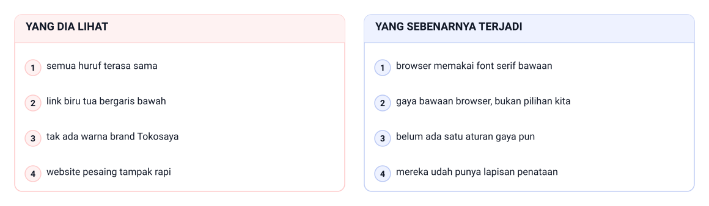

Pemilik Tokosaya membuka link pratinjau, melihat sebentar, lalu bertanya.

> HTML menyimpan struktur dan isi. Keputusan visualnya ditulis terpisah di CSS.

<!--
Ceritakan komentarnya persis kayak di buku: strukturnya udah rapi, tapi kenapa
tampilannya kayak dokumen lama. Tanyakan siapa yang pernah melihat halaman HTML
tanpa CSS. Jawaban yang diharapkan: yang tampak itu gaya bawaan browser, bukan
keputusan kita. Tekankan bahwa HTML kedua toko sama-sama semantik; bedanya di
lapisan penataan.

Bacakan pasangan keluhannya sambil menunjuk tiap baris gambar. Yang dia lihat:
semua huruf terasa sama, link biru tua bergaris bawah, tak ada warna brand
Tokosaya, website pesaing tampak rapi. Yang sebenarnya terjadi: browser memakai
font serif bawaan, gaya bawaan browser bukan pilihan kita, belum ada satu aturan
gaya pun, mereka udah punya lapisan penataan.
-->

---

<!-- _class: section -->
<!-- _footer: '' -->

# CSS dan Cara Kerjanya

## Bahasa yang menerjemahkan keputusan visual

<!--
Transisi dari keluhan pemilik toko menuju pertanyaan teknis: sebenarnya CSS itu
apa dan gimana ia bekerja. Tahan dulu soal selector; itu masuk di bagian kedua.
-->

---

<!-- _class: compact -->

# Apa Itu CSS

CSS adalah bahasa deklaratif buat menjelaskan tampilan dokumen HTML.

| Pertanyaan | Yang menjawab |
|---|---|
| Apa isi halaman ini? | HTML |
| Gimana isi itu tampil? | CSS |

- *Style sheets*: kumpulan aturan gaya, dipisah dari struktur
- *Cascading*: cara browser menyatukan aturan yang bertabrakan
- Hasil ditentukan kecocokan selector, bukan urutan program
- Gaya ditulis sekali, lalu dipakai di banyak elemen

> HTML itu manekin, CSS itu pakaiannya.

<!--
Tekankan kalimat manekin dan pakaian; ini pegangan buat seluruh bab. Tanyakan:
kalau warna brand Tokosaya ganti, yang berubah HTML atau CSS? Jawaban yang
diharapkan: cukup CSS-nya. Ingatkan juga bahwa CSS nggak punya urutan program
kayak logika aplikasi.
-->

---

# Anatomi Blok Aturan

```css
/* Satu blok aturan: selector h1 dan blok deklarasinya */
h1 {
  color: #1E293B;
  font-size: 32px;
}
```

`File: latihan-css/anatomi-rule.css`

- `h1` adalah selector, `{ }` adalah blok deklarasi
- `color: #1E293B;` satu declaration, `#1E293B` nilainya
- Tiap declaration diakhiri titik koma
- Kode heksadesimal enam digit dipakai di seluruh proyek

<!--
Sebutkan istilah selector, declaration, dan blok aturan pelan-pelan; kosakata ini
dipakai terus sampai Bab 8. Minta mahasiswa menunjuk mana selector dan mana
declaration di slide. Ingatkan titik koma di akhir tiap declaration karena ini
kesalahan paling sering di praktikum pertama.
-->

---

<!-- _class: compact -->

# Selector Mencocokkan Elemen

```html
<body>
  <h1>Laporan Status Aplikasi Peminjaman Ruang</h1>
  <p>Perbaikan pencarian ruang terselesaikan pada pekan ini.</p>
  <p>Uji tampilan cetak rekap peminjaman dijadwalkan hari Rabu.</p>
</body>
```

```css
h1 { color: #4F46E5; }
p  { color: #334155; }
```

- Selector `h1` cocok dengan satu elemen judul
- Selector `p` cocok dengan dua paragraf sekaligus
- Kedua file di `latihan-css/pencocokan/`: HTML-nya dan `css/style.css`

<!--
Gambarkan browser mencocokkan aturan ke pohon DOM, bukan menjalankan kode dari atas
ke bawah. Tanyakan: berapa elemen yang menerima warna dari satu aturan `p`?
Jawaban yang diharapkan: dua, dan itu inti efisiensi CSS.
-->

---

# Satu Gaya Pusat, Banyak Halaman

- Website layanan akademik bisa punya lima puluh halaman
- Tanpa CSS, penataan diulang di setiap halaman
- Satu `style.css` terpusat: ubah sekali, terasa di semua halaman
- Gaya konsisten membuat pengguna yakin sistemnya terkelola

> Memisahkan struktur dan tampilan itu soal biaya pemeliharaan, bukan selera.

<!--
Penting buat mahasiswa SI: hitung bareng-bareng, empat halaman kali sepuluh baris
gaya sama dengan berapa baris yang harus disunting manual. Tanyakan apa risikonya
kalau salah satu halaman lupa ikut diubah. Jawaban yang diharapkan: halaman itu
tertinggal dan tampil beda sendiri.
-->

---

# Contoh: Satu Gaya Pusat, Banyak Halaman

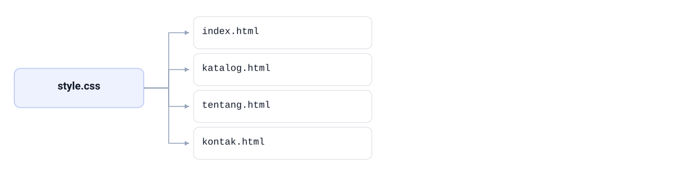

Warna identitas Tokosaya diganti dari #4F46E5 jadi #4338CA: cukup satu baris di
`style.css`, lalu `index.html`, `katalog.html`, `tentang.html`, dan `kontak.html`
ikut berubah karena semuanya menarik file yang sama lewat `<link>`. Cara lama butuh
4 halaman × 10 baris gaya = 40 baris disunting manual, dan satu halaman yang
terlewat langsung tampil beda.

<!--
Tunjuk akarnya dulu: satu file `style.css`, lalu empat anak yang semuanya menarik
gaya dari file itu. Tanyakan apa yang terlihat kalau satu halaman lupa diberi
`<link>`. Jawaban yang diharapkan: halaman itu balik ke gaya bawaan browser dan
kelihatan beda sendiri. Minta kelas menuliskan angka 40 baris tadi di catatan.
-->

---

# Inline, Internal, dan External

| Aspek | Inline | Internal | External |
|---|---|---|---|
| Letak kode | atribut `style` pada elemen | elemen `<style>` di `head` | file `.css` terpisah |
| Jangkauan | satu elemen | satu halaman | seluruh halaman proyek |
| Dipakai ulang | nggak bisa | antarelemen satu halaman | antar semua halaman |
| Pemeliharaan | buruk, tersebar | sedang | baik, satu pusat |
| Posisi dalam proyek | demonstrasi konsep | eksperimen cepat | default proyek |

<!--
Ini tabel yang paling sering ditanyakan; bahas baris "posisi dalam proyek" paling
akhir. Tanyakan kenapa inline nggak boleh jadi pola proyek. Jawaban yang
diharapkan: nggak bisa dipakai ulang, menang atas hampir semua gaya, dan susah
diaudit. Sebutkan bahwa ketiganya sama-sama sah secara teknis.
-->

---

<!-- _class: compact -->

# Praktik Terbaik: External CSS

```html
<head>
  <title>Tiga Cara Memasang CSS</title>
  <!-- Cara 2: internal CSS di dalam head -->
  <style>
    p {
      color: #334155;
    }
  </style>
  <!-- Cara 3: external CSS melalui elemen link -->
  <link rel="stylesheet" href="css/style.css">
</head>
```

`File: latihan-css/tiga-cara-css/index.html`

- Inline cuma buat memperlihatkan konsep
- Internal berguna buat eksperimen cepat satu halaman
- External jadi default: satu file buat semua halaman
- Taruh `<link>` sebagai bagian tetap di `head` setiap halaman

<!--
Tunjukkan urutan di `head`: internal ditulis dulu, external setelahnya. Ingatkan
bahwa kalau dua aturan setara kekuatannya, yang ditulis belakangan menang. Tanyakan
apa yang terjadi kalau `<link>` diletakkan di atas `<style>`.
-->

---

<!-- _class: section -->
<!-- _footer: '' -->

# Selector dan Keadaan Elemen

## Memilih elemen mana yang diberi gaya

<!--
Masuk ke bagian yang paling banyak dipraktikkan: memilih elemen mana yang diberi
gaya, dan gimana menata keadaannya. Sebutkan bahwa semuanya langsung dipakai
di praktikum Tokosaya.
-->

---

# Tiga Selector Dasar

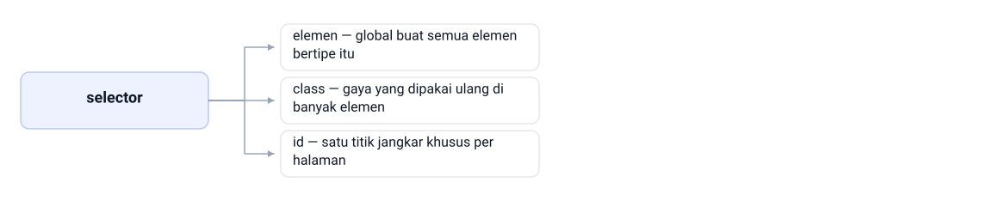

> Kalau gaya itu bakal muncul lagi di tempat lain, yang kamu butuh adalah class.

<!--
Minta mahasiswa memilih selector buat tiga kebutuhan sebelum kamu menunjukkan
jawabannya. Tekankan aturan praktisnya: class buat gaya yang berulang, ID buat
yang benar-benar cuma satu. Ingatkan bahwa selector elemen nggak melihat konteks,
jadi paragraf di footer ikut berubah.

Tiga jenisnya: elemen — global buat semua elemen bertipe itu; class — gaya yang
dipakai ulang di banyak elemen; id — satu titik jangkar khusus per halaman.
Penulisannya: `p`, `h1`, `a` untuk elemen, `.hero-title` untuk class, dan
`#pengantar` untuk id. Tanyakan mana yang cocok buat gaya tombol yang muncul di
tiga halaman; jawabannya class.
-->

---

# Penamaan Class dengan Kebab-Case

- Class adalah atribut HTML dan bisa dipakai ulang
- Pola `blok-elemen`: `site-nav`, `hero-title`, `produk-card`
- Huruf kecil dengan tanda hubung, bukan camelCase
- Nama berbasis peran, bukan tampilan literal
- Hindari `.merah-kecil` atau `.huruf-besar`

> Nama class yang baik membuat HTML dan CSS saling menunjuk tanpa dokumentasi tambahan.

<!--
Ini kebiasaan yang paling sering diabaikan mahasiswa. Tulis `site-nav` di papan,
lalu tanya: apa peran elemen ini kalau enam bulan lagi kamu buka file ini? Lanjutkan
dengan nama berbasis tampilan kayak `.merah-kecil`; tanyakan apa yang terjadi pas
desain berubah. Jawaban yang diharapkan: namanya jadi menyesatkan.
-->

---

# Contoh: Penamaan Class dengan Kebab-Case

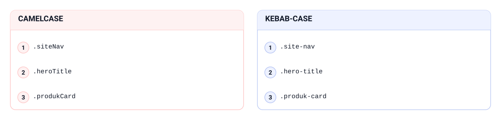

Badge "Best Seller" Tokosaya bertulis #1E293B di atas #F59E0B. Nama berbasis peran
menuliskan maksudnya: `.site-nav`, `.hero-title`, `.produk-card`. Konvensi proyek
memakai kebab-case — huruf kecil bertanda hubung — bukan camelCase seperti
`.siteNav`, `.heroTitle`, `.produkCard`, dan bukan nama tampilan seperti `.merah-kecil`.

<!--
Tanyakan: enam bulan lagi kamu buka file ini, dari nama `.merah-kecil` kamu tahu
elemennya buat apa? Jawaban yang diharapkan: nggak, paling cuma tahu warnanya dulu
merah. Lalu bandingkan dua kolom di gambar: barisnya sejajar, elemennya sama, cuma
bedanya penulisan. `.siteNav` dan `.site-nav` sama-sama navigasi situs; yang kanan
yang dipakai proyek ini. Ingatkan polanya: huruf kecil, kata disambung tanda
hubung, bukan camelCase.
-->

---

# Grouping dan Descendant

```css
/* Descendant: p di dalam laporan-section */
.laporan-section p {
  line-height: 1.7;
}

/* Grouping: dua selector berbagi satu blok aturan */
h1, h2 {
  color: #1E293B;
}
```

`File: latihan-css/selector-dasar/css/style.css`

- Grouping pakai koma: menggabungkan selector yang berbagi aturan
- Descendant pakai spasi: menyasar elemen di dalam elemen lain
- Grouping mencegah duplikasi deklarasi warna judul

<!--
Tekankan bedanya koma dan spasi: satu menggabungkan, satu menyempitkan jangkauan.
Tanyakan apa arti `.laporan-section p`. Jawaban yang diharapkan: setiap paragraf
di dalam elemen ber-class itu, nggak peduli seberapa dalam posisinya.
-->

---

# Lima Pseudo-Class Dasar

- `:hover` — kursor berada di atas elemen
- `:focus` — elemen menerima fokus keyboard
- `:first-child` — anak pertama elemen induknya
- `:last-child` — anak terakhir elemen induknya
- `:nth-child()` — pola urutan: `odd`, `even`, atau `2n`

> Semua keadaan ini ditangani murni oleh CSS, tanpa satu baris JavaScript pun.

<!--
Katakan dengan jelas bahwa ini tanpa JavaScript, sesuai cakupan mata kuliah. Tunjukkan
`:focus` sambil menabrak tombol Tab di laptop yang diproyeksikan biar kelas melihat
fokus itu nyata. Sebutkan bahwa penulisannya menempel tanpa spasi, misal `a:hover`.
-->

---

# Contoh: Lima Pseudo-Class Dasar

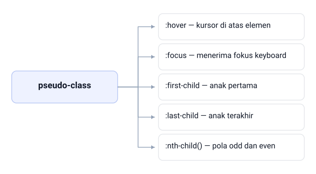

Di navigasi Tokosaya, `:hover` kursor di atas elemen dan `.site-nav a:hover` jadi
#4F46E5; `:focus` menerima fokus keyboard lewat `outline: 2px`. Di daftar menu,
`:first-child` anak pertama, `:last-child` anak terakhir, dan `:nth-child()` pola
odd dan even menyala selang-seling.

<!--
Tanya satu per satu: apa bedanya `:hover` dan `:focus`? Jawaban yang diharapkan:
`:hover` butuh kursor mouse, `:focus` bisa dicapai tombol Tab. Tunjuk lima cabang di
gambar dan ingatkan semuanya jalan tanpa satu baris JavaScript. Minta kelas menunjuk
mana yang menyala karena posisi anak, bukan karena sentuhan pengguna.
-->

---

<!-- _class: compact -->

# Menata Keadaan Link

```css
/* :hover pas kursor berada di atas link */
.site-nav a:hover {
  color: #4F46E5;
}

/* :focus pas link menerima fokus keyboard */
.site-nav a:focus {
  outline: 2px solid #4F46E5;
}
```

`File: latihan-css/pseudo-class/css/style.css`

- Tanpa umpan balik, orang ragu linknya bisa diklik
- Gaya fokus jangan dihapus: itu pengganti kursor buat pengguna keyboard

<!--
Tanyakan kenapa `outline` fokus jangan dihapus biar tampilan terlihat bersih.
Jawaban yang diharapkan: pengguna keyboard nggak punya kursor, jadi fokus adalah
satu-satunya isyarat posisi mereka. Ingatkan juga bahaya menulis `a :hover` dengan
spasi, karena artinya jadi beda.
-->

---

<!-- _class: compact -->

# Butir Pertama, Terakhir, dan Baris Tabel

```css
/* Anak pertama pada daftar menu */
.menu-list li:first-child {
  font-weight: 600;
  color: #1E293B;
}

/* Anak terakhir pada daftar menu diberi warna perhatian */
.menu-list li:last-child {
  color: #DC2626;
}

/* Baris ganjil pada isi tabel diberi latar lembut */
.statistik-table tbody tr:nth-child(odd) {
  background-color: #F8FAFC;
}
```

`File: latihan-css/pseudo-class/css/style.css`

- Menghindari class tambahan pada butir pertama atau terakhir
- Satu baris CSS menggantikan class di setiap baris tabel

<!--
Tunjukkan efek `:nth-child(odd)` pada tabel: latarnya jadi selang-seling. Tanyakan
apa yang terjadi kalau ada baris baru disisipkan di tengah tabel. Jawaban yang
diharapkan: pewarnaannya ikut menyesuaikan sendiri, nggak kayak class manual.
-->

---

<!-- _class: section -->
<!-- _footer: '' -->

# Nilai, Satuan, dan Kaskade

## Memilih nilai, lalu memahami siapa yang menang

<!--
Pindah dari "elemen mana yang diberi gaya" ke "nilai apa yang diberikan dan siapa
yang menang kalau ada konflik". Katakan bahwa bagian inilah yang bikin file CSS
terasa nggak bisa diprediksi kalau dilewati.
-->

---

# Empat Properti Inti Visual

| Properti | Fungsi | Nilai contoh |
|---|---|---|
| `color` | warna tinta teks dan dekorasi garis | `#4F46E5`, `red`, `rgb(79, 70, 229)` |
| `background-color` | warna latar kotak elemen | `#F8FAFC` |
| `border` | tebal, gaya, dan warna tepi sekaligus | `1px solid #E2E8F0` |
| `opacity` | transparansi, nilai 0 sampai 1 | `0.95` |

- Proyek ini konsisten memakai heksadesimal enam digit
- `background-color` nggak diwariskan ke elemen anak

<!--
Ingatkan bahwa keempat properti ini cuma fondasi; jarak dan layout menyusul di
Bab 5 dan 7. Tekankan bahwa heksadesimal dipakai konsisten karena Bab 4 bakal
mengubahnya jadi design token. Tanyakan apa bedanya `opacity: 0.95` dengan
`opacity: 0`.
-->

---

<!-- _class: compact -->

# Warna Bukan Cuma Soal Selera

```css
.badge-tersedia {
  color: #FFFFFF;
  background-color: #16A34A;
  border: 1px solid #E2E8F0;
}

.badge-laris {
  color: #1E293B;
  background-color: #F59E0B;
  border: 1px solid #E2E8F0;
  opacity: 0.95;
}
```

`File: latihan-css/properti-inti/css/style.css`

- Badge "Tersedia" memakai teks putih di atas hijau sukses
- Badge "Best Seller" memakai teks gelap di atas amber

> Jangan memasangkan warna hanya karena menurutmu bedanya udah cukup.

<!--
Minta kelas menebak kenapa badge amber pakai teks gelap, bukan putih. Jawaban yang
diharapkan: kontrasnya lebih nyaman dibaca. Sebutkan bahwa aturan kontras resmi
menyusul di Bab 4 dan dikaitkan ke standar WCAG di Bab 13.
-->

---

# Lima Satuan CSS

- `px` — satuan tetap, cocok buat garis dan nilai kecil
- `%` — relatif terhadap lebar atau tinggi kotak induk
- `em` — relatif terhadap ukuran font elemen itu sendiri
- `rem` — relatif terhadap `font-size` elemen akar, lazimnya 16px
- `vw` dan `vh` — 1/100 dari lebar dan tinggi viewport
- `1rem = 16px`, `2rem = 32px` pas font akar 16px

<!--
Jangan hafalkan kelimanya sekaligus; cukup tekankan pasangan rem buat font dan
persen buat lebar. Tanyakan apa yang terjadi pada `2rem` kalau pengguna memperbesar
font dasar browser. Jawaban yang diharapkan: ukurannya ikut membesar, dan itulah
sisi aksesibilitasnya. Peringatkan juga bahwa `em` bersarang bisa menumpuk.
-->

---

# Contoh: Lima Satuan CSS

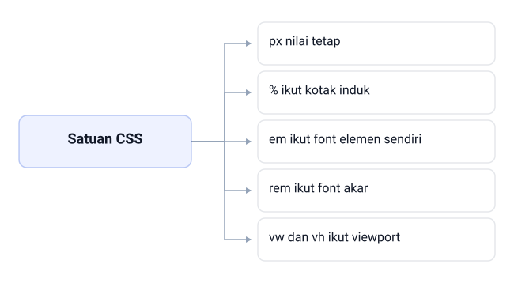

Judul hero Tokosaya ditulis `2rem`: 32px kalau font akar 16px, dan 40px kalau font
akar 20px. Kelima satuan CSS ini alternatif, bukan bertingkat; yang membedakan cuma
acuannya — `px` nilai tetap, `%` ikut kotak induk, `em` ikut font elemen sendiri,
`rem` ikut font akar, dan `vw` dan `vh` ikut viewport.

<!--
Bacakan kelima cabang sambil menyebut acuannya: `px` nilai tetap, nggak mengacu ke
apa pun; `%` ikut lebar atau tinggi kotak induk; `em` ikut font elemen itu sendiri;
`rem` ikut font akar, 1rem = 16px; `vw` dan `vh` 1/100 dari lebar dan tinggi
viewport. Tegaskan kelimanya alternatif, bukan bertingkat — tidak ada yang "di atas"
yang lain, pilihan ditentukan kebutuhan. Ulangi pertanyaan deck: kalau pengguna
memperbesar font dasar browser, mana yang ikut membesar? Jawaban yang diharapkan:
`rem`, karena dia mengacu ke font akar, sedangkan `px` nggak ikut. Tekankan `vw` dan
`vh` bergantung penuh pada layar, jadi jangan dipakai buat ukuran font.
-->

---

# Memilih Satuan Sesuai Keperluan

| Keperluan | Satuan disarankan | Alasan singkat |
|---|---|---|
| Ukuran font teks | `rem` | mengikuti pengaturan pengguna, ramah aksesibilitas |
| Jarak internal kecil | `px` atau `em` | tetap, mudah difiksasi terhadap desain |
| Lebar blok konten | `%` | mengikuti lebar layar |
| Tinggi banner atau hero | `vh` | mengikuti tinggi layar |
| Ketebalan garis | `px` | nilai kecil stabil lintas satuan |

<!--
Kaitkan tabel ini dengan keputusan praktikum: font pakai rem, lebar pakai persen,
garis pakai px. Minta mahasiswa menulis satu aturan buat masing-masing baris sebelum
kamu lanjut. Sebutkan bahwa skala jarak dirapikan lagi dengan basis 8px di Bab 4.
-->

---

# Kaskade: Siapa yang Menang

- Kaskade adalah cara browser memutuskan pemenang pas aturan bertabrakan
- Gaya bawaan browser (user-agent) selalu di bawah aturan yang kita tulis
- Kalau aturan setara, yang ditulis paling akhir yang menang
- `!important` itu surat keputusan darurat: hindari jadi kebiasaan

> CSS yang terasa berantakan biasanya bukan karena propertinya salah, tapi karena kaskadenya belum dipahami.

<!--
Pakai analogi pemilihan seragam kalau kelas terlihat bingung: ada kebijakan
pemerintah, ada aturan sekolah. Tanyakan siapa yang menang antara link biru bawaan
browser dan aturan `a` yang kita tulis. Jawaban yang diharapkan: aturan kita.
Ingatkan bahwa `!important` sah, tapi bikin aturan berikutnya makin susah diatur.
-->

---

# Contoh: Kaskade: Siapa yang Menang

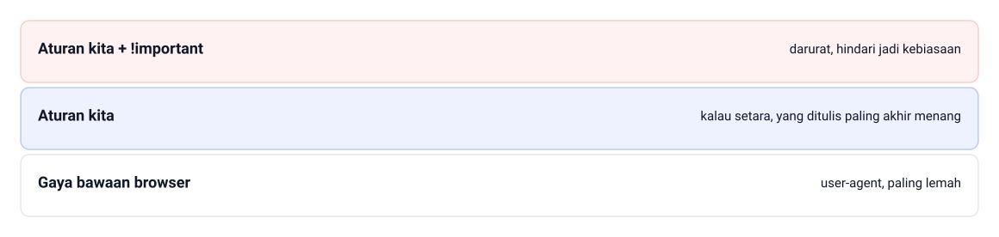

Link di `.site-nav` lahir dari browser sebagai biru tua bergaris bawah, tapi aturan
kita menang: `a { color: #4F46E5; }` membuatnya indigo, sedangkan gaya bawaan browser
— user-agent, paling lemah — tetap di dasar. `!important` bukan sumber aturan keempat,
cuma penanda pada aturan kita + !important: darurat, hindari jadi kebiasaan. Kalau
setara, yang ditulis paling akhir menang.

<!--
Tanyakan siapa yang menang antara biru tua bawaan browser dan aturan
`.site-nav a { color: #4F46E5; }`. Jawaban yang diharapkan: aturan kita, karena gaya
bawaan browser, pita paling bawah, selalu kalah. Lanjut: kalau dua aturan kita
sama-sama menyasar link yang sama, siapa menang? Jawaban: yang ditulis paling akhir —
itu catatan di pita tengah gambar. Tunjuk pita paling atas: `!important` bukan
sumber aturan keempat, cuma penanda darurat pada aturan kita, dan dia menang atas
urutan penulisan.
-->

---

# Alur Keputusan Kaskade

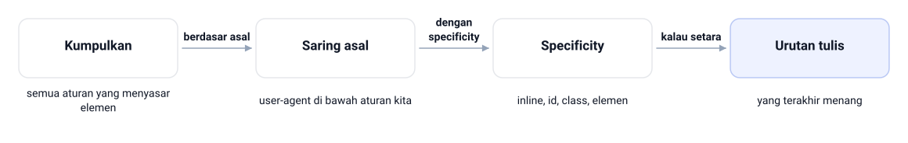

<!--
Bacakan empat langkah ini pelan-pelan; ini rangkuman yang paling sering dipakai pas
debugging. Siapkan satu contoh konflik sederhana di papan dan jalankan langkahnya
bareng-bareng. Tekankan bahwa urutan penulisan bukan penentu pertama.

Langkahnya, sesuai urutan gambar: Kumpulkan — semua aturan yang menyasar elemen.
Saring asal — user-agent di bawah aturan kita. Specificity — inline, id, class,
elemen. Urutan tulis — yang terakhir menang. Rantainya: kumpulkan semua aturan yang
menyasar elemen, lalu saring berdasar asal (`user-agent < aturan yang kita tulis`),
urutkan dengan specificity (`inline > id > class > elemen`), dan kalau setara aturan
yang ditulis paling akhir menang. Langkah 3 dan 4 paling sering bikin bingung pas
pertama belajar; urutan penulisan baru dipakai kalau kekhususannya setara.
-->

---

# Membaca Specificity

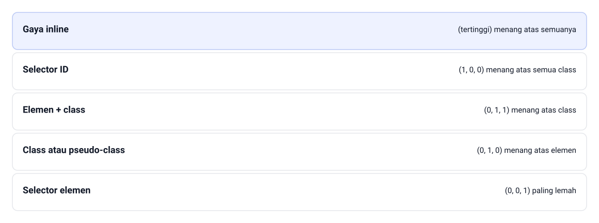

Specificity dinilai sebagai pasangan tiga angka `(id, class, elemen)`.

<!--
Ajari kelas membaca tiga angka itu sebagai tiga tingkat, bukan satu bilangan: selector
elemen (0, 0, 1) paling lemah, class atau pseudo-class (0, 1, 0) menang atas elemen,
elemen + class (0, 1, 1) menang atas class, selector ID (1, 0, 0) menang atas semua
class, dan gaya inline tertinggi menang atas semuanya.

Minta mereka menghitung specificity `p#pengurusan.note` sebelum kamu tunjukkan
jawabannya: (1, 1, 1). Ingatkan bahwa satu angka id selalu mengalahkan berapa pun
jumlah class. Bentuk penulisan tiap tingkat: `p` buat elemen, `.note` atau `:hover`
buat class dan pseudo-class, `p.note` buat elemen + class, `#pengumuman` buat ID, dan
`style="color: #DC2626"` buat gaya inline.
-->

---

# Inheritance: yang Diwarisi dan Bukan

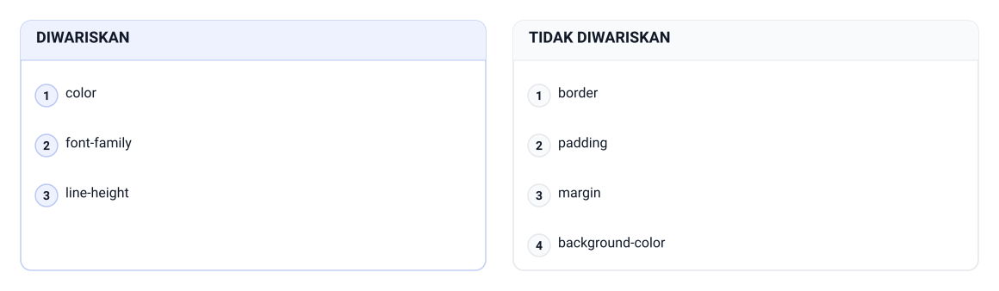

> Pewarisan itu kayak warna mata yang diturunkan dari orang tua ke anak.

<!--
Tanyakan kenapa `border` sengaja nggak diwariskan. Jawaban yang diharapkan: kalau
diwariskan, setiap elemen anak ikut menyalin tepi induknya dan halaman jadi penuh
garis. Lanjutkan dengan menunjukkan bahwa `line-height: 1.6` di `body` langsung
berlaku ke seluruh teks di praktikum.

Kelompok properti teks diwariskan: `color`, `font-family`, `line-height`. Kelompok
properti kotak tidak diwariskan: `border`, `padding`, `margin`, `background-color`.
Tekankan akibatnya: `color` pada `body` cukup buat jadi warna default hampir semua
teks, sedangkan kalau `border` ikut diwarisi, tiap anak menyalin tepi induknya.
-->

---

<!-- _class: compact -->

# Laboratorium Kaskade

```css
/* Aturan 1: hanya menyasar elemen p, specificity (0, 0, 1) */
p {
  color: #334155;
}

/* Aturan 2: class menang atas selector elemen, (0, 1, 0) */
.note {
  color: #F59E0B;
}

/* Aturan 4: kombinasi id, class, dan elemen, (1, 1, 1) */
p#pengurusan.note {
  color: #16A34A;
}
```

`File: latihan-css/kaskade-demo/css/style.css`

- `<p class="note">` tampil amber dari aturan 2
- `<p id="pengurusan" class="note">` tampil hijau dari aturan 4
- Paragraf bergaya inline tampil merah, menang atas aturan id

<!--
Minta mahasiswa menebak warna tiap paragraf dulu, baru jalankan kodenya. Lanjutkan
dengan membuka panel Styles DevTools dan telusuri aturan mana yang tercoret dan mana
yang berlaku. Ini latihan paling berguna menjelang tugas akhir bab. Ingatkan bahwa
gaya inline di contoh itu khusus demonstrasi, bukan pola proyek.
-->

---

# Kebiasaan yang Bikin CSS Susah Dirawat

- Memakai `!important` buat menyelesaikan setiap konflik
- Selector kepanjangan kayak `#navigasi ul li a.tautan` padahal `.nav-link` cukup
- Menyebarkan aturan serupa ke banyak file gaya
- Menaruh gaya inline di HTML produksi yang nggak kelihatan di `style.css`

> Satu file gaya, selector spesifik seperlunya, biarkan kaskade bekerja sebagaimana mestinya.

<!--
Bahas dua kesalahan yang paling sering muncul di tugas: `!important` dan selector
kepanjangan. Minta mahasiswa memeriksa file masing-masing dan menghitung berapa
banyak `!important` yang mereka tulis. Tanyakan kenapa specificity yang terlalu
tinggi bikin aturan susah diganti nanti.
-->

---

# Contoh: Kebiasaan yang Bikin CSS Susah Dirawat

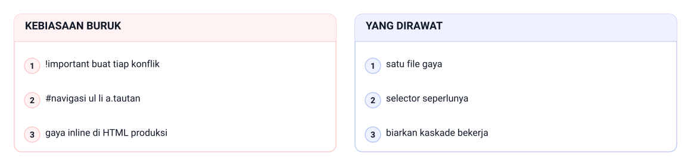

Satu kasus dari tugas: `.nav-link` cukup (0, 1, 0), tapi yang ditulis
`#navigasi ul li a.tautan` dengan specificity (1, 1, 3). Tambah `!important` buat
tiap konflik dan gaya inline di HTML produksi, dan `style.css` jadi susah dirawat —
versi yang dirawat cuma butuh satu file gaya, selector seperlunya, biarkan kaskade
bekerja.

<!--
Hitung specificity `#navigasi ul li a.tautan` bareng-bareng: satu id, satu class, tiga
elemen, jadi (1, 1, 3). Tanyakan kenapa angka itu bikin masalah nanti. Jawaban yang
diharapkan: aturan penggantinya butuh specificity minimal sama, jadi selector baru
makin panjang. Tunjuk kolom kanan dan tegaskan tiga kebiasaan buruk di kiri itu yang
paling sering muncul di tugas.
-->

---

<!-- _class: section -->
<!-- _footer: '' -->

# Praktik: style.css v1 Tokosaya

## Satu file gaya buat dua halaman

<!--
Masuk ke praktikum. Ingatkan bahwa hasil akhir bab ini cuma satu file `style.css`
yang dipakai dua halaman, dan itu udah cukup buat disebut konsisten. Tujuan
praktikumnya bukan bikin halaman terlihat cantik.
-->

---

# Langkah Praktikum

1. Buka folder proyek `tokosaya-css/` dari Bab 2
2. Buat folder `css`, lalu file `style.css` di dalamnya
3. Tambahkan kail class pada elemen utama `index.html`
4. Tautkan `<link>` yang sama di `index.html` dan `tentang.html`
5. Tulis aturan buat body, heading, link, header, hero, bagian konten, footer
6. Muat ulang di browser, lalu periksa panel Styles di DevTools

<!--
Jalankan langkah ini sambil didemokan di layar, jangan cuma dibacakan. Sering-sering
berhenti di langkah tiga karena kesalahan penamaan class paling banyak terjadi di
situ. Ingatkan menyimpan file sebelum memuat ulang, dan periksa Console kalau gaya
nggak muncul sama sekali.
-->

---

<!-- _class: compact -->

# Kail Class di index.html

```html
<header class="site-header">
  <p class="brand">Tokosaya</p>
  <nav class="site-nav" aria-label="Navigasi utama">
    <a href="index.html">Beranda</a>
    <a href="katalog.html">Katalog</a>
    <a href="tentang.html">Tentang</a>
    <a href="kontak.html">Kontak</a>
    <a href="#" class="nav-cart">Keranjang</a>
  </nav>
</header>
<main>
  <section class="hero">
    <h1 class="hero-title">Peralatan Kerja Digital untuk Semua</h1>
    <a href="#" class="btn-cta">Lihat Katalog</a>
  </section>
</main>
```

`File: tokosaya-css/index.html`

- HTML membawa identitas peran, CSS membawa keputusan visual
- Halaman Katalog dan Kontak masih memakai `href="#"` karena belum dibuat

<!--
Tekankan pembagian tugasnya: HTML membawa identitas, CSS membawa keputusan. Tanyakan
kenapa tombol CTA pakai `href="#"`; jawabannya karena halaman tujuannya baru lahir di
bab berikutnya. Periksa bareng-bareng bahwa semua nama class konsisten kebab-case dan
nggak ada satu pun id yang dipasang cuma buat gaya.
-->

---

<!-- _class: compact -->

# Isi style.css v1

```css
/* ---------- Tokosaya style.css — v1 (Bab 3) ---------- */

/* ---------- Dasar halaman ---------- */
body {
  margin: 0;
  font-family: 'Segoe UI', Tahoma, Verdana, sans-serif;
  color: #334155;
  background-color: #F8FAFC;
  line-height: 1.6;
}

/* ---------- Heading ---------- */
h1, h2, h3 {
  color: #1E293B;
  line-height: 1.25;
  margin: 0 0 16px;
}
```

`File: tokosaya-css/css/style.css`

- Komentar kepala file dan komentar bagian menandai isi file
- Urutannya mengikuti anatomi halaman: dasar, header, isi, footer

<!--
Buka file aslinya di layar dan tunjukkan urutan bagiannya dari atas ke bawah.
Aturan link, header, hero, dan footer menyusul di bawahnya; lanjutkan di editor.
Tanyakan kenapa `body` ditulis paling awal, bukan paling akhir. Jawaban yang
diharapkan: urutan penulisan ikut menentukan pemenang pas specificity setara, jadi
gaya global ditaruh di depan biar prediktabel. Lanjutkan aturan link, header, hero,
dan footer sisanya langsung di editor.
-->

---

# Hasil yang Diharapkan

- Teks tampil sans-serif dengan jarak baris 1.6
- Heading tegas #1E293B dengan ukuran bertingkat: 36px, 28px, 20px
- Latar halaman #F8FAFC dengan panel putih dan garis #E2E8F0
- Link indigo #4F46E5, menggelap ke #4338CA pas di-hover
- Kotak fokus indigo muncul pas ditabrak tombol Tab
- Satu file `style.css` yang sama menata kedua halaman

<!--
Bandingkan tampilan sebelum dan sesudah langsung di browser, jangan cuma menampilkan
slide ini. Kalau ada yang hasilnya belum berubah, curigai jalur `<link>` salah dulu
sebelum menuduh kodenya salah. Ingatkan hard refresh dengan Ctrl+F5 kalau browser
masih memakai file gaya dari cache.
-->

---

<!-- _class: compact -->

# Studi Kasus: Refactor Halaman Layanan

**Sebelum:** hampir setiap elemen diberi atribut `style`.

```html
<ul style="line-height: 1.7; color: #334155;">
  <li>Senin sampai Kamis: 08.00 sampai 16.00</li>
  <li style="color: #DC2626;">Jumat: 08.00 sampai 11.30</li>
</ul>
```

`File: kasus-bab-03/layanan-publik/versi-inline.html`

<!--
Ceritakan kisahnya dulu: tiga halaman serupa, satu halaman tertinggal waktu warna
identitas diganti. Tanyakan langkah pertama refactor-nya. Jawaban yang diharapkan:
audit dan hapus atribut `style` dulu, karena gaya inline menang atas apa pun di
`style.css`.
-->

---

<!-- _class: compact -->

# Setelah Refactor: Nama Peran

**Sesudah:** nama peran menggantikan keputusan visual.

```html
<ul class="jam-list">
  <li>Senin sampai Kamis: 08.00 sampai 16.00</li>
  <li class="jam-short">Jumat: 08.00 sampai 11.30</li>
</ul>
```

`File: kasus-bab-03/layanan-publik/index.html`

- Warna identitas diganti, dua halaman ikut berubah, satu tertinggal
- Kalau nama perannya jelas, satu perubahan di `style.css` cukup buat semua halaman

<!--
Tegaskan bahwa refactor ini fondasi yang nanti dipakai Tokosaya buat empat halaman.
Tanyakan: apa yang terjadi pada halaman ketiga kalau namanya masih `merah-kecil`
atau `huruf-besar`? Jawaban yang diharapkan: namanya jadi membingungkan begitu
desainnya berubah.
-->

---

# Latihan

- Tulis blok aturan buat badge "Baru" produk Webcam HD WC-720: teks putih, latar indigo, tepi 1px #E2E8F0, class `badge-baru`
- Jelaskan kenapa kamu memilih class, bukan ID
- Tulis ulang `latihan-css/tiga-cara-css` jadi external penuh, lalu catat jumlah atribut `style` yang dihapus
- Pada `latihan-css/kaskade-demo`, tukar posisi Aturan 1 dan Aturan 2: kenapa hasilnya nggak berubah?

> Jelaskan alasannya, bukan cuma nama propertinya.

<!--
Kerjakan butir pertama bareng-bareng di papan, sisanya buat latihan mandiri.
Perhatikan butir terakhir: tujuan soalnya bukan mencari jawaban benar, tapi menyadari
bahwa specificity mengalahkan urutan penulisan. Tanyakan pasangan aturan mana di file
itu yang hasilnya justru berubah kalau ditukar.
-->

---

# Cek Daftar style.css v1

- Satu file `css/style.css` dipakai lewat `<link>` di kedua halaman
- `body` menetapkan font dasar, warna teks, dan latar
- Heading memakai `rem` dengan ukuran bertingkat
- Link punya keadaan `:hover` dan `:focus`
- Nggak ada `!important` dan nggak ada gaya inline
- Komentar banner menandai setiap bagian file

<!--
Minta mahasiswa saling memeriksa file pakai daftar ini dan menunjukkan buktinya
langsung di kode. Tanyakan aturan mana yang ternyata bisa dihapus karena propertinya
udah diwarisi dari `body`. Ingatkan bahwa satu properti sebaiknya punya satu tempat
utama yang jelas.
-->

---

# Rangkuman

- CSS menata rupa lewat blok aturan: selector dan blok deklarasi
- External CSS jadi default proyek; inline cuma demonstrasi konsep
- Selector: elemen, class kebab-case `blok-elemen`, dan ID yang hemat
- Pseudo-class menata keadaan elemen tanpa JavaScript
- `rem` buat font, `%` buat lebar, `px` buat garis, `vh` buat tinggi layar
- Kaskade memilih pemenang: asal, specificity, lalu urutan penulisan

<!--
Tutup dengan pesan utama: tampilan boleh berubah, tapi keputusannya harus tinggal di
satu tempat yang jelas. Sebutkan bahwa Bab 4 bakal mengganti warna hex yang ditulis
berulang dengan design token, dan menaikkan standar tipografinya. Ingatkan bahwa
selector, kaskade, dan specificity di bab ini jadi pisau utama buat menerapkan token
itu dengan terkendali.
-->

---

<!-- _class: lead -->
<!-- _footer: '' -->

# Tugas dan Refleksi

Terapkan `style.css` v1 ke `index.html` dan `tentang.html`, lalu tulis catatan 150 kata berisi tiga keputusan warnamu dan alasannya.

**Pertanyaan refleksi:** kenapa spesifikasi web menaruh gaya inline di puncak specificity?

<!--
Tugas individu: kumpulkan `style.css`, kedua file HTML dengan class yang rapi, dan
catatan 150 kata. Nilai keterhubungan external CSS di kedua halaman, kelengkapan
keadaan `:hover` dan `:focus`, organisasi file dengan komentar banner, serta
kecocokan warnanya. Tekankan bahwa yang dinilai bukan warna yang cantik, tapi file
yang gampang dibaca orang lain.
-->
