<!-- _class: lead -->
<!-- _paginate: skip -->
<!-- _footer: '' -->

# Tipografi dan Visual Design CSS

**Bab 4** · Bikin halaman Tokosaya berkarakter brand

Studi kasus: **Tokosaya**

<!--
Buka dengan mengingatkan hasil Bab 3: halaman udah kebaca, tapi belum punya
karakter. Tanyakan siapa yang pernah merasa halamannya kurang meyakinkan padahal
isinya udah benar. Sebutkan bahwa bab ini memberi dua senjata, tipografi dan
sistem warna, lalu menyatukan keduanya lewat design token.
-->

---

# Tujuan Pembelajaran

Habis bab ini, kamu bakal bisa:

- Njelasin peran tipografi buat keterbacaan, identitas, dan rasa nyaman pas dipakai
- Masang Google Fonts Poppins dan Inter, plus fallback stack yang aman
- Pakai properti tipografi dasar dan skala rem, termasuk clamp()
- Nyusun sistem warna Tokosaya lengkap sama warna semantik dan ambang kontras WCAG
- Mainin border-radius, box-shadow, opacity, dan background solid atau gradient
- Ngumpulin design token jadi CSS custom properties di :root

<!--
Bacakan tujuan ini singkat, lalu tekankan CPMK-nya: menerapkan CSS buat visual
antarmuka, menuju mini design system di Bab 12. Katakan bahwa urutan babnya
disengaja: pilih font dulu, atur propertinya, baru bangun skala dan token.
Sepuluh menit terakhir dipakai buat praktikum, bukan buat teori baru.
-->

---

<!-- _class: compact split-left -->

# Dua Beranda, Isi yang Sama

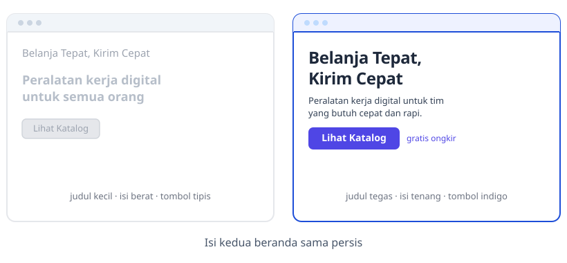

- Isinya sama persis; bedanya cuma bentuk huruf sama warnanya
- Mata kita nangkep bentuk kalimatnya dulu, baru isinya

<!--
Tunjuk diagram kiri-kanan ini, jangan bacakan daftarnya. Manajer konten memaparkan
dua tampilan beranda Tokosaya, lalu bertanya mana yang bikin pelanggan percaya.
Ceritakan ulang rapat pekanan itu: dua beranda, isi persis sama, hampir seluruh
ruangan memilih versi kedua tanpa ragu. Tanyakan kenapa versi kedua menang padahal
teksnya identik. Jawaban yang diharapkan: pembaca menangkap bentuk hurufnya sebelum
sampai ke isi kalimatnya.
-->

---

<!-- _class: section -->
<!-- _footer: '' -->

# Tipografi dan Web Font

## Pilih hurufnya, terus atur tampilannya

<!--
Transisi dari keluhan pemilik toko ke pertanyaan teknis: huruf apa yang dipakai
dan gimana memuatnya biar sama di semua perangkat. Tahan dulu soal skala ukuran;
itu masuk di bagian kedua. Sebutkan bahwa semua yang dibahas di sini langsung
dipakai di landing page praktikum.
-->

---

# Menyusun Huruf, Bukan Cuma Memilih

- Tipografi itu ngatur ukuran, jarak, dan bobot huruf
- Tujuannya biar teks gampang dibaca tapi tetap punya karakter
- Hampir semua antarmuka web isinya teks
- Judul produk, label form, pesan status, semuanya huruf

> Tipografi itu pakaian teks: nggak mengubah isi, tapi menentukan kesan pertama.

<!--
Tekankan analogi pakaian teks; ini pegangan buat seluruh bab. Tanyakan mana yang
lebih cepat bikin orang ragu: kalimat yang salah atau huruf yang sulit dibaca.
Jawaban yang diharapkan: hurufnya, karena pembaca berhenti sebelum sampai ke
isinya. Ingatkan bahwa tipografi bukan hiasan, tapi alat komunikasi layanan.
-->

---

<!-- _class: compact split-left -->

# Typeface dan Font

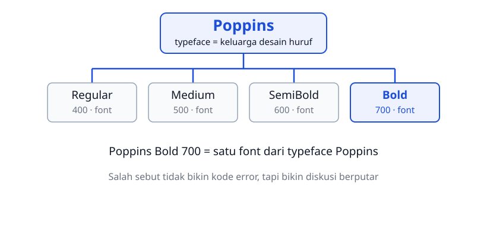

- Typeface itu keluarganya; font itu satu wujud berat dan gaya di dalamnya
- Salah sebut nggak bikin kode error, cuma bikin obrolan tim muter-muter

<!--
Dua istilah ini sering dipakai saling menggantikan, padahal artinya beda. Ini
kosakata yang dipakai pas ngobrol dengan desainer, jadi bahas pelan-pelan.
Tunjuk satu cabang diagram: Poppins itu keluarganya, Bold 700 itu salah satu
font-nya. Tanyakan: Poppins Bold 700 itu typeface atau font. Jawaban yang
diharapkan: font, karena ada berat dan gayanya. Tegaskan bahwa salah sebut nggak
bikin kode error, tapi bikin diskusi tim berputar tanpa hasil.
-->

---

# Kenapa Tipografi Penting

- Teks yang ditata asal bikin pembaca capek sebelum nemu informasinya
- Hierarki yang jelas: judul tampak kayak judul
- Penjelasan kelihatan kayak penjelasan, tombol kelihatan bisa dipencet
- Di portal rumah sakit, instruksi obat harus tetap kebaca
- Di sistem akademik, kolom pentingnya harus nongol

> Desain yang baik jujur soal fungsinya.

<!--
Kaitkan tiga contoh itu dengan layanan yang ada di sekitar kampus, bukan dengan
toko online. Minta mahasiswa menyebut satu layar yang menurut mereka paling sulit
dibaca dan jelaskan kenapa. Tutup dengan kalimat Norman: desain yang baik jujur
soal fungsinya.
-->

---

<!-- _class: compact split-left -->

# Poppins buat Judul, Inter buat Isi

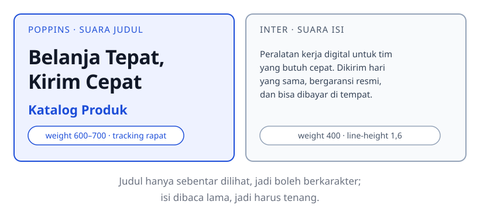

- Judul cuma sebentar dilihat, jadi boleh berkarakter
- Isi dibaca lama, jadi harus tenang
- Dua typeface beda peran itu pola yang umum banget di industri

<!--
Tunjukkan beda hurufnya langsung di browser, jangan cuma dari diagram: ciri
Poppins paling kelihatan pada huruf "a" yang bulat. Diagram ini menggambarkan
peran dan angkanya karena SVG tidak bisa memuat webfont; bentuk aslinya dibuka
di browser. Tanyakan kenapa judul dan isi sengaja beda keluarga. Jawaban yang
diharapkan: judul cuma sebentar dilihat jadi boleh berkarakter, isi dibaca lama
jadi harus tenang.
-->

---

# Font Sistem Beda di Tiap Perangkat

- Browser pakai font sistem bawaan, bukan pilihan kita
- Windows, macOS, dan HP Android nampilin keluarga huruf yang beda-beda
- Beda-beda itu bikin identitas brand jadi nggak konsisten
- Solusinya web font: diunduh dari layanan online pas halamannya dibuka
- Google Fonts nyimpen ribuan typeface berlisensi terbuka

<!--
Tanyakan siapa yang pernah membuka website dan hurufnya terasa beda di HP. Jawaban
yang diharapkan: itu font sistem, bukan font brand. Tekankan bahwa alasan utamanya
konsistensi identitas, bukan soal cantik atau nggak. Sebutkan bahwa halaman tetap
harus terbuka pas fontnya gagal diunduh.
-->

---

<!-- _class: compact -->

# Memuat Google Fonts

```html
<link rel="preconnect" href="https://fonts.googleapis.com">
<link rel="preconnect" href="https://fonts.gstatic.com" crossorigin>
<link rel="stylesheet" href="https://fonts.googleapis.com/css2?family=Poppins:wght@400;500;600;700&family=Inter:wght@400;500;600&display=swap">
```

`File: tokosaya-css/index.html`

- Ketiganya ditulis di dalam `<head>`
- Dua preconnect nyiapin koneksi ke server font dari awal
- `family=` minta keluarga huruf sekaligus daftar ketebalannya
- `display=swap` nampilin font cadangan sementara

<!--
Buka fonts.google.com dan tunjukkan cara menyalin URL-nya, jangan cuma menampilkan
slide. Tekankan bahwa URL ini disalin persis dan nggak boleh diketik ulang, karena
satu huruf beda bikin fontnya nggak termuat. Tanyakan apa yang terjadi kalau
`<link>` ditaruh di luar `head`; jawaban yang diharapkan: urutan pemuatan jadi
nggak menentu.
-->

---

<!-- _class: compact -->

# Fallback Stack Wajib Ada

```css
html {
  /* fallback stack: Inter lalu sans-serif generik */
  font-family: 'Inter', sans-serif;
}

h1, h2, h3 {
  font-family: 'Poppins', sans-serif;
}
```

`File: tokosaya-css/css/style.css`

- Browser baca daftarnya dari kiri ke kanan
- Kalau Inter gagal dimuat, pindah ke `sans-serif` perangkat
- Nama font yang ada spasinya dibungkus tanda kutip
- Selalu tutup stacknya pakai kategori generik

<!--
Jelaskan bahwa stack itu daftar cadangan, bukan daftar pilihan. Minta mahasiswa
menutup akses internet lalu memuat ulang halaman; teksnya tetap terbaca dengan
font sistem. Ingatkan bahwa stack tanpa kategori generik adalah kesalahan yang
sering lolos dari pemeriksaan sendiri, dan baru ketahuan di komputer orang lain.
-->

---

<!-- _class: section -->
<!-- _footer: '' -->

# Properti Tipografi dan Skala

## Ukuran dan jarak yang ikut sistem

<!--
Pindah dari memuat font ke mengatur tampilannya. Katakan bahwa bagian ini yang
paling sering dianggap remeh mahasiswa karena isinya angka semua. Sebutkan bahwa
skala di sini bakal dipakai terus sampai Bab 13, jadi jangan dilewati.
-->

---

# Properti Teks Setiap Hari

| Properti | Fungsi | Praktik di Tokosaya |
|---|---|---|
| `font-size` | ukuran huruf | ditulis pakai `rem` |
| `font-weight` | ketebalan huruf | 400 isi, 600 subjudul, 700 judul |
| `line-height` | tinggi baris | 1,6 paragraf, 1,2 judul |
| `letter-spacing` | jarak antarhuruf | sedikit negatif buat judul besar |
| `text-align` | perataan | rata kiri; `center` cuma di hero |

- `font-family`, `color`, dan `line-height` nurun ke elemen anak
- `font-size` sama jarak nggak ikut nurun

<!--
Jangan hafalkan seluruh propertinya sekaligus; cukup tandai lima yang paling
sering dipakai. Tekankan dua baris terakhir soal pewarisan, karena itu yang
menjelaskan kenapa `body` atau `html` cukup ditulis sekali. Tanyakan properti mana
yang ikut turun ke elemen anak dan mana yang nggak.
-->

---

<!-- _class: compact split-left -->

# Line-height: Nilai Tanpa Satuan

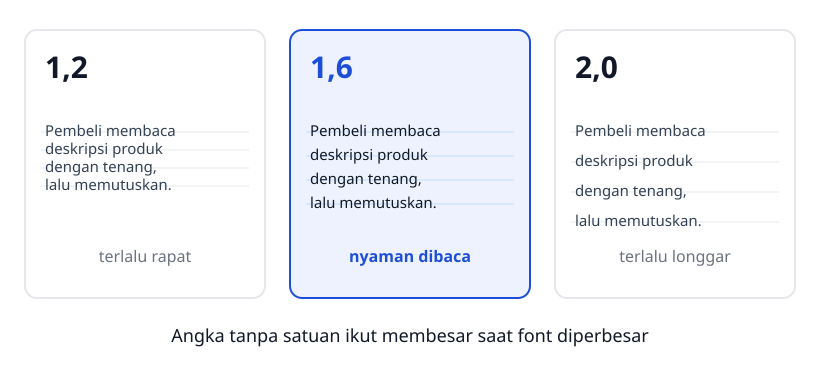

- `1.6` artinya 1,6 kali ukuran font elemen itu sendiri
- Angka tanpa satuan ikut membesar; `24px` ngunci jaraknya
- Teks panjang enak di 1,5–1,7; judul besar mantap di 1,1–1,25

<!--
Tunjuk tiga panel diagram, lalu suruh mahasiswa membaca satu paragraf panjang
dengan `1.2` lalu `1.6` di layar proyektor supaya bedanya terasa. Tanyakan kenapa
angka tanpa satuan lebih aman. Jawaban yang diharapkan: nilainya ikut membesar
pas pengguna memperbesar font di pengaturan browser. Ingatkan bahwa `24px`
mengunci jaraknya.
-->

---

# Ukuran yang Berubah Tanpa Aturan

- Bayangin tiap judul ditulis pakai ukuran yang asal
- 19px di sini, 21px sana, 23px di seberang
- Mata pembaca nggak nemu pintu masuk halamannya
- Keputusan ukuran pindah dari rasa ke sistem
- "Kayaknya terlalu kecil" diganti "ini level 3, jadi 1.25rem"

> Skala mengubah tebakan jadi keputusan yang bisa diulang.

<!--
Minta mahasiswa membuka file latihan masing-masing dan menghitung berapa ukuran
judul berbeda yang mereka tulis. Tekankan bahwa yang diperbaiki lebih dulu adalah
kebiasaan menebak ukuran, bukan angkanya satu per satu. Sebutkan bahwa skala
datang di slide berikutnya.
-->

---

<!-- _class: compact split-left -->

# Skala Tipografi Tokosaya

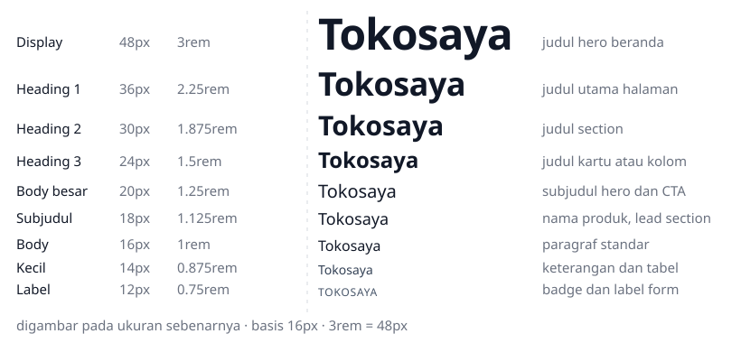

- Satuan `rem` ikut ukuran font akar `html`; basisnya 16px
- Skala inilah yang nopang hierarki visual nanti

<!--
Diagram ini digambar pada ukuran sebenarnya, jadi label 12px memang sekecil itu.
Minta mahasiswa mencari padanan piksel dari `2.25rem` sebelum kamu membacakan
jawabannya. Tekankan nama levelnya, karena nama itulah yang dipakai pas ngobrol
dengan desainer.
-->

---

<!-- _class: compact split-left -->

# Hierarki Visual

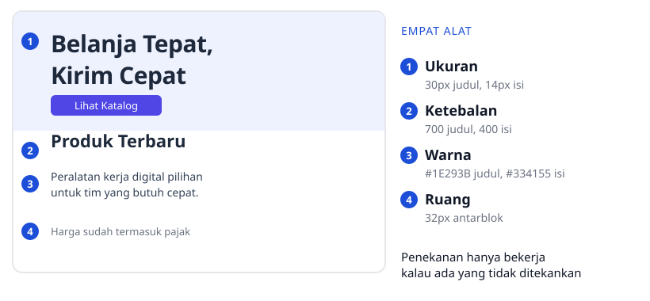

- Hierarki itu gabungan ukuran, ketebalan, warna, dan ruang
- Skala ngatur ukuran tampilan; heading nyatain makna

<!--
Bacakan nomor satu per satu sambil menunjuk elemen di sisi kiri diagram.
Tanyakan kenapa menebalkan semua kalimat justru bikin nggak ada yang menonjol.
Jawaban yang diharapkan: penekanan cuma bekerja kalau ada bagian yang nggak
ditebalkan. Ingatkan bahwa skala dan heading bekerja berpasangan, kayak gelar
jabatan dan seragamnya.
-->

---

<!-- _class: compact split-left -->

# clamp() Menjaga Ukuran Judul

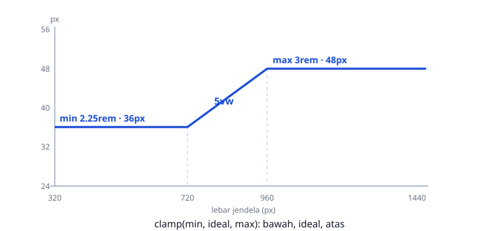

- `font-size: clamp(2.25rem, 5vw, 3rem)` di `.hero-title`
- Angka tengah `5vw` itu ukuran ideal yang ikut lebar layar
- Batas bawah dan atas nahan judulnya, baik di HP maupun monitor lebar

<!--
Peragakan `clamp()` sambil menggeser lebar jendela di layar proyektor, lalu tunjukkan
titik di diagram yang sedang bergerak. Tanyakan apa fungsi angka tengah `5vw`.
Jawaban yang diharapkan: ukuran ideal yang mengikuti lebar layar, tapi tetap
dibatasi batas atas dan batas bawah. Sebutkan bahwa media query dibedah penuh di
Bab 7, jadi kasus ini belum membutuhkannya.
-->

---

<!-- _class: section -->
<!-- _footer: '' -->

# Sistem Warna dan Kontras

## Warna yang bawa makna, bukan selera

<!--
Masuk ke bagian warna. Katakan bahwa di sini mahasiswa paling sering punya selera
tapi belum punya alasan. Sebutkan bahwa bab ini menyediakan angka, bukan pendapat,
buat membela setiap keputusan warna di depan tim.
-->

---

# Tiga Tugas Warna di Antarmuka

- Bangun identitas brand lewat warna utama
- Arahin perhatian orang pakai warna aksen
- Nyampein makna lewat warna semantik
- Kalau perannya nggak jelas, warna cuma jadi kebisingan

> Ini yang membedakan toko berwarna dari toko berwarna-warni.

<!--
Tekankan tiga perannya satu per satu, lalu tunjukkan satu halaman yang warnanya
terlalu banyak. Tanyakan warna mana di halaman itu yang punya peran jelas. Jawaban
yang diharapkan: cuma satu atau dua; sisanya cuma jadi kebisingan visual.
-->

---

<!-- _class: compact split-left -->

# Palet Tokosaya

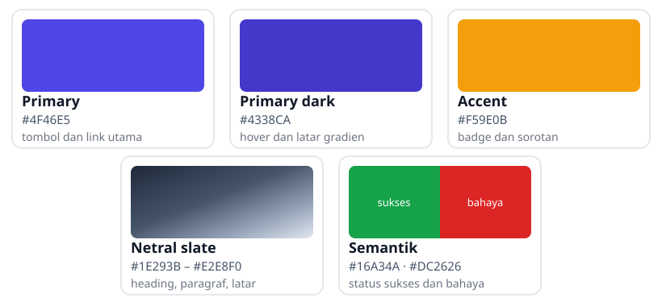

- Tiap warna punya satu peran; di luar lima kartu ini nggak dipakai tanpa alasan
- Warna utama gelap dipakai pas tombol di-hover
- Indigo memimpin, amber menyorot, slate menopang, hijau dan merah bicara

<!--
Tempel diagram ini di folder proyek biar mahasiswa sering melihatnya. Minta mereka
menyebut di mana tiap warna dipakai sebelum kamu menunjukkan labelnya. Ingatkan
bahwa palet ini terkunci, jadi warna di luar kartu nggak dipakai tanpa alasan.
Sebutkan bahwa kartu netral sengaja berupa gradien karena dipakai berjenjang, bukan
satu warna tunggal.
-->

---

# Warna Semantik

- Orang langsung paham maknanya tanpa baca teksnya
- Hijau buat status berhasil atau tersedia
- Merah buat error atau stok habis
- Amber buat hal yang perlu dilihat
- Di Tokosaya: hijau tersedia, amber Best Seller, indigo Baru

> Hijau dan merah bukan pilihan rasa, tapi janji makna.

<!--
Tanyakan kenapa pembaca layanan publik lebih cepat paham badge berwarna daripada
membaca statusnya. Jawaban yang diharapkan: maknanya langsung terbaca tanpa harus
membaca teks. Sebutkan bahayanya: warna semantik yang dipakai buat hiasan bikin
maknanya pudar.
-->

---

# Contrast Ratio dan Ambang AA

- Seberapa kontras warna teks dibanding latarnya
- Rentangnya dari 1:1 (nggak kelihatan) sampai 21:1 (hitam di putih)
- WCAG 2.2 nentuin ambang AA buat teks
- Teks ukuran normal butuh minimal 4,5:1
- Teks besar sekitar 24px cukup 3:1

> Jangan percaya mata di layar yang kelewat terang.

<!--
Jangan masuk ke rumus luminansinya; cukup tunjukkan ambangnya dan cara memakainya.
Buka penghitung kontras sekali di depan kelas sebagai contoh. Tekankan kalimat
penutupnya, lalu sebutkan bahwa audit formalnya diulang di Bab 13.
-->

---

<!-- _class: compact split-left -->

# Kontras Palet Tokosaya

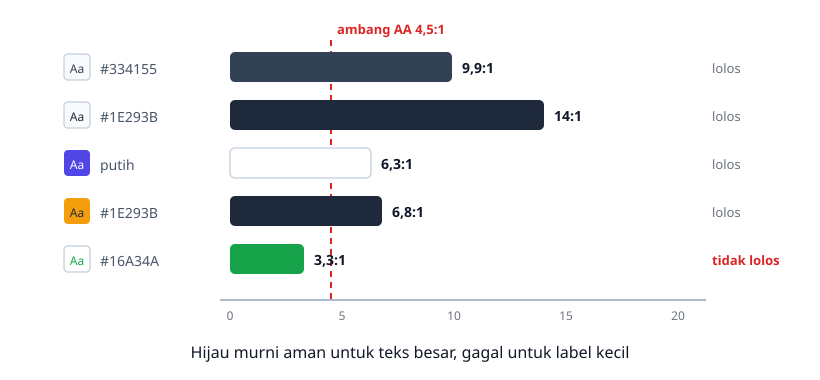

- Batang yang lewat garis 4,5:1 aman buat label kecil
- Hijau murni di latar terang cuma buat teks besar; solusinya pakai tint jadi latar

<!--
Bahas bar terakhir paling lama; itu inti pelajarannya. Tanyakan kenapa hijau murni
gampang dipakai salah padahal tampak jelas. Jawaban yang diharapkan: rasionya cuma
3,3:1, cukup buat teks besar tapi gagal buat label kecil. Ingatkan solusinya: warna
semantik ke latar tint, teks ke warna gelap.
-->

---

<!-- _class: compact -->

# Solid dan Gradient

```css
/* Permukaan membaca: satu warna solid */
.produk-card {
  background-color: var(--clr-surface);
}

/* Hero: gradien indigo dari primary menuju primary-dark */
.hero {
  background-image: linear-gradient(to bottom right, #4F46E5, #4338CA);
}
```

`File: tokosaya-css/css/style.css`

- `to bottom right` jalan dari kiri atas ke kanan bawah
- Gradien dipakai kayak bumbu: satu-dua titik per halaman
- Cek kontras teks di atasnya, jangan cuma lihat gradiennya

<!--
Bandingkan kartu putih solid dengan hero bergradien di layar proyektor. Tanyakan
kenapa kartu produk sengaja nggak diberi gradien. Jawaban yang diharapkan:
permukaan yang dibaca lama lebih nyaman kalau datar. Sebutkan bahwa gradien di
halaman ini cuma muncul di hero, CTA, dan footer.
-->

---

<!-- _class: section -->
<!-- _footer: '' -->

# Permukaan dan Design Token

## Satu pusat kendali buat seluruh halaman

<!--
Bagian terakhir menyatukan semuanya. Katakan bahwa token itu jawaban buat masalah
yang bakal mereka rasakan sendiri pas file CSS-nya membesar. Sebutkan bahwa Bab 12
bakal menaikkan token ini jadi design system penuh.
-->

---

<!-- _class: compact split-left -->

# Membulat dan Melembutkan

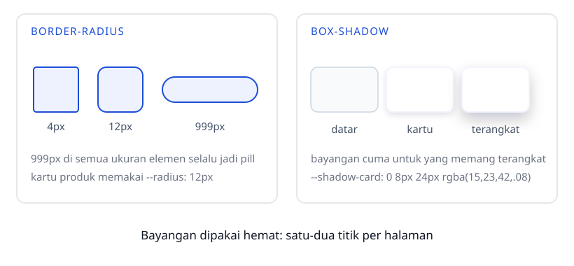

- `--radius: 12px` buat kartu, `border-radius: 999px` buat badge
- `--shadow-card: 0 8px 24px rgba(15, 23, 42, 0.08)` bikin kartu terangkat

<!--
Tunjukkan `999px` pada elemen sempit dan elemen lebar biar kelas melihat bentuknya
selalu pill. Tanyakan kenapa bayangan tidak dipakai di semua kartu. Jawaban yang
diharapkan: bayangan dipakai hemat, cuma buat yang memang terangkat dari halaman.
Sebutkan bahwa radius dan bayangan sama-sama lewat token, jadi tidak ada angka
liar di komponen.
-->

---

<!-- _class: compact split-left -->

# Meredupkan: opacity dan rgba

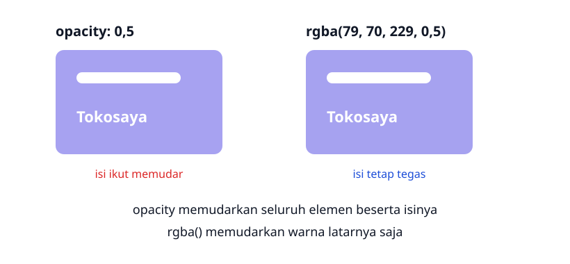

- `opacity` kena ke seluruh elemen, isinya ikut pudar
- `rgba()` cuma ngefek ke satu warna: latar atau teks

<!--
Ini konsep yang paling sering salah, jadi jangan dilewati. Tanyakan bedanya
`opacity` dengan `rgba()`. Jawaban yang diharapkan: `opacity` memengaruhi seluruh
elemen beserta isinya, `rgba()` cuma warnanya. Minta mahasiswa menunjuk mana panel
yang teksnya ikut pudar.
-->

---

<!-- _class: compact -->

# Blok Design Token Tokosaya

```css
:root {
  --clr-primary: #4F46E5;
  --clr-primary-dark: #4338CA;
  --clr-accent: #F59E0B;
  --clr-dark: #1E293B;
  --clr-body: #334155;
  --clr-bg: #F8FAFC;
  --clr-surface: #FFFFFF;
  --clr-border: #E2E8F0;
  --clr-success: #16A34A;
  --clr-danger: #DC2626;
  --font-heading: 'Poppins', sans-serif;
  --font-body: 'Inter', sans-serif;
  --radius: 12px;
  --shadow-card: 0 8px 24px rgba(15, 23, 42, 0.08);
  --space-unit: 8px;
}
```

`File: tokosaya-css/css/style.css` — blok ini dipakai apa adanya di seluruh proyek.

<!--
Buka file aslinya di editor biar mahasiswa melihat blok ini di awal `style.css`.
Tanyakan kenapa namanya `--clr-primary` bukan `--indigo`. Jawaban yang diharapkan:
nama mengungkap peran, jadi ganti warna brand nggak bikin namanya bohong.
Ingatkan bahwa salah ketik satu huruf bikin seluruh warna kembali abu-abu.
-->

---

<!-- _class: compact split-left -->

# Token Jarak dan calc()


- `--space-unit: 8px` jadi basis semua jarak di halaman
- `padding: calc(var(--space-unit) * 7) calc(var(--space-unit) * 4)` buat section
- Penamaan kebab-case: `--clr-` buat warna, `--font-` buat tipografi; token cuma buat nilai yang berulang

<!--
Hitung bareng-bareng `calc(var(--space-unit) * 7)` sebelum kamu menunjukkan
jawabannya. Tekankan bahwa seluruh ritme jarak halaman mengikuti kelipatan 8px.
Sebutkan bahwa token yang berlebihan sama buruknya dengan warna yang berantakan,
jadi simpan cuma nilai yang memang berulang.
-->

---

# Langkah Praktikum

1. Tulis kerangka `index.html` plus tiga tag `<link>` Google Fonts
2. Bikin `header` isinya logo teks dan navbar statis
3. Bikin hero: judul, paragraf subjudul, dan tombol "Lihat Katalog"
4. Bikin section `#produk` dengan grid delapan kartu produk
5. Bikin section CTA bergradien, terus tutup pakai `footer` kontak
6. Tulis `:root` lengkap, reset singkat, terus semua komponennya

<!--
Jalankan langkah ini sambil didemokan di layar, jangan cuma dibacakan. Berhenti di
langkah pertama buat memastikan tiga tag font disalin persis, karena di situ
kesalahan paling sering terjadi. Ingatkan menyimpan kedua file sebelum memuat
ulang browser.
-->

---

<!-- _class: compact -->

# Kerangka index.html

```html
<head>
  <meta charset="UTF-8">
  <meta name="viewport" content="width=device-width, initial-scale=1.0">
  <title>Tokosaya — Belanja Tepat, Kirim Cepat</title>
  <link rel="preconnect" href="https://fonts.googleapis.com">
  <link rel="preconnect" href="https://fonts.gstatic.com" crossorigin>
  <link rel="stylesheet" href="css/style.css">
</head>
```

`File: tokosaya-css/index.html`

- File HTML-nya cuma bertambah beberapa baris dari Bab 3
- `css/style.css` dimuat setelah font
- Tiga tag font lengkapnya ada di slide Memuat Google Fonts
- `h1` cuma satu, heading turun level tanpa lompat

<!--
Tekankan bahwa yang berubah di HTML cuma bagian `head`. Tanyakan kenapa
`css/style.css` dimuat setelah tag font. Jawaban yang diharapkan: biar gaya kita
sendiri dievaluasi belakangan, jadi keputusan kita yang menang. Periksa juga
bahwa heading di halaman itu tetap menurun tanpa melompat.
-->

---

<!-- _class: compact -->

# Token dan Tipografi di style.css

```css
html {
  font-family: var(--font-body);
  color: var(--clr-body);
  background-color: var(--clr-bg);
  line-height: 1.6;
}

h1, h2, h3 {
  font-family: var(--font-heading);
  color: var(--clr-dark);
  line-height: 1.2;
}

a {
  color: var(--clr-primary);
  text-decoration: none;
}
```

`File: tokosaya-css/css/style.css`

<!--
Baca blok ini dari atas kayak kalimat: font badan, warna badan, latar badan.
Tunjukkan bahwa di sini nggak ada satu pun kode heksadesimal warna, semuanya lewat
`var()`. Ingatkan bahwa `a` tanpa `text-decoration` bikin menu lebih bersih, tapi
link di dalam paragraf sebaiknya tetap bergaris bawah.
-->

---

# Hasil yang Diharapkan

- Judul kelihatan bulat-geometris Poppins, isinya pakai Inter
- Hero gradien indigo diagonal, teksnya putih
- Judul `h1` mengecil halus pas jendelanya dipersempit
- Delapan kartu: latar putih, pojok 12px, bayangan lembut
- Badge amber, tint hijau, tint merah, dan tint indigo
- Di layar ≤ 576px, kartunya numpuk satu kolom

<!--
Bandingkan halaman sebelum dan sesudah langsung di browser, jangan cuma
menampilkan slide. Kalau fontnya tetap standar, periksa URL dan letak `<link>`
dulu sebelum menuduh kodenya salah. Ingatkan uji lebar jendela sampai di bawah
576px buat melihat kartu jadi satu kolom.
-->

---

# Latihan

- Jelasin beda typeface dan font pakai contoh di luar buku
- Benerin `font-family: Poppins;` yang tanpa tanda kutip dan tanpa fallback
- Hitung nilai piksel dari 3rem sampai 0.75rem di basis 16px
- Dari diagram kontras, mana yang lolos AA: `#4F46E5`, `#16A34A`, `#1E293B`?
- Ganti `--clr-primary` jadi `#4338CA`, terus catat lima elemen yang berubah
- Bikin hierarki empat tingkat pakai skala rem dan token Tokosaya

> Jelaskan alasannya, bukan cuma nama propertinya.

<!--
Kerjakan butir pertama bareng-bareng di papan, sisanya buat latihan mandiri. Butir
keempat paling berguna buat ujian karena melatih membaca diagram kontras, bukan
menghafal angkanya. Ingatkan bahwa jawabannya harus memuat alasan, bukan cuma kata
lolos atau gagal.
-->

---

# Cek Daftar Bab 4

- Poppins dan Inter dimuat di `head` pakai fallback lengkap
- Semua ukuran teks diambil dari skala `rem`, bukan angka liar
- `line-height` unitless: 1,6 buat isi dan 1,2 buat judul
- Semua pasangan teks dan latar lolos ambang 4,5:1
- Badge pakai tint jadi latar dan teks gelap jadi tintanya
- Di luar `:root`, cuma `#FFFFFF` yang ditulis langsung

<!--
Minta mahasiswa saling memeriksa file pakai daftar ini dan menunjukkan buktinya
langsung di kode. Tanyakan baris mana yang paling sering belum terpenuhi. Jawaban
yang diharapkan: ukuran teks yang masih ditulis pakai `px` liar, bukan dari skala.
-->

---

# Rangkuman

- Tipografi nentuin keterbacaan, hierarki, dan identitas halaman
- Web font jaga konsistensi antar perangkat; fallback jadi pengamannya
- Ukuran pakai `rem`, `line-height` tanpa satuan, letter-spacing seperlunya
- Type scale 3rem sampai 0.75rem jadi tulang punggung hierarkinya
- Warna Tokosaya bermakna: indigo, amber, slate, hijau, dan merah
- Design token di `:root` nyatuin semua keputusan: ubah sekali, semuanya ikut

<!--
Tutup dengan dua gagasan: huruf dan warna itu keputusan desain, bukan selera.
Sebutkan bahwa Bab 5 bakal mengatur jarak dan lapisan, jadi token `--space-unit`
mulai bekerja penuh di sana. Ingatkan bahwa skala dan token di bab ini dipakai
terus sampai bab akhir.
-->

---

<!-- _class: lead -->
<!-- _footer: '' -->

# Tugas dan Refleksi

Tugas kelompok: susun palet alternatif Tokosaya pakai struktur token `:root` yang sama, plus tabel kontras minimal empat baris.

**Pertanyaan refleksi:** apa yang bikin halaman tetap enak dibaca pas fontnya gagal diunduh?

<!--
Bagi kelompok tiga sampai empat orang dan minta mereka menyiapkan tabel kontras
sebelum mulai mengubah nilai token. Nilai apakah semua pasangan teks utama lolos
4,5:1, bukan warna yang menurut mereka paling bagus. Tekankan bahwa yang dinilai
file yang gampang dibaca orang lain, bukan yang paling artistik.
-->
