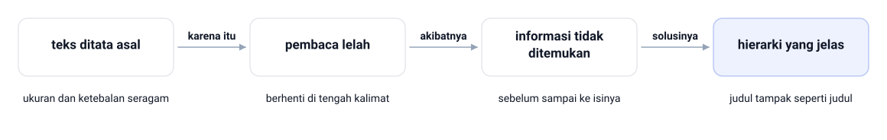
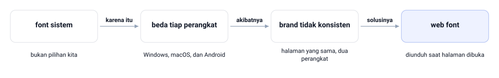
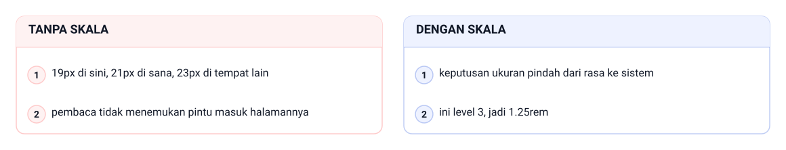
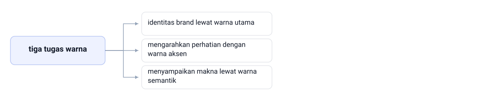

<!-- _class: lead -->
<!-- _paginate: skip -->
<!-- _footer: '' -->

# Tipografi dan Visual Design CSS

**Bab 4** · Membangun karakter brand halaman Tokosaya

Studi kasus: **Tokosaya**

<!--
Buka dengan mengingatkan hasil Bab 3: halaman sudah terbaca, tetapi belum punya
karakter. Tanyakan siapa yang pernah merasa halamannya kurang meyakinkan padahal
isinya sudah benar. Jelaskan bahwa bab ini memberi dua bekal, tipografi dan sistem
warna, lalu menyatukan keduanya lewat design token.
-->

---

# Tujuan Pembelajaran

Setelah bab ini, Anda dapat:

- Menjelaskan peran tipografi untuk keterbacaan, identitas, dan kenyamanan
- Memasang Google Fonts Poppins dan Inter, beserta fallback stack yang aman
- Menggunakan properti tipografi dasar dan skala rem, termasuk clamp()
- Menyusun sistem warna Tokosaya dengan warna semantik dan ambang kontras WCAG
- Mengatur border-radius, box-shadow, opacity, serta background solid atau gradient
- Mengumpulkan design token menjadi CSS custom properties di :root

<!--
Bacakan tujuan ini secara singkat, lalu tekankan CPMK-nya: menerapkan CSS untuk
visual antarmuka, menuju mini design system di Bab 12. Jelaskan bahwa urutan bab
ini disengaja: pilih font lebih dulu, atur propertinya, lalu bangun skala dan
token. Sepuluh menit terakhir dipakai untuk praktikum, bukan untuk teori baru.
-->

---

<!-- _class: compact split-left -->

# Dua Beranda, Isi yang Sama


- Isinya sama persis; yang berbeda hanya typeface dan warnanya
- Mata menangkap bentuk kalimat lebih dahulu, baru isinya

<!--
Tunjuk diagram kiri-kanan ini, jangan membacakan daftarnya. Manajer konten memaparkan
dua tampilan beranda Tokosaya, lalu bertanya mana yang membuat pelanggan percaya.
Ceritakan ulang rapat pekanan itu: dua beranda, isi persis sama, hampir seluruh
ruangan memilih versi kedua tanpa ragu. Tanyakan mengapa versi kedua menang padahal
teksnya identik. Jawaban yang diharapkan: pembaca menangkap bentuk huruf sebelum
sampai ke isi kalimatnya.
-->

---

<!-- _class: section -->
<!-- _footer: '' -->

# Tipografi dan Web Font

## Memilih typeface, lalu mengatur tampilannya

<!--
Transisi dari keluhan pemilik toko ke pertanyaan teknis: typeface apa yang dipakai
dan bagaimana memuatnya agar sama di semua perangkat. Tahan dulu soal skala ukuran;
itu masuk di bagian kedua. Sebutkan bahwa semua yang dibahas di sini langsung
dipakai di landing page praktikum.
-->

---

# Menyusun Typeface, Bukan Sekadar Memilih

- Tipografi mengatur font-size, letter-spacing, dan font-weight
- Tujuannya agar teks mudah dibaca tetapi tetap punya karakter
- Hampir semua antarmuka web berisi teks
- Judul produk, label form, pesan status, semuanya teks

> Tipografi adalah pakaian teks: tidak mengubah isi, tetapi menentukan kesan pertama.

<!--
Tekankan analogi pakaian teks; ini pegangan untuk seluruh bab. Tanyakan mana yang
lebih cepat membuat orang ragu: kalimat yang salah atau typeface yang sulit dibaca.
Jawaban yang diharapkan: typeface-nya, karena pembaca berhenti sebelum sampai ke
isinya. Ingatkan bahwa tipografi bukan hiasan, melainkan alat komunikasi layanan.
Demo: demos/bab-04/02-menyusun-typeface.html — bandingkan judul 1rem/400 dengan judul 3rem/700 pada isi yang sama.
-->

---

# Contoh: Menyusun Typeface, Bukan Sekadar Memilih


Judul hero Tokosaya memakai `font-family: 'Poppins'` dan isinya memakai Inter di kedua versi; typeface-nya tidak berubah, yang berbeda hanya susunan propertinya. Di versi yang sekadar memilih, judul 1rem atau 16 px dan isi 1rem, semua font-weight 400, jadi tidak ada yang menonjol. Di versi yang menyusun, judul 3rem atau 48 px dengan font-weight 700, isi tetap 400 dan 1rem pada basis 16 px, jadi judul terbaca sebagai judul.

<!--
Bandingkan dua kolom. SVG tidak dapat memuat web font, jadi keduanya membandingkan
nilai propertinya, bukan bentuk hurufnya; bentuk aslinya dibuka di browser seperti
pada slide Poppins dan Inter. Tanyakan apa yang berubah padahal typeface-nya identik.
Jawaban yang diharapkan: yang bekerja bukan pilihan typeface-nya, tetapi susunan
propertinya — 16 px menjadi 48 px pada judul, 400 menjadi 700, isinya tidak
disentuh. Tunjuk kolom SEKADAR MEMILIH lebih dulu, lalu kolom MENYUSUN, lalu minta
satu layar di kampus yang masih memakai versi pertama.
-->

---

<!-- _class: compact split-left -->

# Typeface dan Font


- Typeface adalah keluarganya; font adalah satu wujud berat dan gaya di dalamnya
- Salah menyebut tidak membuat kode error, hanya membuat diskusi tim berputar tanpa hasil

<!--
Dua istilah ini sering dipakai saling menggantikan, padahal artinya berbeda. Ini
kosakata yang dipakai saat berdiskusi dengan desainer, jadi bahas pelan-pelan.
Tunjuk satu cabang diagram: Poppins adalah keluarganya, Bold 700 adalah salah satu
font-nya. Tanyakan: Poppins Bold 700 itu typeface atau font. Jawaban yang
diharapkan: font, karena punya berat dan gaya. Tegaskan bahwa salah menyebut tidak
membuat kode error, tetapi membuat diskusi tim berputar tanpa hasil.
Demo: demos/bab-04/01-typeface-dan-font.html — bandingkan empat font dalam keluarga Poppins lewat berat 400, 500, 600, dan 700.
-->

---

# Mengapa Tipografi Penting

- Teks yang ditata asal membuat pembaca lelah sebelum menemukan informasinya
- Hierarki yang jelas: judul tampak seperti judul
- Penjelasan terlihat seperti penjelasan, tombol terlihat dapat ditekan
- Di portal rumah sakit, instruksi obat harus tetap terbaca
- Di sistem akademik, kolom penting harus menonjol

> Desain yang baik jujur soal fungsinya.

<!--
Kaitkan tiga contoh itu dengan layanan di sekitar kampus, bukan dengan toko online.
Minta mahasiswa menyebut satu layar yang menurut mereka paling sulit dibaca dan
jelaskan alasannya. Tutup dengan kalimat Norman: desain yang baik jujur soal
fungsinya.
-->

---

# Contoh: Mengapa Tipografi Penting



Satu layar portal rumah sakit menulis instruksi obat dengan ukuran dan ketebalan seragam, sama seperti catatan kaki. Teks ditata asal seperti itu membuat pembaca lelah, berhenti di tengah kalimat, lalu informasi tidak ditemukan sebelum sampai ke isinya. Ganti jadi hierarki yang jelas — judul 3rem, instruksi 1rem — supaya judul tampak seperti judul.

<!--
Bacakan rantai di gambar sebagai satu kalimat: teks ditata asal, karena itu pembaca
lelah; akibatnya informasi tidak ditemukan; solusinya hierarki yang jelas. Setelah
itu balik arahnya: minta mahasiswa menyebut properti mana yang harus dikembalikan
ke seragam supaya rantai ini rusak lagi. Jawaban yang diharapkan: cukup `font-size`
dan `font-weight` judulnya, isinya tidak perlu diubah. Tunjuk dua angka di akhir
gambar sebagai buktinya: judul 3rem atau 48 px, isi 1rem atau 16 px, jadi judul
tiga kali ukuran isinya.
-->

---

<!-- _class: compact split-left -->

# Poppins untuk Judul, Inter untuk Isi


- Judul hanya sebentar dilihat, jadi boleh berkarakter
- Isi dibaca lama, jadi harus tenang
- Dua typeface dengan peran berbeda adalah pola yang umum di industri

<!--
Tunjukkan perbedaan typeface-nya langsung di browser, jangan hanya dari diagram:
ciri Poppins paling terlihat pada huruf "a" yang bulat. Diagram ini menggambarkan
peran dan angkanya karena SVG tidak dapat memuat web font; bentuk aslinya dibuka
di browser. Tanyakan mengapa judul dan isi sengaja berbeda keluarga. Jawaban yang
diharapkan: judul hanya sebentar dilihat sehingga boleh berkarakter, isi dibaca
lama sehingga harus tenang.
-->

---

# Font Sistem Berbeda di Tiap Perangkat



<!--
Tanyakan siapa yang pernah membuka website dan merasa hurufnya berbeda di ponsel.
Jawaban yang diharapkan: itu font sistem, bukan font brand. Tekankan bahwa alasan
utamanya konsistensi identitas, bukan soal cantik atau tidak. Sebutkan bahwa
halaman tetap harus terbuka saat font gagal diunduh.

Bacakan rantai di diagram sambil menunjuk tahapnya satu per satu. Browser memakai
font sistem bawaan, bukan pilihan kita; karena itu Windows, macOS, dan Android
menampilkan keluarga font yang berbeda — beda tiap perangkat. Akibatnya identitas
brand tidak konsisten: halaman yang sama, dua perangkat, bisa terlihat seperti dua
situs yang berbeda. Solusinya web font, keluarga huruf yang diunduh saat halaman
dibuka dari layanan online, jadi bentuk huruf tidak lagi ditentukan perangkat.
Sebutkan juga bahwa Google Fonts menyimpan ribuan typeface berlisensi terbuka.
Demo: demos/bab-04/03-font-sistem-dan-web-font.html — lihat tiga permintaan font-family yang jatuh ke font sistem yang sama, lalu blok tag Google Fonts.
-->

---

<!-- _class: compact -->

# Memuat Google Fonts

```html
<link rel="preconnect" href="https://fonts.googleapis.com">
<link rel="preconnect" href="https://fonts.gstatic.com" crossorigin>
<link rel="stylesheet" href="https://fonts.googleapis.com/css2?family=Poppins:wght@400;500;600;700&family=Inter:wght@400;500;600&display=swap">
```

`File: tokosaya-css/index.html`

- Ketiganya ditulis di dalam `<head>`
- Dua preconnect menyiapkan koneksi ke server font sejak awal
- `family=` meminta keluarga huruf sekaligus daftar ketebalannya
- `display=swap` menampilkan font cadangan untuk sementara

<!--
Buka fonts.google.com dan tunjukkan cara menyalin URL-nya, jangan hanya menampilkan
slide. Tekankan bahwa URL ini disalin persis dan tidak boleh diketik ulang, karena
satu karakter berbeda membuat font tidak termuat. Tanyakan apa yang terjadi jika
`<link>` ditaruh di luar `head`; jawaban yang diharapkan: urutan pemuatan menjadi
tidak menentu.
-->

---

<!-- _class: compact -->

# Fallback Stack Wajib Ada

```css
html {
  /* fallback stack: Inter lalu sans-serif generik */
  font-family: 'Inter', sans-serif;
}

h1, h2, h3 {
  font-family: 'Poppins', sans-serif;
}
```

`File: tokosaya-css/css/style.css`

- Browser membaca daftarnya dari kiri ke kanan
- Jika Inter gagal dimuat, browser pindah ke `sans-serif` perangkat
- Nama font yang mengandung spasi dibungkus tanda kutip
- Selalu tutup stack dengan kategori generik

<!--
Jelaskan bahwa stack adalah daftar cadangan, bukan daftar pilihan. Minta mahasiswa
mematikan akses internet lalu memuat ulang halaman; teksnya tetap terbaca dengan
font sistem. Ingatkan bahwa stack tanpa kategori generik adalah kesalahan yang
sering lolos dari pemeriksaan sendiri, dan baru ketahuan di komputer orang lain.
Demo: demos/bab-04/04-fallback-stack.html — bandingkan stack yang lengkap dengan font-family: Poppins; yang tanpa tanda kutip dan tanpa fallback.
-->

---

<!-- _class: section -->
<!-- _footer: '' -->

# Properti Tipografi dan Skala

## Ukuran dan jarak yang mengikuti sistem

<!--
Pindah dari memuat font ke mengatur tampilannya. Katakan bahwa bagian ini paling
sering dianggap remeh mahasiswa karena isinya angka semua. Sebutkan bahwa skala di
sini akan dipakai hingga Bab 13, jadi jangan dilewati.
-->

---

# Properti Teks Setiap Hari

| Properti | Fungsi | Praktik di Tokosaya |
|---|---|---|
| `font-size` | ukuran teks | ditulis memakai `rem` |
| `font-weight` | ketebalan teks | 400 isi, 600 subjudul, 700 judul |
| `line-height` | tinggi baris | 1,6 paragraf, 1,2 judul |
| `letter-spacing` | jarak antarhuruf | sedikit negatif untuk judul besar |
| `text-align` | perataan teks | rata kiri; `center` hanya di hero |

- `font-family`, `color`, dan `line-height` diwariskan ke elemen anak
- `font-size` dan jarak tidak diwariskan

<!--
Jangan menghafalkan seluruh propertinya sekaligus; cukup tandai lima yang paling
sering dipakai. Tekankan dua baris terakhir soal inheritance, karena itu yang
menjelaskan mengapa `body` atau `html` cukup ditulis sekali. Tanyakan properti mana
yang ikut turun ke elemen anak dan mana yang tidak.
Demo: demos/bab-04/05-properti-teks.html — coba letter-spacing dan text-align pada judul 2.25rem.
-->

---

<!-- _class: compact split-left -->

# Line-height: Nilai Tanpa Satuan


- `1.6` berarti 1,6 kali ukuran font elemen itu sendiri
- Angka tanpa satuan ikut membesar; `24px` mengunci jaraknya
- Teks panjang nyaman di 1,5–1,7; judul besar tegas di 1,1–1,25

<!--
Tunjuk tiga panel diagram, lalu minta mahasiswa membaca satu paragraf panjang
dengan `1.2` lalu `1.6` di layar proyektor agar perbedaannya terasa. Tanyakan
mengapa angka tanpa satuan lebih aman. Jawaban yang diharapkan: nilainya ikut
membesar saat pengguna memperbesar font di pengaturan browser. Ingatkan bahwa
`24px` mengunci jaraknya.
Demo: demos/bab-04/06-line-height.html — bandingkan line-height 1.2, 1.6, dan 2, lalu lihat 24px mengunci jarak saat font diperbesar.
-->

---

# Ukuran yang Berubah Tanpa Aturan



> Skala mengubah tebakan menjadi keputusan yang dapat diulang.

<!--
Minta mahasiswa membuka file latihan masing-masing dan menghitung berapa ukuran
judul berbeda yang mereka tulis. Tekankan bahwa yang diperbaiki lebih dulu adalah
kebiasaan menebak ukuran, bukan angkanya satu per satu. Sebutkan bahwa skala hadir
di slide berikutnya.

Bacakan dua kolom diagram sebagai satu cerita. Kolom kiri, tanpa skala: bayangkan
setiap judul ditulis dengan ukuran yang asal — 19px di sini, 21px di sana, 23px di
tempat lain — sehingga pembaca tidak menemukan pintu masuk halamannya. Kolom kanan,
dengan skala: keputusan ukuran pindah dari rasa ke sistem; yang tadinya "terasa
terlalu kecil" diganti "ini level 3, jadi 1.25rem". Tutup dengan kalimat di bawah
diagram: skala mengubah tebakan menjadi keputusan yang dapat diulang.
Demo: demos/bab-04/07-skala-tipografi.html — bandingkan judul 19, 21, dan 23 px tanpa skala dengan Display, Heading 1, Isi, dan Label dari skala rem.
-->

---

<!-- _class: compact split-left -->

# Skala Tipografi Tokosaya


- Satuan `rem` mengikuti ukuran font akar `html`; basisnya 16px
- Skala inilah yang menopang hierarki visual nanti

<!--
Diagram ini digambar pada ukuran sebenarnya, jadi label 12px memang sekecil itu.
Minta mahasiswa mencari padanan piksel dari `2.25rem` sebelum Anda membacakan
jawabannya. Tekankan nama levelnya, karena nama itulah yang dipakai saat
berdiskusi dengan desainer.
-->

---

<!-- _class: compact split-left -->

# Hierarki Visual


- Hierarki adalah gabungan ukuran, ketebalan, warna, dan ruang
- Skala mengatur ukuran tampilan; heading menyatakan makna

<!--
Bacakan nomor satu per satu sambil menunjuk elemen di sisi kiri diagram. Tanyakan
mengapa menebalkan semua kalimat justru membuat tidak ada yang menonjol. Jawaban
yang diharapkan: penekanan hanya bekerja jika ada bagian yang tidak ditebalkan.
Ingatkan bahwa skala dan heading bekerja berpasangan, seperti gelar jabatan dan
seragamnya.
-->

---

<!-- _class: compact split-left -->

# clamp() Menjaga Ukuran Judul


- `font-size: clamp(2.25rem, 5vw, 3rem)` di `.hero-title`
- Angka tengah `5vw` adalah ukuran ideal yang mengikuti lebar layar
- Batas bawah dan atas menahan judulnya, baik di ponsel maupun monitor lebar

<!--
Peragakan `clamp()` sambil menggeser lebar viewport di layar proyektor, lalu
tunjukkan titik pada diagram yang sedang bergerak. Tanyakan apa fungsi angka
tengah `5vw`. Jawaban yang diharapkan: ukuran ideal yang mengikuti lebar layar,
tetapi tetap dibatasi batas atas dan bawah. Sebutkan bahwa media query dibahas
penuh di Bab 7, jadi kasus ini belum membutuhkannya.
Demo: demos/bab-04/08-clamp.html — persempit jendela browser dan lihat judul berhenti di 36 px lalu 48 px.
-->

---

<!-- _class: section -->
<!-- _footer: '' -->

# Sistem Warna dan Kontras

## Warna yang membawa makna, bukan selera

<!--
Masuk ke bagian warna. Katakan bahwa di sini mahasiswa paling sering punya selera
tetapi belum punya alasan. Sebutkan bahwa bab ini menyediakan angka, bukan
pendapat, untuk membela setiap keputusan warna di depan tim.
-->

---

# Tiga Tugas Warna di Antarmuka



> Inilah yang membedakan toko berwarna dari toko berwarna-warni.

<!--
Tekankan tiga perannya satu per satu, lalu tunjukkan satu halaman yang warnanya
terlalu banyak. Tanyakan warna mana di halaman itu yang punya peran jelas. Jawaban
yang diharapkan: hanya satu atau dua; sisanya hanya menjadi kebisingan visual.

Tiga tugas yang digambar di slide, dari atas ke bawah: membangun identitas brand
lewat warna utama, mengarahkan perhatian dengan warna aksen, dan menyampaikan makna
lewat warna semantik. Ingatkan bahwa jika perannya tidak jelas, warna hanya menjadi
kebisingan — bukan identitas, bukan penunjuk arah, bukan makna.
-->

---

<!-- _class: compact split-left -->

# Palet Tokosaya


- Tiap warna punya satu peran; di luar lima kartu ini warna tidak dipakai tanpa alasan
- Warna utama gelap dipakai saat tombol di-hover
- Indigo memimpin, amber menyorot, slate menopang, hijau dan merah berbicara

<!--
Tempel diagram ini di folder proyek agar mahasiswa sering melihatnya. Minta mereka
menyebutkan di mana tiap warna dipakai sebelum Anda menunjukkan labelnya. Ingatkan
bahwa palet ini terkunci, jadi warna di luar kartu tidak dipakai tanpa alasan.
Sebutkan bahwa kartu netral sengaja berupa gradient karena dipakai berjenjang,
bukan satu warna tunggal.
Demo: demos/bab-04/09-palet-tokosaya.html — lihat lima kartu peran palet dan hover tombol dari #4F46E5 ke #4338CA.
-->

---

# Warna Semantik

- Orang langsung memahami maknanya tanpa membaca teks
- Hijau untuk status berhasil atau tersedia
- Merah untuk error atau stok habis
- Amber untuk hal yang perlu diperhatikan
- Di Tokosaya: hijau tersedia, amber Best Seller, indigo Baru

> Hijau dan merah bukan pilihan rasa, tetapi janji makna.

<!--
Tanyakan mengapa pembaca layanan publik lebih cepat memahami badge berwarna
daripada membaca statusnya. Jawaban yang diharapkan: maknanya langsung terbaca
tanpa harus membaca teks. Sebutkan bahayanya: warna semantik yang dipakai untuk
hiasan membuat maknanya pudar.
Demo: demos/bab-04/10-warna-semantik.html — tebak makna empat badge sebelum membaca teksnya.
-->

---

# Contoh: Warna Semantik


Tiga badge di kartu produk Tokosaya tidak menulis penjelasan apa pun. Ketiga badge itu hijau `#16A34A` tersedia, amber `#F59E0B` Best Seller, indigo `#4F46E5` Baru — satu warna untuk satu makna, dan maknanya terbaca sebelum teksnya. Warna hiasan bekerja sebaliknya: warnanya dipilih supaya ramai, tidak ada makna yang menempel, dan status harus ditulis dan dibaca.

<!--
Mulai dari kartu produk sungguhan, bukan dari daftar ini: tutup tulisan di badge,
lalu minta kelas menebak arti tiap warna hanya dari warnanya. Lanjutkan dengan
pertanyaan yang belum dijawab slide induk: apa yang terjadi kalau muncul status
keempat. Jawaban yang diharapkan: status baru harus lebih dulu diberi makna di
palet, karena warna di luar palet tidak dipakai tanpa alasan. Tunjuk pasangan hex
dan nama tokennya, lalu ingatkan bahwa komponen memakai `var(--clr-success)`,
bukan `#16A34A`, seperti di blok token.
-->

---

# Contrast Ratio dan Ambang AA

- Seberapa kontras warna teks dibanding latarnya
- Rentangnya dari 1:1 (tidak terlihat) sampai 21:1 (hitam di atas putih)
- WCAG 2.2 menetapkan ambang AA untuk teks
- Teks ukuran normal membutuhkan minimal 4,5:1
- Teks besar sekitar 24px cukup 3:1

> Jangan percaya mata di layar yang terlalu terang.

<!--
Jangan masuk ke rumus luminansinya; cukup tunjukkan ambangnya dan cara memakainya.
Buka penghitung contrast ratio sekali di depan kelas sebagai contoh. Tekankan
kalimat penutupnya, lalu sebutkan bahwa audit formalnya diulang di Bab 13.
Demo: demos/bab-04/11-kontras-aa.html — lihat lima pasangan palet terhadap ambang 4,5:1 dan badge tint sebagai jalan keluar.
-->

---

# Contoh: Contrast Ratio dan Ambang AA


Rentangnya dari 1:1 teks tidak terlihat, batas bawah, sampai 21:1 hitam di atas putih, batas atas. Ambang AA memotong rentang itu: teks normal di bawah 4,5:1 gagal ambang AA, sedangkan teks normal minimal 4,5:1 lolos ambang AA; teks besar 24 px cukup 3:1, sedangkan teks besar 24 px di bawah 3:1 gagal. Di palet Tokosaya, teks `#1E293B` di atas kartu putih `#FFFFFF` lolos, sedangkan hijau `#16A34A` hanya 3,3:1 — cukup untuk teks besar 24 px, gagal untuk label 12 px.

<!--
Tanyakan apakah label hijau 12 px di kartu produk lolos AA. Jawaban yang diharapkan:
tidak — 3,3:1 hanya cukup untuk teks besar 24 px ke atas, sedangkan label kecil butuh
4,5:1. Lalu tunjuk dua kolom gambar: yang gagal di kiri, yang lolos di kanan, dengan
batas bawah 1:1 dan batas atas 21:1 sebagai ujung rentangnya. Tutup dengan jalan
keluarnya: teks hijau dipindah ke tint, teksnya pakai warna gelap.
-->

---

<!-- _class: compact split-left -->

# Kontras Palet Tokosaya


- Batang yang melewati garis 4,5:1 aman untuk label kecil
- Hijau murni di latar terang hanya untuk teks besar; solusinya memakai tint sebagai latar

<!--
Bahas batang terakhir paling lama; itu inti pelajarannya. Tanyakan mengapa hijau
murni mudah dipakai salah padahal tampak jelas. Jawaban yang diharapkan: contrast
ratio-nya hanya 3,3:1, cukup untuk teks besar tetapi gagal untuk label kecil.
Ingatkan solusinya: warna semantik ke latar tint, teks ke warna gelap.
-->

---

<!-- _class: compact -->

# Solid dan Gradient

```css
/* Permukaan membaca: satu warna solid */
.produk-card {
  background-color: var(--clr-surface);
}

/* Hero: gradient indigo dari primary menuju primary-dark */
.hero {
  background-image: linear-gradient(to bottom right, #4F46E5, #4338CA);
}
```

`File: tokosaya-css/css/style.css`

- `to bottom right` berjalan dari kiri atas ke kanan bawah
- Gradient dipakai seperti bumbu: satu atau dua titik per halaman
- Periksa contrast ratio teks di atasnya, jangan hanya melihat gradient-nya

<!--
Bandingkan kartu putih solid dengan hero bergradient di layar proyektor. Tanyakan
mengapa kartu produk sengaja tidak diberi gradient. Jawaban yang diharapkan:
permukaan yang dibaca lama lebih nyaman jika datar. Sebutkan bahwa gradient di
halaman ini hanya muncul di hero, CTA, dan footer.
Demo: demos/bab-04/12-gradient-dan-solid.html — bandingkan kartu produk solid dengan hero bergradient indigo.
-->

---

<!-- _class: section -->
<!-- _footer: '' -->

# Permukaan dan Design Token

## Satu pusat kendali untuk seluruh halaman

<!--
Bagian terakhir menyatukan semuanya. Katakan bahwa design token adalah jawaban
untuk masalah yang akan mereka rasakan sendiri saat file CSS membesar. Sebutkan
bahwa Bab 12 akan menaikkan token ini menjadi design system penuh.
-->

---

<!-- _class: compact split-left -->

# Membulat dan Melembutkan


- `--radius: 12px` untuk kartu, `border-radius: 999px` untuk badge
- `--shadow-card: 0 8px 24px rgba(15, 23, 42, 0.08)` membuat kartu terangkat

<!--
Tunjukkan `999px` pada elemen sempit dan elemen lebar agar kelas melihat bentuknya
selalu pill. Tanyakan mengapa box-shadow tidak dipakai di semua kartu. Jawaban
yang diharapkan: box-shadow dipakai hemat, hanya untuk yang memang terangkat dari
halaman. Sebutkan bahwa border-radius dan box-shadow sama-sama lewat token, jadi
tidak ada angka liar di komponen.
Demo: demos/bab-04/13-border-radius.html — bandingkan border-radius 4, 12, dan 999 px serta dua tingkat box-shadow.
-->

---

<!-- _class: compact split-left -->

# Meredupkan: opacity dan rgba


- `opacity` mengenai seluruh elemen, isinya ikut memudar
- `rgba()` hanya berpengaruh pada satu warna: latar atau teks

<!--
Ini konsep yang paling sering salah, jadi jangan dilewati. Tanyakan perbedaan
`opacity` dengan `rgba()`. Jawaban yang diharapkan: `opacity` memengaruhi seluruh
elemen beserta isinya, `rgba()` hanya warnanya. Minta mahasiswa menunjuk panel
mana yang teksnya ikut memudar.
Demo: demos/bab-04/14-opacity-rgba.html — tunjukkan kartu yang teksnya ikut memudar karena opacity.
-->

---

<!-- _class: compact -->

# Blok Design Token Tokosaya

```css
:root {
  --clr-primary: #4F46E5;
  --clr-primary-dark: #4338CA;
  --clr-accent: #F59E0B;
  --clr-dark: #1E293B;
  --clr-body: #334155;
  --clr-bg: #F8FAFC;
  --clr-surface: #FFFFFF;
  --clr-border: #E2E8F0;
  --clr-success: #16A34A;
  --clr-danger: #DC2626;
  --font-heading: 'Poppins', sans-serif;
  --font-body: 'Inter', sans-serif;
  --radius: 12px;
  --shadow-card: 0 8px 24px rgba(15, 23, 42, 0.08);
  --space-unit: 8px;
}
```

`File: tokosaya-css/css/style.css` — blok ini dipakai apa adanya di seluruh proyek.

<!--
Buka file aslinya di editor agar mahasiswa melihat blok ini di awal `style.css`.
Tanyakan mengapa namanya `--clr-primary` bukan `--indigo`. Jawaban yang diharapkan:
nama mengungkap peran, jadi mengganti warna brand tidak membuat namanya bohong.
Ingatkan bahwa salah ketik satu karakter membuat seluruh warna kembali abu-abu.
Demo: demos/bab-04/15-design-token.html — lihat sepuluh swatch token warna, lalu tombol dan kartu yang hanya memakai var().
-->

---

<!-- _class: compact split-left -->

# Token Jarak dan calc()


- `--space-unit: 8px` menjadi basis semua jarak di halaman
- `padding: calc(var(--space-unit) * 7) calc(var(--space-unit) * 4)` untuk section
- Penamaan kebab-case: `--clr-` untuk warna, `--font-` untuk tipografi; token hanya untuk nilai yang berulang

<!--
Hitung bersama-sama `calc(var(--space-unit) * 7)` sebelum Anda menunjukkan
jawabannya. Tekankan bahwa seluruh ritme jarak halaman mengikuti kelipatan 8px.
Sebutkan bahwa token yang berlebihan sama buruknya dengan warna yang berantakan,
jadi simpan hanya nilai yang memang berulang.
Demo: demos/bab-04/16-token-jarak-calc.html — hitung padding section dari --space-unit: 8px lewat calc().
-->

---

# Langkah Praktikum

1. Tulis kerangka `index.html` plus tiga tag `<link>` Google Fonts
2. Buat `header` berisi logo teks dan navbar statis
3. Buat hero: judul, paragraf subjudul, dan tombol "Lihat Katalog"
4. Buat section `#produk` dengan grid delapan kartu produk
5. Buat section CTA bergradient, lalu tutup dengan `footer` kontak
6. Tulis `:root` lengkap, reset singkat, lalu semua komponennya

<!--
Jalankan langkah ini sambil didemokan di layar, jangan hanya dibacakan. Berhenti di
langkah pertama untuk memastikan tiga tag font disalin persis, karena di situ
kesalahan paling sering terjadi. Ingatkan untuk menyimpan kedua file sebelum
memuat ulang browser.
-->

---

<!-- _class: compact -->

# Kerangka index.html

```html
<head>
  <meta charset="UTF-8">
  <meta name="viewport" content="width=device-width, initial-scale=1.0">
  <title>Tokosaya — Belanja Tepat, Kirim Cepat</title>
  <link rel="preconnect" href="https://fonts.googleapis.com">
  <link rel="preconnect" href="https://fonts.gstatic.com" crossorigin>
  <link rel="stylesheet" href="css/style.css">
</head>
```

`File: tokosaya-css/index.html`

- File HTML-nya hanya bertambah beberapa baris dari Bab 3
- `css/style.css` dimuat setelah font
- Tiga tag font lengkapnya ada di slide Memuat Google Fonts
- `h1` hanya satu, heading turun level tanpa melompat

<!--
Tekankan bahwa yang berubah di HTML hanya bagian `head`. Tanyakan mengapa
`css/style.css` dimuat setelah tag font. Jawaban yang diharapkan: agar gaya kita
sendiri dievaluasi belakangan, sehingga keputusan kita yang menang. Periksa juga
bahwa heading di halaman itu tetap menurun tanpa melompat.
-->

---

<!-- _class: compact -->

# Token dan Tipografi di style.css

```css
html {
  font-family: var(--font-body);
  color: var(--clr-body);
  background-color: var(--clr-bg);
  line-height: 1.6;
}

h1, h2, h3 {
  font-family: var(--font-heading);
  color: var(--clr-dark);
  line-height: 1.2;
}

a {
  color: var(--clr-primary);
  text-decoration: none;
}
```

`File: tokosaya-css/css/style.css`

<!--
Baca blok ini dari atas seperti kalimat: font badan, warna badan, latar badan.
Tunjukkan bahwa di sini tidak ada satu pun kode heksadesimal warna, semuanya lewat
`var()`. Ingatkan bahwa `a` tanpa `text-decoration` membuat menu lebih bersih,
tetapi link di dalam paragraf sebaiknya tetap bergaris bawah.
-->

---

# Hasil yang Diharapkan

- Judul tampil bulat-geometris Poppins, isinya memakai Inter
- Hero bergradient indigo diagonal, teksnya putih
- Judul `h1` mengecil halus saat viewport dipersempit
- Delapan kartu: latar putih, pojok 12px, box-shadow lembut
- Badge amber, tint hijau, tint merah, dan tint indigo
- Di layar ≤ 576px, kartunya menumpuk satu kolom

<!--
Bandingkan halaman sebelum dan sesudah langsung di browser, jangan hanya
menampilkan slide. Jika fontnya tetap standar, periksa URL dan letak `<link>`
lebih dulu sebelum menuduh kodenya salah. Ingatkan untuk menguji lebar viewport
sampai di bawah 576px agar terlihat kartu menjadi satu kolom.
-->

---

# Latihan

- Jelaskan perbedaan typeface dan font memakai contoh di luar buku
- Perbaiki `font-family: Poppins;` yang tanpa tanda kutip dan tanpa fallback
- Hitung nilai piksel dari 3rem sampai 0.75rem pada basis 16px
- Dari diagram kontras, mana yang lolos AA: `#4F46E5`, `#16A34A`, `#1E293B`?
- Ganti `--clr-primary` menjadi `#4338CA`, lalu catat lima elemen yang berubah
- Buat hierarki empat tingkat memakai skala rem dan token Tokosaya

> Jelaskan alasannya, bukan hanya nama propertinya.

<!--
Kerjakan butir pertama bersama-sama di papan, sisanya untuk latihan mandiri. Butir
keempat paling berguna untuk ujian karena melatih membaca diagram kontras, bukan
menghafal angkanya. Ingatkan bahwa jawabannya harus memuat alasan, bukan hanya kata
lolos atau gagal.
-->

---

# Cek Daftar Bab 4

- Poppins dan Inter dimuat di `head` dengan fallback lengkap
- Semua font-size diambil dari skala `rem`, bukan angka liar
- `line-height` unitless: 1,6 untuk isi dan 1,2 untuk judul
- Semua pasangan teks dan latar lolos ambang 4,5:1
- Badge memakai tint sebagai latar dan teks gelap sebagai warnanya
- Di luar `:root`, hanya `#FFFFFF` yang ditulis langsung

<!--
Minta mahasiswa saling memeriksa file memakai daftar ini dan menunjukkan buktinya
langsung di kode. Tanyakan baris mana yang paling sering belum terpenuhi. Jawaban
yang diharapkan: font-size yang masih ditulis memakai `px` liar, bukan dari skala.
-->

---

# Rangkuman

- Tipografi menentukan keterbacaan, hierarki, dan identitas halaman
- Web font menjaga konsistensi antar perangkat; fallback menjadi pengamannya
- Ukuran memakai `rem`, `line-height` tanpa satuan, letter-spacing seperlunya
- Type scale 3rem sampai 0.75rem menjadi tulang punggung hierarkinya
- Warna Tokosaya bermakna: indigo, amber, slate, hijau, dan merah
- Design token di `:root` menyatukan semua keputusan: ubah sekali, semuanya ikut
**Demo:** seluruh konsep bab ini bisa dicoba di [demos/bab-04/index.html](demos/bab-04/index.html).

<!--
Tutup dengan dua gagasan: typeface dan warna adalah keputusan desain, bukan selera.
Sebutkan bahwa Bab 5 akan mengatur jarak dan lapisan, jadi token `--space-unit`
mulai bekerja penuh di sana. Ingatkan bahwa skala dan token di bab ini dipakai
hingga bab akhir.
-->

---

<!-- _class: lead -->
<!-- _footer: '' -->

# Tugas dan Refleksi

Tugas kelompok: susun palet alternatif Tokosaya memakai struktur token `:root` yang sama, plus tabel kontras minimal empat baris.

**Pertanyaan refleksi:** apa yang membuat halaman tetap nyaman dibaca saat font gagal diunduh?

<!--
Bagi kelompok tiga sampai empat orang dan minta mereka menyiapkan tabel kontras
sebelum mulai mengubah nilai token. Nilai apakah semua pasangan teks utama lolos
4,5:1, bukan warna yang menurut mereka paling bagus. Tekankan bahwa yang dinilai
adalah file yang mudah dibaca orang lain, bukan yang paling artistik.
-->
