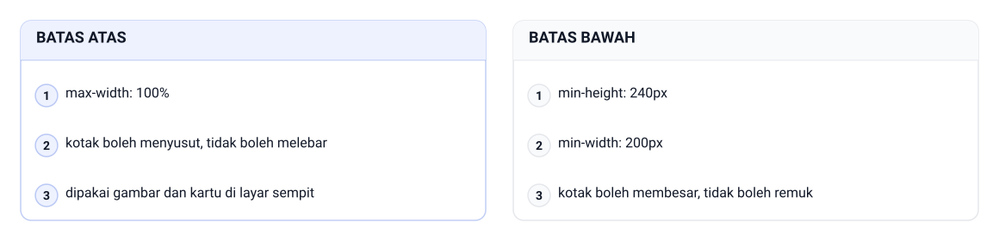
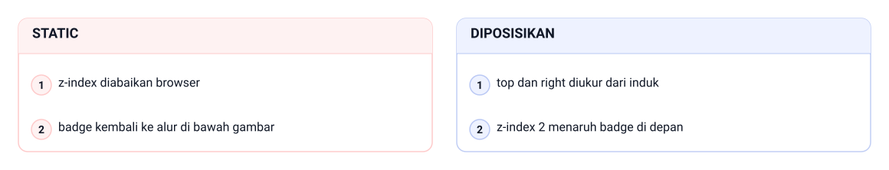
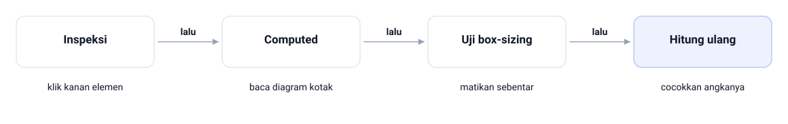

<!-- _class: lead -->
<!-- _paginate: skip -->
<!-- _footer: '' -->

# CSS Box Model dan Layout

**Bab 5** · Menghitung kotak, bukan menebak jarak

Studi kasus: **Tokosaya**

<!--
Buka dengan pertanyaan: kenapa halaman yang HTML-nya udah rapi masih bisa meleset
beberapa piksel? Bab ini ngubah cara kerja dari menebak jarak jadi ngitung kotak.
Hasil akhirnya satu komponen kartu produk Tokosaya yang bisa kamu inspeksi sendiri.
-->

---
<!-- _class: compact -->

# Tujuan Pembelajaran

Setelah menyelesaikan bab ini, kamu bisa:

- Anatomi kotak: content, padding, border, margin, dari dalam ke luar
- Hitungan lebar total di `content-box` dan `border-box`
- Menahan ukuran dengan `min-width`, `max-width`, dan `min-height`
- Pemasangan `box-sizing: border-box` global dan alasannya
- Perilaku `display`: `block`, `inline`, dan `inline-block`
- Penanganan `overflow` dan pemenggalan teks panjang
- Posisi kotak: `position`, `z-index`, dan skala jarak 8 px

<!--
Bacakan tujuh butir ini sebagai janji, bukan daftar. Tiap butir punya rangkaian yang
sama sepanjang bab: definisi, kenapa penting, hitungan atau demo DevTools, lalu salah
kaprah yang harus kamu kenali.

Hubungkan dengan Bab 4: token warna dan huruf udah siap, bab ini nambahin jarak dan
penghitungan. Tanyain siapa yang selama ini ngira `width` itu lebar kotak yang keliatan
di layar; jawaban itu yang dibongkar di butir kedua.
-->

---

# Tiga Gejala, Satu Akar


Kamu magang di tim digital Tokosaya. Katalognya berulah: badge terlempar ke pojok halaman, kartu ketiga meluber, dan jarak antarkartu 12, 17, lalu 28 px padahal di desain ketiganya sama.

> Ketiga gejala itu bukan salah HTML, tapi satu akar yang sama: kotak.

<!--
Ceritakan tiga gejalanya sebagai pengalaman magang, jangan cuma dibacakan: badge
terlempar ke pojok kanan, kartu ketiga meluber, dan jarak kartu 12, 17, lalu 28 px.

Tanyain dugaan awal mereka buat ketiga gejala; jawaban yang diharapkan: salah tulis
HTML, kontainer kekecilan, dan desainnya beda — ketiganya salah. Yang sebenarnya:
induknya belum `relative`, mode `content-box` menambah padding, dan belum ada skala
jarak tetap.
-->

---

<!-- _class: section -->
<!-- _footer: '' -->

# Kotak dan Cara Menghitungnya

## Lapisan, hitungan, dan satu mode untuk semua

<!--
Transisi dari gejala ke alat ukurnya. Bagian pertama inilah yang paling ngubah cara
berpikir: setelah paham lapisannya, layout jadi soal aritmetika, bukan selera.

Tahan dulu soal `display` dan `position`; keduanya masuk bagian kedua dan ketiga.
-->

---


<!-- _class: compact -->

# Anatomi Kotak: Empat Lapisan


- Urutan dari dalam ke luar: content, padding, border, margin
- Content menyimpan isi; padding ruang dalam yang ikut berwarna dan bisa diklik
- Border garis pemisah; margin ruang luar yang selalu transparan

> Padding ikut berwarna; margin tidak pernah.

<!--
Tunjuk dari tengah ke luar: content, padding, border, margin. Tekankan dua fakta yang
nentuin semua hitungan nanti: padding ikut mewarnai latar dan ikut bisa diklik,
sedangkan margin nggak dua-duanya.

Tanyain lapisan mana yang bikin kartu terasa lega pas dibaca; jawaban yang diharapkan:
padding, karena ia bagian dari kotak dan ikut berwarna. Sebutkan urutan itu juga urutan
kerja: kalau lebar meleset, periksa padding dulu, lalu border, terakhir margin.
-->

---


<!-- _class: compact -->

# Analogi Poster Berbingkai


- Content adalah kanvas tempat gambar dicetak
- Padding adalah passe-partout: masih milik poster, ikut berwarna
- Border adalah bingkai kayu: batas yang ikut dihitung
- Margin adalah jarak ke poster lain: tidak dimiliki siapa pun

<!--
Analogi ini yang paling berguna pas kamu harus menjelaskan keputusan desain ke rekan
non-teknis: content adalah kanvas poster tempat gambar dicetak, padding adalah
passe-partout di sekeliling kanvas, border adalah bingkai kayu yang membatasi kanvas,
dan margin adalah jarak ke poster lain di dinding.

Tanyain lapisan mana yang ikut berubah kalau latar elemen dikasih warna; jawaban yang
diharapkan: content dan padding. Lanjut pertanyaan kedua: kalau poster tetangga mau
dirapatkan, lapisan mana yang digeser? Jawabannya margin — kamu lagi ngatur hubungan
antarkotak, bukan ngatur kotaknya.
-->

---

# Padding dan Margin Bukan Hal yang Sama


- Padding milik elemen: latar dan area klik ikut memenuhinya
- Margin di luar kotak: transparan, tidak bisa diklik
- Border tipis, 1 sampai 2 px, jadi garis pemisah keduanya
- Klik tombol yang bertambah luas selalu hasil padding, bukan margin

<!--
Tekankan bahwa padding itu bagian dari tubuh elemen itu sendiri: klik dan latar ikut
memenuhi seluruh area padding. Margin berada di luar kotak dan selalu transparan — kartu
berlatar putih dengan margin 32 px tetap nampakin bidang kaca di sekelilingnya.

Tanyain: kalau bidang kaca itu mau ikut berwarna, properti mana yang dipakai? Jawaban
yang diharapkan: padding, bukan margin. Lanjut ke kasus tombol: tombol yang gampang
dipencet nambah luasnya karena padding; margin cuma nyorong tetangganya menjauh.
-->

---


<!-- _class: compact -->

# Margin Vertikal Bisa Runtuh


- Margin bawah 16 px bertemu margin atas 24 px: jaraknya 24 px, bukan 40 px
- Yang dipakai nilai terbesar, bukan hasil penjumlahan
- Padding tidak punya perilaku runtuh ini
- Cara periksa: klik dua kotak di DevTools, lihat pita marginnya jadi satu

> Ritme vertikal antarseksi lebih aman distandarkan lewat padding kontainer.

<!--
Hitung bareng-bareng: 16 px bawah ketemu 24 px atas, jaraknya jadi 24 px, bukan 40 px.
Aturannya: margin bawah dan margin atas bertetangga nggak dijumlahkan, yang dipakai
adalah nilai yang paling besar. Inilah yang bikin mahasiswa nuduh CSS-nya rusak padahal browser cuma
jalanin aturan runtuh.

Cara memeriksanya: pilih dua kotak bertetangga di DevTools, pita margin keduanya menyatu
dan angkanya cuma muncul sekali. Tanyain kenapa padding yang dipilih buat ritme
antarseksi; jawaban yang diharapkan: padding nggak runtuh, jadi jaraknya bisa diprediksi.
-->

---


<!-- _class: compact -->

# Angka width Cuma Sepotong Kotak


```css
.panel {
  width: 280px;      /* hanya area konten */
  padding: 16px;     /* ditambahkan di luar */
  border: 4px solid #4F46E5;
}
```

- 280 + 16 + 16 + 4 + 4 = 320 px lebar di layar
- Selisih 40 px itulah yang memunculkan bilah gulir horizontal

> Angka yang kamu tulis bukan angka yang dipakai browser.

<!--
Minta mereka ngitung sendiri sebelum kamu tunjukin 320 px di layar. Angka `width` cuma
milik area konten: 280 px ditambah padding kiri-kanan 16 px dan border kiri-kanan 4 px,
jadi lebar di layar 280 + 32 + 8 = 320 px. Rinciannya: padding 16 px (kiri 16 px,
kanan 16 px) dan border 4 px (kiri 4 px, kanan 4 px).

Tanyain kenapa kartu yang "seharusnya" muat tiga di satu baris jadi meluber sepuluh
piksel; jawaban yang diharapkan: padding dan border nambah lebar di luar 280 px. Ini akar
gejala kedua di apersepsi.
-->

---

# Studi Kasus: Dashboard SIAKAD

Fakultas merancang ulang dashboard mahasiswa: tiga kartu informasi utama.

- Padding 40 px bikin kartu terlalu tinggi
- Jarak di dalam kartu campur: 12, 17, dan 28 px
- Kartu ketiga terlempar keluar layar laptop
- Kolom kartu tidak sejajar di tepi atas
- Perbaikan: padding 24 px dan 16 px dari skala 8

> Box model bukan urusan estetika, tapi kecepatan pengguna memahami data.

<!--
Ceritakan dampaknya dari perilaku layar, bukan dari angka statistik: kartu yang terlalu
tinggi maksa pengguna menggulir buat membandingkan dua angka yang seharusnya
bersebelahan.

Tanyain kenapa jarak 17 px antara label dan nilainya justru mecah kelompok informasi;
jawaban yang diharapkan: mata membacanya kayak dua blok berbeda, jadi angkanya nggak
lagi keliatan sebagai satu pasangan. Pola yang sama dibangun ulang dengan Grid di Bab 7.
-->

---

# Contoh: Studi Kasus: Dashboard SIAKAD


Satu kartu statistik SIAKAD, content 240 × 64 px dan border 4 px tiap sisi, jadi yang bisa digeser cuma paddingnya. Dengan padding 40 px per sisi, tinggi kartu 152 px (64 + 40 + 40 + 4 + 4), dan kartu terlalu tinggi. Dengan padding 24 px per sisi, angka dari skala 8, tinggi kartu 120 px (64 + 24 + 24 + 4 + 4): hemat 32 px per kartu tanpa mengubah satu pun isinya. Tinggi 64 px itu tetap dua baris teks — label 24 px, jarak 8 px, angka 32 px.

<!--
Minta kelas ngitung tinggi kartunya sendiri sebelum kamu tunjukin 152 px. Jawaban yang
diharapkan: 64 + 40 + 40 + 4 + 4 = 152 px, sedangkan padding 24 px cuma
64 + 24 + 24 + 4 + 4 = 120 px.

Tunjuk dua panel di gambar: kiri padding 40 px, kanan 24 px, dan baris pertama kedua
panel sama persis. Tekankan hasilnya per kartu: 32 px lebih pendek tanpa satu pun data
hilang. Sebutkan 40 px nggak ada di daftar 8, 16, 24, 32, 48, dan 64 px.
-->

---

# Menahan Kotak dengan min dan max

- `width` tanpa nilai lain mengikuti lebar induk
- `min-width` menjaga kotak tidak pernah lebih sempit dari batasnya
- `max-width: 100%` mencegah gambar meluber dari kartu
- `width: 280px` plus `max-width: 100%` pola klasik kartu
- `.container` dibatasi 960 px supaya baris teks nyaman dibaca

<!--
Satu pertanyaan buat kelima baris: siapa yang nentuin ukuran kotak ini — induknya,
browser, atau batas yang kita tulis?

Tanyain kenapa kita nggak ngunci `height` di paragraf yang isinya bisa nambah; jawaban
yang diharapkan: teks yang kepotong itu kegagalan aksesibilitas, jadi pakai
`min-height`. Tekankan bahwa `min-width` dan `max-width` itu dua batas berlawanan arah,
dan keduanya nggak ngunci ukuran kayak `width`.
-->

---


<!-- _class: compact -->

# Batas Atas dan Batas Bawah



- `max-width` adalah batas atas: kotak boleh menyusut, tidak boleh melebar
- `min-width` dan `min-height` adalah batas bawah: kotak boleh membesar, tidak boleh remuk
- `min-height: 240px` menahan kartu yang isinya masih pendek
- `width` mengunci; `min` dan `max` cuma menahan

> Satu properti mengunci, dua lainnya cuma menahan.

<!--
Ini slide yang membedakan "menahan" dari "mengunci": angka di `width` itu keputusan
final, sedangkan angka di `min` dan `max` cuma rambu. Tekankan arah rambunya —
`max-width` nahan dari atas, `min-width` dan `min-height` nahan dari bawah.

Tanyain: kalau layar menyempit, mana yang lebih dulu kerja, `width: 280px` atau
`max-width: 100%`? Jawaban yang diharapkan: `max-width` yang menang, karena ia batas
atas yang nggak boleh dilanggar. Rambu atas itulah yang dipakai gambar dan kartu di
layar sempit; sedangkan `min-width: 200px` menahan kolom samping supaya nggak habis
dimakan layar sempit.
-->

---

<!-- _class: compact -->

# Satu Aturan border-box Global

```css
/* Semua kotak dihitung dari tepi border ke tepi border */
*,
*::before,
*::after {
  box-sizing: border-box;
}
```

`File: tokosaya-css/css/style.css`

<!--
Tekankan bahwa satu aturan ini ngubah arti semua angka lebar di seluruh file: selector
`*` menjangkau semua elemen, `*::before` dan `*::after` ikut disamakan, dan angka
`width` jadi lebar kotak utuh.

Pasang sekali di awal file, setelah token dan sebelum komponen. Tanyain apa yang terjadi
ke konten kalau padding diperbesar di mode ini; jawaban yang diharapkan: kontennya yang
menyusut, bukan kotaknya.
-->

---

# Kenapa border-box Jadi Pilihan Global

- Angka di mockup desainer sudah termasuk padding dan border
- Satu mode berarti lebar di CSS sama dengan lebar di DevTools
- Padding membesar menyusutkan isi, bukan melebarkan kotak
- Lebar dua kartu bisa dijumlah langsung: 280 + 280 + gap
- Mencampur dua mode membuat setiap hitungan harus diperiksa ulang

> Lebar yang kamu tulis adalah lebar yang kamu lihat.

<!--
Alasan terkuat ada di baris keempat: di `border-box`, penjumlahan lebar kartu bisa
dipercaya tanpa ngitung padding tiap komponen satu per satu.

Tanyain kenapa nyampur dua mode dianggap lebih bahaya daripada milih mode yang "kurang
nyaman"; jawaban yang diharapkan: komponen yang salah mode nggak keliatan rusak di satu
tempat, ia cuma nggeser layout di tempat lain, jadi bug-nya muncul jauh dari penyebabnya.
-->

---
<!-- _class: section -->
<!-- _footer: '' -->

# Jenis Kotak dan Konten Meluber

## Kotak jenis apa, dan ke mana isinya pergi

<!--
Transisi dari hitungan ke perilaku. Bagian ini yang paling banyak memunculkan pertanyaan
di kelas: banyak "kesalahan styling" sebenarnya cuma perilaku bawaan elemen yang belum
dipahami, bukan kode yang salah.
-->

---

# display Menentukan Jenis Kotak

- Properti `display` memilih jenis kotak elemen
- Nilai bawaannya ditetapkan stylesheet browser
- `p`, `div`, `h1`, dan `ul` berperilaku `block`
- `span`, `a`, `strong`, dan `em` berperilaku `inline`
- Jenis kotak bisa diubah tanpa menyentuh HTML

<!--
Tekankan bahwa nilai bawaan itu bukan pilihanmu — stylesheet browser yang
menetapkannya lewat selector `p { display: block }` dan sejenisnya.

Demo: buka DevTools, pilih satu `span`, tunjuk baris `display: inline` di panel
Computed. Tanyain elemen apa yang bakal kamu kasih padding penuh: link di dalam paragraf
atau badge di dalam daftar. Jawaban yang diharapkan: dua-duanya perlu perlakuan berbeda.
-->

---

# Contoh: display Menentukan Jenis Kotak


Lima elemen kartu produk Tokosaya. Dua cabang pertama dipilihkan stylesheet browser: block berisi p dan div, inline berisi span dan a. Lalu badge — bawaannya inline, karena badge itu memang span. Cabang inline-block — ditulis di CSS: baru terisi setelah display: inline-block.

<!--
Minta kelas nebak jenis kotak tiap elemen sebelum gambarnya dibuka. Jawaban yang
diharapkan: p dan div block, span dan a inline, badge ikut inline karena bawaannya —
dia memang span.

Tunjuk ketiga cabangnya, lalu tekankan bahwa cabang `inline-block` nggak pernah datang
sendiri: satu properti `display` mindahin badge tanpa nyentuh HTML sama sekali.
-->

---

# block, inline, dan inline-block

| Perilaku | block | inline | inline-block |
|---|---|---|---|
| Mulai baris baru | ya | tidak | tidak |
| `width` dan `height` | berlaku | diabaikan | berlaku |
| `margin` atas dan bawah | berlaku | diabaikan | berlaku |
| `padding` atas dan bawah | mendorong teks | cuma melukis latar | mendorong baris |
| Contoh | `p`, `div`, `ul` | `span`, `a` | badge, tombol |

<!--
Bahas kolom `inline` paling lama, karena di situ letak kebingungannya: padding
atas-bawahnya keliatan tapi nggak nggeser apa pun. Minta mereka nebak kenapa
`width: 120px` di `span` nggak ngefek sama sekali; jawaban yang diharapkan: dimensi
elemen inline memang diabaikan browser.

Tunjukkan buktinya di DevTools: pilih sebuah `span`, panel Computed melaporkan lebar
yang ngikutin teks, bukan angka yang kamu tulis.
-->

---

# Badge Tokosaya Butuh inline-block

- Badge "Best Seller" adalah label kecil dekat harga
- Sebagai `inline`, padding dan dimensinya diabaikan
- Sebagai `block`, badge memaksa baris baru
- Sebagai `inline-block`, kotak penuh tapi tetap mengalir
- Pola yang sama dipakai buat item navigasi

<!--
Jadikan badge contoh tunggal yang diulang terus: satu properti, tiga perilaku berbeda.
Tanyain apa yang terjadi kalau badge dibiarkan `inline` padahal padding-nya 8 px 16 px;
jawaban yang diharapkan: bentuknya remuk dan latarnya nempel di teks tanpa nyorong baris.

Sebutkan item navigasi pakai pola yang sama, jadi yang kamu pelajari di badge berlaku di
menu. Tanyain mana yang lebih tepat buat badge; jawaban yang diharapkan: `inline-block`,
karena `block` maksa badge turun ke baris sendiri dan misahin dari harga.
-->

---

# Contoh: Badge Tokosaya Butuh inline-block


Badge "Best Seller" di kartu produk: content 88 × 22 px, diberi `padding: 8px 16px` — dua nilai, jadi atas-bawah 8 px dan kiri-kanan 16 px (empat nilai ditulis atas, kanan, bawah, kiri: `8 16 8 16 px`). Lebar totalnya 88 + 16 + 16 = 120 px dan tingginya 22 + 8 + 8 = 38 px, angka yang cuma dihormati browser kalau badge-nya display: inline-block.

<!--
Minta mereka ngitung dulu sebelum kamu tunjukin angkanya: 88 + 16 + 16 jadi berapa, dan
22 + 8 + 8 jadi berapa. Jawaban yang diharapkan: 120 × 38 px, dan itu kotak yang
beneran dipakai browser.

Sambungkan dengan slide anatomi: padding ikut nambah kotak, jadi angka 120 px itu udah
termasuk padding. Tanyain apa yang terjadi kalau badge-nya dibiarkan inline; jawaban
yang diharapkan: padding atas-bawahnya cuma melukis latar tanpa nyorong baris.
-->

---

<!-- _class: compact -->

# Salah Kaprah: Celah Tipis Antar Kotak

```css
.daftar-produk {
  font-size: 0;                /* hapus celah spasi antar item */
}

.produk-card {
  display: inline-block;
  font-size: 16px;             /* kembalikan ukuran teks kartu */
}
```

- Celah itu spasi yang kamu tulis di HTML, bukan margin atau padding
- `inline-block` memperlakukan kotak seperti kata, jadi spasi ikut dihitung

`File: tokosaya-css/css/style.css`

> Celah yang nggak berasal dari margin mana pun hampir selalu berasal dari spasi.

<!--
Tunjukkan celahnya dulu di browser sebelum kamu jelaskan triknya, karena gejalanya
keliatan kayak bug: dua kartu `inline-block` bersebelahan punya celah 4 sampai 5 px yang
nggak berasal dari margin mana pun.

Cara memeriksa: pilih dua kartu di DevTools, pastikan margin dan padding keduanya nol —
celahnya tetap ada. Jawaban yang diharapkan: celahnya dari spasi atau baris baru di
antara `</li>` dan `<li>`. Sebutkan Bab 6 ngganti trik ini dengan `gap`.
-->

---

# overflow: Nasib Konten Meluber

| Nilai | Perilaku |
|---|---|
| `visible` | bawaan; konten menumpang keluar kotak |
| `hidden` | memotong tanpa bilah gulir |
| `scroll` | selalu menampilkan bilah gulir |
| `auto` | bilah gulir cuma kalau diperlukan |

- `auto` adalah pilihan aman buat panel yang isinya dinamis
- `overflow` tidak mengubah hitungan lebar kotak

<!--
Empat nilai, satu pertanyaan: mau diapakan isi yang nggak muat. Tekankan urutan kerjanya:
`border-box` dulu, baru `overflow` sebagai pengaman visual — `overflow` nggak memperbaiki
hitungan, ia cuma ngatur tampilannya.

Tanyain bedanya `scroll` dan `auto`; jawaban yang diharapkan: `scroll` nampilin bilah
walaupun kontennya muat, jadi keliatan berlebihan dan makan ruang.
-->

---

# Potong Melingkar dan Gulir Panel

- Kartu ber-radius 12 px masih menampakkan sudut gambar yang tajam
- `overflow: hidden` di media memotong gambar ikut sudut kartu
- Tabel presensi panjang dibungkus wadah bertinggi terbatas
- `overflow-y: auto` bikin panel menggulir sendiri
- Halaman tidak ikut tergulir, konteks pengguna tetap terjaga

<!--
Tunjukkan sudut kartu yang masih tajam sebelum `overflow: hidden` dipasang; itu
perbedaan yang paling gampang dilihat kelas. Prinsip besarnya: yang dibatasi kotaknya,
bukan isinya — radius 12 px di kartu nggak motong sudut gambar di dalamnya sampai wadah
gambarnya sendiri yang motong.

Tanyain apa akibatnya kalau seluruh halaman yang menggulir buat tabel panjang; jawaban
yang diharapkan: konteks pengguna hilang, header dan menu ikut kegeser.
-->

---

# Contoh: Potong Melingkar dan Gulir Panel


Kartu Tokosaya beradius 12 px. Tanpa aturan, dua hal tetap bocor: sudut gambar tetap tajam walau kartu beradius 12 px, dan tabel 480 px memanjangkan seluruh halaman. Dengan overflow, dua-duanya beres tanpa isinya diubah: overflow: hidden memotong gambar ikut sudut kartu, dan overflow-y: auto menggulir panel 200 px saja — 480 − 200 = 280 px sisanya menunggu di dalam panel.

<!--
Angkanya bisa dihitung sendiri: 480 − 200 = 280 px yang nunggu di dalam panel, dan itu
jumlah yang sama dengan yang tadinya memanjangkan halaman.

Tanyain kenapa `overflow-y` yang dipakai dan bukan `overflow`; jawaban yang diharapkan:
supaya cuma arah vertikal yang digulir, panel nggak tiba-tiba bisa digeser ke samping.
Dua aturan di gambar ini nyelesaiin dua gejala berbeda: sudut tajam dan halaman memanjang.
-->

---

<!-- _class: compact -->

# Elipsis: Tiga Properti Satu Kesatuan

```css
.nama-terpotong {
  white-space: nowrap;         /* larang teks turun ke baris baru */
  overflow: hidden;            /* potong bagian yang keluar */
  text-overflow: ellipsis;     /* tampilkan tanda potong */
}
```

`File: tokosaya-css/css/style.css`

> Memotong teks tanpa jejak adalah kegagalan informasi, bukan keindahan.

<!--
Minta mahasiswa nghapus satu properti satu per satu dan ngamatin akibatnya; ketiganya
memang satu kesatuan. Tanpa `overflow: hidden` tanda potongnya nggak muncul, dan tanpa
`white-space: nowrap` nggak ada yang kepotong.

Tekankan atribut `title`: tambahin supaya nama penuh tetap kebaca, karena motong teks
yang nggak bisa diamati lagi itu kegagalan informasi. Tanyain di mana pola ini bakal
dipakai di kartu produk; jawaban yang diharapkan: nama produk, bukan harga.
-->

---

# Teks Panjang: Dua Resep Lain

- `overflow-wrap: break-word` mematahkan kata yang super panjang
- Cocok buat URL atau nama file yang tidak boleh melebar
- `-webkit-line-clamp` membatasi deskripsi jadi dua baris
- Teknik clamp masih memakai prefiks vendor
- Putusan desainnya tetap sama: kotak yang dibatasi, bukan konten

<!--
Tunjukkan nama file panjang kayak laporan tahunan yang bikin panel melebar tanpa
`break-word`. Sebutkan `line-clamp` masih pakai prefiks vendor dan dukungannya perlu
diperiksa di dokumentasi resmi.

Tanyain mana yang lebih aman buat teks penting: motong di sisi penyunting konten atau
motong otomatis; jawaban yang diharapkan: motong di sisi konten lebih aman, karena
keputusannya diambil sadar dan nggak bergantung dukungan browser.
-->

---

# Contoh: Teks Panjang: Dua Resep Lain


Nama produk WC-720 di kartu 280 px, dua resep buat masalah yang sama. Resep 1 — break-word: kata 60 huruf dipatahkan di tengah, kotak tetap 280 px, teks turun baris, tanpa prefiks vendor. Resep 2 — line-clamp: nama berhenti di dua baris, sisanya diganti tanda elipsis, masih butuh prefiks webkit. Contoh kartu Tokosaya di bab ini memakai resep 2. Kartunya tetap 280 px: 280 − 16 − 16 − 1 − 1 = 246 px content, padding 16 px, border 1 px.

<!--
Minta kelas nyelesein pengurangannya: 280 − 16 − 16 − 1 − 1 jadi berapa. Jawaban yang
diharapkan: 246 px, dan itulah lebar yang tersisa buat teks di dalam padding 16 px dan
border 1 px.

Tekankan dua resep ini jawab dua masalah berbeda: `overflow-wrap` matahin satu kata yang
nggak boleh melebar, `-webkit-line-clamp` mangkas isi yang boleh dipendekkan. Contoh
kartu di bab ini pakai resep kedua.
-->

---
<!-- _class: section -->
<!-- _footer: '' -->

# Posisi Kotak dan Irama Jarak

## Di mana kotak duduk, dan berapa jaraknya

<!--
Pindah dari "kotak jenis apa ini" ke "di mana kotak ini duduk dan berapa jaraknya".
Bagian ini nyelesaiin dua gejala di apersepsi sekaligus: badge yang terlempar ke pojok
halaman dan jarak antarkartu yang nggak konsisten.
-->

---


<!-- _class: compact -->

# Lima Nilai position


- `static` dan `relative` ikut alur; `relative` bergeser dari posisinya
- `absolute` lepas dari alur, diukur dari leluhur yang diposisikan
- `fixed` lepas dari alur dan diukur dari viewport
- `sticky` ikut alur sampai titik geser, lalu menempel

<!--
Kalimat paling penting di slide ini: `relative` lebih sering dipakai buat landasan
daripada buat nggeser, dan landasan itulah gunanya buat anak yang `absolute`. Lima
nilainya: static — bawaan, ikut alur dokumen; relative — bergeser dari posisinya;
absolute — lepas dari alur; fixed — menempel viewport; sticky — ikut alur sampai titik
geser.

Tanyain apa landasan sebuah kotak `absolute` kalau nggak ada satu pun leluhur yang
diposisikan; jawaban yang diharapkan: halaman itu sendiri, dan itulah badge yang terlempar
ke pojok layar di apersepsi. Jawaban itu dibuktikan di slide berikutnya.
-->

---

<!-- _class: compact -->

# Badge Menempel di Pojok Gambar

```css
.produk-media {
  position: relative;        /* badge diukur dari tepi gambar */
}

.produk-badge {
  position: absolute;
  top: 8px;
  right: 8px;
  z-index: 2;
}
```

`File: tokosaya-css/css/style.css`

- `absolute` mencari leluhur yang diposisikan, bukan induk terdekat di HTML
- Tanpa `relative` di induk, badge lari ke pojok halaman
- Kotak `absolute` tidak menggeser teks di bawahnya karena sudah keluar dari alur

<!--
Demonstrasikan ini langsung: hapus `position: relative` sebentar, muat ulang, biarkan
kelas lihat badge terlempar. Kembalikan, lalu tekankan bahwa 8 px itu jarak dari tepi
gambar, bukan dari halaman.

Tanyain kenapa `top` dan `right` nggak ngefek apa pun kalau induknya `static`; jawaban
yang diharapkan: nggak ada leluhur yang diposisikan, jadi acuannya viewport.
-->

---


<!-- _class: compact -->

# z-index pada Elemen Diposisikan



- `z-index` mengatur urutan tumpukan kotak yang bertumpuk
- Hanya bekerja kalau `position` bukan `static`
- Pakai skala kecil yang direncanakan: 1, 2, dan 10
- Hindari loncatan ke 9999 yang bikin susah di-debug

<!--
Tunjuk dua panel: di kiri `position: static`, jadi `z-index` diabaikan browser dan badge
balik ke alur di bawah gambar; di kanan elemen diposisikan, `top` dan `right` diukur
dari induk, dan `z-index` 2 naruh badge di depan.

Tanyain kenapa `z-index: 9999` dianggap kebiasaan buruk walaupun hasilnya keliatan
benar; jawaban yang diharapkan: nilainya nggak terdokumentasi, jadi aturan berikutnya
terpaksa nulis angka lebih besar lagi.
-->

---

# Contoh: z-index pada Elemen Diposisikan


Tiga strata di dalam produk-media. Paling depan badge Best Seller — position absolute, z-index 2 — dan angka 2 itu satu-satunya z-index di style.css. Di bawahnya gambar produk yang static, ikut alur; kotak seperti itu tidak butuh z-index karena hanya yang diposisikan bisa diurutkan. Paling bawah produk-media sendiri: position relative, landasan badge mengukur 8 px dari tepi gambar.

<!--
Tanyain dulu apa yang terjadi kalau badge dibiarkan `position: static`; jawaban yang
diharapkan: `z-index` diabaikan sekaligus `top` dan `right` nggak berlaku, jadi badge
balik ke alur di bawah gambar.

Tunjuk tiga pita di gambar dari atas ke bawah: badge, gambar produk, lalu produk-media
sebagai landasan. Tekankan angka 2 di `style.css` itu satu-satunya `z-index` di kartu
ini — nggak ada `z-index: 1` di file mana pun, dan itu memang disengaja.
-->

---

# Skala Jarak Delapan Piksel

- Sistem jarak dibangun dari basis `--space-unit: 8px`
- Langkahnya 8, 16, 24, 32, 48, dan 64 px
- Setiap jarak harus jatuh di salah satu langkah itu
- Delapan membagi rata lebar layar 320, 640, 960, dan 1280
- Langkah 4 px cuma buat koreksi mikro, ditulis di komentar

> Jarak yang bisa dihitung lebih mudah dirawat daripada jarak yang ditebak.

<!--
Tanyain kenapa 8 yang dipilih, bukan 5 atau 7; jawaban yang diharapkan: angkanya membagi
rata lebar layar umum tanpa sisa, jadi jarak dan kolom bisa dibagi tanpa pecahan piksel.

Tekankan efeknya ke pengguna: bagian yang nggak berkaitan muncul pada takaran seragam,
jadi mata nggak perlu ganti ukuran kaca pembesarnya tiap blok. Langkah 4 px boleh, asal
ditulis di komentar dan bukan jadi kebiasaan.
-->

---

# Kapan padding, Kapan margin

- Padding adalah bagian dari komponen itu sendiri
- Padding memperluas latar sekaligus area klik tombol
- Margin memisahkan komponen dari tetangganya
- Jarak vertikal antarseksi lebih aman lewat padding kontainer
- Padding 8 px per sisi menaikkan tombol di atas ambang WCAG 24 px

<!--
Ulangi padanan fisiknya: padding itu jarak foto ke tepi passe-partout, margin itu jarak
antar passe-partout di dinding. Tanyain siapa yang selama ini pakai margin buat melebarkan
tombol; itu kebiasaan yang paling sering muncul di tugas, dan jawabannya selalu padding.

Sebutkan kriteria Target Size dari WCAG 2.2 menetapkan area sentuh minimal 24 × 24 px,
jadi padding punya fungsi aksesibilitas, bukan cuma estetika.
-->

---

<!-- _class: compact -->

# Jarak Baku Proyek Tokosaya

```css
.hero {
  padding: 64px 0;             /* 8 × 8 — jeda besar antarseksi */
}

.hero-subtitle {
  margin: 0 0 32px;            /* 8 × 4 — jarak ke tombol CTA */
}

.produk-body {
  padding: 16px;               /* 8 × 2 — ruang napas dalam kartu */
}

.produk-card {
  margin: 0 16px 32px 0;       /* 8 × 2 dan 8 × 4 */
}
```

`File: tokosaya-css/css/style.css`

<!--
Buka file aslinya dan hitung satu per satu langkah skalanya bareng kelas. Yang negakkan
disiplinnya adalah komentar `8 × n`: setiap angka baru harus punya pasangan di skala.

Cara memeriksa: telusuri seluruh file dan tandai nilai yang bukan kelipatan 8 — angka
kayak 21 px atau 37 px itu utang yang bakal nagih pas layar menyempit. Tanyain apa yang
harus dilakukan kalau kartu terasa perlu lebih beruang; jawaban yang diharapkan: naik
dari 16 ke 24 atau 32, bukan ke 21.
-->

---

<!-- _class: section -->
<!-- _footer: '' -->

# Praktik: Kartu Produk Tokosaya

## Delapan kartu dengan jarak yang bisa dihitung

<!--
Masuk ke praktikum. Ingatkan bahwa hasil akhirnya bukan halaman cantik, melainkan satu
komponen kartu yang setiap jaraknya bisa dipertanggungjawabkan. Sebutkan kartu inilah
yang nanti disusun ulang dengan Flexbox di Bab 6, jadi markup dan kelasnya dipakai lagi.
-->

---


<!-- _class: compact -->

# Cara Memeriksa Kotak di DevTools



- Inspeksi: klik kanan elemen, lalu pilih Inspect
- Computed: baca diagram kotak dan angka yang dilaporkan browser
- Uji box-sizing: matikan sebentar di panel Styles, bandingkan lebarnya
- Hitung ulang: cocokkan `content + padding + border` dengan angka di panel

<!--
Jalankan urutan ini sekali di layar sebelum kelas ngerjain sendiri: inspeksi elemen lewat
klik kanan, Computed buat baca diagram kotak, uji `box-sizing` dengan mematikannya
sebentar, lalu hitung ulang dan cocokkan angkanya.

Tanyain langkah mana yang paling sering dilewatkan; jawaban yang diharapkan: langkah
terakhir, padahal itu satu-satunya langkah yang membuktikan hitunganmu benar. Tekankan
tangkapan layar langkah ketiga dan keempat dipakai sebagai bukti penilaian.
-->

---

# Langkah Praktikum

1. Buka folder proyek `tokosaya-css/` dan siapkan delapan gambar produk
2. Tulis ulang `index.html` dengan hero dan delapan kartu
3. Tulis ulang `css/style.css` dengan token, reset, dan komponen
4. Pastikan aturan `box-sizing` ada di paling atas setelah token
5. Buka di browser, pastikan tidak ada bilah gulir horizontal
6. Periksa diagram kotak `.produk-card`, lalu matikan `box-sizing` sebentar

<!--
Jalankan langkah ini sambil didemokan di layar, jangan cuma dibacakan. Langkah lima dan
enam yang paling berharga: kelas lihat sendiri pembeda `content-box` dan `border-box` di
proyek nyata, pakai urutan empat langkah di slide sebelumnya.

Ingatkan nyimpen file sebelum muat ulang, dan periksa jalur `<link>` dulu kalau gaya
nggak muncul sama sekali. Tanyain langkah mana yang paling sering gagal; jawaban yang
diharapkan: langkah tiga, biasanya karena nama kelas di HTML dan CSS nggak sama.
-->

---

<!-- _class: compact -->

# Anatomi Kartu di index.html

```html
<li class="produk-card">
  <div class="produk-media">
    
    <span class="produk-badge produk-badge-accent">Best Seller</span>
  </div>
  <div class="produk-body">
    <p class="produk-kategori">Aksesori Input</p>
    <h3 class="produk-nama">Keyboard Mekanis KX-210</h3>
    <p class="produk-harga">Rp650.000</p>
  </div>
</li>
```

`File: tokosaya-css/index.html`

<!--
Tekankan pembagian tugasnya: HTML bawa peran, CSS bawa keputusan visual. Satu kartu satu
`li`, bukan kumpulan `div`; `produk-media` nampung gambar sekaligus badge dan itulah kotak
yang diposisikan `relative`; nggak ada satu pun gaya inline di HTML.

Tanyain kenapa angka `width` dan `height` disamakan rasio gambarnya; jawaban yang
diharapkan: supaya layout nggak melompat pas gambar selesai termuat. Pastikan semua nama
class konsisten kebab-case sebelum kelas lanjut ke file gaya.
-->

---

<!-- _class: compact -->

# Aturan Kartu di style.css

```css
.produk-card {
  display: inline-block;
  vertical-align: top;
  width: 280px;
  max-width: 100%;
  margin: 0 16px 32px 0;
  background-color: var(--clr-surface);
  border: 1px solid var(--clr-border);
  border-radius: var(--radius);
}

.produk-body {
  padding: 16px;
}
```

`File: tokosaya-css/css/style.css`

<!--
Tunjukkan gejala sebelum `vertical-align: top`: kartu dengan isi lebih panjang bikin
deretnya bergerigi. Setiap baris di blok ini mewakili satu tujuan: `display` dan
`vertical-align`, `width` dan `max-width`, margin serta padding dari skala 8, dan border
yang ikut dihitung.

Tanyain kenapa `max-width: 100%` penting walaupun kartunya udah punya lebar tetap;
jawaban yang diharapkan: biar kartu menyusut di layar sempit daripada maksa bilah gulir.
-->

---

# Hasil yang Diharapkan

- Header putih dengan empat link navigasi berderet
- Hero dengan judul besar dan tombol indigo
- Delapan kartu berbaris tiga per baris
- Badge berwarna di pojok kanan atas setiap gambar
- Sudut gambar membulat ikut radius kartu
- Kartu menyusut tanpa bilah gulir di lebar 480 px

<!--
Bandingkan tampilan sebelum dan sesudah langsung di browser, jangan cuma menampilkan slide
ini. Buat nggak tiap baris, tanyain tujuan mana yang membuktikannya: badge di pojok,
sudut membulat, kartu menyusut tanpa gulir, jarak rapi.

Kalau ada yang belum berubah, curigai jalur `<link>` dulu sebelum nuduh kodenya salah.
Ingatkan hard refresh dengan Ctrl+F5 kalau browser masih pakai file gaya dari cache.
-->

---

# Troubleshooting Paling Sering


<!--
Jadikan gambar ini daftar periksa saat kelas praktikum, bukan bahan bacaan. Gejala dan
penyebabnya: kartu sejajar tepi bawah berbeda karena `vertical-align` bawaan masih
baseline; ada celah tipis antarkartu karena spasi di HTML antar `inline-block`; jarak
terasa lebih pendek karena margin vertikal runtuh; badge lari ke pojok halaman karena
induk belum `position: relative`; kartu meluber dan muncul bilah gulir karena mode
`content-box` masih aktif.

Tanyain gejala mana yang paling sering mereka temui di tugas sebelumnya. Tekankan bahwa
semua gejala ini bisa dipastikan lewat diagram kotak di DevTools sebelum satu baris CSS
diubah.
-->

---

<!-- _class: compact -->

# Latihan

- Dua kartu bermargin bawah 16 px dan margin atas 24 px: berapa jarak nyatanya, dan kenapa?
- Hitung lebar total `width: 260px; padding: 16px; border: 4px solid;` di kedua mode
- Sempitkan kartu 280 px ke induk 240 px: properti mana yang menang?
- Matikan `box-sizing` di DevTools, catat lebar `.produk-card` sebelum dan sesudah
- Ubah `.nav-item` jadi `display: block`, amati, lalu jelaskan kenapa berantakan
- Pasang pola elipsis pada nama WC-720, uji dengan nama 60 huruf, isi atribut `title`
- Audit semua `padding` dan `margin`, tandai yang bukan kelipatan 8

> Tuliskan perhitungan dan alasannya, bukan cuma nama propertinya.

<!--
Tujuh butir, satu per tujuan di slide Tujuan Pembelajaran. Kerjakan butir pertama
bareng-bareng di papan, sisanya buat latihan mandiri.

Butir pertama: jawabannya 24 px, karena margin vertikal runtuh ke nilai terbesar. Butir
kedua: 300 px di `content-box`, dan di `border-box` kotaknya tetap 260 px dengan content
220 px. Butir ketiga: `max-width: 100%` yang menang, lebar total 280 px. Butir keenam
nuntut atribut `title`, bukan cuma tiga properti CSS.
-->

---

<!-- _class: compact -->

# Cek Daftar Komponen Kartu

- Padding dan margin tidak tertukar; area klik tombol melebar lewat padding
- `width` di CSS cocok dengan lebar yang dilaporkan panel Computed
- `.produk-card` punya `max-width: 100%`; `.container` dibatasi 960 px
- `box-sizing: border-box` global di awal file, setelah token
- Kartu `inline-block` dan `vertical-align: top`, tanpa celah spasi
- Media memakai `overflow: hidden`; nama produk punya `title`
- Media `relative`, badge `absolute` dengan `z-index: 2`, jarak kelipatan 8

<!--
Minta mahasiswa saling memeriksa file pakai daftar ini dan menunjukkan buktinya langsung
di kode. Urutan barisnya sama dengan urutan tujuan, jadi pemeriksa dan yang diperiksa
pakai kriteria yang sama dengan penilaian.

Tanyain nilai mana yang ternyata bisa dihapus karena udah diwarisi atau udah diatur
induknya. Ingatkan bahwa baris terakhir nggak bisa dibuktikan tanpa buka DevTools pada
lebar 1280 px.
-->

---

<!-- _class: compact -->

# Rangkuman

- Box model berlapis dari content, padding, border, sampai margin
- Margin vertikal bertetangga runtuh ke nilai terbesar; padding tidak
- `content-box` menambah padding ke luar; `border-box` memotongnya dari dalam
- `min` dan `max` menahan ukuran dari bawah dan atas; `width` mengunci
- `display` memilih jenis kotak; `overflow` dan elipsis mengatur isi yang tidak muat
- `relative` landasan `absolute`, `z-index` pakai skala kecil
- Jarak selalu dari skala 8 px, dan tombol melebar lewat padding

<!--
Tutup dengan pesan utama: layout yang bisa dihitung jauh lebih gampang dirawat daripada
layout yang ditebak. Tujuh baris ini urutannya sama dengan daftar Tujuan Pembelajaran.

Sebutkan Bab 6 ngganti trik `inline-block` dan `font-size: 0` dengan Flexbox, `gap`, dan
`justify-content`. Ingatkan bahwa penghitungan kotak di bab ini tetap berlaku di semua
model layout berikutnya — Flexbox dan Grid nggak ngubah cara browser ngitung padding dan
border.
-->

---

<!-- _class: lead -->
<!-- _footer: '' -->

# Tugas dan Refleksi

Susun `tokosaya-css/statistik.html` berisi panel "Ringkasan Tokosaya": empat kotak statistik berderet `inline-block`, seluruh jarak dari skala 8 px, dan satu badge `position: absolute`.

**Pertanyaan refleksi:** kapan kamu memilih `overflow: hidden` daripada `auto`?

<!--
Tugas individu: kumpulkan file HTML, CSS, tangkapan diagram kotak satu kartu, dan catatan
singkat pilihan margin atau padding pada tiap jarak. Nilai ketepatan skala 8 px, badge
yang beneran nempel di kartu, dan nggak adanya bilah gulir horizontal di lebar 1280 px.

Tekankan yang dinilai bukan jarak yang cantik, tapi jarak yang bisa
dipertanggungjawabkan — dan praktikumnya sudah nyiapin urutan empat langkah buat
membuktikannya di DevTools.
-->
