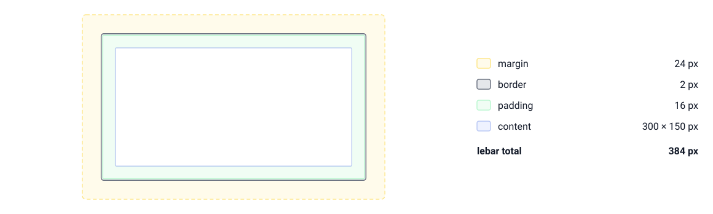
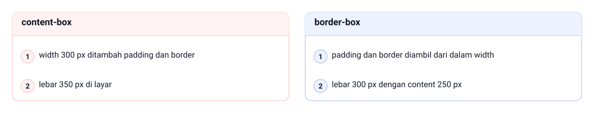
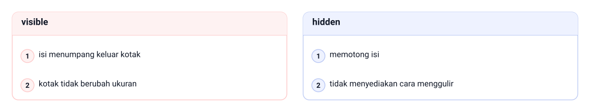
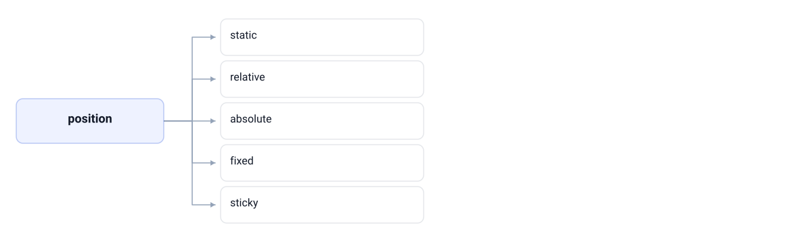

<!-- _class: lead -->
<!-- _paginate: skip -->
<!-- _footer: '' -->

# CSS Box Model dan Layout

## Memahami Ukuran, Tampilan, dan Posisi Elemen

**Bab 5**

<!--
Buka dengan pertanyaan yang muncul di praktikum: mengapa halaman yang HTML-nya sudah rapi
masih meleset beberapa piksel? Bab ini mengubah cara kerja dari menebak jarak menjadi
menghitung kotak.

Sebutkan bahwa hasil akhir bab adalah satu kartu produk yang dapat diperiksa sendiri lewat
DevTools, dan bahwa seluruh hitungan di sini tetap berlaku ketika Flexbox dan Grid dibahas
pada bab berikutnya.
-->

---

<!-- _class: compact -->

# Subtopik Bab Ini

- Anatomi CSS Box Model
- Perhitungan ukuran kotak
- Pengaturan batas ukuran elemen
- Perilaku properti `display`
- Penanganan `overflow` dan teks panjang
- Pengaturan posisi elemen dengan `position` dan `z-index`
- Penerapan skala jarak 8 px

<!--
Bacakan daftar ini sebagai peta bab, bukan sebagai bahan hafalan: tujuh butir, dan setiap
butir akan mendapat slide sendiri.

Minta mahasiswa menandai satu butir yang paling asing bagi mereka. Tandaan itu dipakai lagi
pada slide Latihan, karena soal latihan disusun mengikuti urutan yang sama.
-->

---

<!-- _class: compact -->

# Tujuan Pembelajaran

Setelah menyelesaikan bab ini, peserta diharapkan mampu:

1. Menjelaskan anatomi kotak CSS yang terdiri dari `content`, `padding`, `border`, dan `margin`.
2. Menghitung lebar total elemen menggunakan `content-box` dan `border-box`.
3. Mengendalikan ukuran elemen menggunakan `min-width`, `max-width`, dan `min-height`.
4. Menerapkan `box-sizing: border-box` secara global dan menjelaskan manfaatnya.
5. Membedakan perilaku `display: block`, `inline`, dan `inline-block`.
6. Menangani konten yang melampaui batas kotak menggunakan `overflow` dan aturan pemenggalan teks.
7. Mengatur posisi dan urutan tumpukan elemen menggunakan `position` dan `z-index`.
8. Menerapkan skala jarak berbasis kelipatan 8 px untuk menghasilkan layout yang konsisten.

<!--
Delapan butir ini adalah kontrak penilaian bab: setiap butir akan diuji lewat satu soal
latihan, dan slide Cek Daftar Komponen tidak lagi dipakai sebagai rubrik.

Tanyakan butir mana yang paling sulit dibayangkan; jawaban yang sering muncul adalah butir
ketujuh. Tegaskan bahwa urutan butir sama dengan urutan slide, sehingga mahasiswa dapat
memakai slide Tujuan ini sebagai daftar periksa mandiri.
-->

---

<!-- _class: section -->
<!-- _footer: '' -->

# Bagian 1 · Kotak dan Ukurannya

## Lapisan, hitungan, dan satu mode untuk semua

<!--
Transisi dari daftar tujuan ke alat ukurnya. Bagian ini mengubah cara berpikir: setelah
lapisan kotak dipahami, layout menjadi soal aritmetika, bukan selera.

Tahan dahulu soal `display` dan `position`; keduanya masuk Bagian 2 dan Bagian 3.
-->

---

<!-- _class: compact -->

# Pengenalan CSS Box Model

**Apa itu CSS Box Model?**

CSS Box Model adalah konsep yang menjelaskan bagaimana browser menghitung ruang yang digunakan oleh setiap elemen HTML.

Setiap elemen dapat dipandang sebagai sebuah kotak yang terdiri dari empat lapisan:

- **Content:** area utama yang menampilkan teks, gambar, atau konten lainnya.
- **Padding:** ruang di antara konten dan border.
- **Border:** garis pembatas yang mengelilingi konten dan padding.
- **Margin:** ruang di luar border untuk memisahkan elemen dari elemen lain.

**Mengapa penting?**

- Mengatur ukuran elemen dengan akurat.
- Mengontrol jarak antarelemen.
- Mencegah layout melebar melebihi container.
- Membantu membuat desain responsif dan konsisten.

<!--
Bacakan definisi sekali, lalu berhenti dan tunjukkan satu elemen di layar. Empat lapisan itu
bukan istilah tambahan: setiap nilai `width`, `padding`, `border`, dan `margin` di berkas CSS
mahasiswa akan mengisi salah satu lapisan tersebut.

Tanyakan lapisan mana yang membuat kartu terasa lega saat dibaca; jawaban yang diharapkan
adalah padding, karena padding adalah bagian dari kotak dan ikut berwarna. Ingatkan bahwa
urutan kerja pemeriksaan selalu dari dalam ke luar: content, padding, border, margin.
-->

---

<!-- _class: compact -->

# Diagram: Empat Lapisan Kotak



Urutan lapisan CSS Box Model adalah:

**Content → Padding → Border → Margin**

Ukuran pada gambar: content 300 × 150 px, padding 16 px, border 2 px, margin 24 px, lebar total 384 px.

<!--
Tunjuk dari tengah ke luar sambil menyebut nama lapisannya, satu per satu. Tekankan dua fakta
yang menentukan semua hitungan berikutnya: padding ikut mewarnai latar dan ikut dapat diklik,
sedangkan margin tidak keduanya.

Tanyakan lapisan mana yang berubah ketika latar elemen diberi warna; jawaban yang diharapkan
adalah content dan padding. Lanjutkan dengan pertanyaan kedua: jika dua kartu ingin
dirapatkan, lapisan mana yang digeser? Jawabannya margin, karena yang diatur adalah hubungan
antarkotak.
-->

---
<!-- _class: compact -->

# Anatomi Kotak: Dari Dalam ke Luar (1/4)
**1. Content**

Area untuk isi elemen, seperti teks, gambar, atau komponen.

```css
.card {
  width: 300px;
  height: 150px;
}
```

<!--
Tekankan bahwa `width` dan `height` hanya mengatur lapisan content. Pada slide ini belum ada
border, sehingga angka yang ditulis masih sama dengan lebar kotak yang terlihat.

Tanyakan apa yang berubah ketika padding ditambahkan pada slide berikutnya; jawaban yang
diharapkan adalah kotak menjadi lebih tinggi dan lebih lebar. Ukuran content di sini adalah
titik awal semua hitungan.
Demo: demos/bab-05/01-content.html — satu kotak hanya berisi lapisan content, jadi lebar 300 px sama dengan lebar yang terlihat..
-->
---
<!-- _class: compact -->

# Anatomi Kotak: Dari Dalam ke Luar (2/4)
**2. Padding**

Jarak antara konten dan border.

```css
.card {
  padding: 16px;
}
```

<!--
Tanyakan berapa tambahan lebar dari `padding: 16px`; jawaban yang diharapkan adalah 32 px,
karena singkatan empat sisi menambahkan 16 px di kiri dan 16 px di kanan.

Tegaskan bahwa padding adalah bagian dari kotak: latar elemen ikut mewarnainya dan area klik
ikut meluas. Inilah alasan tombol yang lebih mudah dipencet selalu soal padding, bukan margin.
-->
---
<!-- _class: compact -->

# Anatomi Kotak: Dari Dalam ke Luar (3/4)
**3. Border**

Garis yang mengelilingi padding dan konten.

```css
.card {
  border: 2px solid #333;
}
```

<!--
Bedakan padding dan border dari letaknya: padding berada di dalam border, border menjadi garis
yang mengelilingi padding dan content. Keduanya sama-sama menambah ukuran kotak yang terlihat.

Tanyakan berapa tambahan lebar dari `border: 2px`; jawaban yang diharapkan adalah 4 px, yaitu
2 px di kiri dan 2 px di kanan. Ingatkan bahwa `2px` di sini adalah ketebalan, bukan ukuran
kotak.
-->
---
<!-- _class: compact -->

# Anatomi Kotak: Dari Dalam ke Luar (4/4)
**4. Margin**

Jarak di luar border untuk memisahkan elemen dari elemen lain.

```css
.card {
  margin: 24px;
}
```

**Catatan:** Padding dan border memengaruhi ukuran kotak yang terlihat, sedangkan margin menambah ruang di luar kotak tersebut.

<!--
Kunci slide ini pada kalimat catatan: padding dan border masuk hitungan ukuran kotak, margin
tidak. Kalimat itu yang dipakai terus sampai slide perhitungan lebar total.

Tanyakan berapa lebar kotak jika `width: 300px`, padding 16 px, dan border 2 px dipakai
bersama; jawaban yang diharapkan adalah 336 px. Jika ada yang menjawab 300 px, lanjutkan ke
slide berikutnya tanpa mengoreksi lebih dahulu.
-->
---

<!-- _class: compact -->

# Perbedaan Padding dan Margin (1/2)

Keduanya sama-sama mengatur jarak, tetapi memiliki fungsi berbeda.

| Properti  | Fungsi                            | Lokasi                           |
| --------- | --------------------------------- | -------------------------------- |
| `padding` | Memberikan ruang di dalam elemen  | Di antara content dan border     |
| `margin`  | Memberikan jarak dari elemen lain | Di luar border                   |
| `border`  | Membentuk garis pembatas          | Mengelilingi content dan padding |

**Contoh:**

```css
.card {
  padding: 20px;
  margin: 16px;
  border: 2px solid steelblue;
}
```

<!--
Bacakan tabel dari kolom Lokasi, bukan dari kolom Properti: yang membedakan keduanya adalah
letaknya, bukan namanya.

Tanyakan mengapa `border` ikut masuk tabel padahal bukan pengatur jarak; jawaban yang
diharapkan adalah karena border menjadi batas yang memisahkan padding dari margin. Tanpa
border, batas antara padding dan margin tidak terlihat di layar dan perhitungan jadi sukar
diperiksa.
Demo: demos/bab-05/05-padding-vs-margin.html — dua kotak berdampingan yang membedakan padding (di dalam border) dan margin (di luar border)..
-->

---

<!-- _class: compact -->

# Perbedaan Padding dan Margin (2/2)

**Penjelasan:**

- Konten memiliki ruang tambahan 20 px di setiap sisi.
- Border memiliki ketebalan 2 px.
- Elemen memiliki jarak luar 16 px di setiap sisi.

**Kapan digunakan?**

- Gunakan `padding` agar isi elemen tidak menempel pada tepinya.
- Gunakan `margin` untuk mengatur jarak antarkomponen.

<!--
Hubungkan tiga butir penjelasan dengan contoh kode pada slide sebelumnya, angka per angka.
Sebutkan bahwa 20 px pada padding berarti total tambahan 40 px pada satu sumbu, sedangkan
16 px pada margin tidak menambah ukuran kotak.

Tanyakan properti mana yang dipakai agar tombol lebih mudah dipencet; jawaban yang diharapkan
adalah padding, karena area klik mengikuti padding. Kasus sebaliknya: memberi napas antar
dua kartu adalah urusan margin.
-->

---
<!-- _class: compact -->

# Perhitungan Lebar Total dengan content-box (1/3)
Secara default, browser menggunakan:

```css
box-sizing: content-box;
```

Pada model ini, nilai `width` hanya mengatur lebar area content. Padding dan border ditambahkan di luar ukuran tersebut.

<!--
Sebutkan bahwa `content-box` adalah bawaan browser, jadi bukan pilihan yang diambil
pengembang. Inilah alasan hitungan sering meleset pada proyek pertama.

Tanyakan berapa bagian dari kotak yang diatur oleh `width`; jawaban yang diharapkan hanya area
content. Lanjutkan ke rumus pada slide berikutnya.
Demo: demos/bab-05/06-content-box.html — kotak 300 px yang membengkak jadi 334 px setelah padding dan border dijumlahkan..
-->
---
<!-- _class: compact -->

# Perhitungan Lebar Total dengan content-box (2/3)
**Rumus lebar total:**

```text
Lebar total =
width + padding kiri + padding kanan
       + border kiri + border kanan
```

**Contoh:**

```css
.box {
  width: 300px;
  padding: 20px;
  border: 5px solid black;
}
```

<!--
Minta mahasiswa menuliskan rumus ini di catatan, karena dipakai dua kali: sekali untuk
`content-box` dan sekali untuk `border-box`.

Tanyakan bagian mana dari rumus yang tidak melibatkan margin; jawaban yang diharapkan adalah
seluruhnya, karena margin berada di luar kotak. Setelah rumus disepakati, hitung bersama pada
slide berikutnya.
-->
---
<!-- _class: compact -->

# Perhitungan Lebar Total dengan content-box (3/3)
**Perhitungan:**

```text
Lebar content = 300 px
Padding       = 20 + 20 = 40 px
Border        = 5 + 5 = 10 px

Lebar total   = 300 + 40 + 10
              = 350 px
```

**Kesimpulan:** Kotak yang ditetapkan memiliki `width: 300px` ternyata menggunakan lebar visual 350 px, belum termasuk margin.

<!--
Hitung bersama-sama di papan, jangan dibacakan. Minta satu mahasiswa menyebut angka padding
horizontal, satu menyebut border horizontal, lalu jumlahkan.

Tanyakan selisih 50 px itu berasal dari mana; jawaban yang diharapkan adalah 40 px padding
ditambah 10 px border. Simpan angka 350 px, karena slide diagram berikutnya membandingkannya
dengan `border-box`.
-->
---

<!-- _class: compact -->

# Diagram: Ukuran di Dua Mode



`content-box`: width 300 px ditambah padding dan border, sehingga lebar 350 px di layar. `border-box`: padding dan border diambil dari dalam width, sehingga lebar 300 px dengan content 250 px.

<!--
Perlihatkan bahwa kotak yang sama menghasilkan dua lebar berbeda hanya karena satu properti.
Tunjuk angka 350 px dan 300 px pada diagram, lalu tunjuk content 250 px di sisi kanan.

Tanyakan mengapa content pada `border-box` menyusut; jawaban yang diharapkan adalah karena
padding dan border diambil dari dalam nilai `width`. Tegaskan bahwa tidak ada yang hilang:
ruang yang sama, hanya cara menghitungnya yang berbeda.
-->

---

<!-- _class: compact -->

# Perhitungan Lebar Total dengan border-box (1/2)

Dengan `box-sizing: border-box`, nilai `width` sudah mencakup content, padding, dan border.

**Contoh:**

```css
.box {
  box-sizing: border-box;
  width: 300px;
  padding: 20px;
  border: 5px solid black;
}
```

**Perhitungan:**

```text
Lebar total       = 300 px
Padding horizontal = 40 px
Border horizontal  = 10 px

Lebar content     = 300 - 40 - 10
                  = 250 px
```

<!--
Perhatikan tanda kurang pada perhitungan: padding dan border dikurangkan dari `width`, bukan
ditambahkan. Inilah satu-satunya perbedaan aritmetika antara kedua mode.

Tanyakan berapa lebar content jika padding dinaikkan menjadi 30 px; jawaban yang diharapkan
adalah 240 px, karena `width` tetap 300 px. Jika ada yang menjawab 260 px, mereka masih
memakai cara berpikir `content-box`.
Demo: demos/bab-05/07-border-box.html — kotak yang sama dengan border-box: lebar tetap 300 px, isinya yang menyusut..
-->

---

<!-- _class: compact -->

# Perhitungan Lebar Total dengan border-box (2/2)

**Perbandingan:**

| Komponen           | `content-box` | `border-box` |
| ------------------ | ------------- | ------------ |
| Nilai `width`      | 300 px        | 300 px       |
| Padding horizontal | 40 px         | 40 px        |
| Border horizontal  | 10 px         | 10 px        |
| Lebar kotak total  | 350 px        | 300 px       |

**Kesimpulan:** `border-box` membuat ukuran luar elemen lebih mudah diprediksi.

<!--
Bacakan tabel baris demi baris dari bawah ke atas: lebar total dulu, baru penyusunnya. Cara
membaca ini memperjelas bahwa tiga baris pertama identik, dan hanya baris terakhir yang
berbeda.

Tanyakan mode mana yang dipilih jika kartu harus muat tiga dalam container 960 px dengan jarak
antarkartu 16 px; jawaban yang diharapkan adalah `border-box` dengan lebar kartu 300 px,
sehingga 300 + 300 + 300 + 32 masih di bawah 960 px.
-->

---

<!-- _class: compact -->

# Memahami box-sizing: border-box Global (1/2)

Dalam proyek web, developer sering menerapkan `border-box` kepada semua elemen agar pengaturan ukuran lebih konsisten.

**Contoh:**

```css
*,
*::before,
*::after {
  box-sizing: border-box;
}
```

**Penjelasan:**

- `*` memilih semua elemen.
- `*::before` memilih pseudo-element `::before`.
- `*::after` memilih pseudo-element `::after`.
- `border-box` memastikan padding dan border termasuk dalam perhitungan `width` dan `height`.

<!--
Tekankan bahwa aturan ini ditulis sekali di awal berkas gaya, sebelum aturan lain. Jika
diletakkan di tengah, komponen yang sudah dihitung akan berubah ukuran tanpa sebab yang
jelas.

Tanyakan mengapa `::before` dan `::after` perlu disebut terpisah; jawaban yang diharapkan
adalah karena pseudo-element tidak termasuk pemilih `*`. Tanpa keduanya, elemen hias yang
dibuat lewat pseudo-element tetap memakai `content-box`.
Demo: demos/bab-05/08-box-sizing-global.html — aturan global yang membuat seluruh kotak berperilaku border-box, dibandingkan dengan tanpa aturan itu..
-->

---

<!-- _class: compact -->

# Memahami box-sizing: border-box Global (2/2)

**Alasan penerapan global:**

1. Mempermudah perhitungan dimensi komponen.
2. Mengurangi risiko elemen melampaui lebar container.
3. Mempermudah pembuatan grid dan layout responsif.
4. Membuat ukuran komponen lebih konsisten antarbagian aplikasi.

**Catatan:** `border-box` tidak memasukkan margin ke dalam ukuran `width` atau `height`.

<!--
Hubungkan keempat alasan dengan gejala yang akan muncul nanti: bilah gulir horizontal, kartu
yang tidak sejajar, dan grid yang jebol. Semuanya berakar pada perhitungan yang tidak dapat
diprediksi.

Tanyakan apakah `border-box` menyelesaikan seluruh masalah ukuran; jawaban yang diharapkan
adalah tidak, karena margin tetap di luar perhitungan. Sebutkan bahwa catatan di slide ini
adalah batas resmi dari solusi yang sedang dipelajari.
-->

---

<!-- _class: compact -->

# Mengendalikan Ukuran dengan min-width dan max-width (1/2)

Properti ini menentukan batas minimum dan maksimum lebar elemen.

**`min-width`**

Menentukan lebar minimum elemen.

```css
.card {
  min-width: 240px;
}
```

Elemen tidak akan menyusut di bawah 240 px akibat perhitungan ukuran normalnya, meskipun konten atau container yang sempit dapat menimbulkan overflow.

<!--
Tegaskan bahwa `min-width` adalah lantai, bukan pengganti `width`. Elemen normal dapat lebih
lebar dari 240 px; yang dilarang hanya menyusut di bawahnya.

Tanyakan apa yang terjadi jika container lebih sempit dari 240 px; jawaban yang diharapkan
adalah elemen tetap 240 px dan muncul overflow. Sebutkan bahwa akibat ini dibahas pada
Bagian 2, sehingga mahasiswa mengenali nama gejalanya lebih dahulu.
Demo: demos/bab-05/09-min-max-width.html — kotak yang berhenti menyusut di min-width dan berhenti melebar di max-width saat wadahnya diubah..
-->

---

<!-- _class: compact -->

# Mengendalikan Ukuran dengan min-width dan max-width (2/2)

**`max-width`**

Menentukan lebar maksimum elemen.

```css
.container {
  width: 100%;
  max-width: 1200px;
  margin-inline: auto;
}
```

**Manfaat:**

- Container dapat mengikuti lebar layar.
- Lebarnya tidak akan melebihi 1200 px.
- Margin otomatis membantu memusatkan container ketika tersedia ruang.

**Penerapan umum:** layout responsif, kartu produk, formulir, dan area konten utama.

<!--
Baca pasangan `width: 100%` dan `max-width: 1200px` sebagai satu kesatuan: 100% membuat
container mengikuti layar, `max-width` menghentikannya pada batas yang nyaman dibaca.
`margin-inline: auto` hanya berfungsi karena masih ada sisa ruang.

Tanyakan apa yang terjadi pada layar selebar 1600 px; jawaban yang diharapkan adalah container
tetap 1200 px dan sisanya menjadi margin kiri dan kanan. Jika `margin-inline: auto` dihapus,
container menempel ke kiri meskipun lebarnya benar.
-->

---

<!-- _class: compact -->

# Mengendalikan Tinggi dengan min-height (1/2)

`min-height` menetapkan tinggi minimum sebuah elemen tanpa membatasi pertumbuhannya pada ukuran tersebut.

**Contoh:**

```css
.hero {
  min-height: 300px;
  padding: 24px;
}
```

**Artinya:**

- Elemen memiliki tinggi minimum 300 px.
- Jika konten bertambah, elemen dapat menjadi lebih tinggi.
- Konten tidak harus dipaksa masuk ke kotak dengan tinggi tetap.

<!--
Bandingkan dengan `height` yang mengunci, dan `min-height` yang hanya menetapkan lantai.
Sebutkan kasus yang sering terjadi: hero section dengan `height` tetap lalu judul dua baris
terpotong.

Tanyakan properti mana yang dipakai untuk panel informasi yang panjangnya berubah-ubah;
jawaban yang diharapkan adalah `min-height`, agar panel tumbuh bersama isinya. Ingatkan bahwa
konten yang tidak muat tetap menjadi urusan `overflow` pada Bagian 2.
Demo: demos/bab-05/10-min-height.html — kartu dengan isi pendek yang tetap setinggi min-height, lalu isi panjang yang melewatinya..
-->

---

<!-- _class: compact -->

# Mengendalikan Tinggi dengan min-height (2/2)

**Perbandingan:**

| Properti     | Fungsi                            |
| ------------ | --------------------------------- |
| `min-height` | Menetapkan tinggi minimum         |
| `height`     | Menetapkan tinggi yang ditentukan |
| `max-width`  | Membatasi lebar maksimum          |
| `min-width`  | Membatasi lebar minimum           |

**Contoh penggunaan:** hero section, kartu artikel, panel informasi, dan area konten yang panjangnya bervariasi.

<!--
Bacakan tabel sebagai dua pasang: tinggi di atas, lebar di bawah. Kesalahan yang sering
terjadi adalah menukar pasangan, misalnya memakai `max-width` untuk mengatur tinggi.

Tanyakan properti mana yang tetap harus dipakai jika tinggi minimum sudah ditetapkan dan
konten justru lebih pendek; jawaban yang diharapkan adalah `min-height` saja, karena elemen
akan memakai tinggi minimum tersebut. Lanjutkan ke Bagian 2 dengan menyebut bahwa jenis
kotak menentukan apa yang terjadi ketika isi tidak muat.
-->

---

<!-- _class: section -->
<!-- _footer: '' -->

# Bagian 2 · Jenis Kotak dan Konten Meluber

## Kotak jenis apa, dan ke mana isinya pergi

<!--
Pindah dari ukuran ke perilaku. Bagian ini menjawab pertanyaan yang berbeda: bukan berapa
besar kotaknya, tetapi kotak ini berjenis apa dan apa yang terjadi ketika isinya tidak muat.

Katakan bahwa `display` dan `overflow` adalah dua properti yang paling sering diubah tanpa
dipahami, sehingga gejalanya muncul jauh dari penyebabnya.
-->

---
<!-- _class: compact -->

# Memahami Properti display (1/4)
Properti `display` menentukan bagaimana elemen berpartisipasi dalam layout.

Tiga nilai dasar yang perlu dipahami:

1. `block`
2. `inline`
3. `inline-block`

<!--
Mulai dari pertanyaan yang mudah diperiksa di layar: elemen mana yang selalu memulai baris
baru? Jawaban yang diharapkan adalah `div`, `section`, dan `p`, yang dibahas pada slide
berikutnya.

Tegaskan bahwa `display` berbicara tentang perilaku layout, bukan tentang jenis tag. Sebutkan
bahwa ketiga nilai ini dibahas satu per satu, dan setiap nilai mendapat slide sendiri.
Demo: demos/bab-05/11-display.html — block, inline, dan inline-block dirender berdampingan, plus tabel pembandingnya..
-->
---
<!-- _class: compact -->

# Memahami Properti display (2/4)
**`display: block`**

- Biasanya dimulai pada baris baru.
- Secara default, mengambil lebar yang tersedia pada containing block.
- Mendukung pengaturan `width` dan `height`.

```css
div {
  display: block;
}
```

Elemen yang umumnya bersifat block secara default adalah `div`, `section`, dan `p`.

<!--
Tanyakan mengapa `block` dapat diberi `width` dan `height`; jawaban yang diharapkan adalah
karena kotaknya mengambil lebar penuh containing block, sehingga ukurannya bermakna.

Minta mahasiswa memperhatikan baris baru yang dibuat oleh elemen block: setiap elemen block
mendorong tetangganya ke baris berikutnya. Tahan dulu `inline`, dan minta mereka memperhatikan
perbedaan itu pada slide berikutnya.
-->
---
<!-- _class: compact -->

# Memahami Properti display (3/4)
**`display: inline`**

- Mengalir bersama teks pada baris yang sama.
- Tidak membuat baris baru dengan sendirinya.
- `width` dan `height` tidak mengatur ukuran kotak inline non-replaced seperti yang dilakukan pada block.
- Padding dan border horizontal tetap terlihat, sedangkan padding dan border vertikal tidak mengubah tinggi baris seperti elemen block.

```css
span {
  display: inline;
}
```

<!--
Tekankan kata non-replaced pada butir ketiga, dan sebutkan contoh replaced element seperti
`img` yang berperilaku berbeda. Tanpa catatan itu, mahasiswa akan menganggap `width` pada
`inline` selalu diabaikan.

Tanyakan mengapa `padding` vertikal pada `inline` tidak menambah tinggi baris; jawaban yang
diharapkan adalah karena latar boleh melebar, tetapi baris tetap dihitung dari tinggi teks.
Uji langsung di DevTools bila waktu memungkinkan.
-->
---
<!-- _class: compact -->

# Memahami Properti display (4/4)
**`display: inline-block`**

- Dapat berada dalam aliran baris yang sama.
- Mendukung pengaturan `width` dan `height`.
- Tetap memiliki karakter kotak seperti block.

```css
.badge {
  display: inline-block;
  width: 100px;
  padding: 8px;
}
```

<!--
Posisikan `inline-block` sebagai jalan tengah: mengalir seperti `inline`, tetapi dapat diukur
seperti `block`. Sebutkan bahwa nilai inilah yang dipakai pada kartu produk di akhir bab.

Tanyakan mengapa badge lebih cocok memakai `inline-block` daripada `inline`; jawaban yang
diharapkan adalah karena badge perlu lebar dan padding yang benar-benar dihitung. Lanjutkan
dengan slide diagram untuk membandingkan ketiganya dalam satu gambar.
-->
---

<!-- _class: compact -->

# Diagram: Tiga Jenis Kotak


Tiga nilai `display: block`, `display: inline`, dan `display: inline-block` dibandingkan pada alur baris yang sama.

<!--
Tunjuk perbedaan dari kiri ke kanan: `block` memulai baris baru, `inline` mengalir bersama
teks, `inline-block` mengalir tetapi tetap dapat diukur.

Tanyakan nilai mana yang dipakai untuk menu navigasi mendatar; jawaban yang diharapkan
adalah `inline-block`, karena setiap butir harus sebaris dan memiliki jarak yang pasti.
Peringatkan bahwa jawaban itu hanya berlaku sampai Flexbox dibahas pada Bab 6.
-->

---

<!-- _class: compact -->

# Perbandingan block, inline, dan inline-block (1/2)

| Karakteristik         | `block`                      | `inline`                        | `inline-block`           |
| --------------------- | ---------------------------- | ------------------------------- | ------------------------ |
| Memulai baris baru    | Ya, umumnya                  | Tidak                           | Tidak, umumnya           |
| `width` dan `height`  | Ya                           | Tidak untuk inline non-replaced | Ya                       |
| Mengikuti aliran teks | Tidak seperti inline         | Ya                              | Ya                       |
| Cocok untuk           | Container dan bagian halaman | Teks dan tautan                 | Badge dan tombol sebaris |

**Contoh:**

```html
<div class="block">Block</div>
<span class="inline">Inline</span>
<span class="inline-block">Inline-block</span>
```

<!--
Bacakan tabel per kolom, bukan per baris: satu nilai `display` sampai habis, baru pindah ke
nilai berikutnya. Cara ini menjaga perbedaan antarkolom tetap terlihat.

Tanyakan baris mana yang paling sering menjebak; jawaban yang diharapkan adalah baris
`width` dan `height` pada `inline`, karena latar boleh melebar sementara ukuran kotaknya
tidak berubah. Lanjutkan ke contoh kode untuk membuktikannya.
-->

---

<!-- _class: compact -->

# Perbandingan block, inline, dan inline-block (2/2)

```css
.block {
  display: block;
}

.inline {
  display: inline;
}

.inline-block {
  display: inline-block;
  width: 120px;
  padding: 8px;
}
```

**Inti pembelajaran:** pilih `display` berdasarkan perilaku layout yang dibutuhkan, bukan sekadar jenis tag HTML.

<!--
Tegaskan kalimat inti: tag dan `display` adalah dua hal berbeda. `div` dapat dijadikan
`inline`, `span` dapat dijadikan `block`, dan aturan gaya yang menang adalah yang terakhir
dibaca browser.

Tanyakan mengapa memilih berdasarkan jenis tag berbahaya; jawaban yang diharapkan adalah
karena kebutuhan layout dapat berubah tanpa tag berubah. Tutup Bagian 2 dengan menyebut bahwa
jenis kotak hanya menentukan aliran; isi yang tidak muat diatur oleh `overflow`.
-->

---
<!-- _class: compact -->

# Memahami overflow (1/4)
`overflow` mengatur apa yang terjadi ketika konten melampaui area kotak, khususnya pada elemen yang memiliki batas ukuran.

**Nilai yang umum digunakan:**

**`visible`**

Konten yang melampaui kotak tetap terlihat.

```css
.box {
  overflow: visible;
}
```

<!--
Sebutkan bahwa `visible` adalah nilai bawaan, sehingga konten yang meluber adalah perilaku
normal, bukan kerusakan. Ini menjelaskan mengapa bilah gulir horizontal muncul tanpa ada
properti yang ditulis.

Tanyakan mengapa konten yang meluber dapat menutupi elemen lain; jawaban yang diharapkan
adalah karena kotaknya tidak berubah ukuran, hanya isinya yang keluar.
Demo: demos/bab-05/12-overflow.html — visible, hidden, scroll, dan auto pada kotak berukuran tetap yang isinya berlebih..
-->
---
<!-- _class: compact -->

# Memahami overflow (2/4)
**`hidden`**

Konten yang melampaui area kotak dipotong dan tidak dapat digulir melalui mekanisme overflow tersebut.

```css
.box {
  overflow: hidden;
}
```

<!--
Tegaskan bahwa `hidden` memotong isi tanpa memberi cara membacanya. Pemotongan juga
menyembunyikan informasi, sehingga perlu dipertimbangkan dari sisi aksesibilitas.

Tanyakan kapan `hidden` tetap pilihan yang benar; jawaban yang diharapkan adalah ketika bagian
yang terpotong memang hiasan, misalnya gambar latar yang berlebih. Bandingkan dengan nilai
berikutnya yang menyediakan cara menggulir.
-->
---
<!-- _class: compact -->

# Memahami overflow (3/4)
**`auto`**

Browser menyediakan mekanisme scroll ketika diperlukan.

```css
.box {
  max-height: 200px;
  overflow: auto;
}
```

<!--
Tekankan bahwa `auto` bergantung pada kebutuhan: bilah gulir muncul hanya jika isi melebihi
kotak. Inilah alasan `auto` paling sering dipakai bersama `max-height`.

Tanyakan apa yang terjadi jika `max-height` dihapus; jawaban yang diharapkan adalah elemen
tumbuh mengikuti isinya, sehingga tidak ada yang perlu digulir. Lanjutkan ke `scroll` untuk
melihat perilaku yang selalu menyediakan bilah gulir.
-->
---
<!-- _class: compact -->

# Memahami overflow (4/4)
**`scroll`**

Menjadikan elemen sebagai area scroll; scrollbar dapat ditampilkan meskipun kontennya tidak melampaui kotak, bergantung pada browser dan sistem operasi.

```css
.box {
  max-height: 200px;
  overflow: scroll;
}
```

**Contoh penggunaan:** panel percakapan, tabel yang panjang, daftar aktivitas, dan kotak dengan tinggi terbatas.

<!--
Bandingkan `auto` dan `scroll` dari sisi tampilan: `auto` menampilkan bilah gulir hanya bila
perlu, `scroll` selalu menyediakan ruang untuk bilah gulir. Pada beberapa sistem, `scroll`
menyisakan jalur kosong yang membuat lebar konten tidak simetris.

Tanyakan mengapa `auto` lebih sering dipilih; jawaban yang diharapkan adalah karena tampilan
bilah gulir hanya muncul saat dibutuhkan. Tekankan bahwa `overflow` bekerja pada sumbu,
sehingga `overflow-x` dan `overflow-y` dapat diatur terpisah.
-->
---

<!-- _class: compact -->

# Diagram: Konten Meluber



Kotak berukuran tetap dengan isi yang lebih panjang. `overflow: visible` membiarkan isi menumpang keluar kotak dan kotak tidak berubah ukuran; `overflow: hidden` memotong isi dan tidak menyediakan cara menggulir.

<!--
Minta mahasiswa menebak lebih dahulu: apa yang terlihat di layar jika `overflow` tidak
ditulis? Jawaban yang diharapkan adalah isi menumpang keluar kotak, sesuai nilai `visible`.

Tanyakan apa yang berubah jika `overflow: hidden` dipasang; jawaban yang diharapkan adalah isi
terpotong pada batas kotak dan tidak ada cara menggulir. Lanjutkan ke slide berikutnya, karena
teks panjang punya aturan pemenggalan sendiri.
-->

---
<!-- _class: compact -->

# Menangani Teks yang Terlalu Panjang (1/3)
Teks panjang, seperti URL atau rangkaian karakter tanpa spasi, dapat melampaui batas container.

**`overflow-wrap: anywhere`**

Mengizinkan browser memutus rangkaian karakter panjang pada titik yang diperlukan.

```css
.text {
  overflow-wrap: anywhere;
}
```

<!--
Sebutkan bahwa masalah ini berbeda dari `overflow`: kotaknya cukup, tetapi satu kata tidak
muat dalam satu baris. Tanpa aturan pemenggalan, kata itulah yang mendorong lebar container.

Tanyakan apa yang terjadi pada URL panjang tanpa aturan ini; jawaban yang diharapkan adalah
URL tetap satu baris dan container melebar atau muncul gulir horizontal. Lanjutkan ke nilai
berikutnya untuk membandingkan cara pemenggalannya.
Demo: demos/bab-05/13-teks-panjang.html — URL panjang tanpa jeda, lalu hasil overflow-wrap dan word-break pada kotak yang sama..
-->
---
<!-- _class: compact -->

# Menangani Teks yang Terlalu Panjang (2/3)
**`word-break: break-all`**

Memungkinkan pemutusan karakter di berbagai posisi, termasuk di tengah kata.

```css
.text {
  word-break: break-all;
}
```

Gunakan secara hati-hati karena dapat membuat kata biasa lebih sulit dibaca.

<!--
Bedakan dua motif: `overflow-wrap: anywhere` dipakai untuk keselamatan layout, sedangkan
`word-break: break-all` mengubah kebiasaan pemenggalan kata. Yang kedua memotong di mana saja,
termasuk di tengah kata yang sebenarnya dapat dipindah ke baris berikutnya.

Tanyakan baris peringatan pada slide: mengapa pemenggalan agresif menurunkan keterbacaan?
Jawaban yang diharapkan adalah karena mata kehilangan bentuk kata. Batasi pemakaiannya pada
kolom yang memang sempit.
-->
---
<!-- _class: compact -->

# Menangani Teks yang Terlalu Panjang (3/3)
**`text-overflow: ellipsis`**

Menampilkan tanda elipsis saat teks terpotong pada kondisi yang sesuai.

```css
.title {
  white-space: nowrap;
  overflow: hidden;
  text-overflow: ellipsis;
}
```

Properti tersebut biasanya digunakan bersama `overflow: hidden` dan `white-space: nowrap` untuk membuat teks satu baris dengan tanda `...`.

**Praktik yang disarankan:** gunakan `overflow-wrap: anywhere` untuk URL panjang dan gunakan ellipsis ketika ruang tampilan memang sengaja dibatasi.

<!--
Tegaskan bahwa `text-overflow` tidak bekerja sendiri: tanpa `white-space: nowrap` teks akan
membungkus, dan tanpa `overflow: hidden` tidak ada yang dipotong. Ketiganya adalah satu paket.

Tanyakan mengapa nama produk yang dipotong perlu atribut `title`; jawaban yang diharapkan
adalah agar isi lengkapnya tetap dapat dibaca, baik lewat tetikus maupun pembaca layar.
Hubungkan dengan praktik yang disarankan pada baris terakhir.
-->
---

<!-- _class: section -->
<!-- _footer: '' -->

# Bagian 3 · Posisi, Tumpukan, dan Jarak

## Di mana elemen berdiri, dan siapa menutupi siapa

<!--
Bagian ini menjawab dua pertanyaan yang sering dicampur: di mana elemen ditempatkan, dan
siapa yang tampil di atas ketika dua elemen bertumpuk. Posisi dan `z-index` adalah dua
properti berbeda, meskipun selalu dipakai bersama.

Ingatkan bahwa sampai titik ini semua elemen masih mengikuti alur dokumen.
-->

---
<!-- _class: compact -->

# Memahami Properti position (1/5)
`position` mengatur metode penempatan elemen.

**`static`**

Posisi normal dalam aliran dokumen. Ini merupakan nilai default.

```css
.box {
  position: static;
}
```

<!--
Tegaskan bahwa `static` adalah bawaan, sehingga seluruh elemen sebelum slide ini masih berada
di alur dokumen. Nilai ini tidak dapat digeser dengan `top`, `left`, `right`, atau `bottom`.

Tanyakan apa yang terjadi jika `top: 8px` ditambahkan pada elemen `static`; jawaban yang
diharapkan adalah tidak ada yang berubah. Gejala ini sering dilaporkan sebagai bug, padahal
penyebabnya hanya nilai `position` yang belum diubah.
Demo: demos/bab-05/14-position.html — static, relative, absolute, fixed, dan sticky pada satu halaman, lengkap dengan bayangan posisi normalnya..
-->
---
<!-- _class: compact -->

# Memahami Properti position (2/5)
**`relative`**

Elemen tetap menempati tempatnya dalam aliran dokumen, tetapi dapat digeser dari posisi normalnya.

```css
.box {
  position: relative;
  top: 8px;
  left: 8px;
}
```

<!--
`relative` bergeser secara visual, tetapi ruang aslinya tetap dipesan, jadi tetangga tidak ikut
bergerak. Inilah yang membuat `relative` aman untuk menggeser elemen tanpa merusak alur.

Tanyakan ke arah mana elemen bergeser jika `top: 8px` dan `left: 8px` dipakai; jawaban yang
diharapkan adalah 8 px ke bawah dan 8 px ke kanan dari posisi normal.
-->
---
<!-- _class: compact -->

# Memahami Properti position (3/5)
**`absolute`**

Elemen dikeluarkan dari aliran normal dan diposisikan berdasarkan containing block yang sesuai, sering kali dibentuk oleh ancestor dengan `position` selain `static`.

```css
.card {
  position: relative;
}

.badge {
  position: absolute;
  top: 8px;
  right: 8px;
}
```

<!--
Tekankan bahwa elemen `absolute` keluar dari alur, sehingga ruangnya tidak lagi dipesan dan
elemen lain dapat menempatinya. Inilah sebabnya badge dapat diletakkan di atas gambar tanpa
mendorong isi kartu.

Tanyakan apa yang terjadi jika `.card` tidak memakai `position: relative`; jawaban yang
diharapkan adalah badge menempel pada ancestor berikutnya yang diposisikan, sering kali seluruh
halaman.
-->
---
<!-- _class: compact -->

# Memahami Properti position (4/5)
**`fixed`**

Elemen umumnya diposisikan terhadap viewport dan tetap berada di tempat yang sama ketika halaman digulir.

```css
.button-top {
  position: fixed;
  right: 24px;
  bottom: 24px;
}
```

<!--
Tanyakan elemen apa yang biasanya memakai `fixed`; jawaban yang diharapkan adalah tombol
kembali ke atas, navigasi tetap, dan pemberitahuan yang selalu terlihat.

Tegaskan bahwa `fixed` tidak peduli pada posisi induknya: acuannya viewport. Ingatkan bahwa
`fixed` tetap membuat elemen keluar dari alur dokumen.
-->
---
<!-- _class: compact -->

# Memahami Properti position (5/5)
**`sticky`**

Elemen berperilaku seperti elemen dalam aliran normal sampai mencapai ambang posisi tertentu saat scrolling, lalu dapat menempel dalam batas scroll container yang relevan.

```css
.header {
  position: sticky;
  top: 0;
}
```

<!--
Jelaskan `sticky` sebagai dua perilaku berurutan: mengalir seperti biasa, lalu menempel ketika
ambang tercapai. Sebutkan bahwa `top: 0` adalah ambangnya, bukan jarak permanen.

Tanyakan mengapa `sticky` kadang terlihat tidak bekerja; jawaban yang diharapkan adalah karena
ancestornya memiliki `overflow` tersembunyi atau tinggi yang membatasi, sehingga area
menempelnya habis sebelum elemen menempel.
-->
---

<!-- _class: compact -->

# Diagram: Lima Nilai position



Kelima nilai `position` — `static`, `relative`, `absolute`, `fixed`, dan `sticky` — beserta perannya terhadap alur dokumen.

<!--
Bacakan dari atas ke bawah: `static` dan `relative` masih memesan ruang, `absolute` keluar
dari alur, `fixed` menempel pada viewport, dan `sticky` menempel bersyarat.

Tanyakan nilai mana yang dipakai untuk tombol kembali ke atas; jawaban yang diharapkan
adalah `fixed`. Lanjutkan dengan pertanyaan pembeda: nilai mana yang tetap memesan ruang
meskipun digeser? Jawabannya `relative`.
-->

---
<!-- _class: compact -->

# Memahami z-index (1/2)
`z-index` mengatur urutan tumpukan elemen ketika elemen saling bertumpuk dalam konteks penumpukan yang relevan.

**Contoh:**

```css
.card {
  position: relative;
  z-index: 1;
}

.modal {
  position: fixed;
  inset: 0;
  z-index: 1000;
}
```

**Penjelasan:**

- Elemen dengan urutan tumpukan lebih tinggi dapat tampil di atas elemen lain dalam konteks yang sesuai.
- `z-index` bukan jaminan bahwa elemen akan berada di atas semua elemen lain.
- Konteks penumpukan (*stacking context*) dapat membatasi perbandingan nilai `z-index`.
- Pada elemen biasa, `z-index` umumnya berlaku untuk elemen yang diposisikan dan item flex atau grid.

<!--
Tekankan butir kedua: `z-index` tidak bekerja seperti lapisan global. Nilai 1000 pada modal
tetap berada di bawah elemen lain jika keduanya berada pada konteks penumpukan yang berbeda.

Tanyakan mengapa `z-index: 9999` kadang tidak menolong; jawaban yang diharapkan adalah karena
ancestornya membentuk konteks penumpukan baru. Sebutkan contoh pembentuk konteks: `transform`,
`filter`, dan `opacity`.
Demo: demos/bab-05/15-z-index.html — dua kotak bertumpuk yang urutan tumpuknya berubah lewat z-index, dibandingkan dengan tanpa z-index..
-->
---
<!-- _class: compact -->

# Memahami z-index (2/2)
**Contoh penggunaan:**

- Dropdown menu.
- Tooltip.
- Dialog atau modal.
- Navigasi yang menempel.
- Lapisan overlay.

**Praktik yang baik:** tetapkan skala `z-index` yang terencana agar nilai tidak terus bertambah tanpa aturan.

<!--
Minta mahasiswa mengurutkan kelima contoh berdasarkan kepentingannya di layar. Jawaban yang
diharapkan menempatkan modal dan overlay paling atas, tooltip di atas konten, dan dropdown
sedikit di atas konten biasa.

Tanyakan mengapa skala lebih baik daripada angka bebas; jawaban yang diharapkan adalah karena
skala mencegah perang nilai dan memudahkan penelusuran. Berikan contoh skala kecil, misalnya
1 untuk konten, 10 untuk dropdown, dan 100 untuk modal.
-->
---
<!-- _class: compact -->

# Skala Jarak 8 px (1/3)
Skala jarak 8 px adalah pendekatan desain yang menggunakan kelipatan 8 px untuk menjaga konsistensi jarak dan ukuran.

**Contoh skala:**

| Nama      | Ukuran |
| --------- | ------ |
| `space-1` | 8 px   |
| `space-2` | 16 px  |
| `space-3` | 24 px  |
| `space-4` | 32 px  |
| `space-5` | 40 px  |
| `space-6` | 48 px  |
| `space-8` | 64 px  |

<!--
Tanyakan mengapa angkanya melompat dari `space-6` ke `space-8`; jawaban yang diharapkan adalah
karena kelipatan delapan, bukan urutan nomor, sehingga nama menandai ukurannya.

Tanyakan berapa nilai `space-7`; jawaban yang diharapkan adalah 56 px. Latihan kecil ini
memastikan mahasiswa membaca tabel sebagai sistem, bukan sebagai daftar hafalan.
Demo: demos/bab-05/16-skala-jarak-8px.html — satu komponen dengan jarak kelipatan 8 px, dibandingkan dengan jarak acak..
-->
---
<!-- _class: compact -->

# Skala Jarak 8 px (2/2)
**Contoh penerapan:**

```css
:root {
  --space-1: 8px;
  --space-2: 16px;
  --space-3: 24px;
  --space-4: 32px;
}

.card {
  padding: var(--space-3);
  margin-bottom: var(--space-4);
}

.button {
  padding: var(--space-1) var(--space-2);
}
```

**Manfaat:**

- Membuat layout lebih konsisten.
- Memudahkan pemeliharaan desain.
- Mengurangi penggunaan angka jarak yang tidak teratur.
- Membantu menyelaraskan jarak antarbagian UI.

**Catatan:** skala 8 px merupakan panduan desain, bukan aturan wajib CSS. Jarak 4 px atau nilai lain tetap dapat digunakan ketika dibutuhkan.

<!--
Tunjukkan bahwa variabel memindahkan keputusan jarak ke satu tempat: mengubah `--space-3`
sekaligus mengubah semua padding yang memakainya. Inilah nilai praktis dari skala, bukan
sekadar kerapian angka.

Tanyakan mengapa angka 17 px sebaiknya dihindari; jawaban yang diharapkan adalah karena ia
tidak termasuk skala, sehingga jarak sukar diprediksi. Sebutkan catatan pada slide: 4 px tetap
sah untuk koreksi optis.
-->
---

<!-- _class: section -->
<!-- _footer: '' -->

# Bagian 4 · Praktik

## Satu kartu produk, lima kesalahan, lima latihan

<!--
Bagian ini tidak menambah konsep baru. Semua yang dibahas sebelumnya dipakai bersama pada satu
komponen, lalu diperiksa lewat daftar kesalahan dan latihan.

Sebutkan bahwa kartu produk di sini adalah kelanjutan Tokosaya dari Bab 4, sehingga hasilnya
dapat dipakai langsung pada proyek praktikum.
-->

---
<!-- _class: compact -->

# Studi Kasus: Membuat Kartu Produk (1/3)
Gabungkan Box Model, batas ukuran, display, dan skala jarak untuk membangun komponen kartu.

```html
<div class="product-card">
  <span class="product-badge">Baru</span>
  <h2>Nama Produk</h2>
  <p>
    Deskripsi produk yang dapat memuat teks panjang
    tanpa merusak layout.
  </p>
  <button>Beli Sekarang</button>
</div>
```

```css
*,
*::before,
*::after {
  box-sizing: border-box;
}

.product-card {
  position: relative;
  width: 100%;
  max-width: 320px;
  min-height: 220px;
  padding: 24px;
  border: 1px solid #ccc;
  margin: 16px;
}
```

<!--
Baca struktur HTML sebagai urutan lapisan yang akan diberi gaya: pembungkus, badge, judul,
deskripsi, dan tombol. Sebutkan bahwa badge ditulis lebih dahulu agar mudah diposisikan
terhadap pembungkusnya.

Tanyakan peran `.product-card` pada blok CSS ini; jawaban yang diharapkan adalah empat peran
sekaligus: `border-box` untuk hitungan, `relative` sebagai landasan badge, `max-width` menahan
lebar, dan `min-height` memberi tinggi minimum.
Demo: demos/bab-05/17-kartu-produk.html — kartu produk utuh dari struktur HTML sampai badge absolute, plus hitungan lebar dan tingginya..
-->
---
<!-- _class: compact -->

# Studi Kasus: Membuat Kartu Produk (2/3)
```css
.product-badge {
  display: inline-block;
  padding: 8px;
}

.product-card p {
  overflow-wrap: anywhere;
}

.product-card button {
  display: inline-block;
  padding: 8px 16px;
}
```

<!--
Hubungkan tiga aturan ini dengan tiga masalah berbeda: `inline-block` agar badge dapat diukur,
`overflow-wrap` agar deskripsi panjang tidak melebarkan kartu, dan padding pada tombol agar
area klik lebih luas.

Tanyakan mana yang menyelesaikan masalah lebar kartu dan mana yang menyelesaikan masalah
kenyamanan menekan; jawaban yang diharapkan adalah `overflow-wrap` dan padding tombol. Tegaskan
bahwa keduanya tidak saling menggantikan.
-->
---
<!-- _class: compact -->

# Studi Kasus: Membuat Kartu Produk (3/3)
```css
.product-badge {
  position: absolute;
  top: 8px;
  right: 8px;
  z-index: 1;
}
```

**Hasil yang diharapkan:**

- Lebar kartu tidak melebihi 320 px.
- Padding dan border sudah termasuk dalam perhitungan lebar.
- Tinggi minimum kartu adalah 220 px.
- Badge berada di sudut kanan atas kartu.
- Teks panjang dapat membungkus ketika diperlukan.
- Jarak komponen mengikuti skala kelipatan 8 px.

<!--
Uji tiap butir hasil di DevTools, satu per satu, dengan panel Computed sebagai bukti. Butir
kedua dibuktikan dengan mematikan `box-sizing` sebentar dan melihat lebar kartu berubah.

Tanyakan butir mana yang gagal jika `position: relative` dihapus dari `.product-card`; jawaban
yang diharapkan adalah butir keempat, karena badge akan menempel pada halaman. Ingatkan bahwa
`z-index: 1` hanya bermakna karena badge sudah diposisikan.
-->
---

<!-- _class: compact -->

# Diagram: Kartu Produk


Kartu yang sama digambarkan dengan ukuran sebenarnya: content 270 × 170 px, padding 24 px, border 1 px, dan margin 16 px di dalam `max-width: 320px`, dengan lebar total 352 px.

<!--
Tunjuk bahwa padding 24 px berada di dalam kotak, sedangkan margin 16 px berada di luar.
Tegaskan bahwa lebar total 320 px sudah mencakup padding dan border, sesuai `border-box`.

Tanyakan apa yang berubah jika `padding` dinaikkan menjadi 32 px tanpa mengubah `width`;
jawaban yang diharapkan adalah lebar luar tetap 320 px dan content menyusut 16 px. Jika
`box-sizing` diganti ke `content-box`, lebar luar justru bertambah.
-->

---
<!-- _class: compact -->

# Kesalahan Umum dan Cara Menghindarinya (1/3)
**Kesalahan 1: Lebar elemen lebih besar dari perkiraan**

**Penyebab:** menggunakan `content-box` tanpa memperhitungkan padding dan border.

**Solusi:**

```css
* {
  box-sizing: border-box;
}
```

<!--
Sajikan kesalahan ini sebagai pasangan sebab-akibat, bukan sebagai butir hafalan. Gejalanya
muncul di proyek pertama dan dapat dibuktikan dalam satu menit di DevTools.

Tanyakan gejala yang terlihat di layar; jawaban yang diharapkan adalah bilah gulir horizontal,
karena lebar total melebihi container. Tegaskan bahwa ini bukan salah browser, melainkan
selisih antara angka yang ditulis dan angka yang dipakai.
-->
---
<!-- _class: compact -->

# Kesalahan Umum dan Cara Menghindarinya (2/3)
**Kesalahan 2: Konten keluar dari kotak**

**Penyebab:** teks panjang atau konten yang tidak dapat membungkus.

**Solusi:**

```css
.text {
  overflow-wrap: anywhere;
}
```

<!--
Hubungkan kesalahan ini dengan slide teks panjang: kotak sudah benar, tetapi isinya tidak mau
membungkus. Perbaikannya satu properti, bukan perubahan lebar.

Tanyakan apakah memperbesar `width` menyelesaikan masalah; jawaban yang diharapkan adalah
tidak, karena URL panjang akan tetap menjadi satu kesatuan. Sebutkan bahwa solusi ini juga
melindungi kartu ketika nama produk sangat panjang.
-->
---
<!-- _class: compact -->

# Kesalahan Umum dan Cara Menghindarinya (3/3)
**Kesalahan 3: Menggunakan `z-index` tetapi elemen tetap berada di belakang**

**Penyebab:** konteks penumpukan atau aturan posisi yang tidak dipahami.

**Solusi:** periksa ancestor, stacking context, dan jenis elemen.

**Kesalahan 4: Semua jarak menggunakan angka berbeda**

**Penyebab:** tidak memiliki sistem spacing.

**Solusi:** gunakan variabel CSS dan skala jarak yang konsisten.

**Kesalahan 5: Menggunakan tinggi tetap untuk konten dinamis**

**Penyebab:** tinggi elemen ditentukan tanpa mempertimbangkan pertambahan isi.

**Solusi:** pertimbangkan `min-height` dan biarkan elemen berkembang sesuai kebutuhan.

<!--
Kelompokkan tiga kesalahan ini sebagai kesalahan sistem, bukan kesalahan sintaks: tidak ada
pesan galat di konsol, tetapi hasilnya tidak dapat diprediksi.

Tanyakan kesalahan mana yang paling mahal untuk diperbaiki di akhir proyek; jawaban yang
diharapkan adalah kesalahan keempat, karena menyentuh seluruh berkas. Dua kesalahan lain cukup
diperbaiki secara lokal.
-->
---
<!-- _class: compact -->

# Latihan dan Evaluasi (1/3)
**Latihan 1: Menghitung ukuran kotak**

Sebuah elemen memiliki:

```css
.box {
  width: 200px;
  padding: 10px;
  border: 2px solid black;
}
```

Pertanyaan:

1. Berapa lebar total dengan `content-box`?
2. Berapa lebar total dengan `border-box` jika `width` tetap 200 px?
3. Berapa lebar content pada masing-masing model?

<!--
Kerjakan Latihan 1 bersama-sama di papan, karena soalnya menghitung dan jawabannya harus
disepakati sebelum lanjut.

Minta tiga mahasiswa menuliskan jawabannya di papan, satu pertanyaan per orang, dan biarkan
kelas menilai. Simpan jawaban itu sampai slide kunci jawaban dibuka, agar terlihat apakah
hitungan kelas cocok dengan kunci.
-->
---
<!-- _class: compact -->

# Latihan dan Evaluasi (2/3)
**Latihan 2: Memilih `display`**

Tentukan nilai `display` yang paling sesuai untuk:

1. Container utama halaman.
2. Kata atau tautan di dalam paragraf.
3. Badge kecil yang harus berada sebaris dan memiliki ukuran tertentu.

**Latihan 3: Menangani teks panjang**

Buat elemen yang dapat menampilkan URL panjang tanpa menyebabkan container melebar.

<!--
Latihan 2 dikerjakan mandiri, lalu dibahas dengan acungan tangan. Tanyakan alasan pilihan,
bukan hanya nilainya; jawaban yang diharapkan adalah `block` untuk container, `inline` untuk
tautan, dan `inline-block` untuk badge.

Latihan 3 dinilai dari berkas, bukan dari hafalan: tidak boleh ada gulir horizontal pada lebar
1280 px. Minta mahasiswa membuktikannya dengan menyempitkan jendela.
-->
---
<!-- _class: compact -->

# Latihan dan Evaluasi (3/3)
**Latihan 4: Membuat badge**

Buat kartu dengan badge pada sudut kanan atas menggunakan `position: relative` dan `position: absolute`.

**Latihan 5: Menerapkan skala jarak**

Buat sebuah kartu dengan:

- Padding 24 px.
- Jarak bawah 16 px.
- Jarak badge dari tepi atas dan kanan 8 px.

<!--
Latihan 4 dan 5 dapat digabung dalam satu berkas, karena keduanya membangun komponen yang
sama. Yang dinilai adalah bukti di layar, bukan panjang CSS-nya.

Tanyakan apa yang harus dibuktikan pada tiap latihan; jawaban yang diharapkan adalah badge
menempel pada kartu saat halaman digulir untuk Latihan 4, dan semua jarak merupakan kelipatan
8 untuk Latihan 5.
-->
---
<!-- _class: compact -->

# Kunci Jawaban Latihan (1/3)
**Jawaban Latihan 1**

Untuk `content-box`:

```text
Lebar total = 200 + (10 × 2) + (2 × 2)
            = 224 px
```

Untuk `border-box`:

```text
Lebar total = 200 px
Lebar content = 200 - 20 - 4
              = 176 px
```

<!--
Bandingkan dengan jawaban yang ditulis di papan: 224 px dan 176 px. Jika ada yang menjawab
176 px untuk `content-box`, mereka sudah menghitung dengan cara `border-box`.

Tanyakan mengapa lebar content berbeda meskipun `width: 200px` sama; jawaban yang diharapkan
adalah karena `border-box` mengambil padding dan border dari dalam nilai `width`.
-->
---
<!-- _class: compact -->

# Kunci Jawaban Latihan (2/3)
Lebar content pada `content-box` adalah 200 px, sedangkan pada `border-box` adalah 176 px.

**Jawaban Latihan 2**

1. Container utama: `block`.
2. Tautan dalam paragraf: `inline`.
3. Badge sebaris dengan ukuran tertentu: `inline-block`.

**Jawaban Latihan 3**

```css
.url {
  overflow-wrap: anywhere;
}
```

<!--
Sahihkan Latihan 2 dengan alasan, bukan hanya kunci: container memenuhi lebar, tautan mengalir
bersama teks, dan badge harus dapat diukur.

Tanyakan apakah `word-break: break-all` diterima untuk Latihan 3; jawaban yang diharapkan
adalah diterima secara teknis, tetapi `overflow-wrap: anywhere` lebih aman karena tidak
memenggal kata biasa.
-->
---
<!-- _class: compact -->

# Kunci Jawaban Latihan (3/3)
**Jawaban Latihan 4**

```css
.card {
  position: relative;
}

.badge {
  position: absolute;
  top: 8px;
  right: 8px;
}
```

**Jawaban Latihan 5**

```css
.card {
  padding: 24px;
  margin-bottom: 16px;
}

.badge {
  position: absolute;
  top: 8px;
  right: 8px;
}
```

Pastikan `.card` juga menggunakan `position: relative` agar badge diposisikan terhadap kartu.

<!--
Tunjukkan bahwa kedua jawaban menghasilkan CSS yang hampir sama, dan itulah intinya: satu
komponen dapat menjawab beberapa tujuan sekaligus.

Tutup dengan mengaitkan ke daftar kesalahan umum: satu deklarasi yang hilang, gejala yang jauh
dari penyebabnya. Ingatkan bahwa berkas ini dipakai kembali pada praktikum Bab 6.
-->
---

<!-- _class: compact -->

# Kesimpulan

Poin penting yang perlu diingat:

1. CSS Box Model terdiri dari content, padding, border, dan margin.
2. `content-box` menambahkan padding dan border di luar nilai `width`.
3. `border-box` memasukkan padding dan border ke dalam nilai `width`.
4. `min-width`, `max-width`, dan `min-height` membantu mengendalikan ukuran elemen.
5. `block`, `inline`, dan `inline-block` memiliki perilaku layout yang berbeda.
6. `overflow` dan aturan pemenggalan teks membantu mengendalikan konten yang melampaui kotak.
7. `position` dan `z-index` mengatur penempatan serta tumpukan elemen.
8. Skala jarak 8 px membantu menghasilkan desain yang konsisten dan mudah dipelihara.

**Demo:** seluruh konsep bab ini bisa dicoba di [demos/bab-05/index.html](demos/bab-05/index.html).

<!--
Tutup dengan pesan bahwa layout yang dapat dihitung lebih mudah dirawat daripada layout yang
ditebak. Kedelapan butir ini urutannya sama dengan slide Tujuan Pembelajaran, sehingga dapat
dipakai sebagai daftar periksa sebelum ujian.

Minta mahasiswa menyebut satu butir yang masih belum jelas; catat butir yang paling banyak
disebut, dan jadikan pembuka pada pertemuan berikutnya. Sebutkan bahwa Bab 6 menggantikan
trik `inline-block` dengan Flexbox, sementara seluruh hitungan kotak di bab ini tetap
berlaku.
-->

---

<!-- _class: lead -->
<!-- _footer: '' -->

# Pesan Penutup

Memahami CSS Box Model dan perilaku layout adalah fondasi penting untuk membangun antarmuka web yang rapi, responsif, konsisten, dan mudah dikembangkan.

<!--
Tutup sesi dengan satu kalimat yang menautkan bab ini ke seluruh mata kuliah: hitungan kotak
adalah dasar dari setiap model layout yang akan dipakai sampai proyek akhir.

Tanyakan satu hal yang akan mereka periksa lebih dahulu di proyek berikutnya; jawaban yang
diharapkan adalah diagram kotak di panel Computed. Sebutkan bahwa berkas kartu produk dari
latihan dipakai kembali pada praktikum Bab 6.
-->
