<!-- _class: lead -->
<!-- _paginate: skip -->
<!-- _footer: '' -->

# Pengenalan Bootstrap 5

**Bab 9** · Kerangka siap pakai buat merapikan antarmuka

Studi kasus: **Tokosaya** versi 2

<!--
Buka dengan mengingatkan bahwa delapan bab sebelumnya menulis HTML dan CSS dari
nol. Katakan bahwa babak kedua proyek Tokosaya dimulai di sini: pola yang berulang
diserahkan ke kerangka siap pakai. Tanyakan sekilas siapa yang pernah mendengar
Bootstrap, tapi tahan dulu urusan teknisnya.
-->

---

# Tujuan Pembelajaran

Setelah menyelesaikan bab ini, kamu bisa:

- Fungsi, manfaat, dan batasan CSS framework
- Arsitektur Bootstrap 5 dan kelompok fasilitasnya
- Starter template 5.3.3 lewat CDN CSS, tanpa JavaScript
- Container, breakpoint, dan grid 12 kolom responsif
- Kelas utility buat spacing, display, tipografi, warna
- Kapan memakai utility Bootstrap dan kapan CSS kustom

<!--
Bacakan tujuan ini singkat saja, lalu tekankan satu pertanyaan pemandu: bagian mana
gaya yang benar-benar berulang, dan bagian mana yang harus tetap khas Tokosaya.
Sebutkan bahwa bab ini mendukung CPMK 5 tentang penerapan CSS framework. Ingatkan
batas tegasnya: tanpa satu baris JavaScript.
-->

---

# Pekerjaan yang Mulai Menumpuk

Kisah UTS Bab 8 berakhir manis: tiga halaman Tokosaya lolos rubrik.

- Pemilik minta keranjang, checkout, blog promo, dan penyegaran
- Mahasiswa magang harus menyerahkan hasilnya minggu ke-9
- Menulis ulang navbar, kartu, dan footer berarti menyalin ratusan baris
- Selisih kecil kayak jarak 14 px gampang terlewat
- Muncul pertanyaan yang sering muncul di dunia industri

> Bolehkah kita memakai kerangka yang udah jadi?

<!--
Ceritakan kisah UTS Bab 8 secukupnya, lalu arahkan ke masalah barunya. Tanyakan apa
yang terjadi kalau navbar dan footer ditulis ulang di setiap halaman; jawaban yang
diharapkan: ratusan baris disalin, dan selisih kecil kayak jarak 14 px gampang
terlewat. Tutup dengan pertanyaan pemandu di blockquote.
-->

---

# Contoh: Pekerjaan yang Mulai Menumpuk

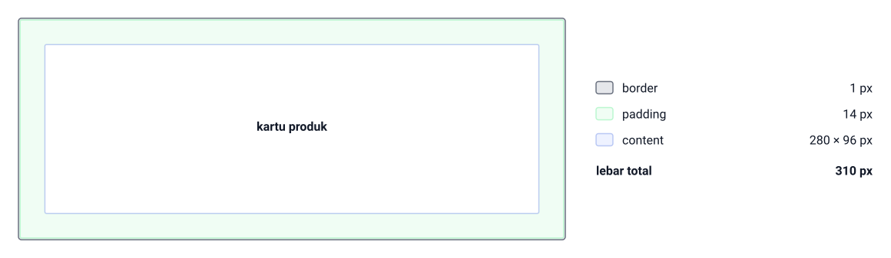

Halaman keranjang menyalin kartu produk dari halaman lama, tapi padding-nya ketik 14 px, bukan 16 px. Isinya tetap content 280 × 96 px dan border-nya tetap 1 px, jadi lebar totalnya 280 + 14 + 14 + 1 + 1 = 310 px, sedangkan kartu aslinya 314 px. Selisih 4 px itu nggak kelihatan mata, dan di situlah penyalinan navbar, kartu, dan footer ke empat halaman mulai bocor.

<!--
Minta kelas menghitung dulu sebelum menebak: dengan padding 14 px, lebar total kartu produk jadi berapa. Jawaban yang diharapkan: 310 px, yaitu 280 + 14 + 14 + 1 + 1, empat piksel lebih ramping dari kartu aslinya. Tunjuk label padding di daftar kanan gambar, lalu tanyakan apa yang terjadi kalau empat halaman baru menyalin tiga komponen dengan cara yang sama.
-->

---

<!-- _class: section -->
<!-- _footer: '' -->

# Mengapa CSS Framework

## Kerangka buat pola yang berulang

<!--
Transisi dari keluhan tim menuju pertanyaan yang lebih besar: bolehkah kita memakai
kerangka yang udah jadi? Tahan dulu soal Bootstrap; bagian ini cuma membangun
alasannya. Katakan bahwa jawabannya disusun pelan-pelan sepanjang bab.
-->

---

# Apa Itu CSS Framework

- Kumpulan aturan CSS siap pakai berbentuk file pustaka
- Dilengkapi pola penamaan kelas yang konsisten
- Layout dibentuk dengan menambah kelas di HTML
- Bukan menulis ulang aturan gaya dari nol
- Ada juga batasan yang harus kamu kenali

> Kayak kit furnitur siap rak, bukan menjahit dari pola kain.

<!--
Pakai analogi kit furnitur lawan menjahit dari pola kain; itu pegangan buat seluruh
bab. Tanyakan apa bedanya membentuk layout lewat kelas di HTML dengan menulis aturan
gaya sendiri. Jawaban yang diharapkan: kelas jadi lebih cepat, tapi aturannya
tersimpan di file pustaka, bukan di file kita.
-->

---

# Contoh: Apa Itu CSS Framework

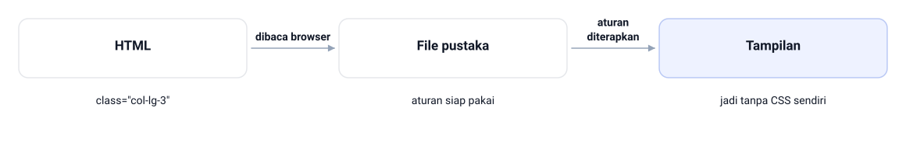

Di landing page Tokosaya, satu baris `<div class="col-lg-3">` sudah cukup: HTML cuma menyebut nama kelas, file pustaka memegang aturan siap pakai buat kelas itu, dan tampilan kartu jadi tanpa CSS sendiri. Kelas di HTML dibaca browser, lalu aturan diterapkan dari file pustaka ke elemennya.

<!--
Telusuri gambar dari kiri ke kanan bareng kelas. Tanyakan siapa yang menyimpan aturannya: file kita atau file pustaka. Jawaban yang diharapkan: file pustaka, karena HTML cuma menyebut nama kelas `col-lg-3` dan nggak ada satu aturan CSS pun yang ditulis di proyek Tokosaya buat kolom itu. Tutup dengan mengingatkan bahwa inilah bedanya dengan menulis gaya dari nol.
-->

---

# Manfaat Memakai Framework

- Efisiensi waktu: kartu dan kolom cukup lewat kelas
- Konsistensi: seluruh tim memakai skala jarak yang sama
- Pola responsif teruji: breakpoint rapi, bug layout berkurang
- Dokumentasi lengkap: jawaban biasanya sudah tersedia

> Dua halaman yang ditulis orang berbeda tetap terasa serumpun.

<!--
Tekankan dua manfaat yang paling terasa di proyek tim: konsistensi skala dan pola
responsif yang udah disaring pemakaian luas. Tanyakan kenapa konsistensi penting di
sistem informasi dengan puluhan tampilan. Jawaban yang diharapkan: halaman yang
ditulis orang berbeda tetap terasa serumpun.
-->

---

# Contoh: Manfaat Memakai Framework


Dua orang di tim yang sama menulis kartu produk untuk dua halaman berbeda: Penulis A dan Penulis B. Dua-duanya mendarat di angka yang sama — content 280 × 96 px, padding 16 px, border 1 px, lebar total 314 px, hasil 280 + 16 + 16 + 1 + 1. Angkanya sama karena `p-3` sudah membawa skala 3 alias 1 rem, bukan karena kesepakatan lisan di grup chat.

<!--
Tanyakan apa yang bikin Penulis A dan Penulis B mendarat di 314 px yang sama, padahal dua-duanya menulis di halaman berbeda. Jawaban yang diharapkan: kelas `p-3` sudah membawa skalanya sendiri, jadi nggak ada yang menebak 14 atau 18 px. Bandingkan baris nomor 1 sampai 4 di kedua panel gambar — isinya sama persis dari atas ke bawah, dan itulah bukti angkanya nggak bergantung pada siapa yang menulis. Tutup dengan manfaat yang paling terasa di tim: halaman yang ditulis orang berbeda tetap terasa serumpun.
-->

---

# Batasan yang Perlu Dipertimbangkan

- Tampilan cenderung seragam dan identitas merek bisa luntur
- File gaya lebih besar dari yang sebenarnya dibutuhkan
- Ada biaya belajar ejaan dan pola nama kelas
- Rupa dan struktur mulai bercampur di HTML

> Salah eja kelas punya efek senyap: markup tampak benar, gaya nggak muncul.

<!--
Bahas batasannya dengan jujur, jangan cuma menjual enaknya. Tanyakan apa risiko
kesalahan eja kelas pada markup yang tampak benar. Jawaban yang diharapkan: efeknya
senyap, gaya cuma nggak muncul dan susah dicari. Ingatkan bahwa identitas merek bisa
luntur kalau nggak ditimpa dengan CSS kustom.
-->

---

# Contoh: Batasan yang Perlu Dipertimbangkan

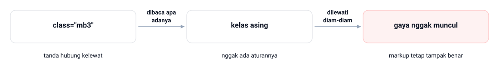

Salah ketik satu tanda hubung: `class="mb3"` bukannya `mb-3`. Kelas itu dibaca apa adanya sebagai kelas asing, nggak ada aturannya di file pustaka, jadi dilewati diam-diam dan gaya nggak muncul — padahal markup tetap tampak benar di editor. Efek senyap inilah yang bikin salah eja kelas susah dicari.

<!--
Tanyakan kenapa efeknya disebut senyap: apa yang terlihat di editor saat kelasnya salah. Jawaban yang diharapkan: markup tetap tampak benar, dan yang hilang cuma gayanya. Tunjuk urutan panah di gambar — class="mb3" dengan tanda hubung kelewat, dibaca sebagai kelas asing, lalu dilewati diam-diam — lalu minta kelas menyebutkan cara paling cepat menemukannya, yaitu memeriksa gaya elemen di DevTools.
-->

---

# Kapan Sebaiknya Menulis CSS Sendiri

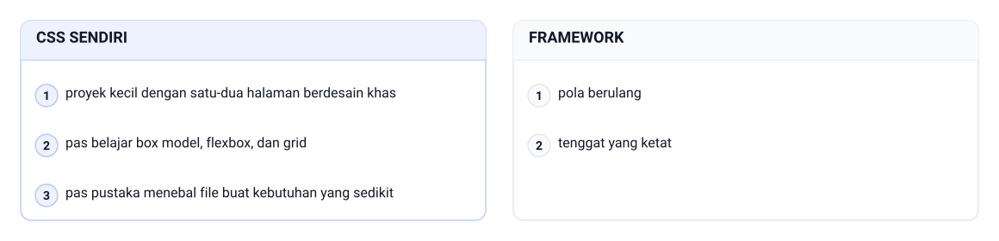

> Bab 1 sampai 8 sengaja tanpa framework biar dasarnya kuat.

<!--
Tegaskan bahwa Bab 1 sampai 8 sengaja tanpa framework supaya box model, flexbox, dan
grid dipahami dari akarnya. Tanyakan kapan justru lebih baik menulis CSS sendiri.
Jawaban yang diharapkan: proyek kecil berdesain sangat khas, atau pas pustaka cuma
menambah berat file tanpa banyak menolong.

Pegangan yang dipakai di slide, sisi CSS sendiri: proyek kecil dengan satu-dua halaman
berdesain khas, pas belajar box model, flexbox, dan grid, dan pas pustaka menebal file
buat kebutuhan yang sedikit. Sisi framework cuma dua: pola berulang dan tenggat yang
ketat.

Satu hal yang sengaja tidak masuk gambar: CSS kustom tetap dipakai buat identitas yang
harus tetap khas, karena bagian itulah yang tidak boleh diserahkan ke pustaka.

Tanyakan lagi: kalau proyeknya kecil tapi tenggatnya ketat, mana yang menang? Jawaban
yang diharapkan: pola berulang ditangani framework, identitas khas tetap ditulis
sendiri.
-->

---

<!-- _class: section -->
<!-- _footer: '' -->

# Bootstrap 5 dan Arsitekturnya

## Kenali alatnya sebelum dipakai

<!--
Masuk ke alat yang akan dipakai sepanjang babak kedua. Katakan bahwa kita mengenal
pustakanya dulu sebelum menyentuh kode. Sebutkan bahwa peta fasilitas di bagian ini
membuat kita tahu ke mana mencari kalau suatu gaya nggak muncul.
-->

---

# Apa Itu Bootstrap 5

- CSS framework open-source yang lahir dari proyek Twitter
- Dibuat Mark Otto dan Jacob Thornton, rilis 2011
- Versi 5 terbit 2021, buku ini terkunci di 5.3.3
- Dokumentasi resminya lengkap dan ramah pemula
- Pemasangan lewat CDN sangat sederhana
- Pola nama kelasnya mudah dibaca buat belajar

> Bootstrap itu alat bantu, bukan bos yang mengatur semuanya.

<!--
Sebutkan asal-usulnya singkat saja; yang lebih penting adalah versi terkunci 5.3.3.
Tanyakan kenapa dokumentasi yang lengkap itu penting buat pemula. Jawaban yang
diharapkan: pas bingung dengan sebuah kelas, jawabannya biasanya udah tersedia,
jadi waktu mencari solusi lebih hemat.
-->

---

# Contoh: Apa Itu Bootstrap 5

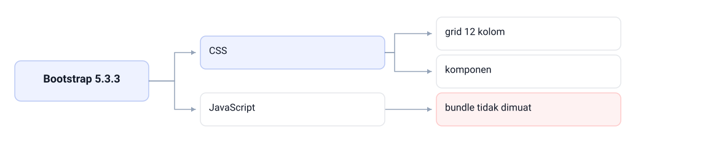

Satu paket Bootstrap 5.3.3 isinya dua bagian. Bagian CSS menyumbang grid 12 kolom dan komponen kayak navbar, sedangkan bagian JavaScript dikemas di file `bootstrap.bundle` dan di buku ini bundle tidak dimuat sama sekali. Jadi yang kita pakai cuma separuh paketnya, dan itu keputusan sadar yang ditulis di head.

<!--
Tanyakan versi mana yang dikunci buku ini, lalu tunjukkan angkanya di akar gambar: 5.3.3, bukan 5 terbaru. Lanjutkan ke dua cabangnya. Tanyakan bagian mana yang kita pakai dan bagian mana yang sengaja ditinggal; jawaban yang diharapkan: CSS-nya dipakai lewat CDN, sedangkan bundle JavaScript-nya nggak dimuat, padahal di situ menu lipat dan modal hidup.
-->

---

# Dua Cara Memperoleh Pustaka

- Unduh filenya lalu simpan di folder proyek
- Atau pasang link langsung dari server CDN
- CDN: jaringan penyaji file statis lewat URL link
- Buat pembelajaran, CDN lebih praktis tanpa instalasi
- Kelemahannya butuh jaringan internet; nilai integrity dicek di dokumentasi

```text
https://cdn.jsdelivr.net/npm/bootstrap@5.3.3/dist/css/bootstrap.min.css
```

`File: tokosaya-bootstrap/index.html (link CDN Bootstrap 5.3.3)`

<!--
Tunjukkan URL CDN persis di slide dan minta mahasiswa menyalinnya utuh, jangan
mengetik ulang dari ingatan. Sebutkan kejujurannya: link murni demi keterbacaan,
jadi nilai integrity perlu dicek di dokumentasi resmi buat website sungguhan.
Tanyakan kapan sebaiknya mengunduh file dan menyimpannya di folder proyek.
-->

---

# Enam Kelompok Fasilitas


<!--
Peta enam kelompok ini berguna sebagai rujukan sepanjang Bab 9 sampai 12. Minta
mahasiswa menebak ke kelompok mana navbar dan ke kelompok mana `mb-3` sebelum kamu
jawab. Ikon nggak termuat di file CSS inti; Bootstrap Icons 1.11.3 punya link sendiri,
jadi pengingatnya diucapkan saja di kelas, nggak perlu memakan ruang slide.

Enam kelompok fasilitas Bootstrap 5 yang digambar, lengkap dengan isinya. Layout:
container dan grid system, inti bab ini. Content: reboot, tipografi, tabel, gambar, dan
kode. Forms: gaya elemen isian, dibangun penuh di Bab 11. Components: navbar, kartu,
badge, dan alert. Helpers: kelas bantu kombinasi kayak clearfix. Utilities: kelas kecil
buat jarak, tampilan, warna.

Jawaban dua tebakan tadi: navbar masuk Components, `mb-3` masuk Utilities. Dua itulah
yang paling sering keliru di kelas.
-->

---

<!-- _class: compact -->

# Starter Template Bootstrap 5.3.3

```html
<!DOCTYPE html>
<html lang="id">
<head>
  <meta charset="UTF-8">
  <meta name="viewport" content="width=device-width, initial-scale=1.0">
  <title>Tokosaya — Belanja Tepat, Kirim Cepat</title>
  <!-- Bootstrap 5.3.3 — CSS via CDN -->
  <link rel="stylesheet" href="https://cdn.jsdelivr.net/npm/bootstrap@5.3.3/dist/css/bootstrap.min.css">
  <!-- Bootstrap Icons 1.11.3 -->
  <link rel="stylesheet" href="https://cdn.jsdelivr.net/npm/bootstrap-icons@1.11.3/font/bootstrap-icons.css">
  <!-- Tanpa bootstrap.bundle (JavaScript di luar cakupan mata kuliah) -->
  <!-- Google Fonts: Poppins (heading) + Inter (isi) -->
  <link href="https://fonts.googleapis.com/css2?family=Poppins:wght@400;500;600;700&family=Inter:wght@400;500;600&display=swap" rel="stylesheet">
  <!-- CSS kustom Tokosaya — selalu dimuat setelah Bootstrap -->
  <link rel="stylesheet" href="css/style.css">
</head>
```

`File: tokosaya-bootstrap/index.html (versi template dasar)`

- Urutannya dijaga: Bootstrap, Icons, Fonts, lalu kustom
- `css/style.css` paling belakang supaya menang di kaskade

<!--
Jalankan template ini di layar dan tunjukkan tombol uji `.btn-primary` yang tampil
biru bawaan; itu tanda stylesheet termuat. Tekankan dua hal: komentar penanda tanpa
bundle, dan `css/style.css` yang wajib paling belakang. Tanyakan apa yang terjadi
kalau urutan link-nya tertukar.
-->

---

# Tanpa Satu Baris JavaScript

- File bundle JavaScript menghidupkan menu lipat dan modal
- Buku ini nggak memuat satu baris JavaScript pun
- Komponen interaktif dipelajari sebagai markup dan status statis
- Navigasi mobile diupayakan lewat CSS kustom
- Komentar penanda tanpa bundle disimpan di setiap head

> Itu keputusan sadar yang ditulis di markup, bukan kelalaian.

<!--
Ini bagian yang paling terus terang di bab ini, jadi jangan diburu-buru. Katakan apa
adanya: bundle JavaScript memang menghidupkan menu lipat dan modal di dunia nyata,
tapi mata kuliah ini berpijak pada HTML dan CSS murni. Tanyakan kenapa komentar
penandanya disimpan di setiap head; jawaban yang diharapkan: biar pembaca kode tahu
itu keputusan sadar, bukan lupa.
-->

---

# Contoh: Tanpa Satu Baris JavaScript

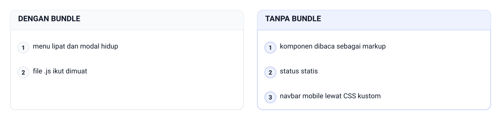

Dengan bundle, menu lipat dan modal hidup karena ada JavaScript yang mengurus statusnya; tanpa bundle, komponen dibaca sebagai markup dan status statis. Bedanya cuma file `.js` ikut dimuat atau tidak — dan Tokosaya versi 2 memilih sisi kanan: navbar mobile lewat CSS kustom.

<!--
Tanyakan apa yang sebenarnya hilang kalau bundle nggak dimuat. Jawaban yang diharapkan: cuma interaksinya — menu lipat dan modal nggak hidup — sedangkan gaya dan layoutnya utuh. Tunjuk dua panel gambar dan minta kelas memilih sisi mana yang dipakai buku ini, lalu tanyakan kenapa keputusan itu ditulis sebagai komentar penanda di setiap head.
-->

---

<!-- _class: section -->
<!-- _footer: '' -->

# Container dan Grid 12 Kolom

## Menata tulang halaman dengan kelas jadi

<!--
Pindah dari soal pustaka ke soal tulang halaman. Katakan bahwa container dan grid
adalah dua hal yang paling sering dipakai di praktikum. Sebutkan bahwa semuanya
nanti cuma ditulis sebagai kelas di HTML.
-->

---

# Container dan Container Fluid

- Container itu wadah horizontal pembungkus isi halaman
- `.container` membatasi lebar maksimum lalu menengahkan isi
- `.container-fluid` memakai lebar penuh 100% di semua ukuran
- Ada penengah `.container-md`: penuh sampai ambang tertentu
- Teks terlalu lebar melemahkan keterbacaan pembaca

> Bilah pengumuman dan footer gelap cocok pakai container-fluid.

<!--
Tanyakan mana yang lebih nyaman buat paragraf panjang: lebar penuh atau lebar
terbatas. Jawaban yang diharapkan: lebar terbatas, karena baris yang terlalu panjang
melemahkan keterbacaan. Sebutkan bahwa footer gelap dan bilah pengumuman justru
cocok pakai container-fluid.
-->

---

# Contoh: Container dan Container Fluid


Di layar 1200 px, `.container` cuma memakai 1140 px: isi halaman 1140 px, margin 30 px kiri dan 30 px kanan, jadi lebar total 1140 + 30 + 30 = 1200 px. `.container-fluid` nggak punya batas itu: isi halaman 1200 px selebar layar, margin 0 px kiri dan 0 px kanan, jadi lebar total 1200 px. Baris nomor 1 sampai 3 di gambar membandingkan dua-duanya pada sumbu yang sama — isi halaman, margin, lalu lebar total.

<!--
Tanyakan berapa bagian kosong di kiri dan kanan saat layar 1200 px; jawaban yang diharapkan: 30 px di masing-masing sisi, karena 1200 − 1140 = 60 lalu dibagi dua. Tunjuk baris margin di panel kiri, lalu baris yang sama di panel kanan yang isinya 0 px — bedanya cuma satu batas, bukan fitur tambahan. Tutup dengan menanyakan kenapa bilah pengumuman dan footer gelap justru lebih cocok `container-fluid`.
-->

---

# Lebar Maksimum Container

| Ambang viewport | Lebar maksimum `.container` |
|---|---|
| ≥ 576 px (sm) | 540 px |
| ≥ 768 px (md) | 720 px |
| ≥ 992 px (lg) | 960 px |
| ≥ 1200 px (xl) | 1140 px |
| ≥ 1400 px (xxl) | 1320 px |

- Di bawah 576 px container tampil lebar penuh
- Enam nama breakpoint: xs, sm, md, lg, xl, xxl
- Kelas responsif bekerja mobile-first dan berlaku ke atas

<!--
Jangan minta mahasiswa menghafal angka-angkanya; cukup tunjukkan polanya, makin
lebar layar makin lebar batasnya. Tanyakan berapa lebar maksimum container di layar
1000 px. Jawaban yang diharapkan: 960 px, karena breakpoint lg aktif mulai 992 px.
Ingatkan pengecualiannya: `.container-fluid` selalu penuh.
-->

---

# Tiga Lapis Grid

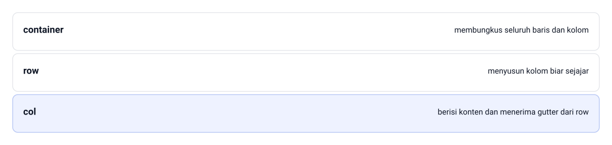

> Angka 12 kaya faktor, jadi hampir semua layout bisa diwakili.

<!--
Pakai bayangan penggaris 12 garis; itu cara paling gampang menjelaskan grid.
Tanyakan kenapa angkanya 12, bukan 10. Jawaban yang diharapkan: 12 kaya faktor,
jadi setengah, sepertiga, seperempat, dan seperenam semuanya pas. Sebutkan pola 8+4
yang sering dipakai buat sidebar laporan.

Tiga lapis yang digambar, dari luar ke dalam: container membungkus seluruh baris dan
kolom; row menyusun kolom biar sejajar dalam satu baris; col berisi konten dan menerima
gutter dari row.

Dua hal yang tidak masuk gambar: setiap row dibayangkan sebagai penggaris 12 garis, dan
kombinasi lazimnya 6+6, 4+4+4, 3×4, 2×6, 8+4. Sebutkan pola 8+4 buat sidebar laporan
sebagai contoh konkretnya.
-->

---

# Kelas Kolom yang Wajib Diasah

- `col-12` — kolom penuh pada semua ukuran layar
- `col-md-6` — setengah lebar mulai 768 px ke atas
- `col-lg-3` — seperempat lebar mulai 992 px ke atas
- `col` tanpa angka membagi lebar secara merata
- `col-auto` mengikuti lebar isi kolom
- `row-cols-*` membagi baris sama lebar tanpa kelas per kolom

<!--
Fokuskan ke tiga kelas yang wajib diasah, dan pastikan mahasiswa bisa membacanya
sebagai jumlah garis penggaris. Tanyakan arti `col-lg-3`. Jawaban yang diharapkan:
seperempat lebar mulai 992 px ke atas, yaitu 3 garis dari 12. Sebutkan `col-auto`
dan `row-cols-*` sebagai varian yang jarang tapi berguna.
-->

---

# Contoh: Kelas Kolom yang Wajib Diasah

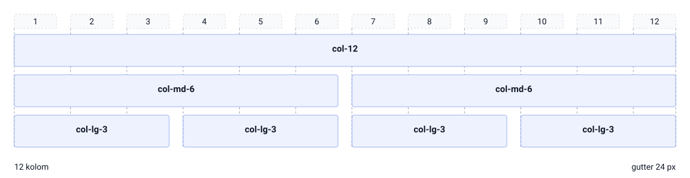

Satu baris kartu di container 1140 px: `col-12` menindih 12 kolom penuh, `col-md-6` dua kolom setengah, dan `col-lg-3` empat kolom seperempat — 4 × 3 = 12 kolom, pas habis. Gutter 24 px ikut dihitung di antara kolom, jadi lebar satu `col-lg-3` bukan 1140 dibagi empat, melainkan 267 px.

<!--
Minta kelas membaca tiap kelas sebagai jumlah garis penggaris: `col-md-6` berarti 6 dari 12. Jawaban yang diharapkan: setengah, jadi dua kartu per baris mulai 768 px. Lanjutkan ke baris ketiga gambar — empat `col-lg-3` menindih 3 garis masing-masing, 4 × 3 = 12 — lalu tanyakan ke mana gutter 24 px pergi, yaitu ke celah antarkolom.
-->

---

<!-- _class: compact -->

# Peta Perilaku Grid

```text
8 kartu produk, kelas col-12 col-md-6 col-lg-3

Ponsel (<768 px)   [ 100% ]              → 1 kartu per baris
Tablet (≥768 px)   [ 50% ][ 50% ]        → 2 kartu per baris
Desktop (≥992 px)  [25%][25%][25%][25%]  → 4 kartu per baris

Penggaris 12 garis: |--|--|--|--|--|--|--|--|--|--|--|--|
col-lg-3 menindih 3 garis; 4 kolom × 3 garis = 12 garis penuh.
```

- Kelas tanpa awalan menjadi dasar buat layar kecil
- Tiap breakpoint yang lebih besar menimpanya

<!--
Tunjukkan peta ini lalu minta mahasiswa menebak tampilan delapan kartu di tablet.
Jawaban yang diharapkan: dua kartu per baris, jadi empat baris. Tekankan urutan
mobile-first: kelas tanpa awalan jadi dasar, lalu tiap breakpoint yang lebih besar
menimpanya kalau kelasnya ada.
-->

---

# Kolom Wajib Anak Langsung dari row

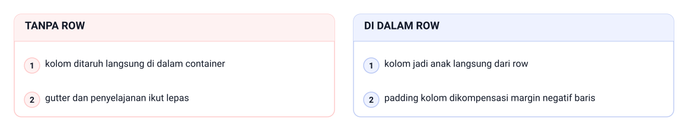

> Bungkus dulu kolomnya dengan row sebelum menulis kelas col.

<!--
Ini kesalahan paling sering pada pemula, jadi sisihkan waktu khusus. Tanyakan apa
yang lepas kalau kolom ditaruh langsung di dalam container. Jawaban yang diharapkan:
gutter nggak terbentuk karena padding kolom nggak lagi dikompensasi margin negatif
baris. Minta mahasiswa memeriksa sendiri struktur container, row, dan col.

Gambar di slide membandingkan dua susunan. Tanpa row: kolom ditaruh langsung di dalam
container, jadi gutter dan penyelajanan ikut lepas. Di dalam row: kolom jadi anak
langsung dari row, padding kolom dikompensasi margin negatif baris, jadi gutter
terbentuk dan kolom sejajar.

Ingatkan sekali lagi bahwa kesalahan ini begitu lumrah pada pemula, bukan tanda
kodenya rusak.
-->

---

<!-- _class: section -->
<!-- _footer: '' -->

# Utility, Warna, dan Identitas

## Kelas kecil, keputusan besar

<!--
Masuk ke kelompok kelas yang paling banyak dipakai sehari-hari. Katakan bahwa
utility itu sederhana, tapi keputusannya yang butuh kesadaran. Sebutkan bahwa
bagian ini juga membahas cara menjaga identitas Tokosaya di atas rupa bawaan.
-->

---

# Apa Itu Utility

- Kelas CSS kecil yang mengubah satu properti visual
- Satu kelas, satu maksud, tanpa aturan tambahan
- Contoh: `mb-3`, `p-4`, `text-center`, `d-none`
- Gaya sekali pakai nggak perlu menambah baris CSS
- Tetap lebih rapi daripada gaya inline

> Analoginya kayak label stiker: tempel, langsung berlaku.

<!--
Tekankan janji satu kelas satu maksud. Tanyakan kenapa utility masih lebih rapi
daripada menempel atribut `style` di elemen. Jawaban yang diharapkan: utility tetap
mengikuti skala dan nama yang seragam, sedangkan gaya inline tersebar dan susah
diaudit.
-->

---

# Contoh: Apa Itu Utility

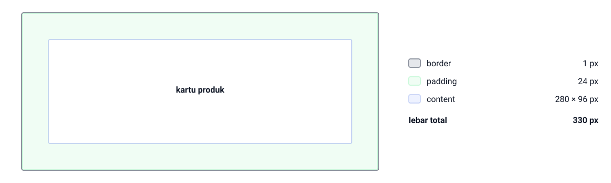

Satu kelas `p-4` di kartu produk menambah padding 24 px di keempat sisi, dan `border` menyumbang 1 px: content 280 × 96 px jadi 280 + 24 + 24 + 1 + 1 = 330 px lebar total. Nggak ada satu baris CSS baru di `style.css` — cuma dua kelas ditempel, dan kartunya langsung berubah.

<!--
Tanyakan berapa baris CSS yang ditulis di `style.css` buat perubahan ini; jawaban yang diharapkan: nol, karena `p-4` dan `border` sudah ada di file pustaka. Tunjuk baris padding 24 px lalu baris content di daftar kanan gambar, dan minta kelas menghitung sendiri lebar totalnya: 330 px. Tutup dengan menanyakan kenapa utility masih lebih rapi daripada atribut `style` yang ditempel langsung.
-->

---

# Pola Nama Kelas Utility

- Polanya: properti, sisi, breakpoint, lalu nilai
- `mb-3` berarti margin bawah skala 3
- `p-lg-4` berarti padding semua sisi mulai lg
- `d-md-block` berarti display block mulai md
- Huruf properti: p untuk padding, m untuk margin
- Huruf sisi: b bawah, t atas, x kiri-kanan, y atas-bawah

> Skala 0 sampai 5: angka 3 setara 1 rem, angka 5 setara 3 rem.

<!--
Ajari membacanya sebagai potongan, bukan hafalan: properti, sisi, breakpoint, nilai.
Minta mahasiswa mengartikan `p-lg-4` sebelum kamu jawab. Ingatkan bahwa skala 3
setara 1 rem, jadi masih bertalian dengan skala jarak 8 px dari bab sebelumnya.
-->

---

# Contoh: Pola Nama Kelas Utility

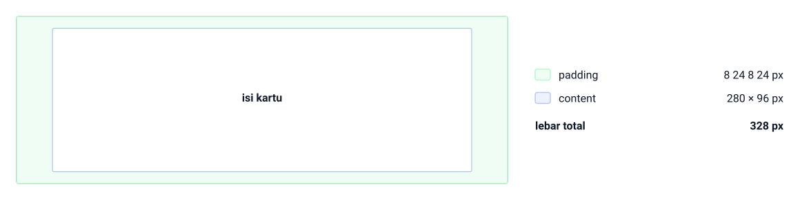

`px-4 py-2` dibaca sebagai potongan: p, x, lalu 4 berarti padding kiri-kanan skala 4 alias 24 px, sedangkan py-2 memberi 8 px atas-bawah. Hasilnya padding 8 24 8 24 px pada content 280 × 96 px — isi kartu yang sama — jadi lebar total 328 px dan tinggi total 112 px.

<!--
Baca kelasnya sebagai potongan, bukan hafalan: p dulu, lalu sisi x, lalu skala 4. Tanyakan kenapa padding kiri-kanan 24 px tapi atas-bawah cuma 8 px; jawaban yang diharapkan: angka 4 lebih besar dari 2, dan skalanya 1,5 rem lawan 0,5 rem. Tunjuk pita padding di gambar — tebal kiri-kanan jelas beda dari atas-bawah — lalu minta kelas menyebutkan arti `p-lg-4` dengan pola yang sama.
-->

---

# Utility Spacing dan Display

| Kelas | Arti | Perilaku |
|---|---|---|
| `mb-3` | margin-bottom skala 3 | jarak bawah 1 rem |
| `p-4` | padding keempat sisi skala 4 | jarak dalam 1,5 rem |
| `px-4 py-2` | padding kiri-kanan 4, atas-bawah 2 | jarak asimetris |
| `mx-auto` | margin kiri-kanan otomatis | elemen tampil di tengah |
| `d-flex` | display flex | anak elemen jadi item flex |

- `g-3` sampai `g-5` mengatur jarak antarkolom pada row

<!--
Bahas tabel ini pelan-pelan dan minta mahasiswa membaca tiap baris sebagai kalimat,
misal `mb-3` berarti margin bawah 1 rem. Tanyakan bedanya `p-4` dengan `px-4 py-2`.
Jawaban yang diharapkan: yang pertama keempat sisi sama, yang kedua horizontal lebar
dan vertikal rendah.
-->

---

# Menyembunyikan Elemen dengan d-none d-md-block

- `d-none` menyembunyikan elemen pada semua ukuran
- `d-md-block` memunculkannya kembali mulai 768 px
- Dua kelas berkolaborasi membentuk logika min-width
- Nggak perlu satu baris media query pun

> Pola ini layak dihafal karena banget sering dipakai di praktik.

<!--
Hati-hati di sini: dua kelas yang saling melengkapi sering bikin bingung kalau
dibaca terpisah. Tanyakan kenapa urutan `d-none` lalu `d-md-block` penting. Jawaban
yang diharapkan: yang menyembunyikan dipasang dulu, lalu yang memunculkan kembali
mulai 768 px, jadi perilakunya seperti min-width. Tunjukkan dengan mengubah lebar
jendela di layar.
-->

---

<!-- _class: compact -->

# Contoh: Menyembunyikan Elemen dengan d-none d-md-block

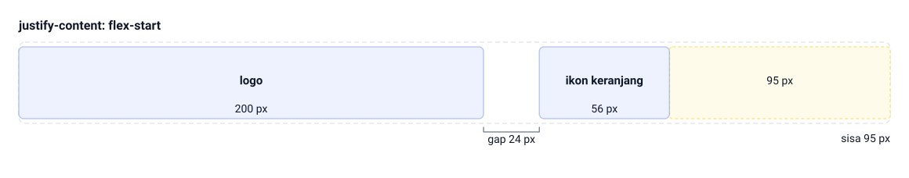

Di layar 375 px: logo 200 px + gap 24 px + ikon keranjang 56 px = 280 px, jadi sisa 95 px. Kotak pencarian disembunyikan karena butuh 400 px dan nggak kebagian tempat; mulai 768 px `d-md-block` memunculkannya lagi. `justify-content: flex-start` membiarkan sisa ruang itu menganggur, bukan melar — pita amber garis putus-putus di ujung kanan gambar itu ruang kosong, bukan butir ketiga, jadi butirnya tetap dua: logo dan ikon keranjang.

<!--
Tanyakan ke mana kotak pencarian pergi di layar 375 px. Jawaban yang diharapkan: disembunyikan `d-none`, bukan dikecilkan, jadi lebarnya nggak ikut dihitung. Tunjuk pita amber garis putus-putus 95 px di ujung kanan gambar: itu ruang kosong yang menganggur, bukan butir ketiga — butirnya cuma logo dan ikon keranjang. Sebut juga tanda gap 24 px di bawah pita, lalu tanyakan kenapa urutan `d-none` baru `d-md-block` penting saat jendela browser dilebarkan.
-->

---

# Utility Tipografi

- `fs-1` sampai `fs-6` sebanding hierarki h1 sampai h6
- `display-1` sampai `display-6` buat judul berukuran menonjol
- `lead` buat paragraf pengantar yang lebih besar
- `fw-normal`, `fw-semibold`, `fw-bold` mengatur tebal huruf
- `text-start`, `text-center`, `text-end` mengatur perataan teks
- Judul tetap pakai elemen h1 sampai h6 yang semantik

> `h3 class="fs-5"` mengubah ukuran tanpa merusak struktur.

<!--
Tekankan aturan aksesibilitas yang tetap berlaku: judul tetap pakai elemen h1 sampai
h6 semantik, kelas ukuran cuma menempel. Tanyakan kenapa `div` besar dengan `fs-1`
bukan judul yang benar. Jawaban yang diharapkan: pembaca layar nggak membacanya
sebagai kepala bagian.
-->

---

# Contoh: Utility Tipografi

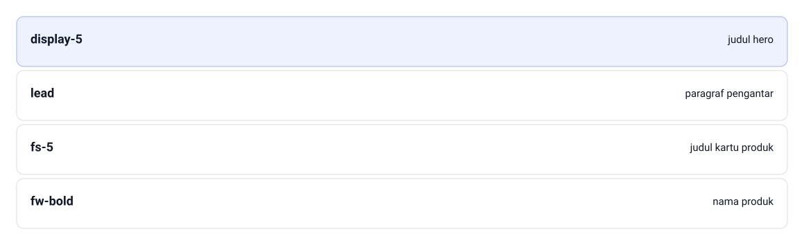

Hero Tokosaya ditulis sebagai tiga lapis ukuran, dan gambar menyusunnya dari yang paling menonjol ke bawah: `display-5` buat judul hero, `lead` buat paragraf pengantar, lalu `fs-5` buat judul kartu produk. Nama produk bukan lapis keempat — `fw-bold` itu bobot huruf, bukan ukuran, jadi dia nggak ikut tangga. Elemennya tetap `<h2>` dan `<h3>` yang semantik — kelasnya cuma menempel, jadi pembaca layar tetap tahu mana kepala bagian.

<!--
Tanyakan lapis mana yang paling atas di gambar; jawaban yang diharapkan: `display-5`, karena lapis itu yang dipakai buat judul hero — yang paling besar dan paling menonjol di halaman. Lanjutkan ke `fs-5` yang dipakai di judul kartu produk: ukurannya turun, tapi elemennya tetap `<h3>` yang semantik. Tutup dengan dua pertanyaan aksesibilitas: kenapa `div` besar berkelas `display-5` bukan judul yang benar, dan kenapa `fw-bold` nggak pernah masuk tangga ukuran.
-->

---

# Utility atau CSS Kustom

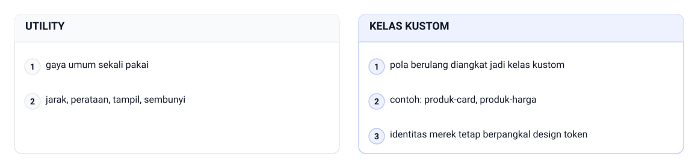

> Belasan kelas utility di satu elemen itu sinyal bahaya.

<!--
Pakai tiga aturan sederhana ini sebagai rambu praktikum. Tanyakan tanda bahaya apa
yang muncul kalau satu elemen punya belasan kelas utility. Jawaban yang diharapkan:
polanya berulang, jadi sebaiknya diangkat jadi kelas kustom `blok-elemen`. Ingatkan
bahwa identitas tetap berpangkal design token di `:root`.

Aturan yang digambar, sisi utility: utility buat gaya umum sekali pakai, yaitu jarak,
perataan, tampil, sembunyi, dan warna semantik. Sisi kelas kustom: pola berulang
diangkat jadi kelas kustom, contoh: `produk-card`, `produk-harga`, dan identitas merek
tetap berpangkal design token di `:root`.

Minta mahasiswa menandai satu elemen di `index.html` praktikum yang kelasnya sudah
lebih dari lima, lalu putuskan bersama apakah polanya berulang atau tidak.
-->

---

# Palet Bootstrap Bukan Palet Tokosaya

- Kelas warna semantik: primary, success, danger, warning
- Namanya peran warna, bukan nama warna mentah
- Warna primary bawaan Bootstrap itu biru, bukan indigo
- Amber Tokosaya juga beda dari kuning bawaan
- `text-*`, `bg-*`, dan `text-bg-*` buat teks, latar, badge
- `text-danger` berarti pesan bahaya, bukan merah tertentu

> Palet indigo-amber sudah jadi identitas Tokosaya sejak Bab 4.

<!--
Tanyakan warna primary bawaan Bootstrap itu apa; jawaban yang diharapkan: biru,
bukan indigo Tokosaya. Tekankan bahwa nama kelas warna itu peran, bukan warna
mentah, sehingga `text-danger` dibaca sebagai pesan bahaya. Dari sini alasan overlay
jadi jelas.
-->

---

# Contoh: Palet Bootstrap Bukan Palet Tokosaya

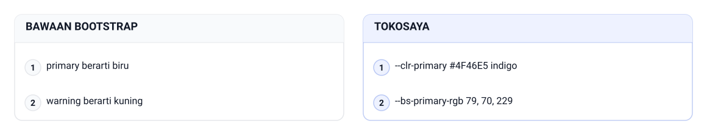

Di Bootstrap, primary berarti biru dan warning berarti kuning — bukan indigo dan amber Tokosaya. Palet Tokosaya menggeser dua peran yang sama itu: primary jadi indigo #4F46E5 dan warning jadi amber, dijajarkan baris per baris di gambar supaya kelihatan bahwa yang digeser peran yang sama, bukan kelas baru. Yang menggeser cuma dua token di `:root`: `--clr-primary` #4F46E5 (indigo Tokosaya) dan `--bs-primary-rgb` 79, 70, 229, dua-duanya ditulis di `css/style.css` yang termuat setelah Bootstrap.

<!--
Tanyakan warna `text-primary` bawaan Bootstrap itu apa; jawaban yang diharapkan: biru, bukan indigo Tokosaya. Lanjutkan ke `text-warning` yang kuning, bukan amber. Tunjuk baris 1 di kedua panel gambar — primary berarti biru di kiri, primary jadi indigo #4F46E5 di kanan — lalu baris 2 dengan pergeseran yang sama untuk warning. Kata kuncinya dua token, bukan sepuluh; tutup dengan kenapa `css/style.css` harus termuat setelah Bootstrap.
-->

---

<!-- _class: compact -->

# Overlay CSS Kustom

```css
/* kustom — overlay dua token utama Tokosaya di atas Bootstrap */
:root {
  --clr-primary: #4F46E5;
  --clr-primary-dark: #4338CA;
  /* menyelaraskan warna primary Bootstrap (kelas text-*, bg-*) */
  --bs-primary-rgb: 79, 70, 229;
}

/* tombol utama Tokosaya dibentuk dari kelas btn + kelas kustom */
.btn-tokosaya {
  background-color: var(--clr-primary);
  border-color: var(--clr-primary);
  color: #FFFFFF;
}
```

`File: tokosaya-bootstrap/css/style.css (cuplikan overlay)`

- `css/style.css` termuat setelah Bootstrap biar menang di kaskade
- `--bs-primary-rgb` menggeser kelas warna ke indigo Tokosaya

<!--
Bacakan cuplikan ini baris demi baris dan tunjukkan bahwa cuma dua token yang
digeser. Tanyakan kenapa `css/style.css` harus termuat setelah Bootstrap. Jawaban
yang diharapkan: pas specificity setara, aturan yang termuat belakangan menang.
Ingatkan bahwa variabel tema bisa bergeser antar rilis, jadi tombol khas sengaja
dibentuk kelas kustom yang eksplisit.
-->

---

<!-- _class: compact -->

# Bootstrap vs Tailwind CSS

| Aspek | Bootstrap 5.3 | Tailwind CSS 3.x |
|---|---|---|
| Filosofi | komponen siap pakai | utility-first kelas atomik |
| Komponen siap pakai | banyak sekaligus | disusun sendiri |
| Proses pembangunan | cukup link CDN | lazim dengan alat pembangun |
| Identitas merek | perlu overlay kustom | bebas bentuk, markup ramai |
| Kurva awal pemula | landai, kelas terbaca | curam, hafalan pola |

- Buku ini memilih Bootstrap karena dokumentasinya ramah pemula

<!--
Soalnya bukan memilih pemenang, tapi mengenali filosofinya. Tanyakan kapan
utility-first seperti Tailwind justru merepotkan pemula. Jawaban yang diharapkan:
markupnya jadi ramai karena satu elemen bisa menanggung banyak kelas atomik.
Sebutkan bahwa buku ini cuma mengenalkan namanya, tanpa contoh kode.
-->

---

<!-- _class: compact -->

# Praktikum: Tujuan dan Persiapan

- Bangun ulang landing page Tokosaya versi 2
- Folder baru `tokosaya-bootstrap/` dengan `css/` dan `img/`
- Salin aset gambar baku dari proyek `tokosaya-css/`
- Tulis dulu tiga poin layout di selembar kertas
- Siapkan data 8 produk baku dari tabel §5.2
- Hasil: satu `index.html` responsif tanpa JavaScript

<!--
Jangan cuma membacakan; buka folder proyeknya dan tunjukkan strukturnya. Ingatkan
untuk menulis tiga poin layout di kertas sebelum menyentuh kode. Tanyakan kenapa
aset gambar dari proyek `tokosaya-css/` bisa dipakai ulang; jawabannya karena nama
filenya udah baku.
-->

---

<!-- _class: compact -->

# Praktikum: Langkah Pertama

- Tulis `index.html` mengikuti starter template 9.3
- Tambahkan navigasi statis dengan navbar dan ikon keranjang
- Bangun hero dengan `display-5`, `lead`, dan tombol `hero-cta`
- Susun section keunggulan dengan tiga ikon `text-primary`

<!--
Jalankan langkah ini sambil didemokan di layar. Berhenti agak lama di starter
template karena kesalahan urutan link paling banyak terjadi di situ. Pastikan
tombol uji `.btn-primary` tampil bergaya sebelum mahasiswa lanjut ke markup panjang.
-->

---

<!-- _class: compact -->

# Praktikum: Langkah Lanjutan

- Susun grid produk: delapan kartu `col-12 col-md-6 col-lg-3`
- Tutup dengan footer tiga kolom dan baris tagline
- Tulis `css/style.css`: token, hero, kartu, tombol, footer
- Uji responsif di 375 px, 768 px, dan 1200 px

<!--
Bagian ini yang paling padat, jadi dampingi mahasiswa di grid produk. Tanyakan
kenapa kartu pakai `col-12 col-md-6 col-lg-3`, bukan satu kelas saja. Jawaban yang
diharapkan: satu kelas cuma melayani satu breakpoint, sedangkan pola ini melayani
HP, tablet, dan desktop sekaligus.
-->

---

# Latihan

- Uraikan tiga alasan memakai framework dan dua batasannya
- Ubah `latihan-grid.html` jadi layout laporan 8+4 mulai `xl`
- Terjemahkan `px-4`, `mt-auto`, `d-none d-md-block`, dan `g-4`
- Rancang galeri UMKM: 1 kolom di HP, 2 mulai md, 4 mulai xl
- Perbaiki `col-md-4` yang berdiri langsung di dalam container

> Jelaskan alasannya, bukan cuma nama kelasnya.

<!--
Kerjakan butir pertama bareng-bareng di papan, sisanya buat latihan mandiri.
Perhatikan butir kelima: tujuannya menyadari struktur container, row, dan col, bukan
mencari jawaban benar. Tanyakan apa yang terjadi pada gutter kalau kolom ditaruh
langsung di dalam container.
-->

---

# Cek Daftar Praktikum

- Kedua link CDN CSS sukses termuat di tab Network
- Navigasi punya lima item dengan ikon keranjang
- Hero menampilkan judul, subjudul, dan tombol amber
- Delapan kartu tampil 1, 2, lalu 4 per baris
- Ikon keunggulan dan badge Baru tampil indigo
- Nggak ada satu pun file `.js` di folder proyek

<!--
Gunakan daftar ini buat memeriksa hasil praktikum, bukan buat dibaca saja. Minta
mahasiswa menunjukkan buktinya langsung di browser dan di tab Network. Tanyakan
langkah pertama yang dilakukan kalau halaman tampak polos; jawaban yang diharapkan:
periksa kedua link CDN dan urutan pemuatannya.
-->

---

# Rangkuman

- CSS framework mempercepat gaya dan menyelaraskan kelas
- Bootstrap 5.3.3 dipakai hanya file CSS-nya lewat CDN
- Tanpa bundle JavaScript, dengan komentar penanda di head
- Container mengatur lebar; breakpoint bekerja mobile-first
- Grid 12 kolom: `col-12 col-md-6 col-lg-3` buat 1/2/4 kartu
- Utility satu properti; identitas tetap di overlay token

<!--
Tutup dengan pesan utama: kerangka buat pola yang berulang, sedangkan kelas kustom
dan design token buat identitas. Sebutkan bahwa Bab 10 mengubah pola yang sama jadi
komponen visual siap pakai. Ingatkan bahwa batasnya tetap sama: tampilannya indah,
tetap statis, dan tanpa satu baris JavaScript.
-->

---

<!-- _class: lead -->
<!-- _footer: '' -->

# Tugas dan Refleksi

Buat tabel 10 pilihan gaya dari `index.html` Praktikum: tandai sekali pakai atau berulang, lalu putuskan utility atau kelas kustom dengan satu kalimat alasan.

**Pertanyaan refleksi:** kenapa buku ini memilih tanpa bundle JavaScript?

<!--
Tugas individunya mengumpulkan tabel sepuluh pilihan gaya plus satu paragraf
simpulan. Nilai alasannya, bukan nama kelasnya, dan pastikan minimal tiga argumen
mengutip konsistensi token Tokosaya. Tekankan bahwa keputusannya nggak boleh
seragam semuanya satu tipe.
-->
