<!-- _class: lead -->
<!-- _paginate: skip -->
<!-- _footer: '' -->

# Form dan User Interface Design

**Bab 11** · Merancang pintu masuk data yang jelas

Studi kasus: **Tokosaya**

<!--
Buka dengan mengingatkan posisi bab ini: Bab 10 menutup halaman katalog berbasis
Bootstrap, dan sekarang kita menambah halaman keranjang serta membangun ulang
halaman kontak. Katakan bahwa bab ini bukan soal komponen baru, tapi soal
keputusan desain yang bikin form enak dipakai. Sebutkan bahwa Bab 12 bakal
merangkum semua keputusan visual ini jadi design system.
-->

---

# Tujuan Pembelajaran

Setelah menyelesaikan bab ini, kamu bisa:

- Empat prinsip desain form dan alasan di baliknya
- Elemen form HTML5: label, input, select, checkbox, radio, fieldset
- Kelas form Bootstrap pada halaman kontak Tokosaya
- Layout form dua kolom yang responsif di HP
- Status visual statis dan pesan validasi di dekat medan
- Checklist aksesibilitas: label, urutan tab, autocomplete

<!--
Bacakan tujuan ini singkat, lalu tekankan bahwa semuanya bisa dicapai cuma dengan
HTML, CSS, dan kelas Bootstrap. Tanyakan siapa yang pernah isi form online dan
berhenti di tengah jalan karena bingung. Jawaban itu jadi pembuka yang bagus buat
bagian prinsip desain.
-->

---

# Rani dan Form yang Bikin Ragu

- Rani membeli flash drive dan keyboard buat tugas akhir
- Di checkout, kolom nama nggak punya label
- Nomor telepon nggak ada petunjuk format
- Pesan kupon cuma berbunyi "error kode 7"
- Dua kali salah mengetik email, transaksi batal

> Sistem informasi hidup dari data, dan form adalah pintu masuk data itu.

<!--
Ceritakan alur Rani pelan-pelan, jangan buru-buru ke solusi teknis. Tanyakan
bagian mana yang paling bikin Rani ragu, dan biarkan mahasiswa menyebutkan
label serta pesan error sendiri. Tutup dengan menegaskan bahwa masalahnya
bukan teknologi, tapi desain yang nggak rapi.
-->

---

# Contoh: Rani dan Form yang Bikin Ragu

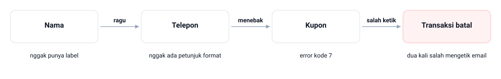

Di checkout Tokosaya, Rani melewati tiga kegagalan berurutan: kolom Nama nggak punya label, Telepon nggak ada petunjuk format, dan pesan Kupon cuma berbunyi "error kode 7". Tiap langkah bikin dia ragu lalu menebak, sampai dua kali salah mengetik email dan Transaksi batal.

<!--
Telusuri rantai di gambar dari kiri ke kanan: satu salah ketik kecil menular ke
langkah berikutnya, dan ujungnya transaksi batal. Tanyakan di langkah mana Rani
sebenarnya masih bisa diselamatkan, lalu minta kelas menunjuk satu perbaikan
termurah di rantai itu. Jawaban yang diharapkan: label dan petunjuk format, dua
hal yang nggak butuh satu baris JavaScript pun.
-->

---

<!-- _class: section -->
<!-- _footer: '' -->

# Prinsip Desain Form

## Empat keputusan yang menentukan formmu dipakai atau ditinggalkan

<!--
Masuk ke bagian pertama. Katakan bahwa keempat prinsip ini jadi alat diagnosis
yang dipakai lagi di studi kasus dan di Bab 13. Tahan dulu godaan ngomong soal
Bootstrap; kelas-kelas itu masuk nanti.
-->

---

# Form Itu Pintu Masuk Data

- Form adalah kumpulan kontrol buat mengumpulkan data pengguna
- Data terkirim ke sistem sebagai satu kesatuan
- Contoh: pendaftaran, pengajuan cuti, peminjaman buku, checkout
- Di form, layanan digital paling gampang gagal
- Pengguna datang dengan tujuan jelas, kesabarannya terbatas

> Jangan membuat pengguna harus berpikir.

<!--
Tekankan kalimat Steve Krug karena itu jadi pegangan seluruh bab. Tanyakan apa
risikonya buat organisasi kalau pengguna salah mengisi data karena formnya
membingungkan. Jawaban yang diharapkan: alamat keliru tersimpan di basis data
dan pesanan gagal diantar.
-->

---

# Contoh: Form Itu Pintu Masuk Data

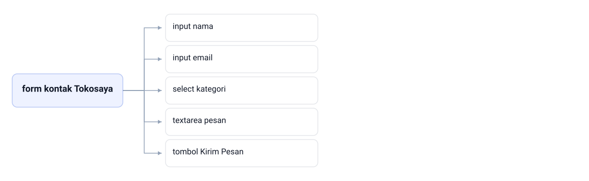

Satu form kontak Tokosaya memuat empat kontrol: label Pesan, input email, select kategori, dan tombol Kirim Pesan. Keempatnya menggantung pada satu form dan terkirim sebagai satu kesatuan, jadi satu alamat keliru di input email sudah cukup bikin pesanan gagal diantar.

<!--
Tunjuk akarnya dulu: semua kontrol menggantung pada satu form, dan itulah arti
satu kesatuan data. Tanyakan apa akibatnya kalau satu kontrol saja nggak ikut
terkirim. Jawaban yang diharapkan: data di basis data jadi nggak lengkap, dan
tim CS harus menebak alamat yang benar. Tutup dengan mengingatkan bahwa validasi
browser cuma menyaring format, bukan menjamin isinya benar.
-->

---

# Empat Prinsip Desain Form

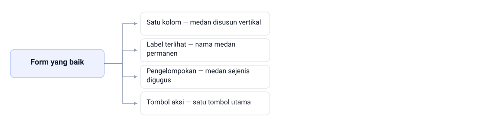

> Form yang baik mengurangi keputusan pengguna, bukan menambahnya.

<!--
Jadikan gambar ini daftar periksa yang dibuka sepanjang bab, lalu janjikan bahwa
tiap cabangnya dibahas satu slide sendiri setelah ini.

Bacakan keempat cabangnya dari atas ke bawah: satu kolom — medan disusun vertikal
dari atas ke bawah; label terlihat — nama medan permanen, bukan cuma
placeholder; pengelompokan — medan sejenis digugus, progres terlihat jelas;
tombol aksi — satu tombol utama, labelnya menyatakan akibatnya.

Tanyakan prinsip mana yang paling sering dilanggar di form kampus yang mereka
pakai. Paling banyak biasanya label dan tombol aksi.
-->

---

# Prinsip Satu Kolom

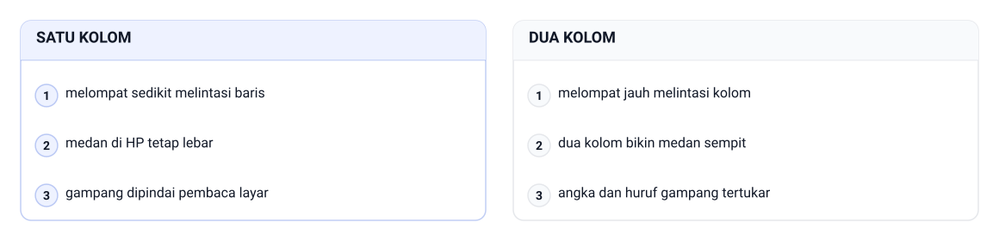

> Satu kolom itu default. Pasangan medan pendek cuma pengecualiannya.

<!--
Tunjukkan beda form satu kolom dan tiga kolom langsung di layar kalau bisa.
Bacakan gambar per baris: mata manusia membaca melompat sedikit melintasi baris,
nggak melompat jauh melintasi kolom.

Kolom kiri, satu kolom: medan di HP tetap lebar, dan form satu kolom gampang
dipindai pembaca layar. Kolom kanan, dua kolom: di HP dua kolom bikin medan
sempit, jadi angka dan huruf gampang tertukar.

Tanyakan kenapa form dua kolom di HP bikin salah ketik meningkat. Jawaban yang
diharapkan: medannya jadi sempit, angka dan huruf gampang tertukar. Tutup dengan
membacakan kalimat di slide.
-->

---

# Label Terlihat, Placeholder Bukan Label

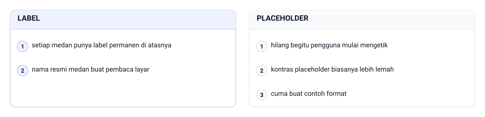

> `nama@domain.id` itu contoh isian, bukan nama medan.

<!--
Tanyakan apa yang terjadi kalau satu-satunya petunjuk pada medan cuma
placeholder. Jawaban yang diharapkan: panduannya hilang tepat pas pengguna
mulai mengisi.

Bandingkan dua kolom di gambar. Kolom label: setiap medan punya label permanen di
atasnya, dan label itu nama resmi medan buat pembaca layar. Kolom placeholder:
hilang begitu pengguna mulai mengetik, kontras placeholder biasanya lebih lemah,
jadi ia cuma buat contoh format.

Tutup dengan menegaskan bahwa label yang terlihat dan placeholder yang berisi
contoh format itu dua hal berbeda yang saling melengkapi.
-->

---

# Pengelompokan dan Progres

- Medan sebanding diguguskan dengan batas visual jelas
- Data pribadi, alamat, dan pembelian: tiga gugus berbeda
- Proses panjang ditampilkan bertahap, bukan disemprot sekaligus
- Pengguna tahu posisinya dan sisa pekerjaannya
- Halaman keranjang Tokosaya punya tiga zona
- Daftar item, pilihan pengiriman, ringkasan biaya

<!--
Gunakan halaman keranjang Tokosaya sebagai contoh konkret tiga zona. Tanyakan apa
yang terjadi kalau ketiga zona itu ditumpuk jadi satu blok tanpa garis dan jarak.
Jawaban yang diharapkan: pengguna kehilangan tempat berpijak dan nggak tahu
bagian mana yang harus diperiksa dulu.
-->

---

# Contoh: Pengelompokan dan Progres

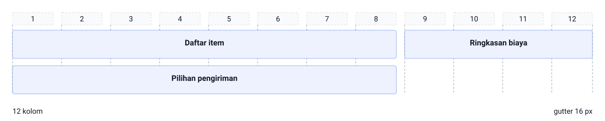

Halaman keranjang Tokosaya dibagi 12 kolom dengan gutter 16 px: Daftar item dan Pilihan pengiriman masing-masing selebar 8 kolom, sedangkan Ringkasan biaya dan Tombol utama selebar 4 kolom. Karena 8 + 4 = 12, kedua zona berdiri berdampingan dalam satu baris, dan tiap zona tetap dipisahkan gutter yang sama lebarnya.

<!--
Bacakan penggarisnya: 12 kolom, dan tiap zona menempati track yang bisa dihitung
sendiri oleh mahasiswa. Tanyakan kenapa Daftar item dapat 8 kolom sementara
Ringkasan biaya cuma 4. Jawaban yang diharapkan: daftar item perlu ruang buat
nama produk dan harga, ringkasan cukup buat beberapa angka. Tekankan bahwa
progres terlihat karena tiap zona punya batas sendiri, bukan karena ada garis
hiasan di antaranya.
-->

---

# Prinsip Tombol Aksi yang Jelas

- Satu tombol utama per halaman, jangan dua
- Label tombol menyatakan akibatnya
- "Kirim Pesan" dan "Lanjut ke Pembayaran" itu contoh baik
- Tombol ganda bergaya sama bikin pengguna berpikir dua kali
- Tombol pendamping diberi `type="button"`

> Label "OK" memaksa pengguna menebak apa yang bakal terjadi.

<!--
Tanyakan kenapa "OK" dan "Submit" jadi label yang lemah. Jawaban yang
diharapkan: keduanya nggak menyatakan akibat tindakan. Ingatkan bahwa tombol
kecil di pojok bawah dengan label kabur adalah gejala khas form yang dibangun
tergesa-gesa.
-->

---

# Contoh: Prinsip Tombol Aksi yang Jelas

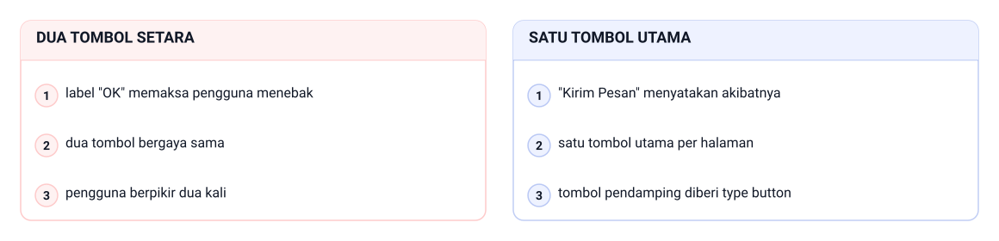

Di baris aksi halaman kontak, versi kiri menaruh dua tombol setara dengan label "OK", jadi pengguna berpikir dua kali. Versi kanan cuma punya satu tombol utama per halaman: tombol "Kirim Pesan" menyatakan akibatnya, dan tombol pendamping diberi type button supaya nggak ikut mengirim form.

<!--
Tunjuk dua panelnya bergantian: kiri dua tombol bergaya sama, kanan satu aksi
utama. Tanyakan kenapa label "OK" memaksa pengguna menebak. Jawaban yang
diharapkan: labelnya nggak menyatakan akibat tindakan, beda dengan "Kirim
Pesan". Ingatkan juga bahwa tombol pendamping yang lupa type button masih di
dalam form, jadi ia dianggap tombol kirim.
-->

---

<!-- _class: section -->
<!-- _footer: '' -->

# Elemen Form HTML5

## Bahan penyusun form, dari label sampai tombol

<!--
Pindah dari prinsip ke bahan. Katakan bahwa setiap elemen di sini punya peran
semantik, jadi bukan sekadar kotak isian. Semua yang dibahas di sini dipakai
lagi di praktikum.
-->

---

# label dan Pasangan for–id

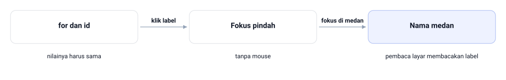

> `aria-label` itu pelengkap, bukan pengganti label yang terlihat.

<!--
Telusuri gambar dari kiri ke kanan. Tahap pertama, pasangan `for` dan `id`:
nilainya harus sama, dan itu juga aturan bab ini, setiap medan wajib punya label
terhubung. Tahap kedua, klik label langsung ke medannya, jadi fokus pindah tanpa
mouse. Tahap ketiga yang paling penting: nama medan terbaca karena pembaca layar
membacakan label sebagai nama medan.

Tunjukkan satu medan tanpa label di browser dan minta mahasiswa menebak
gimana pembaca layar menyebutnya. Jawaban yang diharapkan: cuma "kotak isian"
tanpa nama. Ingatkan bahwa form bisa tetap terlihat rapi walau aksesibilitasnya
sudah turun, dan bahwa fokus di medan yang berpindah tadi hasil sambungan
for–id, bukan kebetulan.
-->

---

# input dan Semantik type

| Type | Kegunaan |
|---|---|
| `text` | teks bebas pendek, kayak kode kupon |
| `email` | alamat surel dengan format khusus |
| `tel` | nomor telepon dengan pad angka |
| `number` | angka dengan batas min dan maks |
| `date` | tanggal lewat pemilih bawaan |

- `type` menentukan keyboard yang muncul di HP
- Pemeriksaan format bawaan browser jalan tanpa skrip

<!--
Tekankan bahwa memilih `type` yang tepat itu keputusan gratis: satu atribut,
dapat keyboard yang sesuai dan penyaringan isian sekaligus. Tanyakan bedanya
`type="text"` dan `type="tel"` di HP. Jawaban yang diharapkan: keyboard angka
muncul sendiri buat `tel`.
-->

---

# textarea dan select

- `textarea` buat isian panjang kayak pesan
- Atribut `rows` mengatur tinggi awalnya
- Isi `textarea` ditulis di antara tag pembuka dan penutup
- `input` menyimpan isinya di atribut `value`
- `select` buat pilihan yang sudah jelas dan terbatas
- Salah ketik berkurang dan data jadi lebih seragam

<!--
Tunjukkan perbedaan penyimpanan isi: `textarea` di antara tag, `input` di
atribut `value`. Tanyakan kenapa kategori produk lebih baik pakai `select`
daripada `text`. Jawaban yang diharapkan: pilihannya jadi seragam sehingga
datanya gampang diolah. Sebutkan `selected` dan `optgroup` sekilas saja.
-->

---

# Contoh: textarea dan select

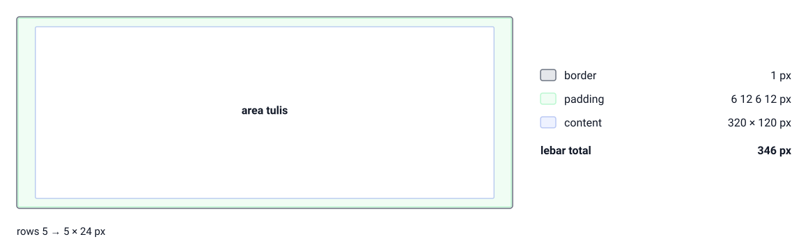

Textarea pesan di kontak.html memakai rows 5 → 5 × 24 px, jadi area tulis 320 × 120 px. Tambah padding 6 12 6 12 px dan border 1 px di tiap sisi: lebar total 346 px (320 + 12 + 12 + 1 + 1) dan tinggi 134 px (120 + 6 + 6 + 1 + 1).

<!--
Tinggi awal textarea itu cuma rows dikali tinggi satu baris, bukan angka ajaib.
Tanyakan kenapa rows 5 lebih aman daripada tinggi tetap dalam piksel. Jawaban
yang diharapkan: rows ikut ukuran font pengguna, jadi form tetap terbaca saat
teks diperbesar. Tunjuk pita padding dan kotak content di gambar: padding 12 px
kiri-kanan itu yang bikin teks nggak menempel ke bingkai.
-->

---

# checkbox dan radio

- Checkbox membolehkan lebih dari satu pilihan sekaligus
- Radio cuma membolehkan satu pilihan per kelompok
- Radio satu kelompok wajib memakai `name` yang sama
- Dari `name` itu browser tahu pilihannya saling meniadakan
- Bungkus `fieldset` kalau masih satu pertanyaan

<!--
Tanyakan apa akibatnya kalau dua radio sesi ujian salah ditulis jadi checkbox.
Jawaban yang diharapkan: pengguna bisa memilih pagi dan sore sekaligus, lalu
datanya jadi nggak masuk akal. Sebutkan juga bahwa checkbox cocok buat
persetujuan dan langganan.
-->

---

# Contoh: checkbox dan radio

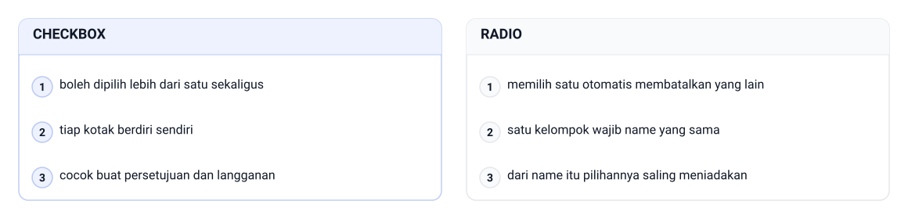

Di satu kelompok radio, semua pilihan memakai name yang sama, jadi memilih satu otomatis membatalkan yang lain. Checkbox boleh dipilih lebih dari satu sekaligus, dan itulah sebabnya ia cocok buat persetujuan dan langganan yang memang boleh lebih dari satu.

<!--
Tanyakan apa akibatnya kalau dua radio sesi ujian salah ditulis jadi checkbox.
Jawaban yang diharapkan: pengguna bisa memilih pagi dan sore sekaligus, lalu
datanya nggak masuk akal. Tunjuk kolom radio: satu kelompok wajib name yang
sama, dan dari name itu pilihannya saling meniadakan; di kolom checkbox tiap
kotak berdiri sendiri.
-->

---

# fieldset dan legend

- `fieldset` mengelompokkan medan yang saling berhubungan
- `legend` memberi judul buat kelompoknya
- Browser dan pembaca layar mengenali `fieldset` sebagai satu unit
- Konteks kelompok tetap terbawa pas masuk radio kedua
- Pakai setiap kali ada lebih dari satu radio atau checkbox

<!--
Jelaskan dengan skenario pembaca layar: pengguna masuk ke radio kedua dan tetap
mendengar nama kelompoknya. Tanyakan apa judul kelompok yang tepat buat tiga
radio pilihan pengiriman di keranjang. Jawaban yang diharapkan: "Pilihan
Pengiriman", persis kayak di kode praktikum.
-->

---

# Contoh: fieldset dan legend

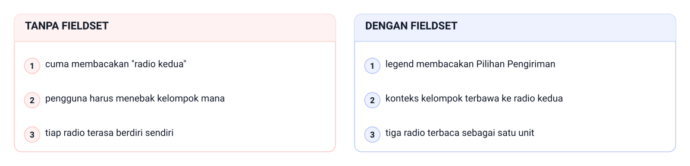

Satu fieldset Pilihan Pengiriman berisi legend sebagai judul kelompoknya, plus radio pertama, radio kedua, dan radio ketiga. Karena legend menempel pada fieldset, pengguna yang masuk ke radio kedua tetap mendengar nama kelompoknya.

<!--
Bayangkan pembaca layar cuma menyebut nama radionya saja, jadi konteksnya harus
datang dari fieldset. Tanyakan apa yang didengar pengguna kalau ketiga radio itu
nggak dibungkus fieldset. Jawaban yang diharapkan: cuma "radio kedua", tanpa
nama kelompok, dan pengguna harus menebak ini kelompok yang mana. Ingatkan bahwa
legend itu satu-satunya judul kelompok yang dikenali browser.
-->

---

# button dan Perilaku Bawaannya

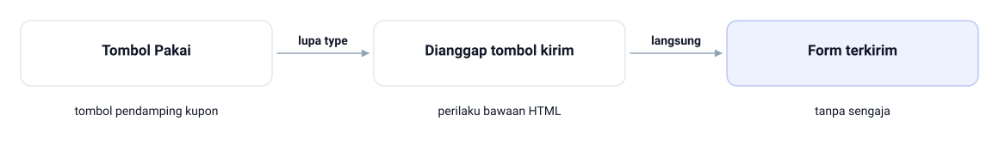

<!--
Ini jebakan yang paling sering kena di praktikum. Tunjukkan tombol "Pakai" pada
bidang kupon sebagai contoh nyata: tombol pendamping kupon yang lupa
`type="button"` masih berada di dalam form, jadi ia dianggap tombol kirim karena
perilaku bawaan HTML, dan seluruh form langsung terkirim.

Susun ulang rantainya di papan: lupa `type`, dianggap tombol kirim, lalu form
terkirim tanpa sengaja. Tekankan bahwa ini perilaku bawaan HTML, bukan pilihan
kita, dan satu-satunya penawarnya adalah memberi `type="button"` buat aksi
visual atau pendamping. Minta mahasiswa memeriksa tombol di file masing-masing
setelah kelas.
-->

---

<!-- _class: compact -->

# Kode: Elemen Form Dasar

```html
<form action="#" method="get">
  <fieldset>
    <legend>Data Pendaftar</legend>
    <p>
      <label for="nim">Nomor Induk Mahasiswa</label>
      <input type="text" id="nim" name="nim">
    </p>
    <p>
      <label for="email-kampus">Email Kampus</label>
      <input type="email" id="email-kampus" name="email-kampus">
    </p>
  </fieldset>
</form>
```

`File: tokosaya-bootstrap/latihan/elemen-form.html`

- Tiap label terhubung ke medannya lewat pasangan `for`–`id`
- Pemilihan `type` yang tepat cukup dilakukan sekali di markup

<!--
Halaman latihan ini sengaja ditulis dengan HTML murni tanpa gaya Bootstrap supaya
perhatian tetap ke strukturnya. Minta mahasiswa menunjuk mana label dan mana
medan, lalu tunjukkan pasangan `for`–`id`-nya cocok. Ingatkan bahwa versi
lengkapnya juga punya radio, checkbox, dan tombol.
-->

---

<!-- _class: section -->
<!-- _footer: '' -->

# Bootstrap Form

## Merapikan form tanpa menulis gaya dari nol

<!--
Transisi ke Bootstrap. Katakan bahwa HTML polos tadi sengaja dipakai buat
memahami struktur, dan sekarang kita rapikan tampilannya dengan kelas yang udah
teruji. Sebutkan bahwa pola dasarnya cuma tiga kelas dan bakal diulang terus.
-->

---

# Kenapa Kelas Form Bootstrap

- HTML polos tampil beda antar browser
- Jaraknya belum konsisten dan hasilnya terasa mentah
- Bootstrap merapikan lewat sekumpulan kelas form
- `mb-3` memberi jarak antar kelompok medan
- Kelompok yang berjarak membantu mata memindai cepat

<!--
Jelaskan bahwa `mb-3` bukan hiasan: pengguna memindai form per unit label plus
medan, dan jarak antarunit yang membantu. Tanyakan apa yang terjadi kalau semua
kelompok medan dirapatkan tanpa jarak. Jawaban yang diharapkan: form terasa
seperti blok abu-abu yang bikin mata cepat lelah.
-->

---

# Contoh: Kenapa Kelas Form Bootstrap

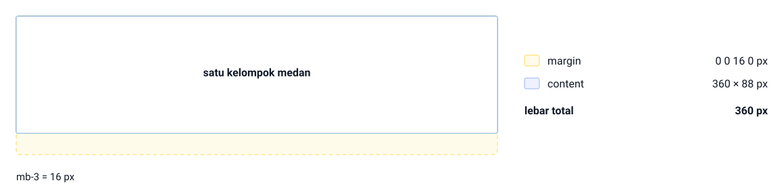

Ambil satu kelompok medan 360 × 88 px dan pasang mb-3 = 16 px. Margin-nya cuma tumbuh di bawah, 0 0 16 0 px, jadi lebar total tetap 360 px karena margin vertikal nggak menambah lebar kotak, dan 16 px itulah jarak ke kelompok berikutnya.

<!--
Tunjuk pita amber yang cuma ada di bawah: itu mb-3, dan arahnya memang cuma
satu. Tanyakan apa yang terjadi kalau semua kelompok medan dirapatkan tanpa
jarak. Jawaban yang diharapkan: form terasa seperti blok abu-abu panjang dan
mata cepat lelah. Tegaskan bahwa kotak content tetap 360 × 88 px, jadi jarak itu
nggak mengubah ukuran medannya.
-->

---

<!-- _class: compact -->

# Pola Dasar Kelompok Medan

```html
<!-- Cuplikan: pola dasar kelompok medan -->
<div class="mb-3">
  <label for="email" class="form-label">Alamat Email</label>
  <input type="email" class="form-control" id="email" name="email"
         placeholder="nama@contoh.id" autocomplete="email" required
         aria-describedby="bantuan-email">
  <div class="form-text" id="bantuan-email">
    Kami membalas ke email ini maksimal satu hari kerja.
  </div>
</div>
```

`File: tokosaya-bootstrap/kontak.html`

- `label for` terhubung ke `id`, jadi fokusnya tepat
- `form-control` menyeragamkan tampilan medan
- `form-text` menjelaskan kenapa data itu diminta
- `autocomplete` membantu browser mengisi ulang data

<!--
Katakan bahwa satu kelompok kecil ini memperlihatkan empat keputusan desain
sekaligus, dan pola ini bakal diulang di hampir semua medan Tokosaya. Minta
mahasiswa menemukan keempatnya sebelum kamu membacakan catatan kelas.
Ingatkan bahwa `form-text` dihubungkan lewat `aria-describedby`.
-->

---

# Kelas Form yang Kamu Pakai

| Kelas | Dipasang pada | Peran |
|---|---|---|
| `mb-3` | pembungkus kelompok | jarak antar kelompok medan |
| `form-label` | `label` | tipografi dan jarak label |
| `form-control` | `input`, `textarea` | gaya medan isian |
| `form-select` | `select` | gaya pilihan tarik-turun |
| `form-text` | pembungkus kecil | teks bantuan di bawah medan |

- `form-check-input` dan `form-check-label` buat checkbox dan radio

<!--
Ini tabel rujukan yang bakal dibuka terus selama praktikum. Tekankan bahwa
`select` punya kelas sendiri karena struktur dalamnya memang berbeda dari
medan teks. Minta mahasiswa menebak kelas buat medan tarik-turun sebelum
jawabannya dibacakan.
-->

---

<!-- _class: compact -->

# form-text atau Pesan Status

```html
<div class="col-12">
  <label for="pesan" class="form-label">Pesan</label>
  <textarea class="form-control" id="pesan" name="pesan" rows="5"
            placeholder="Tulis pesan Anda di sini…"
            aria-describedby="bantuan-pesan"></textarea>
  <div class="form-text" id="bantuan-pesan">
    Sertakan nomor pesanan bila menyangkut transaksi.
  </div>
</div>
```

- `form-text` selalu tampil sebagai bantuan permanen
- Pesan status muncul cuma kalau isiannya valid atau nggak valid
- Placeholder hilang pas diketik, tapi bantuan tetap terbaca
- Hubungkan bantuan ke medannya lewat `aria-describedby`

> Teks bantuan yang nggak dihubungkan terdengar kayak paragraf biasa.

<!--
Tanyakan mana yang lebih tepat buat kalimat "Gunakan nomor yang aktif menerima
pesan": bantuan atau pesan status. Jawaban yang diharapkan: bantuan, karena
petunjuk itu berlaku terus, bukan cuma pas ada kesalahan. Ingatkan bahwa
keduanya bisa muncul berdampingan di bawah satu medan.
-->

---

# input-group: Medan dengan Lampiran

- `input-group` menyandingkan medan dengan lampiran
- Lampirannya bisa teks statis kayak `@` atau `Rp`
- Lampiran itu memakai kelas `input-group-text`
- Bisa juga tombol di ujung medan
- Konteks isian langsung terbaca, pengguna nggak menebak

> Contoh Tokosaya: bidang kupon dengan tombol "Pakai" di ujungnya.

<!--
Gambarkan tiga pemakaian: tanda `@` di depan nama pengguna, satuan `Rp` di depan
angka, dan tombol "Pakai" buat kode kupon. Tanyakan kenapa lampiran itu bukan
sekadar hiasan. Jawaban yang diharapkan: pengguna langsung tahu satuan atau
arti kolomnya tanpa membaca instruksi panjang.
-->

---

# Contoh: input-group: Medan dengan Lampiran

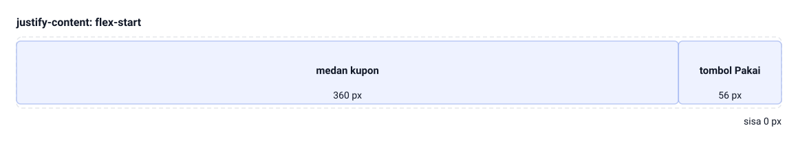

Di bidang kupon keranjang Tokosaya, medan kupon 360 px disandingkan dengan tombol Pakai 56 px. Karena input-group gap 0, keduanya menempel tanpa celah: 360 + 56 = 416 px, dan sisa 0 px di ujung baris.

<!--
Tanyakan kenapa lampiran itu bukan sekadar hiasan. Jawaban yang diharapkan:
pengguna langsung tahu arti kolomnya tanpa membaca instruksi panjang. Di gambar,
input-group ini cuma justify-content: flex-start dengan gap 0, jadi medan kupon
dan tombol Pakai benar-benar menempel, nggak ada celah satu piksel pun.
-->

---

<!-- _class: section -->
<!-- _footer: '' -->

# Layout, Status, dan Fokus

## Form yang tetap enak dipakai di layar kecil dan lewat keyboard

<!--
Bagian ini menyatukan tiga hal yang sering dianggap terpisah: penataan lebar,
status visual, dan fokus. Katakan bahwa ketiganya sebenarnya satu urusan, yaitu
gimana form terasa pas dipakai.
-->

---

<!-- _class: compact -->

# Layout: row, col, dan Titik Henti

```html
<!-- Cuplikan: dua medan bersebelahan di layar ≥ md -->
<div class="row g-3">
  <div class="col-md-6">
    <label for="nama-depan" class="form-label">Nama Depan</label>
    <input type="text" class="form-control" id="nama-depan"
           name="nama-depan" autocomplete="given-name">
  </div>
  <div class="col-md-6">
    <label for="nama-belakang" class="form-label">Nama Belakang</label>
    <input type="text" class="form-control" id="nama-belakang"
           name="nama-belakang" autocomplete="family-name">
  </div>
</div>
```

`File: tokosaya-bootstrap/kontak.html`

- `row` mengelompokkan kolom, `g-3` memberi jarak antar kolom
- Di HP keduanya otomatis kembali jadi satu kolom penuh

<!--
Tanyakan bedanya `col-6` dan `col-md-6` di layar HP. Jawaban yang diharapkan:
`col-6` tetap membagi layar HP jadi dua bagian sempit, sedangkan `col-md-6`
menumpuknya sampai lebar medium ke atas. Ingatkan bahwa gutter `g-3` dan
`mb-3` sebaiknya jangan dicampur di satu area tanpa alasan.
-->

---

<!-- _class: compact -->

# Layout Checkout Dua Zona

```text
div.row.g-4
  |- div.col-lg-8   : tabel item + fieldset pengiriman
  `- div.col-lg-4   : kartu ringkasan + kupon + tombol utama
```

```html
<h1 class="mb-1">Keranjang Belanja</h1>
<p class="text-body-secondary mb-4">
  Tinjau pesanan Anda, pilih pengiriman, lalu lanjutkan ke pembayaran.
</p>
```

- Di layar lebar kedua kolom tampil berdampingan
- Di HP keduanya menumpuk: item dulu, ringkasan sesudahnya
- Tombol "Lanjut ke Pembayaran" jadi satu-satunya CTA

<!--
Tekankan bahwa total kolomnya pas dua belas, jadi 8 + 4 langsung berdampingan di
layar besar. Tanyakan bagian mana yang diperiksa pengguna lebih dulu di HP.
Jawaban yang diharapkan: daftar item dulu, karena itulah yang muncul lebih
awal. Sebutkan bahwa halaman ini checkout visual statis, bukan alur bayar
sungguhan.
-->

---

# disabled dan readonly

| Atribut | Bisa diubah | Ikut terkirim |
|---|---|---|
| `disabled` | nggak | nggak |
| `readonly` | nggak | iya |

- `disabled` bikin medan tampil redup dan nggak bisa diedit
- `readonly` cuma bisa dibaca, isinya tetap terkirim
- `readonly` cocok buat nomor pesanan yang sudah terbit
- `select` pakai `disabled`, bukan `readonly`

<!--
Tanyakan mana yang tepat buat nomor pesanan yang harus ikut terkirim ke server.
Jawaban yang diharapkan: `readonly`, karena isinya dibutuhkan tapi nggak boleh
diubah. Sebutkan bahwa Bootstrap otomatis memberi tampilan berbeda buat kedua
atribut itu, jadi nggak perlu kelas tambahan.
-->

---

<!-- _class: compact -->

# is-valid dan is-invalid

```html
<div class="mb-3">
  <label for="kode-kupon" class="form-label">Kode Kupon</label>
  <input type="text" class="form-control is-invalid" id="kode-kupon"
         name="kode-kupon" value="TKSA-00" aria-describedby="bantuan-kupon">
  <div class="invalid-feedback">
    Kode kupon tidak ditemukan. Periksa kembali email promo Anda.
  </div>
  <div class="form-text" id="bantuan-kupon">Format contoh: TKSA-10.</div>
</div>
```

`File: tokosaya-bootstrap/latihan/status-form.html`

- `is-valid` memberi bingkai hijau dan ikon centang
- `is-invalid` memberi bingkai merah pada medan bermasalah
- `invalid-feedback` baru muncul kalau medannya `is-invalid`
- Status ini cuma styling statis, bukan verifikasi isian
- Verifikasi sungguhan pakai JavaScript Bootstrap, di luar cakupan

<!--
Tanyakan kenapa pesan itu nggak muncul meski teksnya udah ditulis di markup.
Jawaban yang diharapkan: medannya belum memakai kelas `is-invalid`, jadi
pasangan status-pesannya nggak lengkap. Tegaskan bahwa kelas status di bab ini
ditulis manual buat mempelajari bentuk visualnya, dan itu penuh sesuai cakupan
mata kuliah.
-->

---

# Fokus Harus Terlihat dan Urutan Tab

- Fokus menandai elemen yang aktif sekarang
- Pengguna keyboard nggak punya kursor, cuma punya fokus
- Jangan menghapus cincin fokus biar tampilan tampak bersih
- `:focus-visible` muncul buat fokus dari navigasi keyboard
- Urutan tab mengikuti susunan elemen di dokumen
- Hindari `tabindex` positif; pilihan terbaik justru tanpa `tabindex`

> Urutan visual yang sama dengan urutan dokumen itu keputusan desain.

<!--
Tekan tombol Tab di laptop yang diproyeksikan biar kelas melihat fokus itu nyata.
Tanyakan kenapa `tabindex` positif sebaiknya dihindari. Jawaban yang diharapkan:
nilainya merusak urutan alami dan bikin pengguna keyboard melompat nggak karuan.
Ingatkan bahwa `autofocus` dipakai hemat, cuma kalau itu memang tugas utama
halaman.
-->

---

# Contoh: Fokus Harus Terlihat dan Urutan Tab

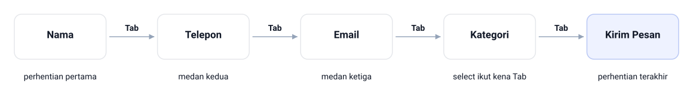

Di form kontak Tokosaya, Nama jadi perhentian pertama, Email dan medan berikutnya menyusul, lalu Kategori karena select ikut kena Tab, dan Kirim Pesan sebagai perhentian terakhir. Urutannya sama dengan urutan dokumen, jadi tiga kali tekan Tab dari Nama sudah sampai di tombol tanpa satu pun lompatan.

<!--
Tekan Tab di laptop yang diproyeksikan biar kelas lihat cincin fokusnya nyata.
Tanyakan kenapa tabindex positif sebaiknya dihindari. Jawaban yang diharapkan:
nilainya merusak urutan alami dan bikin pengguna keyboard melompat nggak karuan.
Tunjuk panah Tab di gambar: urutannya persis susunan elemen di dokumen, bukan
susunan yang kelihatan bagus di layar.
-->

---

# Tiga Praktik Aksesibilitas Form

- Label eksplisit terhubung `for`–`id` sejak awal
- Placeholder jangan menggantikan label yang terlihat
- `autocomplete` menjelaskan tujuan medan ke browser
- Pesan status ditulis, bukan cuma diwakili warna
- Bingkai merah nggak menolong pengguna buta warna

> Empat hal ini fondasi WCAG 2.2 yang paling sering dicek.

<!--
Tanyakan kenapa bingkai merah saja nggak cukup buat menyampaikan kesalahan.
Jawaban yang diharapkan: informasi nggak boleh disampaikan lewat warna saja,
jadi pesan tertulis itu wajib. Sebutkan bahwa audit formalnya menyusul di
Bab 13 dengan alatnya sendiri.
-->

---

# Contoh: Tiga Praktik Aksesibilitas Form

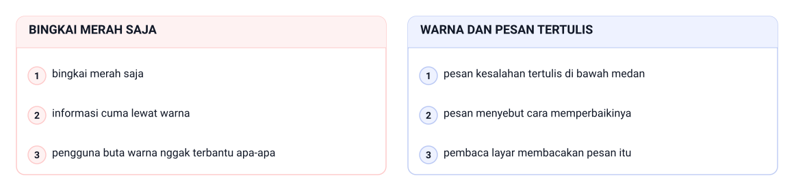

Lihat dua medan kupon yang sama-sama salah. Versi pertama cuma memakai bingkai merah saja, dan informasi cuma lewat warna bikin pengguna buta warna nggak terbantu apa-apa. Versi kedua menambah warna dan pesan tertulis: pesan kesalahan tertulis di bawah medan, pesan menyebut cara memperbaikinya, dan pembaca layar membacakan pesan itu.

<!--
Tanyakan kenapa bingkai merah saja nggak cukup buat menyampaikan kesalahan.
Jawaban yang diharapkan: informasi nggak boleh disampaikan lewat warna saja, jadi
pesan tertulis itu wajib. Tunjuk panel kiri lalu panel kanan, dan tegaskan bahwa
pasangan is-invalid plus invalid-feedback yang mereka tulis di
latihan/status-form.html sudah memenuhi syarat ini tanpa satu baris JavaScript.
-->

---

# autocomplete Menjelaskan Tujuan Medan

| Nilai | Buat medan |
|---|---|
| `name` | nama lengkap |
| `given-name` | nama depan |
| `family-name` | nama belakang |
| `email` | alamat surel |
| `tel` | nomor telepon |

- Browser mengisi ulang data yang sudah disimpan pengguna
- WCAG 1.3.5: tujuan medan harus bisa dibaca program

<!--
Tekankan bahwa `autocomplete` punya dua manfaat sekaligus: mempercepat pengisian
dan menyatakan tujuan medan secara terprogram. Tanyakan kenapa medan yang udah
jelas buat mata masih perlu ditandai begini. Jawaban yang diharapkan: karena
browser dan alat bantu nggak melihat label seperti yang dilihat manusia.
-->

---

<!-- _class: compact -->

# Praktikum: Langkah Kerja

- Perbarui `css/style.css` dengan design token Bab 4
- Buat `keranjang.html` sebagai checkout visual statis
- Bangun ulang `kontak.html` dengan form Bootstrap lengkap
- Periksa responsif keranjang di lebar 1200, 768, dan 375px
- Tekan Tab dari awal dokumen, catat urutan fokusnya
- Kirim uji coba, lihat parameter pada URL, lalu rekam pengamatan

> Tekan Tab dulu sebelum menilai tampilannya dari segi aksesibilitas.

<!--
Jalankan langkah ini sambil didemokan, jangan cuma dibacakan. Berhenti di langkah
responsif karena kesalahan `col-6` paling sering muncul di situ. Untuk langkah
terakhir, tunjukkan parameter URL seperti `?nama=...&email=...` dan jelaskan
bahwa halaman memuat ulang karena belum ada pengolah data.
-->

---

<!-- _class: compact -->

# Praktikum: Form Kontak Tokosaya

```html
<div class="col-md-6">
  <label for="nama" class="form-label">Nama Lengkap</label>
  <input type="text" class="form-control is-valid" id="nama"
         name="nama" placeholder="Budi Santoso" autocomplete="name" required>
  <div class="valid-feedback">Nama terisi dengan benar.</div>
</div>
<div class="col-md-6">
  <label for="telepon" class="form-label">
    Nomor Telepon <span class="text-body-secondary">(opsional)</span>
  </label>
  <input type="tel" class="form-control" id="telepon"
         name="telepon" placeholder="0812-3456-7890" autocomplete="tel"
         aria-describedby="bantuan-telepon">
  <div class="form-text" id="bantuan-telepon">
    Gunakan nomor yang aktif menerima pesan.
  </div>
</div>
```

`File: tokosaya-bootstrap/kontak.html`

- Semua label berpasangan `for`–`id` dengan medannya
- Teks bantuan terhubung lewat `aria-describedby`

<!--
Tunjukkan bahwa form kontak memuat seluruh kelas baku bab ini di satu halaman.
Minta mahasiswa memperhatikan bahwa medan panjang seperti pesan memakai `col-12`
karena jarang dipasangkan. Ingatkan bahwa folder proyeknya nggak boleh memuat
satu pun file JavaScript.
-->

---

# Latihan

- Terapkan empat prinsip form pada form pendaftaran perpustakaan
- Tulis empat keputusan desainmu beserta alasan tiap keputusan
- Petakan elemen `latihan/elemen-form.html` ke fungsinya masing-masing
- Tulis cuplikan medan "Kode Promo" memakai pola `input-group`
- Jelaskan beda peran `form-text` dan `invalid-feedback`

> Jelaskan alasannya, bukan cuma nama kelasnya.

<!--
Kerjakan butir pertama bareng-bareng di papan, sisanya jadi latihan mandiri.
Buat butir terakhir, minta satu contoh pesan yang pantas di `form-text` dan satu
yang pantas di `invalid-feedback`. Tanyakan juga kenapa medan kode promo pantas
diberi `autocomplete="off"`.
-->

---

# Cek Daftar Form Tokosaya

- Setiap medan punya label yang terhubung `for`–`id`
- Satu tombol utama berlabel yang menyatakan akibatnya
- Medan pendek berpasangan `col-md-6`, medan panjang `col-12`
- Status valid dan nggak valid punya pesan tertulis
- Nggak ada `tabindex` positif atau gaya fokus yang dihapus
- Nggak ada satu pun file JavaScript di folder proyek

<!--
Minta mahasiswa saling memeriksa file pakai daftar ini dan menunjukkan buktinya
langsung di kode. Tanyakan medan mana yang ternyata belum punya teks bantuan
padahal isiannya nggak jelas. Ingatkan bahwa yang dinilai bukan tampilan yang
cantik, tapi form yang gampang dipakai dan gampang dibaca orang lain.
-->

---

# Rangkuman

- Form adalah pintu masuk data sebuah sistem informasi
- Empat prinsip: satu kolom, label terlihat, kelompok, CTA jelas
- Pasangan `for`–`id` adalah fondasi aksesibilitas form
- `type` pada `input` menyaring isian tanpa satu pun skrip
- Pola Bootstrap: `mb-3`, `form-label`, dan `form-control`
- Status visual statis cuma bentuk; verifikasi aslinya pakai JavaScript

<!--
Tutup dengan pesan utama: kualitas data sebuah organisasi bergantung pada
kualitas form yang mengumpulkannya. Sebutkan jembatan ke Bab 12: keputusan
visual yang hari ini ditulis berulang bakal jadi token dan komponen yang
terdokumentasi. Ingatkan juga bahwa audit seluruh proyek menunggu di Bab 13.
-->

---

<!-- _class: lead -->
<!-- _footer: '' -->

# Tugas dan Refleksi

Tugas 1 (individu): tambahkan blok "Berlangganan Info Produk" di atas footer `kontak.html` memakai pola `input-group`.

Tugas 2 (kelompok): audit satu form nyata di kampusmu memakai checklist bab ini.

**Pertanyaan refleksi:** kapan pasangan medan pendek benar-benar boleh berdampingan?

<!--
Tugas individu dikumpulkan bersama paragraf 4 sampai 6 kalimat yang menjelaskan
alasan tiap kelas yang dipakai. Nilai keterhubungan label, keberadaan teks
bantuan, dan tombol yang menyatakan aksinya. Buat tugas kelompok, tegaskan
bahwa setiap temuan harus diikat ke prinsip yang tepat dan semuanya bisa
diperbaiki tanpa JavaScript.
-->
