<!-- _class: lead -->
<!-- _paginate: skip -->
<!-- _footer: '' -->

# Implementasi Desain Figma ke HTML/CSS

**Bab 14** · Membaca desain, lalu membangunnya dengan setia

Studi kasus: **Tokosaya** — frame `P-DETAIL-01`

<!--
Buka dengan pertanyaan: kalau desainnya udah rapi banget, kenapa hasil kodenya masih
sering meleset? Ingatkan bahwa Bab 13 baru menutup audit proyek `tokosaya-css/`,
dan bab ini pindah ke sisi translasi desain. Sebutkan bahwa hasil akhirnya adalah
halaman `produk.html` yang bakal diperiksa mutunya di Bab 15.
-->

---

# Tujuan Pembelajaran

Setelah menyelesaikan bab ini, kamu bisa:

- Alur designer–developer handoff dari prototip desain sampai kode
- Struktur layout Figma: frame, layer, auto layout, ukuran, dan jarak
- Column grid dua belas kolom beserta gutter dan margin kontainer
- Pemetaan text style dan color style jadi design token di `:root`
- Implementasi frame `produk.html` dengan Bootstrap 5.3 sesuai spesifikasi
- Penilaian kesetiaan hasil pakai fidelity checklist sembilan item

<!--
Bacakan tujuan ini singkat saja, lalu tekankan bahwa CPMK-nya adalah CPMK 10:
menerjemahkan desain atau prototip jadi website yang setia. Sebutkan bahwa semua
keterampilan dari Bab 1 sampai Bab 13 dipakai bareng di sini. Tanyakan siapa yang
pernah menerima desain tanpa angka ukuran sama sekali.
-->

---

# Desain Udah Jadi, Tapi Hasilnya Meleset

Desainer mengirim file Figma yang rapi. Pengembang membukanya dan cuma melihat gambar.

- Ukuran akhirnya ditaksir pakai mata
- Warna tombol sedikit meleset dari desain
- Jarak antarbagian cuma ditebak
- Judul diperkecil sesuka hati

> Yang jelas di kepala desainer belum tentu jelas di kepala pengembang.

<!--
Ceritakan kisah pembukanya: seminggu kemudian desainer mengirim revisi soal warna badge,
jarak kartu, dan font judul. Tanyakan kenapa hal kayak ini bisa terjadi padahal file
desainnya ada. Jawaban yang diharapkan: yang dikirim cuma gambar, bukan keputusan
ukurannya. Sebutkan pola serupa di unit web kampus yang menerima desain portal dari
unit publikasi.
-->

---

# Contoh: Desain Udah Jadi, Tapi Hasilnya Meleset

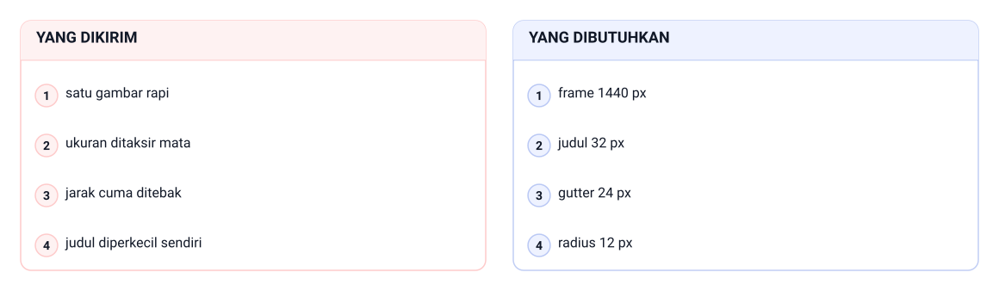

Yang dikirim cuma satu gambar rapi, jadi ukuran ditaksir mata, jarak cuma ditebak, dan judul diperkecil sendiri. Yang dibutuhkan justru angka: frame 1440 px, judul 32 px, gutter 24 px, dan radius 12 px — empat nilai yang nanti disalin ke CSS.

<!--
Tanyakan kenapa revisi tetap datang padahal file desainnya ada. Jawaban yang diharapkan: yang dikirim cuma gambar, bukan angka. Tunjuk panel kanan: frame 1440 px, judul 32 px, gutter 24 px, radius 12 px — empat angka itu yang bikin hasil di browser bisa diperiksa, bukan diperdebatkan.
-->

---

<!-- _class: section -->
<!-- _footer: '' -->

# Alur Desain ke Kode

## Serah terima keputusan, bukan sekadar file

<!--
Transisi dari keluhan revisi menuju pertanyaan teknis: sebenarnya handoff itu apa dan
siapa saja tahapannya. Tahan dulu soal grid dan token; itu masuk di bagian berikutnya.
-->

---

# Apa Itu Handoff

Handoff adalah momen serah terima desain ke pengembang.

- Desain "selesai sebagai gambar", lalu lanjut jadi kode
- Kayak arsitek menyerahkan gambar kerja ke kontraktor
- Kalau dimensi nggak tertulis, kontraktor bakal menebak
- Tebakan itu sumber masalah paling awal
- Rapi atau nggaknya alur ini menentukan jumlah revisi

<!--
Tekankan analogi arsitek dan kontraktor; ini pegangan buat seluruh bab. Tanyakan: kalau
gambar kerja nggak memuat angka dimensi, siapa yang bakal menanggung akibatnya?
Jawaban yang diharapkan: dua-duanya, karena hasil bangunannya jadi berbeda dari rencana.
Ingatkan bahwa handoff bukan mengirim file, tapi mengirim keputusan.
-->

---

# Contoh: Apa Itu Handoff

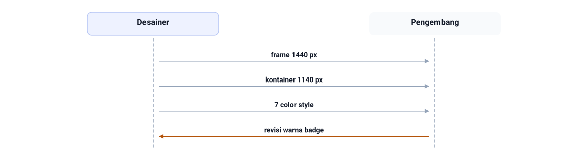

Handoff Tokosaya yang benar: desainer menyerahkan frame 1440 px, kontainer 1140 px, dan 7 color style dalam satu lembar. Pengembang yang menerima angka itu nggak perlu menebak, jadi balasannya cukup revisi warna badge, bukan bongkar ulang halaman.

<!--
Bacakan alurnya sebagai percakapan, bukan sebagai daftar file: desainer mengirim tiga fakta, pengembang membalas satu. Tanyakan apa yang terjadi kalau kiriman pertama cuma gambar tanpa angka. Jawaban yang diharapkan: pengembang balik bertanya, dan revisi warna badge jadi telat.
-->

---

# Rantai Lima Tahap

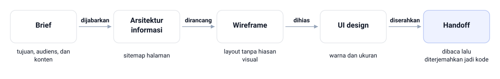

> Implementasi biasanya jauh lebih cepat kalau keputusan desainnya udah beres di depan.

<!--
Gambarkan rantai ini sebagai urutan yang nggak boleh dibolak-balik: brief dijabarkan jadi
arsitektur informasi, arsitektur dirancang jadi wireframe, wireframe dihias jadi UI design,
lalu UI design diserahkan lewat handoff. Tiap tahap menambah satu lapis keputusan yang
nanti disalin ke kode.

Isi tiap tahap, buat dibacakan sambil menunjuk pitanya: Brief: tujuan, audiens, dan konten.
Arsitektur informasi dan sitemap halaman. Wireframe: layout tanpa hiasan visual. UI design
di Figma dengan warna dan ukuran. Handoff: desain dibaca lalu diterjemahkan jadi kode.

Tanyakan tahap mana yang paling sering dilewati tim kecil. Jawaban yang diharapkan:
wireframe, karena orang mau cepat masuk ke tampilan berwarna.
-->

---

# Prototip Bukan Implementasi

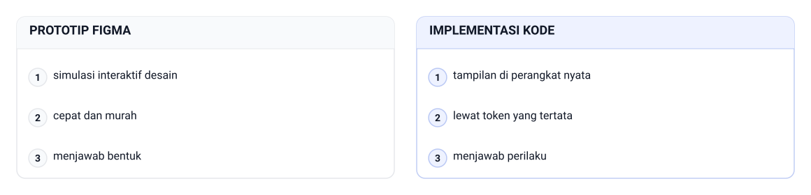

<!--
Ini pasangan istilah yang paling sering tertukar di tugas. Tanyakan mana yang perlu diuji
responsif. Jawaban yang diharapkan: implementasinya, karena prototip cuma menirukan alur
layar. Tekankan juga bahwa interaktivitas berbasis JavaScript di luar cakupan mata kuliah
ini, jadi bagian kayak toggle dan carousel diterjemahkan sebagai tampilan statis.

Bentuknya kayak apa? Prototip Figma: simulasi interaktif desain. Implementasi kode:
tampilan di perangkat nyata. Gimana kalau diubah? Prototip cepat dan murah, implementasi
lewat token yang tertata.

Lanjutkan dengan tiga pembeda: prototip menjawab bentuk, implementasi menjawab perilaku.
Implementasi memuat HTML semantik, CSS bertoken, komponen Bootstrap. Prototip cuma di
Figma, implementasi jalan di layar mana pun.
-->

---

<!-- _class: section -->
<!-- _footer: '' -->

# Membaca Desain di Figma

## Dari kerangka dulu, baru detail

<!--
Masuk ke bagian yang paling banyak dipraktikkan: membaca desain Figma secara sistematis.
Katakan bahwa urutan membacanya kerangka dulu, baru detail, kayak membaca halaman
transkrip: kepala, isi, lalu tanda tangan.
-->

---

# Frame dan Layer di Figma

- Frame: kanvas berukuran tetap buat satu layar
- Contoh ukuran: desktop 1440 px, tablet 768 px, HP 375 px
- Layer: kotak, teks, gambar, dan ikon di dalamnya
- Panel sisi kiri Figma menampilkan hirarki layer
- Masuk dari frame terluar, lalu bedah anak pertama ke bawah
- Cara membaca ini sama dengan membaca struktur HTML

<!--
Tunjukkan panel kiri Figma kalau ada proyektor yang memadai. Tanyakan apa bedanya frame
dan layer buat orang yang baru belajar. Jawaban yang diharapkan: frame punya ukuran
perangkat yang tetap, layer cuma objek di dalamnya. Ingatkan bahwa pengelompokan yang rapi
bikin hirarki HTML mulai kelihatan sendiri.
-->

---

# Contoh: Frame dan Layer di Figma

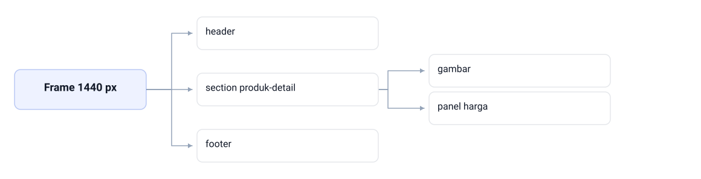

Di Figma, frame 1440 px punya tiga layer utama: header, section produk-detail, dan footer. Bedah section-nya, isinya cuma dua layer lagi, yaitu gambar dan panel harga.

<!--
Susuri urutan ini dari luar ke dalam sambil menunjuk panel kiri Figma. Tanyakan layer mana yang bakal jadi elemen HTML tersendiri. Jawaban yang diharapkan: section produk-detail, karena dia yang membungkus gambar dan panel harga. Sebutkan bahwa frame tablet 768 px dan HP 375 px punya susunan layer yang sama.
-->

---

<!-- _class: compact -->

# Istilah Figma dan Padanannya

| Di Figma | Makna | Padanan HTML/CSS |
|---|---|---|
| Frame | kanvas satu layar perangkat | `<section>`, `<footer>` |
| Layer atau grup | objek dan pengelompokannya | elemen kayak `<header>` |
| Auto layout | penataan anak otomatis | Flexbox: `display: flex`, `gap` |
| Fill dan stroke | warna latar dan garis tepi | `background-color`, `border` |
| Gap dan padding | jarak antaranak dan tepi | `gap`, `padding` |

- Pilih satu elemen di tiap area besar, catat lebar dan tingginya
- Cek isi fill serta stroke di panel kanan Figma

<!--
Ini tabel terjemahan yang paling sering dibuka ulang pas praktikum. Minta mahasiswa menunjuk
mana fill dan mana stroke pada satu kartu sebelum kamu lanjut. Tanyakan kenapa gap dan
padding dipisah barisnya. Jawaban yang diharapkan: keduanya mengatur jarak yang berbeda,
satu antaranak, satu ke tepi.
-->

---

# Auto Layout Itu Flexbox

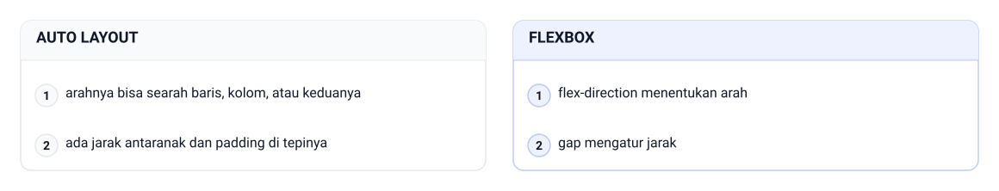

<!--
Pakai contoh baris kartu produk terkait: di Figma dia auto layout searah baris, di kode
jadi baris Flexbox lewat `d-flex` dan `gap`. Tanyakan kenapa analogi ini berguna. Jawaban
yang diharapkan: kamu nggak perlu menebak jaraknya, karena tinggal menyalin angka dari
panel desain. Ingatkan bahwa istilah Figma dan istilah CSS tetap beda.

Tiga fakta yang nggak masuk gambar: auto layout menata anak secara otomatis, padanan
CSS-nya Flexbox yang kamu pelajari di Bab 6, dan baca auto layout jauh lebih gampang
kalau udah paham Flexbox. Di gambar, dua baris dipasangkan: arahnya bisa searah baris,
kolom, atau keduanya dipetakan ke `flex-direction` menentukan arah, dan ada jarak antaranak
dan padding di tepinya dipetakan ke `gap` mengatur jarak.
-->

---

# Column Grid Dua Belas Kolom

- Desain yang rapi hampir nggak pernah menaruh elemen acak
- Grid dua belas kolom jadi konvensi umum
- Angka 12 gampang dibagi 2, 3, dan 4
- Kombinasi 6+6, 4+4+4, dan 8+4 tetap terasa rapi
- Gutter: lebar celah antarkolom
- Margin: jarak sisi kiri dan kanan frame

<!--
Tekankan bahwa grid inilah yang bikin layout terasa rapi padahal elemennya
banyak. Tanyakan apa akibatnya kalau tiap kartu punya celah sendiri-sendiri. Jawaban yang
diharapkan: halaman terlihat dibangun dari tangkapan layar, bukan dari desain. Sebutkan
bahwa angka grid disalin sekali saja, lalu dipakai ulang di semua komponen.
-->

---

# Contoh: Column Grid Dua Belas Kolom

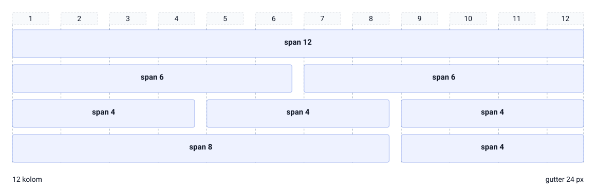

Kontainer 1140 px dibagi 12 kolom dengan gutter 24 px, jadi satu kolom 73 px. Semua kombinasi tetap pas: span 12 penuh, span 6 + span 6, span 4 + span 4 + span 4, dan span 8 + span 4.

<!--
Minta kelas menjumlahkan tiap baris: 12, lalu 6 + 6, lalu 4 + 4 + 4, lalu 8 + 4. Jawaban yang diharapkan: semuanya 12 kolom, dan itu sebabnya layout tetap lurus walau jumlah butirnya beda. Tunjukkan angka 1 sampai 12 di penggaris atas gambar supaya kelas bisa menunjuk kolom yang ditempati tiap butir.
-->

---

<!-- _class: compact -->

# Hitung Grid dan Kelas Bootstrap

- Frame desktop 1440 px, kontainer maksimum 1140 piksel
- Sisi kosong 150 px di kiri dan kanan
- 12 kolom dengan gutter 24 px, satu kolom 73 piksel
- Hitungnya: (1140 − 11 × 24) ÷ 12 = 73
- `.container` berhenti tumbuh di 1140 px pada breakpoint xl
- `g-4` memberi gutter 24 px saat root 16 px

<!--
Kerjakan hitungannya di papan bareng-bareng, jangan cuma ditampilkan. Tanyakan kenapa
angka 11 yang dipakai, bukan 12. Jawaban yang diharapkan: dua belas kolom cuma punya
sebelas celah di antaranya. Ingatkan tanda versi: nilai gutter ikut root font browser,
jadi periksa dokumentasi resmi Bootstrap 5.3 kalau root diubah.
-->

---

# Contoh: Hitung Grid dan Kelas Bootstrap

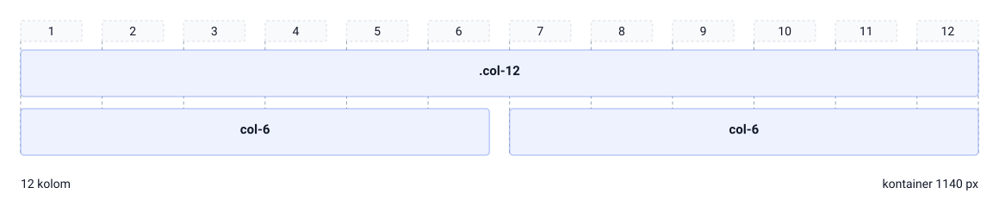

Frame 1440 px dikurangi margin 150 px di kiri dan 150 px di kanan menyisakan content 1140 × 96 px, jadi lebar total tetap 1440 px. Kontainer itu lalu dibagi 12 kolom: (1140 − 11 × 24) ÷ 12 = 73 px per kolom.

<!--
Kerjakan pengurangannya di papan: 1440 − 150 − 150 = 1140. Tanyakan kenapa sisanya 150 px, bukan angka lain. Jawaban yang diharapkan: kontainer Bootstrap berhenti tumbuh di 1140 px, jadi sisa 300 px dibagi dua sama rata. Tunjuk pita margin kiri-kanan di gambar, lalu baris lebar total 1440 px di panel kanan. Nilai di panel itu ditulis urut atas, kanan, bawah, kiri, jadi margin 0 150 0 150 px artinya cuma kiri dan kanan yang diberi 150 px.
-->

---

# Text Style dan Color Style

- Desainer yang rapi nggak mewarnai teks satu per satu
- Text style: keluarga font, ketebalan, ukuran, line-height
- Color style: warna berlabel yang dipakai berulang
- Panel Local styles mengumpulkan semua gaya ini
- Inilah design token dalam bentuk desain

> Baca daftar gaya berlabel, bukan mengklik teks satu per satu di kanvas.

<!--
Ingatkan Bab 12: konsep token desain sebenarnya udah kenal, cuma bentuknya beda. Tanyakan
kenapa daftar gaya berlabel lebih andal daripada mengklik teks satu-satu. Jawaban yang
diharapkan: daftar itu langsung menunjukkan konsistensi dan niat desainernya. Sebutkan
bahwa nama gaya Figma bakal jadi nama variabel CSS.
-->

---

# Contoh: Text Style dan Color Style

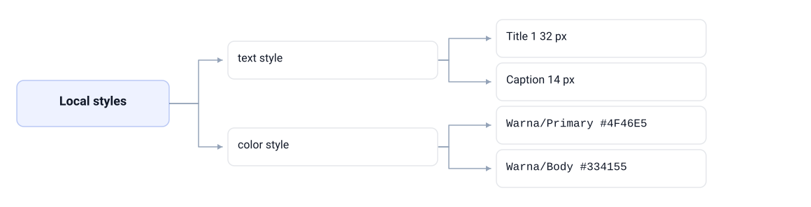

Panel Local styles di Figma cuma punya dua cabang: text style dan color style. Contoh isinya, text style memuat Title 1 32 px sampai Caption 14 px, sedangkan color style memuat Warna/Primary #4F46E5 dan Warna/Body #334155.

<!--
Tanyakan kenapa daftar gaya berlabel lebih andal daripada mengklik teks satu per satu di kanvas. Jawaban yang diharapkan: daftar itu langsung menunjukkan konsistensi dan niat desainernya. Tunjuk cabang color style lalu sebutkan bahwa slide setelah ini membongkar tokennya satu per satu.
-->

---

<!-- _class: compact -->

# Text Style Jadi Aturan Tipografi

| Gaya Figma | Nilai ringkas | Pemetaan CSS |
|---|---|---|
| Heading/Title 1 | Poppins 600, 32 px, 1,25 | `.page-title` |
| Heading/Title 2 | Poppins 600, 28 px, 1,25 | `.produk-nama` |
| Heading/Card Title | Poppins 500, 18 px, 1,4 | `.produk-card-nama` |
| Body/Paragraph | Inter 400, 16 px, 1,6 | aturan `body` |
| Body/Caption | Inter 400, 14 px, 1,5 | `.page-breadcrumb` |

- Nilai ukuran dan ketebalan disalin, bukan ditebak dari perasaan

<!--
Tekankan kolom tengah: itu angka desain, bukan selera penulis kode. Tanyakan kenapa
`Body/Paragraph` dipetakan ke aturan `body`, bukan ke kelas khusus. Jawaban yang
diharapkan: karena hampir semua paragraf memakainya, jadi cukup sekali ditulis di dasar
halaman. Sebutkan bahwa `line-height` di tabel ini juga angka desain, bukan angka bulat
hasil perkiraan.
-->

---

# Warna Berlabel Jadi Token

- `Warna/Primary` `#4F46E5` jadi `--clr-primary`
- `Warna/Accent` `#F59E0B` jadi `--clr-accent`
- `Warna/Dark` `#1E293B` jadi `--clr-dark`
- `Warna/Body` `#334155` jadi `--clr-body`
- `Warna/BG` `#F8FAFC` jadi `--clr-bg`
- `Warna/Surface` `#FFFFFF` dan `Warna/Border` `#E2E8F0` ikut jadi token

<!--
Minta mahasiswa menebak nama variabel buat satu color style fiktif sebelum kamu lanjut.
Tekankan bahwa nilai hex dipindahkan apa adanya, satu kali saja, di blok `:root`. Tanyakan
apa untungnya kalau warna cuma tinggal di satu tempat. Jawaban yang diharapkan: perubahan
desain cukup disalin di satu blok, dan semua badge ikut berubah. Ingatkan pola penamaan
Tokosaya yang udah dipakai sejak Bab 4.
-->

---

# Contoh: Warna Berlabel Jadi Token

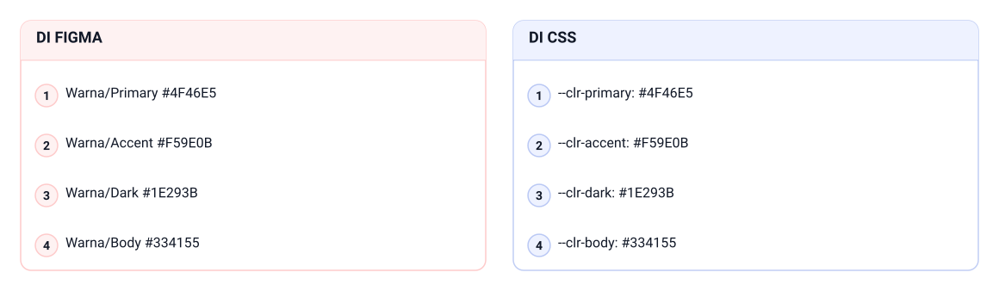

Nama color style dan nama variabel memang beda, tapi hex-nya disalin apa adanya: Warna/Primary #4F46E5 jadi --clr-primary: #4F46E5, Warna/Accent #F59E0B jadi --clr-accent: #F59E0B, Warna/Dark #1E293B jadi --clr-dark: #1E293B, dan Warna/Body #334155 jadi --clr-body: #334155.

<!--
Pasangkan baris kiri dan kanan satu per satu: yang di Figma dan yang di CSS isinya sama, cuma namanya beda. Tanyakan apa untungnya menyalin hex satu kali di blok `:root`. Jawaban yang diharapkan: perubahan desain cukup disalin di satu blok, dan semua badge ikut berubah.
-->

---

# Dua Kehati-hatian Sejak Awal

- Font harus dipanggil lewat Google Fonts, bukan diasumsikan ada
- Kalau panggilan gagal, fallback `sans-serif` menjaga halaman tetap terbaca
- Cek kontras sejak memetakan token, bukan setelah halaman jadi
- `#334155` di atas `#FFFFFF` kontras banget dan itu memang disengaja
- Penerjemah kode nggak cuma menyalin angka, tapi juga niat aksesibelnya

<!--
Tanyakan apa yang terjadi pada halaman kalau Google Fonts gagal dimuat di jaringan kampus.
Jawaban yang diharapkan: teks tetap terbaca lewat fallback generik. Lanjutkan dengan
mengaitkan kontras ke WCAG yang dibahas di Bab 13; tekankan bahwa keputusan aksesibilitas
itu datang dari desain, jadi jangan dihilangkan pas menulis kode.
-->

---

# Contoh: Dua Kehati-hatian Sejak Awal

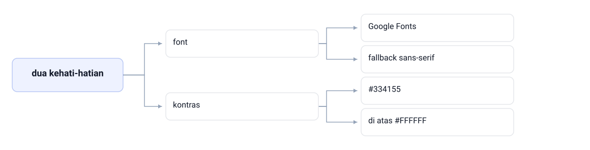

Dua kehati-hatian sejak awal cuma soal font dan kontras. Font dipanggil lewat Google Fonts dengan fallback sans-serif di belakangnya, sementara kontras dicek langsung di pasangan tokennya: #334155 di atas #FFFFFF.

<!--
Tanyakan apa yang terjadi kalau Google Fonts gagal dimuat di jaringan kampus. Jawaban yang diharapkan: teks tetap terbaca karena fallback sans-serif mengambil alih. Tunjuk cabang kontras lalu tegaskan bahwa keputusan aksesibilitas itu datang dari desain, bukan tambahan di akhir.
-->

---

<!-- _class: section -->
<!-- _footer: '' -->

# Menerjemahkan Komponen dan Token

## Baca, pilih elemen, pilih kelas, tulis, bandingkan

<!--
Masuk ke inti kerja bab ini. Katakan bahwa semua yang tadi dibaca di Figma sekarang
dipakai buat membangun komponen nyata di `produk.html`. Ingatkan bahwa hasilnya nanti
diperiksa lagi mutunya di Bab 15.
-->

---

# Lima Langkah Translasi Komponen

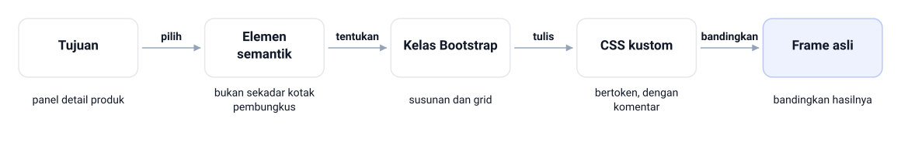

> Pakai utilitas Bootstrap dulu, lalu tambah CSS kustom secara terkontrol.

<!--
Ulang pola lima langkah ini pakai navbar dulu, baru kartu. Tekankan langkah kedua: panel
produk pakai `<section>` dengan `<h2>`, daftar link pakai `<ul>`. Tanyakan kenapa kelas
utilitas dipakai lebih dulu. Jawaban yang diharapkan: supaya susunan nggak ditulis ulang
dan CSS kustom tetap fokus ke warna serta ukuran presisi.

Bacakan kelima langkahnya utuh: tulis tujuan komponennya dulu, misalnya "panel detail
produk". Pilih elemen semantik, bukan sekadar kotak pembungkus. Tentukan kelas Bootstrap
buat susunan dan grid. Tulis CSS kustom bertoken dengan komentar `/* kustom */`.
Bandingkan hasilnya dengan frame asli biar nggak bergeser.
-->

---

<!-- _class: compact -->

# Peta Frame P-DETAIL-01

```text
Frame P-DETAIL-01 (produk.html, 1440 px)
├── <header> .site-nav: tautan + ikon keranjang
├── <section> .page-head: jejak navigasi + judul
├── <section> .produk-detail: row g-4
│   ├── col-lg-7: gambar utama + Spesifikasi Singkat
│   └── col-lg-5: badge, nama, kategori, harga, CTA, info
├── <section> .produk-terkait: h2 + tiga kartu
└── <footer> .site-footer: brand + navigasi + kontak
```

- Rasio 7-5 lahir dari pembacaan grid, bukan dari selera
- Kartu terkait pakai `col-12 col-md-4` biar tiga sejajar di desktop

<!--
Bacakan peta ini dari atas ke bawah, lalu tunjukkan frame aslinya kalau ada. Tanyakan
kenapa panel data dapat kolom lebih sempit dari gambarnya. Jawaban yang diharapkan: karena
angka grid di desain memang membagi begitu. Ingatkan bahwa peta seperti ini yang dipakai
tim nyata sebagai lembar janji kesetiaan.
-->

---

# Keadaan Interaktif Ditranslasi Statis

- Menu dan keranjang aslinya butuh perilaku JavaScript
- Di mata kuliah ini, tampilkan bentuk bukanya secara statis
- Pakai kelas yang sesuai dengan keadaan itu
- Catat bahwa perilaku nyatanya ditangani skrip di luar cakupan
- Membaca keadaan dari desain itu keterampilan yang sering diremehkan

<!--
Tanyakan kenapa mendisplay keadaan statis bukan langkah mundur. Jawaban yang diharapkan:
karena itu melatih membedah state desain, hal yang paling menentukan rasa jadi sebuah UI.
Sebutkan bahwa pendekatan yang sama dipakai pas Bab 11 menata keadaan formulir. Ingatkan
bahwa catatan perilaku wajib ditulis, jangan cuma diingat di kepala.
-->

---

# Contoh: Keadaan Interaktif Ditranslasi Statis

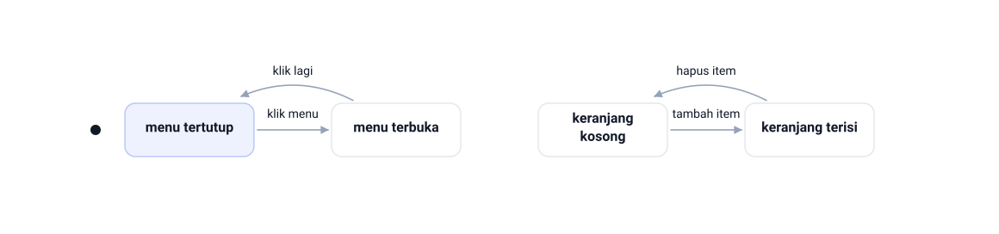

Menu punya dua keadaan, menu tertutup dan menu terbuka, dengan pemicunya klik menu lalu klik lagi untuk menutup. Keranjang juga dua: keranjang kosong dan keranjang terisi, yang berpindah lewat tambah item atau hapus item.

<!--
Tanyakan kenapa dua pasang keadaan ini tetap harus digambar walaupun halamannya statis. Jawaban yang diharapkan: keadaan itulah yang menentukan kelas mana yang dipasang di HTML, jadi tanpa gambarnya kelasnya cuma ditebak. Tunjuk pasangan kanan: keranjang terisi cukup ditampilkan apa adanya sebagai bentuk jadi, lalu tulis di catatan bahwa perilaku JavaScript-nya di luar cakupan.
-->

---

<!-- _class: compact -->

# Component Mapping Tokosaya

| Elemen desain | Peran token | Penerapan |
|---|---|---|
| Tombol "Tambah ke Keranjang" | `--clr-primary`, `--radius` | kelas `btn-tokosaya` |
| Badge "Best Seller" | `--clr-accent`, teks `--clr-dark` | kelas `badge-populer` |
| Badge "Tersedia" | `--clr-success` | kelas `badge-tersedia` |
| Badge "Stok Terbatas" | `--clr-danger` | kelas `badge-stok` |
| Harga produk | `--clr-primary`, Poppins 600 | kelas `produk-harga` |

- Semua sudut komponen memakai `--radius` 12 px

<!--
Tunjukkan panel produk di layar dan sebutkan peran token tiap barisnya. Tanyakan kenapa
badge pakai tiga token berbeda. Jawaban yang diharapkan: karena maknanya beda, satu
sorotan, satu sukses, satu bahaya. Ingatkan bahwa tabel kayak ini makin jarang bikin
interpretasi bebas kalau makin lengkap.
-->

---

# Token Tiga Lapis, Nama Berperan

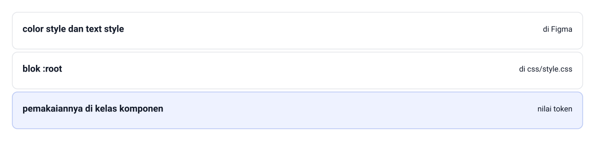

<!--
Tekankan aturan emasnya: nama variabel mengikuti peran. Tanyakan apa yang terjadi kalau
suatu hari desainer mengganti indigo jadi hijau. Jawaban yang diharapkan: cukup blok
`:root` yang disalin ulang, nama kelas dan komponennya nggak perlu berubah. Sebutkan juga
pilihan resmi menimpa variabel tema Bootstrap, plus peringatannya soal versi.

Sebutkan ketiga lapisnya utuh: lapis satu color style dan text style di Figma, lapis dua
blok `:root` di `css/style.css`, lapis tiga pemakaiannya di kelas komponen. Nama variabel
mengikuti peran, bukan warnanya, jadi `--clr-primary` tetap masuk akal kalau indigo diganti
hijau. Ingatkan juga bahwa nilai token dipakai lewat CSS kustom, nggak menimpa utilitas
diam-diam.
-->

---

<!-- _class: compact -->

# Tanpa Hex di Luar `:root`

```css
/* kustom — badge memakai token, bukan hex liar */
.badge-populer {
  background-color: var(--clr-accent);
  color: var(--clr-dark);
}
.badge-tersedia {
  background-color: var(--clr-success);
  color: #FFFFFF;
}
.badge-stok {
  background-color: var(--clr-danger);
  color: #FFFFFF;
}
```

`File: tokosaya-bootstrap/css/style.css`

- Hex liar bikin badge tampak ungu, bukan amber kayak desain
- Tempel aturan "tanpa hex di luar `:root`" di seluruh file kustom

<!--
Ceritakan masalah yang sering muncul: badge Best Seller jadi keunguan karena warna hex
ditulis langsung di CSS, bukan memanggil `var(--clr-accent)`. Tanyakan kenapa aturan
"tanpa hex di luar `:root`" gampang diaudit. Jawaban yang diharapkan: cukup cari tanda `#`
di file kustom dan lihat sisanya. Ingatkan juga supaya urutan badge dan nama produk
mengikuti spesifikasi, bukan selera.
-->

---

<!-- _class: section -->
<!-- _footer: '' -->

# Menjaga Fidelity

## Sembilan item, toleransi dua piksel

<!--
Pindah dari peta token ke penilaian hasil. Katakan bahwa bagian ini yang paling sering
dilupakan mahasiswa karena halaman udah kelihatan "jadi". Ingatkan bahwa checklist ini
juga jadi modul pertama checklist QA di Bab 15.
-->

---

# Apa Itu Fidelity

Fidelity adalah ukuran seberapa dekat hasil implementasi dengan desain.

- Targetnya bukan piksel yang betul-betul sama
- Web hidup di layar dengan panjang yang nggak terduga
- Yang dijaga: tipografi, jarak, warna, dan radius
- Penilaiannya dikaitkan ke lembar spesifikasi, bukan perasaan
- Translasi setia tetap lentur terhadap teks yang memanjang

<!--
Tekankan bahwa "kurang mirip" bukan ukuran yang sah; spesifikasi yang jadi rujukan.
Tanyakan kenapa panjang teks yang memanjang itu wajar di web. Jawaban yang diharapkan:
panjang konten bagian alami web, jadi desainnya harus tahan terhadap itu. Ingatkan
toleransi ± 2 piksel buat selisih kecil akibat pembulatan browser.
-->

---

# Contoh: Apa Itu Fidelity

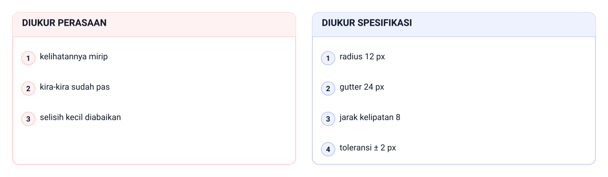

Fidelity selalu diukur ke lembar spesifikasi: radius 12 px, gutter 24 px, jarak kelipatan 8, dan toleransi ± 2 px. Kalau ukurannya cuma kelihatannya mirip, kira-kira sudah pas, dan selisih kecil diabaikan, tidak ada angka yang bisa diperbaiki.

<!--
Pasangkan dua judul panelnya sebelum membahas isinya: diukur perasaan di kiri, diukur spesifikasi di kanan. Tanyakan kenapa panel kiri nggak bisa dipakai buat menilai pekerjaan orang lain. Jawaban yang diharapkan: karena "mirip" nggak bisa dibuktikan, sedangkan radius 12 px dan gutter 24 px bisa. Tunjuk baris toleransi ± 2 px sebagai satu-satunya selisih yang boleh dimaafkan.
-->

---

<!-- _class: compact -->

# Checklist Fidelity 1–5

| No. | Item pemeriksaan | Cara memeriksa |
|---|---|---|
| 1 | Tipografi tiap level | panel Computed pada `h1`, `h2`, `p` |
| 2 | Warna dari token | panel `:root` dan cari tanda `#` |
| 3 | Jarak kelipatan 8 | Computed pada kontainer dan kartu |
| 4 | Radius semua sudut 12 px | `border-radius` kartu, tombol, badge |
| 5 | Gutter 24 px antar kolom | inspect `row` dan `col` |

- Jalankan lewat panel Inspect di Chrome, bagian Computed

<!--
Kerjakan item dua bareng-bareng di layar, karena itu yang paling cepat kelihatan.
Tanyakan kenapa selisih kecil nggak perlu dipaksa diperbaiki. Jawaban yang diharapkan:
itu pembulatan browser, jadi dicatat sebagai toleransi ± 2 piksel. Sebutkan bahwa selisih
besar atau arahnya salah biasanya tanda nilai yang disalin meleset.
-->

---

<!-- _class: compact -->

# Checklist Fidelity 6–9

| No. | Item pemeriksaan | Cara memeriksa |
|---|---|---|
| 6 | Kontainer maksimum 1140 px | lebar `.container` di desktop |
| 7 | Ikon Bootstrap Icons konsisten | bandingkan set ikon dengan desain |
| 8 | Responsif 1440, 768, 375 | Device Toolbar Chrome |
| 9 | Aksesibilitas halaman | kontras, `alt`, urutan heading |

- Simpan hasil pemeriksaannya di `catatan-fidelity.txt`

<!--
Ingatkan bahwa item sembilan menyambung ke checklist Bab 13, bukan pekerjaan baru. Tanyakan
kenapa pemeriksaan responsif wajib walau prototipnya udah kelihatan bagus. Jawaban yang
diharapkan: prototip cuma simulasi layar, jadi tumpukan kolom aslinya harus diuji di kode.
Minta mahasiswa menutup checklist sedikit demi sedikit, bukan menumpuk di akhir.
-->

---

# Dua Kebiasaan Menjaga Fidelity

- Salin nilai, jangan salin perasaan
- Angka piksel di desain dipindahkan apa adanya ke CSS
- Beri nama token kalau nilainya dipakai lebih dari dua kali
- Uji bertahap: selesaikan satu komponen, bandingkan, lalu lanjut
- Jangan membangun seluruh halaman dulu baru mencari selisihnya

> Koreksi yang ditumpuk di akhir selalu terasa lebih capek.

<!--
Bahas kebiasaan kedua paling lama, karena itu yang paling sering dilanggar pas deadline.
Tanyakan apa risiko membangun semua komponen dulu. Jawaban yang diharapkan: selisihnya
menumpuk dan susah dilacak asalnya. Sebutkan bahwa kebiasaan ini yang bikin revisi desainer
berkurang, sama kayak kisah di awal bab.
-->

---

# Contoh: Dua Kebiasaan Menjaga Fidelity

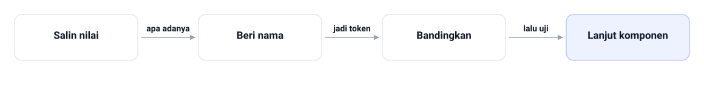

Kebiasaan pertama: salin nilai apa adanya dari panel desain, lalu beri nama jadi token kalau angkanya dipakai lebih dari dua kali. Kebiasaan kedua: bandingkan satu komponen dulu, lalu uji, baru lanjut komponen berikutnya.

<!--
Tanyakan apa risikonya membangun semua komponen dulu baru mencari selisihnya di akhir. Jawaban yang diharapkan: selisihnya menumpuk dan asalnya susah dilacak. Tunjuk panah kedua di gambar, yaitu langkah beri nama, lalu sebutkan bahwa token cuma dipakai kalau nilainya berulang lebih dari dua kali.
-->

---

<!-- _class: compact -->

# Praktik: Membangun `produk.html`

- Lanjutkan folder proyek `tokosaya-bootstrap/` dari Bab 9
- Bangun file baru `produk.html` di dalam folder itu
- Kembangkan `css/style.css` yang sudah ada
- Siapkan empat gambar produk di folder `img/`
- Butuh Chrome dan koneksi buat CDN serta Google Fonts
- Standar kesetiaannya diperiksa bareng dosen

<!--
Katakan bahwa hasil praktikum bab ini adalah input pemeriksaan mutu di Bab 15. Tanyakan
kenapa gambar produk disiapkan sejak awal. Jawaban yang diharapkan: karena ukuran aset dan
batasan kolom saling memengaruhi. Ingatkan supaya `katalog.html` dari Bab 10 tetap utuh di
sebelah halaman baru.
-->

---

# Contoh: Praktik: Membangun `produk.html`

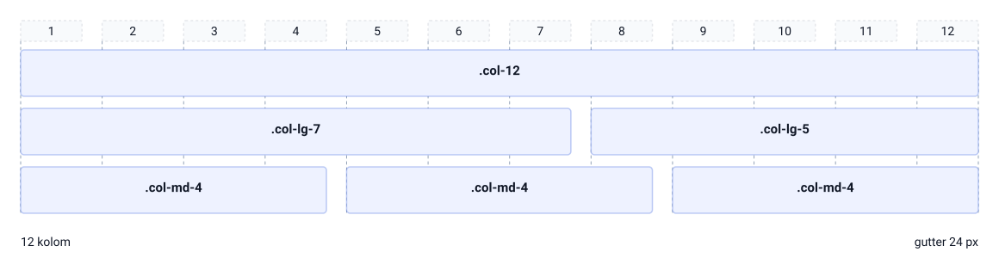

Halaman produk.html disusun di atas kontainer 1140 px dengan gutter 24 px: baris .col-12 penuh, lalu .col-lg-7 untuk gambar dan .col-lg-5 untuk panel harga, lalu tiga kartu .col-md-4. Barisnya 7 + 5 dan 4 + 4 + 4, jadi keduanya tetap berjumlah 12 kolom.

<!--
Minta kelas menebak kelas Bootstrap tiap baris sebelum kamu tunjukkan gambarnya. Tanyakan kenapa panel harga dapat 5 kolom, bukan 6. Jawaban yang diharapkan: angka grid di desain memang membagi begitu, dan itu yang dibaca dari frame, bukan dari selera. Tunjuk baris ketiga: tiga kartu .col-md-4 yang nanti jadi satu kolom di HP.
-->

---

<!-- _class: compact -->

# Langkah Kerja Praktikum

- Baca spesifikasi dulu, jangan menulis kode sebelum jelas
- Susun kerangka HTML dengan lima bagian utama
- Tulis blok `:root` penuh dan aturan dasar halaman
- Tambahkan kelas tiap komponen sesuai angka spesifikasi
- Uji di lebar 1440, 768, dan 375 piksel
- Jalankan checklist, catat hasilnya di `catatan-fidelity.txt`

<!--
Jalankan langkah ini sambil didemokan di layar, jangan cuma dibacakan. Sering-sering
berhenti di langkah pertama, karena kesalahan paling banyak terjadi pas spesifikasi cuma
dibaca sekilas. Tanyakan kenapa angka spesifikasi disalin dulu sebelum rapi-rapi. Jawaban
yang diharapkan: biar nggak ada nilai yang ditaksir.

-->

---

# Contoh: Langkah Kerja Praktikum

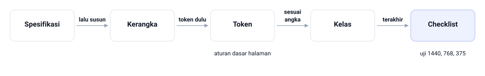

Baca spesifikasi dulu, lalu susun kerangka lima bagian, token dulu di blok `:root`, kelas sesuai angka, terakhir uji lebar 1440, 768, dan 375 piksel. Urutan ini yang bikin angka desain nggak sempat ditaksir.

<!--
Jalankan urutannya sambil didemokan di layar, jangan cuma dibacakan. Tanyakan kenapa spesifikasi dibaca dua kali: sebelum menulis kode dan sebelum menyalin angka. Jawaban yang diharapkan: biar nggak ada nilai yang ditaksir, dan itu penyebab revisi paling sering. Tunjuk langkah terakhir, karena di situlah kesetiaan halaman baru benar-benar diuji.
-->

---

<!-- _class: compact -->

# Token di `css/style.css`

```css
/* kustom — design token hasil pemetaan Figma styles */
:root {
  --clr-primary: #4F46E5;
  --clr-accent: #F59E0B;
  --clr-dark: #1E293B;
  --clr-body: #334155;
  --clr-bg: #F8FAFC;
  --clr-surface: #FFFFFF;
  --clr-border: #E2E8F0;
  --font-heading: 'Poppins', sans-serif;
  --font-body: 'Inter', sans-serif;
  --radius: 12px;
  --shadow-card: 0 8px 24px rgba(15, 23, 42, 0.08);
  --space-unit: 8px;
}
```

`File: tokosaya-bootstrap/css/style.css`

- Nilai disalin dari spesifikasi, bukan ditaksir

<!--
Tunjukkan blok ini di editor aslinya, jangan cuma di slide. Tekankan bahwa `--space-unit`
8 px jadi basis skala jarak 8/16/24/32/48/64. Tanyakan kenapa token dikelompokkan di satu
blok paling atas. Jawaban yang diharapkan: biar jadi satu sumber kebenaran yang gampang
disalin ulang. Lanjutkan dengan aturan dasar `body` dan heading di bawahnya.
-->

---

<!-- _class: compact -->

# Panel Detail Sesuai Urutan Spesifikasi

```html
<div class="produk-panel">
  <span class="badge-populer">Best Seller</span>
  <h2 class="produk-nama mt-3">Keyboard Mekanis KX-210</h2>
  <p class="produk-kategori m-0 mt-2">Aksesori Input</p>
  <p class="produk-harga m-0 mt-2">Rp650.000</p>
  <a href="keranjang.html" class="btn-tokosaya produk-cta">
    <i class="bi bi-cart3 me-2" aria-hidden="true"></i> Tambah ke Keranjang
  </a>
</div>
```

`File: tokosaya-bootstrap/produk.html`

- Urutan isi panel mengikuti spesifikasi bagian F
- Kelas Bootstrap mengurus susunan, kelas kustom mengurus warna

<!--
Minta mahasiswa menyebutkan urutan isi panel sebelum kamu menampilkan kodenya. Tanyakan
kenapa badge diletakkan paling atas, bukan di bawah harga. Jawaban yang diharapkan: karena
spesifikasi menempatkannya sebelum nama produk. Sebutkan bahwa kesalahan urutan kayak ini
justru jadi salah satu bahan analisis di evaluasi bab.
-->

---

# Hasil yang Diharapkan

- Navbar putih bertepi tipis dengan link aktif Katalog
- Page head berisi jejak navigasi dan judul halaman
- Panel kanan: badge amber, harga indigo 24 px, tombol radius 12
- Tiga kartu terkait sejajar dengan gutter 24 px
- Di 375 px kartu jadi satu kolom, judul turun ke 24 px
- Semua warna komponen datang dari blok `:root`

<!--
Bandingkan hasilnya langsung di browser dengan frame desainnya, jangan cuma menampilkan
slide ini. Kalau ada yang belum sesuai, curigai dulu jalur file CSS dan kelas yang lupa
dipasang. Tanyakan apa tanda halaman yang nilai warnanya bukan dari token. Jawaban yang
diharapkan: ada hex yang nempel langsung di selector komponen.
-->

---

# Latihan

- Jelaskan beda prototip dan implementasi, beri satu contoh keputusan
- Ganti `col-md-4` jadi `col-md-6`, catat apa yang berubah
- Susun tabel pemetaan buat `Warna/Info` dan `Warna/Warning`
- Terjemahkan spesifikasi tipografi jadi `.judul-promo` dan `.keterangan-promo`
- Tulis spesifikasi satu kartu buat Webcam HD WC-720
- Buat `produk-mw88.html` dari struktur praktikum, ganti datanya

> Kaitkan jawabanmu dengan angka grid, token, dan spesifikasi desain.

<!--
Kerjakan butir kedua bareng-bareng di papan, sisanya buat latihan mandiri. Perhatikan
butir terakhir: tujuan soalnya bukan menyalin file, tapi menyadari berapa sedikit tempat
yang wajib disunting karena token. Tanyakan pasangan nilai mana yang harus tetap sama di
file baru itu. Jawaban yang diharapkan: seluruh blok `:root` dan kelas komponennya.

-->

---

# Cek Daftar Fidelity Akhir

- Kelima bagian utama `produk.html` lengkap dan semantik
- `:root` memuat token warna, font, radius, dan jarak
- Nggak ada hex liar di luar blok `:root`
- Radius semua komponen 12 px dari token
- `g-4` terpasang di setiap `row` kartu
- Gambar punya `alt`, heading berurutan dengan satu `h1`

<!--
Minta mahasiswa saling memeriksa halaman pakai daftar ini dan menunjukkan buktinya di
DevTools. Tanyakan item mana yang paling sering gagal di tugas tahun lalu. Jawaban yang
diharapkan: hex liar dan `row` tanpa `g-4`. Ingatkan bahwa hasil pemeriksaan ditulis di
`catatan-fidelity.txt` dan itu bagian dari penilaian.

-->

---

# Rangkuman

- Handoff adalah serah terima keputusan desain, bukan file
- Baca Figma urut: frame, layer, auto layout, ukuran, warna
- Grid 12 kolom Tokosaya: kontainer 1140, gutter 24, kolom 73
- Text style dan color style jadi token di blok `:root`
- Translasi komponen memakai pola lima langkah yang berulang
- Fidelity dijaga checklist sembilan item, toleransi ± 2 px

<!--
Tutup dengan pesan utama: janji desain baru muncul di layar kalau angkanya disalin dengan
disiplin. Sebutkan bahwa halaman `produk.html` ini jadi bahan uji mutu di Bab 15, lengkap
dengan pemeriksaan responsif, aksesibilitas, dan debugging visual. Ingatkan bahwa peta
token tiga lapis itu yang bikin seluruh halaman bergerak barengan pas desain diperbarui.
-->

---

<!-- _class: lead -->
<!-- _footer: '' -->

# Tugas dan Refleksi

Tulis spesifikasi tekstual buat page head dan panel detail Webcam HD WC-720, lalu implementasikan keduanya di `produk-wc720.html` dengan token yang sama.

**Pertanyaan refleksi:** kalau desainer cuma menyerahkan tangkapan layar, pertanyaan apa yang kamu ajukan sebelum menulis satu baris kode?

<!--
Tugas individu: kumpulkan file HTML, CSS, dan tabel fidelity kesembilan item. Nilai
kelengkapan spesifikasi angka pikselnya, kesetiaan kode, pemakaian kelas utilitas lebih
dulu, serta tidak adanya warna di luar token. Tekankan bahwa yang dinilai bukan halaman
yang cantik, tapi translasi yang bisa dipertanggungjawabkan angkanya.
-->
