<!-- _class: lead -->
<!-- _paginate: skip -->
<!-- _footer: '' -->

# Final Project dan Quality Assurance

**Bab 15** · Menutup semester dengan bukti, bukan asumsi

Studi kasus: **Tokosaya** — milestone M7

<!--
Buka dengan cerita dari buku: tim magang udah merasa website-nya sempurna, lalu pemilik
toko membukanya sendiri di HP dan menemukan gulir horizontal plus label form yang hilang.
Tanyakan siapa yang pernah merasa proyeknya selesai padahal belum pernah diuji di
perangkat lain. Sebutkan bahwa bab ini bab terakhir sebelum ujian akhir, dan hasilnya
adalah satu paket rilis kandidat.
-->

---

# Tujuan Pembelajaran

Setelah menyelesaikan bab ini, kamu bisa:

- Menjelaskan anatomi final project dan kaitannya ke M7
- Mengidentifikasi cacat organisasi folder dan penamaan file
- Menerapkan prinsip kode bersih pada HTML dan CSS
- Menerapkan praktik terbaik Bootstrap di proyek akhir
- Menjalankan QA sprint: audit, peer review, perbaikan, uji ulang
- Menganalisis temuan pengujian dan mengevaluasi kesiapan rilis

<!--
Bacakan tujuan ini singkat, lalu tekankan bahwa CPMK-nya CPMK 6: disiplin kualitas plus
integrasi proyek akhir. Sebutkan bahwa urutan babnya mengikuti alur kerja QA di dunia
kerja: pahami bentuk jadi, rapikan struktur, uji, perbaiki, lalu kunci rilis. Ingatkan
bahwa semua alatnya udah kamu punya: DevTools, validator W3C, dan checklist aksesibilitas
Bab 13.
-->

---

# Sempurna di Laptop, Belum Siap di HP

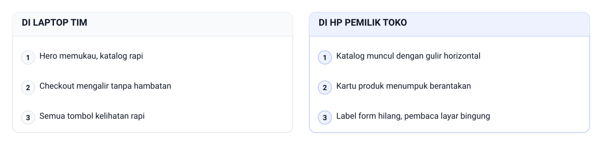

Website `tokosaya-bootstrap/` tampak matang di laptop tim, lalu dibuka pemilik toko di HP-nya.

> Kualitas nggak pernah tinggal menetap. Ia harus diperiksa ulang, bukan diasumsikan.

<!--
Ceritakan detailnya persis kayak buku: pembaca layar menyebut bidang surel sebagai "edit
kosong" karena labelnya nggak terhubung. Tanyakan apa bedanya "terasa selesai" dengan
"siap rilis". Jawaban yang diharapkan: yang pertama perasaan, yang kedua hasil pemeriksaan.
Pakai analogi kalibrasi alat laboratorium kalau kelas terlihat belum kebayang.

Bacakan dua kolom di gambar sebagai satu cerita, jangan dua daftar terpisah. Di laptop tim
hero memukau, katalog rapi; di HP pemilik toko katalog muncul dengan gulir horizontal.
Checkout mengalir tanpa hambatan di laptop, tapi kartu produk menumpuk berantakan di HP.
Semua tombol kelihatan rapi di laptop, sementara label form hilang, pembaca layar bingung
di HP. Tekankan bahwa tiga pasangan ini bukan tiga bug terpisah, melainkan satu pertanyaan:
website ini pernah diuji di perangkat siapa?
-->

---

<!-- _class: section -->
<!-- _footer: '' -->

# Peta Proyek dan Rumah Kode

## Kenali bagiannya dulu, baru menyisir cacatnya

<!--
Masuk ke bagian pertama. Katakan bahwa QA tanpa peta berubah jadi petualangan: orang
memeriksa halaman yang dia suka dan melewatkan yang sepi. Bagian ini menyiapkan peta
anatomi, folder, penamaan, dan kode bersih sebagai fondasi auditnya.
-->

---

# Sembilan Bagian Wajib di Empat Halaman

- Bagian wajib: homepage, navigasi, hero, section konten
- Lanjutannya: kartu, form, footer, layout responsif, design system
- Proyek akhir memilih satu dari delapan kasus di Bab 16
- Ketentuan minimum: empat halaman yang saling tersambung
- Halaman baku Tokosaya: index, katalog, produk, kontak
- Katalog memuat delapan produk baku, misalnya KX-210 dan WC-720

<!--
Tekankan bahwa sembilan bagian ini adalah pedoman resmi, bukan karangan buat slide.
Tanyakan bagian mana yang paling sering dilupakan mahasiswa waktu menyiapkan tugas.
Jawaban yang diharapkan: design system dan layout responsif, karena dua bagian itu
nggak kelihatan di satu halaman saja. Ingatkan bahwa setiap bagian punya risiko khas,
jadi pemeriksaannya juga beda.
Demo: demos/bab-15/01-sembilan-bagian-wajib.html — sembilan bagian wajib dipetakan ke empat kolom halaman Tokosaya, termasuk pita bagian yang berlaku di semuanya.
-->

---

# Contoh: Sembilan Bagian Wajib di Empat Halaman

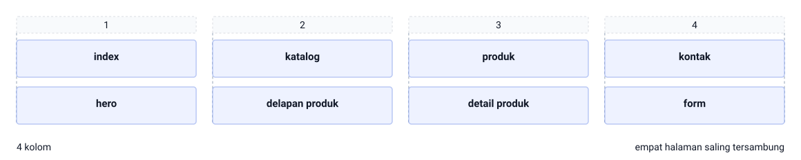

Empat halaman Tokosaya berbagi pola yang sama: `index.html` memuat hero, `katalog.html` memuat delapan produk, `produk.html` memuat detail produk, dan `kontak.html` memuat form. Dibaca sebagai grid 4 kolom, satu kolom satu halaman, jadi sembilan bagian wajib tinggal ditempel ke tempatnya masing-masing. Empat halaman saling tersambung lewat navigasi yang sama.

<!--
Tunjuk satu kolom per halaman dan tanya bagian mana yang paling sering kosong di proyek teman sekelas. Jawaban yang diharapkan: section konten di halaman produk dan footer yang lupa diperbarui. Tekankan bahwa sembilan bagian wajib itu bukan sembilan halaman — empat halaman inilah yang harus lengkap, dan polanya berulang.
-->

---

# Fokus QA Tiap Bagian

| Bagian | Fokus QA khas |
|---|---|
| Homepage | Judul hero lengkap, tombol katalog berfungsi |
| Navigasi | Empat menu aktif, nggak ada link mati |
| Hero | Tagline "Belanja Tepat, Kirim Cepat" konsisten |
| Form | Label terhubung, pesan peringatan bermakna |
| Layout responsif | Test matrix tiga breakpoint terisi penuh |

- Sisa bagiannya ada di buku: section, kartu, footer, design system

<!--
Bahas baris Form paling lama, karena di situlah cacat aksesibilitas paling sering muncul.
Tanyakan kenapa bagian layout responsif nggak bisa diperiksa dari satu halaman saja.
Jawaban yang diharapkan: karena kepatuhannya baru terlihat pas lebar layar berubah.
Sebutkan bahwa tabel ini sekaligus jadi kerangka checklist praktikum nanti.
-->

---

<!-- _class: compact -->

# Struktur Folder Siap Tim

```text
tokosaya-bootstrap/
├── index.html
├── katalog.html
├── produk.html
├── kontak.html
├── checkout.html
├── styleguide.html
├── qa-checklist.html
├── laporan-temuan.html
├── css/
│   └── style.css
└── img/
    └── produk-keyboard-kx210.svg
```

`File: tokosaya-bootstrap/`

- HTML datar di akar, satu folder `css/`, satu folder `img/`
- Alat QA di akar biar reviewer cepat menemukannya

<!--
Gambarkan folder ini sebagai dokumen arsitektur: pengelola baru bisa menebak jalan pikiran
tim cuma dari pohonnya. Tanyakan apa risikonya kalau ada file tambahan nyempil di luar
pola ini. Jawaban yang diharapkan: reviewer kehilangan tempat dan penyisiran jadi
menyisakan lubang. Ingatkan bahwa folder inilah yang diserahkan sebagai paket rilis.
Demo: demos/bab-15/02-struktur-folder-proyek.html — pohon `tokosaya-bootstrap` dirender sebagai daftar bersarang, dengan empat hal yang dibaca reviewer di sebelahnya.
-->

---

# Empat Konvensi Penamaan

- Nama file deskriptif tapi ringkas, tanpa spasi
- Nama gambar memuat kategori dan kode produk
- Satu file CSS di `css/style.css`
- Alat QA ditaruh di akar folder proyek
- Pola `blok-elemen`: kebab-case, huruf kecil, tanda hubung
- Nama kayak `Produk Baru.html` bisa mati di hosting

<!--
Tulis `Produk Baru.html` di papan, lalu tanyakan kenapa file itu bisa jalan lokal tapi mati
di hosting. Jawaban yang diharapkan: sebagian sistem file dan server memperlakukannya beda
dari `produk-baru.html`. Tekankan bahwa penamaan konsisten mengurangi salah ketik jalur,
yang jadi sumber link mati paling umum di proyek pemula.
Demo: demos/bab-15/03-konvensi-penamaan.html — tiga nama berkas yang gagal di hosting dicoret dan dipasangkan dengan versi kebab-case-nya.
-->

---

# Contoh: Empat Konvensi Penamaan

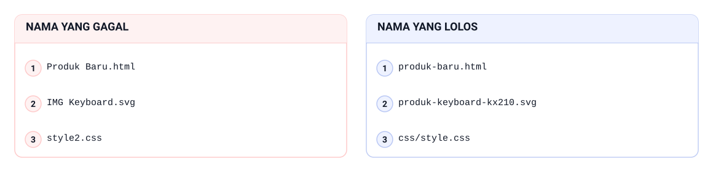

Nama yang gagal biasanya tiga ini, dan nama yang lolos cuma beda tanda hubung: `Produk Baru.html` jalan di laptop tim tapi mati di hosting, sedangkan `produk-baru.html` aman karena huruf kecil semua dan tanpa spasi. `IMG Keyboard.svg` dan `style2.css` melanggar konvensi yang sama, sementara `produk-keyboard-kx210.svg` memuat kategori plus kode produk dan semua gaya tetap di `css/style.css`.

<!--
Tulis `Produk Baru.html` di papan dan tanya kenapa file itu hidup di laptop tapi mati setelah diunggah. Jawaban yang diharapkan: spasi dan huruf besar diperlakukan beda oleh sebagian server, jadi jalurnya berubah. Lanjut ke kolom kanan: kebab-case, huruf kecil, kategori plus kode produk, satu file CSS.
-->

---

# HTML yang Bersih

- DOCTYPE HTML5 plus `lang="id"` di elemen `html`
- `<meta name="viewport">` hadir di setiap halaman
- Satu `h1` per halaman, hierarki heading nggak melompat
- Setiap `img` punya `alt` yang menjelaskan isinya
- Setiap `label` terhubung ke input lewat `for`–`id`
- Elemen semantik dipakai buat header, nav, main, dan footer

<!--
Ingatkan bahwa kode bersih punya dua pembaca: manusia dan mesin, yaitu browser, validator,
dan pembaca layar. Tanyakan kenapa `div` kurang cocok buat pembungkus navigasi. Jawaban
yang diharapkan: elemen semantik memberi peran, dan peran itu yang dibacakan alat bantu.
Sebutkan bahwa aturan ini dipakai ulang sebagai item checklist pada praktikum.
Demo: demos/bab-15/04-html-bersih.html — dua medan surel berdampingan: satu labelnya terhubung lewat `for`–`id` sehingga fokus pindah saat label diklik, satu tidak.
-->

---

# Contoh: HTML yang Bersih

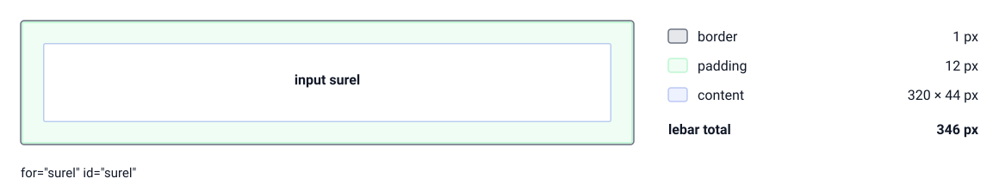

Input surel di `kontak.html` nggak butuh CSS kustom: content 320 × 44 px, padding 12 px, border 1 px, jadi lebar total 346 px. Yang bikin halaman ini bersih bukan angkanya, tapi pasangan `for="surel" id="surel"` yang menyambung label ke input, plus satu `h1` per halaman dan `alt` di setiap `img`.

<!--
Minta kelas menghitung dulu sebelum menebak: 320 + 12 + 12 + 1 + 1 jadi berapa. Jawaban yang diharapkan: 346 px, dan angka itu bukan inti slide ini. Tunjuk baris content, padding, dan border di daftar kanan, lalu tanya apa yang terjadi kalau `for` dan `id` nggak nyambung — pembaca layar menyebut input itu "edit kosong".
-->

---

# CSS yang Bersih

- Urutan file: token `:root`, base, komponen, halaman
- Penamaan kelas kebab-case mengikuti peran, bukan tampilan
- Hapus kode mati dan hapus duplikasi aturan
- `!important` bukan jalan pintas penyelesaian konflik

> Kalau tampilan melawan kamu, hampir selalu masalah kaskade yang bisa dibereskan jujur.

<!--
Minta mahasiswa menghitung berapa aturan di file mereka yang nggak pernah mengenai elemen
apa pun. Tanyakan kenapa `.merah` dan `.fix2` jadi nama yang menyesatkan pas desain berubah.
Jawaban yang diharapkan: namanya mendeskripsikan tampilan sesaat, bukan peran. Sebutkan
bahwa kode mati yang dibiarkan bikin reviewer berani menghapus hal yang salah.
Demo: demos/bab-15/05-css-bersih.html — empat lapis `style.css` ditampilkan berurutan, lalu satu kartu yang seluruh nilainya menumpang token.
-->

---

# Contoh: CSS yang Bersih

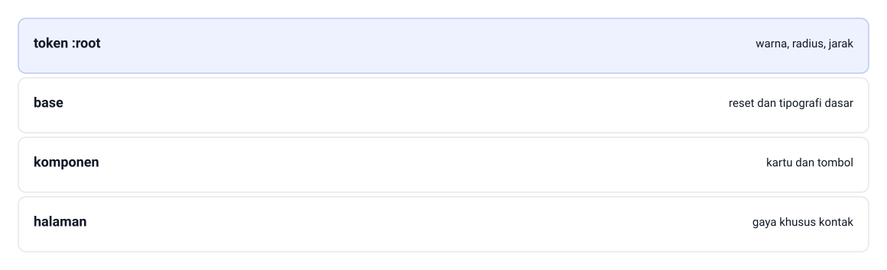

`style.css` Tokosaya dibaca berlapis dari atas: token `:root` buat warna, radius, jarak; lapis base buat reset dan tipografi dasar; lapis komponen buat kartu dan tombol; dan lapis halaman buat gaya khusus kontak. Nilai yang menumpang token bikin `!important` nggak pernah dibutuhkan.

<!--
Tanya kelas: lapis mana yang paling sering jadi tempat sampah di file mereka. Jawaban yang diharapkan: lapis halaman, karena aturan sekali pakai suka ditumpuk di sana. Tunjuk urutan lapisnya dari atas ke bawah, lalu tegaskan bahwa `!important` cuma muncul kalau urutan ini dilanggar.
-->

---

<!-- _class: section -->
<!-- _footer: '' -->

# Praktik Terbaik Bootstrap

## Utilitas dulu, kustom seperlunya

<!--
Pindah dari kebersihan file ke disiplin framework. Katakan bahwa prinsip kepalanya satu
kalimat: manfaatkan utilitas terlebih dahulu, tulis kustom seperlunya, dan jangan pernah
berjuang melawan framework.
-->

---

# Utilitas Dulu, Kustom Seperlunya

- Tanya dulu: apa Bootstrap udah punya kelasnya?
- `mb-3` buat jarak bawah, `text-center` buat perataan
- `d-none d-md-block` menyembunyikan per bagian breakpoint
- `rounded-3` buat sudut bulat standar komponen
- Jangan pernah berjuang melawan framework

<!--
Tekankan bahwa keputusan ini murah dan bisa diulang: kalau utilitasnya ada, pakai
utilitasnya. Tanyakan kenapa pola ini menyelamatkan waktu di sprint perbaikan. Jawaban
yang diharapkan: perubahan jarak atau perataan cukup satu kelas, nggak perlu aturan baru.
Ingatkan bahwa kustom tetap boleh, cuma tempatnya bukan di sini.
Demo: demos/bab-15/06-utilitas-dulu-kustom-seperlunya.html — navbar 1120 px dengan lima item yang celahnya dibagi `space-between`, tanpa satu aturan kustom.
-->

---

# Contoh: Utilitas Dulu, Kustom Seperlunya

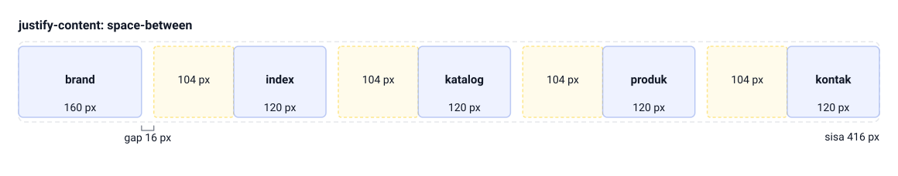

Navbar Tokosaya cukup satu kelas `d-flex` dengan `justify-content: space-between`: brand 160 px, empat menu index, katalog, produk, dan kontak masing-masing 120 px, plus gap 16 px kali empat. Totalnya 160 + 480 + 64 = 704 px dari kontainer 1120 px, jadi sisa 416 px dibagi rata menjadi 104 px di antara lima item — tanpa satu aturan kustom pun.

<!--
Minta kelas menebak dulu dari mana jarak 104 px itu datang, sebelum menghitung. Jawaban yang diharapkan: dari space-between, bukan dari margin per menu. Tunjuk pita amber di gambar dan tegaskan bahwa melebarkan satu menu cukup mengubah basisnya, nggak perlu aturan baru di `style.css`.
-->

---

# Aturan Jaga dan Batas Praktis

- Kustom dikasih komentar `/* kustom */` biar kelihatan
- Nilai kustom menumpang token, bukan hex acak
- Jangan menimpa kelas baku Bootstrap pakai `!important`
- Komponen interaktif butuh bundle JavaScript, di luar cakupan
- CDN dikunci: Bootstrap 5.3.3 dan Bootstrap Icons 1.11.3
- Ganti versi framework menjelang rilis bisa memicu regression

<!--
Minta kelas menunjuk satu aturan kustom di file masing-masing, lalu tanyakan apakah ada
komentar pengenalnya. Lanjutkan dengan risiko ganti versi Bootstrap di tengah sprint QA.
Periksa juga versi Bootstrap di websitenya sekarang, karena buku ini mengunci 5.3.3 dan
versi mayor baru bisa mengubah banyak kelas.
-->

---

# Contoh: Aturan Jaga dan Batas Praktis

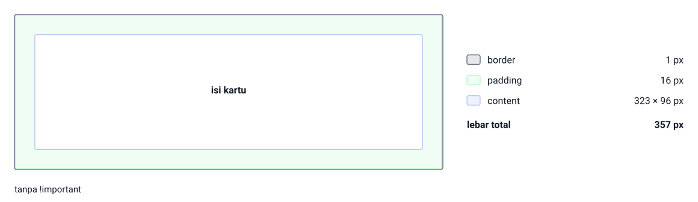

Kartu produk di `col-md-4` sudah beres dari framework: border 1 px ditambah padding 16 px di kiri dan kanan, jadi content 323 × 96 px dan lebar total 357 px — itulah isi kartu yang dilihat pengguna. Semua angka itu datang dari kelas baku, jadi `style.css` nggak perlu aturan penimpa dan tetap tanpa `!important`, sementara CDN dikunci di 5.3.3.

<!--
Tanya kenapa angka 357 px itu justru bukti bahwa nggak ada yang perlu ditimpa. Jawaban yang diharapkan: karena border dan padding sudah dibawa kelas baku, penimpaan cuma menambah aturan yang harus dirawat. Sebutkan bahwa versi 5.3.3 dan 1.11.3 dikunci justru supaya angka ini nggak berubah diam-diam di tengah sprint QA.
-->

---

# Kapan Utilitas, Kapan Kustom

| Kebutuhan | Pilihan |
|---|---|
| Jarak, ukuran, perataan teks | Utilitas `mb-3`, `px-4`, `text-center` |
| Tampil atau sembunyi per breakpoint | Utilitas `d-none d-md-block`, `col-md-4` |
| Bentuk baku kartu, badge, tombol | Komponen `.card`, `.btn`, `.text-bg-danger` |
| Identitas merek: warna, font, radius | Kustom pakai token |
| Latar gradien hero, bayangan khas | Kelas kustom `hero-...` |

<!--
Bahas tabel ini dari atas ke bawah dan minta mahasiswa menebak kolom kanannya dulu. Tanya
kenapa identitas merek justru harus kustom, bukan ditimpa ke kelas Bootstrap. Jawaban yang
diharapkan: merek itu keputusan kita sendiri, jadi tempatnya di kelas komponen yang kita
beri nama. Sebutkan bahwa baris pengecualian satu kasus langka ada di buku.
-->

---

<!-- _class: section -->
<!-- _footer: '' -->

# Uji Lintas Perangkat dan Aksesibilitas

## Website yang bagus di tiga puluh lebar layar

<!--
Masuk ke bagian pengujian. Katakan bahwa bagian ini mengubah pengujian dari lihat-lihat
sana-sini jadi penyisiran yang bisa dijadwalkan dan dilaporkan. Ingatkan bahwa alatnya
device toolbar dan validator, bukan tebakan.
-->

---

# Test Matrix dan Tiga Breakpoint

| Kolom matrix | Lebar | Yang diperiksa |
|---|---|---|
| HP | 360–575 px | nav, hero, kartu, form, footer |
| Tablet | 768–991 px | kolom grid berubah wajar |
| Desktop | 992 px ke atas | jarak dan lebar kontainer |

- Sel matrix diisi status lulus atau temuan
- Gulir horizontal pada lebar apa pun otomatis temuan
- Breakpoint baku Bootstrap: 576, 768, 992, dan 1200 px

<!--
Tekankan aturan mainnya: kalau satu sel belum terisi, kerja belum selesai. Tanyakan kenapa
gulir horizontal bukan soal selera. Jawaban yang diharapkan: itu cacat, karena pengguna
harus menggeser layar buat membaca konten. Ingatkan bahwa tiap temuan sebaiknya disertai
tangkapan layar biar laporan QA punya bukti.
Demo: demos/bab-15/07-test-matrix-tiga-breakpoint.html — tiga wadah berlebar tetap 360, 768, dan 992 px yang mensimulasikan perangkat, ditambah matrix dua belas sel.
-->

---

# Pemindai Lima Titik

- Navigasi — menu terbaca, link hidup, nggak meluber
- Hero — judul dan tombol muat tanpa terpotong
- Grid kartu — kolom berubah wajar, bukan menumpuk kacau
- Form — label, input, dan tombol tersusun sejajar
- Footer — link dan kontak tersusun kembali
- Alatnya device toolbar di Chrome DevTools

<!--
Jalankan pemindaian ini langsung di layar, halaman demi halaman, sambil geser lebarnya.
Tanyakan titik mana yang paling sering ditemukan bermasalah di proyek teman sekelas.
Jawaban yang diharapkan: grid kartu dan form. Sebutkan bahwa urutan lima titik ini
sengaja tetap, biar penyisiran nggak bergantung pada ingatan.
Demo: demos/bab-15/08-pemindai-lima-titik.html — satu halaman contoh disisir berurutan dari navigasi sampai footer, dengan nomor titik menempel di tiap bagiannya.
-->

---

# Contoh: Pemindai Lima Titik

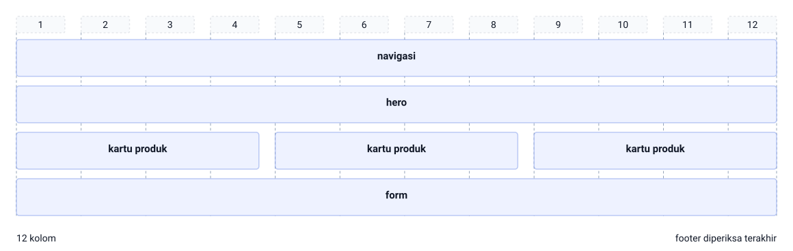

`index.html` disisir dari atas: navigasi, hero, tiga kartu produk di grid 12 kolom, lalu form — dan titik kelima footer diperiksa terakhir. Gutter 24 px serta lebar yang sama di tiap breakpoint bikin urutan ini bisa diulang orang lain tanpa mengandalkan ingatan.

<!--
Jalankan pemindaian ini di layar sambil geser lebar, jangan cuma dibacakan. Tanyakan titik mana yang paling sering bermasalah di proyek teman sekelas; jawaban yang diharapkan: kartu produk dan form. Tunjuk baris kartu produk di gambar, lalu minta kelas menyebut lebar layar tempat baris itu mulai menumpuk.
-->

---

# Browser Testing dan Uji Ulang Regresi

- Chrome jadi browser utama, tambah satu browser lain
- Firefox, Edge, atau Safari buat membandingkan hasil render
- Beda font bawaan dan jarak form dicatat sebagai temuan
- Regression: cacat yang kembali setelah satu perubahan
- Setiap perubahan kaskade wajib disertai penyapuan cepat
- Sapu seluruh navigasi dan satu halaman katalog

<!--
Tanyakan kenapa browser lain sering menemukan cacat yang kita nggak lihat. Jawaban yang
diharapkan: mesin renderingnya beda, jadi jarak bawaan elemen form bisa lain. Lanjutkan
dengan aturan praktis regression: setiap perubahan kaskade disertai penyapuan navigasi
plus satu halaman katalog, karena aturan kustom untuk satu halaman kadang mengenai
halaman lain.
Demo: demos/bab-15/09-uji-lintas-browser-dan-regresi.html — satu putaran lulus, temuan, diperbaiki, uji ulang, ditambah dua panel Chrome dan Firefox yang jarak form-nya berbeda.
-->

---

# Contoh: Browser Testing dan Uji Ulang Regresi

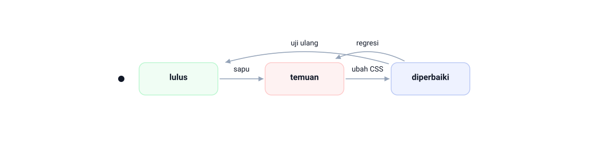

Satu putaran browser testing: katalog lulus di Chrome, disapu di Firefox, muncul temuan; temuan diubah CSS-nya sampai diperbaiki, lalu diuji ulang supaya lulus lagi. Kalau aturan kustom yang sama bikin cacat kambuh di halaman lain, statusnya regresi dan harus diperbaiki sebelum disapu ulang.

<!--
Tanyakan kenapa panah balik dari diperbaiki ke lulus harus lewat uji ulang, bukan lewat perasaan. Jawaban yang diharapkan: status menang cuma setelah halaman diperiksa lagi. Tunjuk panah cacat kembali dan minta kelas menyebut perubahan kaskade seperti apa yang biasanya mengenai halaman lain — biasanya selector yang terlalu lebar.
-->

---

<!-- _class: compact -->

# Lima Pemeriksaan Aksesibilitas dan Alatnya

- `alt` bermakna pada gambar produk, `alt=""` buat dekoratif
- Kontras teks utama minimal 4,5 : 1 terhadap latarnya
- Satu `h1` per halaman, nggak ada lompatan level
- Label terhubung, urutan tab mengalir, pesan status bermakna
- Keyboard dan fokus: skip link jalan, indikator fokus terlihat
- Lighthouse kasih skor, tapi makna tetap dinilai manusia

<!--
Tekankan bahwa lima pemeriksaan ini hasilnya terukur, jadi temuan aksesibilitas punya nomor
pasal WCAG 2.2 yang bisa dilaporkan. Minta kelas menjalankan uji tab tanpa menyentuh mouse
pada satu halaman kontak. Tanyakan kenapa skor Lighthouse tinggi bukan berarti lulus.
Jawaban yang diharapkan: urutan baca dan makna cuma bisa dinilai manusia, jadi alatnya
cuma penguat, bukan pengganti.
Demo: demos/bab-15/10-lima-pemeriksaan-aksesibilitas.html — halaman kontak yang bisa diuji Tab: skip link, kolom surel, lalu tombol kirim, dengan indikator fokus terlihat.
-->

---

# Contoh: Lima Pemeriksaan Aksesibilitas dan Alatnya

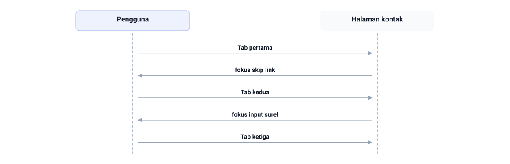

Di halaman kontak, pengguna menekan Tab tanpa menyentuh mouse: Tab pertama memindahkan fokus skip link, Tab kedua ke fokus input surel, dan Tab ketiga ke tombol kirim. Kalau urutan fokus ini mengalir, satu dari lima pemeriksaan aksesibilitas sudah lolos.

<!--
Minta kelas menjalankan uji tab ini di perangkatnya sendiri, jangan cuma dibacakan. Tanyakan apa yang terlihat kalau indikator fokus hilang: jawaban yang diharapkan, pengguna keyboard kehilangan posisi dan berhenti di tengah form. Lanjut ke empat pemeriksaan lain: alt bermakna, kontras teks 4,5 : 1, satu `h1` per halaman, dan label yang terhubung. Ingatkan skor Lighthouse boleh tinggi, tapi urutan fokus dan makna label tetap dinilai manusia.
-->

---

<!-- _class: section -->
<!-- _footer: '' -->

# Konsistensi Visual dan Kesiapan Rilis

## Membaca kaskade, lalu mengunci versi

<!--
Bagian penutup QA. Katakan bahwa di sini kita berhenti menebak dan mulai membaca: aturan
mana yang menang, kenapa menang, dan di file mana aturan itu berasal. Setelah itu barulah
versi dikunci sebagai rilis kandidat.
-->

---

<!-- _class: compact -->

# Debugging CSS di DevTools

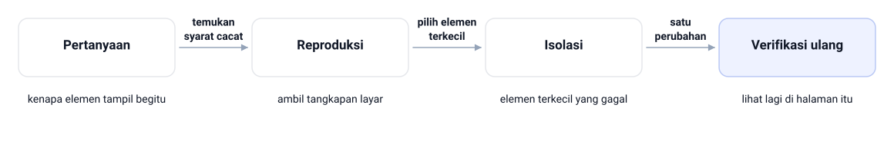

| Panel | Yang ditunjukkan |
|---|---|
| Styles | Semua aturan, yang kalah tampil tercoret |
| Computed | Nilai akhir yang benar-benar menyala |

<!--
Tunjukkan panel Styles pada satu elemen yang sengaja dibuat konflik, lalu suruh kelas
menebak aturan mana yang menang sebelum kamu lihat Computed. Ingatkan bahwa menambah
`!important` sebagai jawaban pertama itu kebiasaan yang menyimpan regression. Sebutkan
bahwa empat langkah ini terasa berat di cacat pertama dan jadi instan di cacat kesepuluh.

Telusuri panahnya satu per satu. Mulai dari pertanyaan: kenapa elemen tampil begitu.
Lanjut ke reproduksi — temukan syarat cacat, ambil tangkapan layar. Setelah itu isolasi:
pilih elemen terkecil yang gagal. Panah terakhir adalah aturan mainnya, hipotesis tunggal,
satu perubahan, lalu verifikasi ulang: lihat lagi di halaman itu. Tekankan bahwa satu
perubahan per putaran itulah yang bikin kamu masih tahu penyebabnya saat hasilnya berubah,
dan utamakan panel Computed untuk membaca nilai akhir yang benar-benar menyala.
Demo: demos/bab-15/11-debugging-css-devtools.html — panel Styles dengan satu aturan tercoret disandingkan dengan panel Computed yang menunjukkan nilai akhirnya.
-->

---

# Checklist Rilis 1/3 — Isi, Brand, dan Meta

- Seluruh link dan navigasi hidup, nggak ada rujukan mati
- Tagline, navigasi, dan kontak identik di semua halaman
- Delapan produk baku tampil dengan nama, kategori, harga
- Harga memakai format `Rp650.000` tanpa spasi
- Meta lengkap: `charset`, `viewport`, `title` deskriptif

<!--
Ini tiga belas item checklist yang dipotong jadi tiga slide biar nggak sesak. Minta kelas
mengklik seluruh menu navigasi bareng-bareng, karena link mati paling cepat ditemukan
dengan cara itu. Tanyakan kenapa brand harus identik di semua halaman. Jawaban yang
diharapkan: pengguna menyimpulkan halaman yang beda tampilan itu halaman yang terlupakan.
Demo: demos/bab-15/12-checklist-rilis.html — lima item checklist rilis 1/3 dengan tanda lulus dan temuan, lalu katalog delapan produk baku dalam grid 12 kolom.
-->

---

# Contoh: Checklist Rilis 1/3 — Isi, Brand, dan Meta

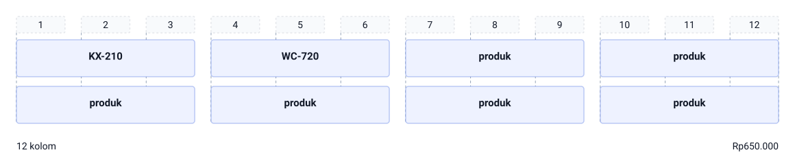

`katalog.html` menampilkan delapan produk baku dalam grid 12 kolom: empat kartu per baris dengan span 3 dan gutter 24 px, dua di antaranya KX-210 dan WC-720. Setiap kartu wajib memuat nama, kategori, dan harga berformat `Rp650.000` tanpa spasi — itu item pertama checklist rilis 1/3.

<!--
Hitung bareng kelas: 4 + 4 + 4 + 4 = 12 kolom, dua baris, delapan kartu produk. Tanyakan kenapa harga harus satu format di semua kartu. Jawaban yang diharapkan: pengguna membandingkan harga dengan mata, dan format yang campur bikin perbandingan itu gagal. Lanjut minta kelas mengklik seluruh menu navigasi untuk mencari link mati.
-->

---

# Checklist Rilis 2/3 — Kode, Perangkat, dan Akses

- HTML lolos W3C validator tanpa kesalahan
- CSS kustom pakai token, tanpa kode mati dan `!important`
- Test matrix tiga breakpoint terisi penuh tanpa sel kosong
- Checklist aksesibilitas Bab 13 lolos: alt, kontras, label, tab
- Komponen identik dengan sampel styleguide Bab 12

<!--
Tanyakan kenapa item validator ditaruh di posisi paling atas. Jawaban yang diharapkan:
satu tag yang nggak ditutup bikin parser menarik kesimpulan berantai di baris berikutnya,
jadi kesalahan pertama itu akarnya. Lanjutkan dengan perbandingan styleguide: setiap
penyimpangan radius atau jarak itu temuan dengan lokasi, bukan beda selera.
-->

---

# Contoh: Checklist Rilis 2/3 — Kode, Perangkat, dan Akses

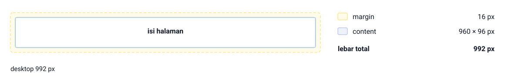

Kolom paling kanan test matrix: di desktop 992 px, kontainer Bootstrap menyisakan margin 16 px di kiri dan kanan, jadi content 960 × 96 px dan lebar total 992 px. Di bawah 992 px isi halaman ini wajib menyusut sendiri, dan sel matrix yang masih kosong tetap dihitung sebagai temuan.

<!--
Tunjuk margin 16 px di gambar dan tanya dari mana angka itu datang. Jawaban yang diharapkan: dari selisih lebar layar 992 px dengan kontainer 960 px, bukan dari aturan kustom. Lanjutkan ke kolom tablet 768 px dan HP 360 px, lalu minta kelas menyebut sel matrix mana yang biasanya dibiarkan kosong.
-->

---

# Checklist Rilis 3/3 — Aset, Alat QA, dan Paket

- Gambar teroptimasi: nama kebab-case, dimensi wajar, format tetap
- Alat QA ditata sesuai kesepakatan kelompok
- Versi akhir disimpan sebagai `tokosaya-bootstrap-v1.0.0-rc1.zip`
- Paket rilis disertai catatan perubahan
- Temuan Kritis yang tersisa harus nol

<!--
Jelaskan kenapa halaman alat QA dibahas di checklist: tanpa kesepakatan kelompok, halaman
itu bisa ikut terkirim seolah bagian produk. Tanyakan apa gunanya catatan perubahan buat
reviewer. Jawaban yang diharapkan: reviewer tahu apa yang berubah sejak draft M6 tanpa
membaca ulang seluruh file. Tutup dengan menegaskan label versi bikin satu titik berhenti
yang bisa dibuktikan.
-->

---

<!-- _class: compact -->

# Contoh: Checklist Rilis 3/3 — Aset, Alat QA, dan Paket

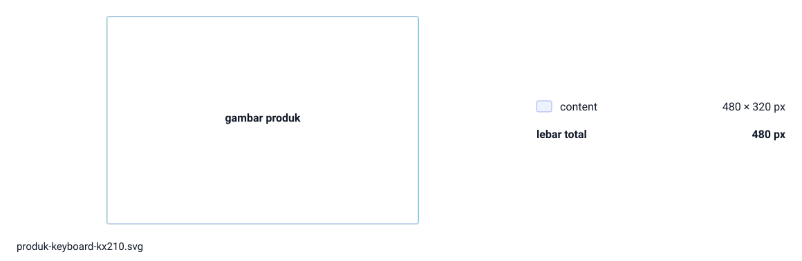

Satu aset di folder `img/`: gambar produk `produk-keyboard-kx210.svg` dengan content 480 × 320 px, jadi lebar total 480 px tanpa border dan tanpa padding. Nama kebab-case, dimensi wajar, satu format tetap — begitu item aset di checklist rilis 3/3 terpenuhi dan paket `tokosaya-bootstrap-v1.0.0-rc1.zip` tinggal dirakit.

<!--
Tanya apa yang terjadi kalau gambar ini disimpan sebagai Keyboard KX210 Final.png berukuran 1600 px. Jawaban yang diharapkan: nama berspasi berisiko mati di hosting, dan berkas besar memperlambat halaman tanpa menambah informasi. Tunjuk angka 480 × 320 px dan tegaskan bahwa ukuran wajar itu keputusan sadar, bukan sisa ekspor.
-->

---

# Paket Rilis Kandidat

- Rilis kandidat: versi siap rilis menunggu persetujuan akhir
- Persetujuannya peer review dan dosen pada Bab 16
- Deployment: menaruh website di hosting statis atau paket ZIP
- Artefak M7: checklist terisi, laporan temuan, paket rilis
- Dosen menilai milestone ini sebelum Bab 16 menyuntik persetujuan

<!--
Bedakan deployment dan rilis kandidat dengan jelas, karena dua kata ini sering dianggap
sama. Tanyakan apa bedanya keputusan rilis yang terdokumentasi dengan keputusan yang
mengikuti suasana hati. Jawaban yang diharapkan: yang terdokumentasi bisa dibantah dan
diulang pemeriksaannya. Sebutkan bahwa nol temuan Kritis itu ukuran terukurnya.
Demo: demos/bab-15/13-paket-rilis-kandidat.html — isi paket rc1 dibuka sebagai satu kotak: empat halaman, satu berkas gaya, folder aset, dan dua alat QA.
-->

---

<!-- _class: compact -->

# Contoh: Paket Rilis Kandidat

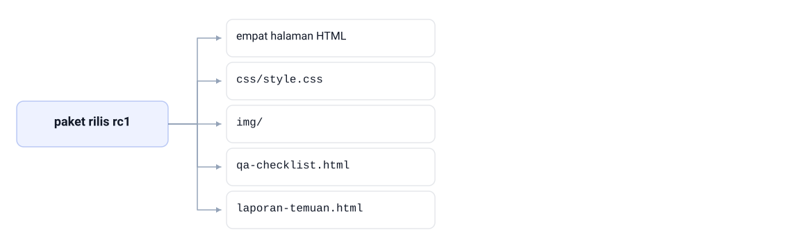

Paket rilis rc1 dibuka reviewer dan isinya harus bisa ditebak: empat halaman HTML yaitu index.html, katalog.html, produk.html, kontak.html, plus css/style.css, folder img/, dan dua alat QA yaitu qa-checklist.html serta laporan-temuan.html. Satu label versi, satu catatan perubahan, nol temuan Kritis.

<!--
Buka satu paket ZIP di layar dan tanya apa yang bikin reviewer percaya paket ini lengkap. Jawaban yang diharapkan: susunannya bisa ditebak tanpa membuka tiap file, dan alat QA kelihatan memisahkan diri dari produk. Tekankan bahwa rilis kandidat menunggu peer review dan dosen, jadi paket ini belum barang jadi yang langsung dipakai.
-->

---

# Skrip Presentasi Tujuh Menit

- Satu menit masalah yang dipecahkan dan audiensnya
- Sekitar sembilan puluh detik arah penyelesaian dan design system
- Tiga menit demo tiga breakpoint, dua form, satu katalog
- Satu menit bukti QA: checklist dan status temuan
- Satu menit refleksi dan rencana pemeliharaan
- Cadangan: tangkapan layar responsif kalau perangkat bermasalah

<!--
Tekankan bahwa skrip ini menyelamatkan kamu dari presentasi yang mengarang. Tanyakan
kenapa bukti QA harus punya porsi sendiri di presentasi. Jawaban yang diharapkan: biar
penilaian berdasar bukti, bukan kesan. Ingatkan juga bahwa Bab 16 menambah tiga menit
QA demo responsif setelah presentasi, jadi latih perpindahan breakpointnya.
-->

---

# Contoh: Skrip Presentasi Tujuh Menit

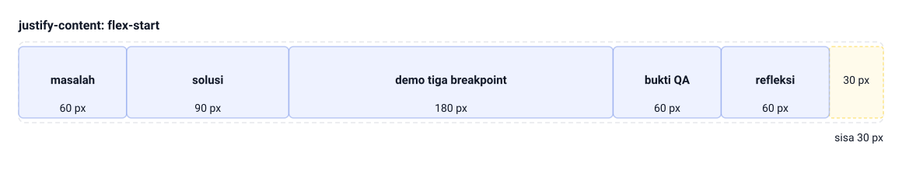

Skrip tujuh menit itu dihitung dari durasi: masalah 60 px, solusi 90 px, demo tiga breakpoint 180 px, bukti QA 60 px, refleksi 60 px. Terpakai 450 px dari container 480 px, jadi sisa 30 px — satu detik satu px, dengan `justify-content: flex-start` supaya urutannya kebaca dari kiri.

<!--
Minta kelas menghitung ulang: 60 + 90 + 180 + 60 + 60 = 450 detik. Tanyakan kenapa bagian demo dapat porsi paling besar. Jawaban yang diharapkan: bukti paling meyakinkan itu halaman yang bergerak di tiga breakpoint, bukan daftar fitur. Ingatkan Bab 16 menambah tiga menit demo responsif, jadi latih perpindahan breakpointnya.
-->

---

# Praktikum QA Sprint: Tujuan dan Alat

- Sasaran: satu putaran QA penuh sampai rilis kandidat
- Draft M6 minimal empat halaman dengan navigasi menyambung
- Chrome dengan DevTools plus validator W3C daring
- `qa-checklist.html` dan `laporan-temuan.html` di akar proyek
- Lembar peer review kelas dan alat pembuat arsip ZIP

<!--
Sebutkan bahwa praktikum ini bukan tempat menulis halaman baru: kalau ada halaman rusak,
selesaikan dulu di luar sprint. Tanyakan siapa yang belum pernah membuka validator W3C.
Jawaban yang diharapkan biasanya masih sepi, jadi tunjukkan validator.w3.org langsung di
layar. Ingatkan bahwa semua temuan ditulis, termasuk yang belum sempat diperbaiki.
-->

---

<!-- _class: compact -->

# Langkah Kerja 1–5

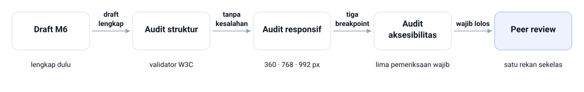

<!--
Jalankan langkah ini bareng-bareng di layar, jangan cuma dibacakan. Tekankan bahwa peer
review itu perjanjian setara: kamu me-review proyeknya sambil dia me-review proyekmu,
biar nggak jadi review satu arah. Tanyakan apa yang biasanya cuma ditemukan mata segar.
Jawaban yang diharapkan: asumsi tersamar yang kamu bawa sendiri sejak awal.

Sebutkan lima langkahnya berurutan sambil menunjuk gambar. Pertama draft M6: pastikan
lengkap dulu sebelum QA dimulai. Kedua audit struktur: validasi tiap halaman di validator
W3C sampai tanpa kesalahan, karena satu tag yang nggak ditutup bikin parser menarik
kesimpulan berantai. Ketiga audit responsif: device toolbar pada 360, 768, 992 px, jadi
panahnya berbunyi tiga breakpoint. Keempat audit aksesibilitas: lima pemeriksaan wajib per
halaman, dan kelimanya wajib lolos. Kelima peer review silang 45 menit dengan satu rekan
sekelas. Peringatkan bahwa semua temuan ditulis, termasuk yang belum sempat diperbaiki.
-->

---

<!-- _class: compact -->

# Prioritas Temuan dan Uji Ulang

| Severitas | Arti | Contoh |
|---|---|---|
| Kritis | menghalangi penggunaan | link mati, form tak berlabel |
| Mayor | memperburuk penggunaan | kontras kurang, kartu tak sejajar |
| Minor | kesalahan kecil | radius dan jarak nggak sesuai styleguide |

- Perbaiki urut dari Kritis, satu perubahan per putaran
- Uji ulang regresi setelah setiap perbaikan
- Tutup temuan hanya setelah verifikasi ulang, lalu kunci rilis

<!--
Ingatkan bahwa status "Diperbaiki" bukan hadiah karena kamu merasa selesai, tapi hasil
verifikasi di halaman dan perangkat yang bersangkutan. Tanyakan kenapa cuma satu perubahan
per putaran. Jawaban yang diharapkan: kalau hasilnya berubah, kamu masih tahu perubahan
mana penyebabnya. Sebutkan bahwa temuan yang tetap Terbuka harus disertai alasan.
-->

---

<!-- _class: compact -->

# Kode: Halaman Checklist QA

```html
<head>
  <meta charset="UTF-8">
  <meta name="viewport" content="width=device-width, initial-scale=1">
  <title>Checklist QA — Tokosaya</title>
</head>
<body class="bg-body-tertiary">
  <main class="container py-4">
    <article class="card shadow-sm">
      <div class="card-body">
        <h2 class="h5 card-title">Struktur dan HTML</h2>
        <ul class="list-group list-group-flush">
          <li class="list-group-item">HTML tervalidasi W3C</li>
          <li class="list-group-item">Satu <code>h1</code> per halaman</li>
        </ul>
      </div>
    </article>
  </main>
</body>
```

`File: tokosaya-bootstrap/qa-checklist.html`

- Nggak ada satu baris CSS kustom di halaman ini
- Semua tampilan menyerahkan diri ke utilitas Bootstrap

<!--
Tunjukkan bahwa halaman ini adalah bukti langsung pola utilitas-pertama: grid, jarak, dan
kartu semuanya dari kelas Bootstrap. Tanyakan kenapa badge prioritas dipakai, bukan tulisan
biasa. Jawaban yang diharapkan: prioritas item jadi terbaca dari warna, bukan ditebak dari
posisi. Ingatkan bahwa satu `h1` di header dan `h2` di kartu menjaga hierarki nggak melompat.
Demo: demos/bab-15/14-halaman-checklist-qa.html — markup `qa-checklist.html` dirender apa adanya, tanpa satu baris CSS kustom.
-->

---

<!-- _class: compact -->

# Kode: Tabel Laporan Temuan

```html
<table class="table table-striped align-middle">
  <thead>
    <tr>
      <th scope="col">ID</th>
      <th scope="col">Temuan</th>
      <th scope="col">Severitas</th>
      <th scope="col">Status</th>
    </tr>
  </thead>
  <tbody>
    <tr>
      <th scope="row">F-01</th>
      <td>Label "Surel" tidak terhubung ke input.</td>
      <td><span class="badge text-bg-danger">Kritis</span></td>
      <td><span class="badge text-bg-success">Diperbaiki</span></td>
    </tr>
  </tbody>
</table>
```

`File: tokosaya-bootstrap/laporan-temuan.html`

- `th scope="row"` menautkan tiap baris dengan ID-nya
- Status berubah cuma setelah verifikasi ulang

<!--
Jelaskan bahwa bentuk tabel dipilih karena laporan profesional selalu difilter: reviewer
bertanya temuan Kritis yang masih terbuka, bukan membaca seluruh cerita. Tunjukkan kolom
langkah reproduksi di file aslinya dan tanyakan kenapa kolom itu wajib. Jawaban yang
diharapkan: temuan yang langkahnya nggak bisa diulang orang lain dianggap nggak valid.
Demo: demos/bab-15/15-tabel-laporan-temuan.html — tiga temuan dengan badge severitas dan status, ditambah tabel arti Kritis, Mayor, dan Minor.
-->

---

<!-- _class: compact -->

# Kode: Refactor CSS Hasil Temuan

```css
/* ============ SEBELUM (bahan review) ============ */
/* kustom */
.card-produk-title { font-size: 22px; }

/* kustom */
div .card-produk-title { font-size: 20px !important; }

/* ============ SESUDAH (dipertahankan) ============ */
/* kustom — judul kartu produk; nilai mengikuti token */
.produk-card .card-title {
  font-size: 1.25rem;
  font-weight: 600;
  color: var(--clr-dark);
  border-radius: var(--radius);
}
```

`File: tokosaya-bootstrap/css/style.css`

- Tiga aturan yang menyasar selector sama itu duplikasi
- `div` menambah bobot, `!important` memaksa kemenangan

<!--
Tekankan bahwa blok SEBELUM cuma bahan diskusi review dan jangan dipertahankan di file riil.
Minta kelas menunjuk tiga penyakitnya satu per satu sebelum kamu tunjukkan jawabannya:
duplikasi terpencar, `!important`, dan nilai acak di luar token. Tutup dengan prinsip
refactornya: satu aturan per maksud, biarkan token memikul nilai, dan biarkan kaskade
bekerja tanpa dipaksa.
Demo: demos/bab-15/16-refactor-css-hasil-temuan.html — blok sebelum dan sesudah berdampingan, lengkap dengan judul kartu hasil render keduanya.
-->

---

# Hasil yang Diharapkan

- `qa-checklist.html`: seluruh item Wajib berstatus lulus
- `laporan-temuan.html`: minimal tiga temuan proyekmu sendiri
- Test matrix tiga breakpoint kali empat halaman terisi penuh
- Paket `tokosaya-bootstrap-v1.0.0-rc1.zip` tanpa link mati
- `laporan-qa.md`: ringkasan checklist dan daftar perubahan
- Temuan Kritis yang tersisa pada rilis kandidat: nol

<!--
Bandingkan hasil proyek teman sekelas kalau ada waktu, jangan cuma membacakan slide ini.
Tanyakan bukti mana yang paling sulit dipalsukan. Jawaban yang diharapkan: test matrix yang
terisi penuh dengan tangkapan layar, karena sel kosong langsung kelihatan. Ingatkan bahwa
paket ZIP harus bisa dibuka dan halamannya berpindah benar tanpa link mati.
-->

---

# Troubleshooting QA


<!--
Bahas keempat masalah ini sebagai gejala yang sering bikin mahasiswa bingung, bukan sebagai
kesalahan pribadi. Tanyakan kenapa satu tag yang nggak ditutup bisa memunculkan lima catatan
validator. Jawaban yang diharapkan: parser menarik kesimpulan berantai setelah tag itu.
Tekankan bahwa perbaikan pertama bisa memangkas senarai validasi drastis.

Bacakan gambar sebagai pasangan gejala dan perbaikannya, baris per baris. Perubahan CSS
nggak terlihat: cek simpan, cache, dan jalur `href`. Validator menampilkan banyak error:
perbaiki yang paling atas dulu. Temuan muncul di halaman lain: batasi selector ke konteks
komponen. Link 404: samakan nama file di disk dan di markup. Tekankan bahwa tiap gejala
punya satu pemeriksaan pendahuluan yang murah, jadi jangan langsung menambah aturan baru.
-->

---

# Latihan

- Jelaskan beda QA, pengujian, dan UAT dengan satu paragraf
- Buat test matrix empat halaman kali tiga breakpoint
- Tulis tiga cacat dari blok CSS temuan reviewer
- Audit `kontak.html` pakai lima pemeriksaan aksesibilitas
- Susun skrip presentasi tujuh menit dengan alokasi waktu
- Ceritakan satu cacat yang cuma ditemukan peer review

<!--
Kerjakan butir pertama bareng-bareng di papan, sisanya jadi latihan mandiri. Butir terakhir
paling sering dijawab dangkal, jadi bantu dengan pertanyaan lanjutan: asumsi apa yang kamu
bawa sampai nggak melihat cacat itu sendiri? Jawaban yang diharapkan: kebiasaan melihat
halaman dari lebar layar yang sama terus. Sebutkan bahwa laporan temuan punya format tetap.
-->

---

# Cek Daftar Rilis Kandidat

- Rilis kandidat punya label versi dan catatan perubahan
- Seluruh sel test matrix terisi, nggak ada sel kosong
- Temuan Kritis tersisa nol, sisanya beralasan jelas
- Tiga artefak M7 lengkap dan bisa dibuka reviewer
- Laporan temuan punya langkah reproduksi yang bisa diulang

<!--
Minta mahasiswa saling memeriksa paket rilis pakai daftar ini dan menunjukkan buktinya
langsung, bukan menjawab lisan. Tanyakan item mana yang paling sering gagal. Jawaban yang
diharapkan: sel test matrix yang dibiarkan kosong dan langkah reproduksi yang ditulis
seadanya. Ingatkan bahwa yang dinilai bukan website yang cantik, tapi QA yang bisa
dipertanggungjawabkan.
-->

---

# Rangkuman

- QA adalah proses sistematis dan terukur, bukan seruan akhir
- Anatomi memetakan sembilan bagian wajib di empat halaman
- Folder tertata dan penamaan kebab-case bikin audit tanpa sisa
- Bootstrap: utilitas dulu, kustom terkomentar, CDN terkunci
- Test matrix dan lima titik membuat uji responsif terencana
- Checklist dua belas titik mengunci versi v1.0.0-rc1
**Demo:** seluruh konsep bab ini bisa dicoba di [demos/bab-15/index.html](demos/bab-15/index.html).

<!--
Tutup dengan pesan utama: kualitas nggak pernah tinggal, ia harus dirawat dan dibuktikan.
Sebutkan bahwa aksesibilitas dan debugging kaskade adalah dua pemeriksaan yang paling
sering mengubah kualitas proyek. Ingatkan bahwa seluruh artefak bab ini jadi bahan mentah
ujian akhir di Bab 16, jadi jangan dihapus setelah dikumpulkan.
-->

---

<!-- _class: lead -->
<!-- _footer: '' -->

# Tugas dan Refleksi

Jalankan praktikum bab ini pada draft final project kamu, lalu kumpulkan checklist terisi, laporan temuan minimal tiga temuan riil, dan paket `tokosaya-bootstrap-v1.0.0-rc1.zip`.

**Pertanyaan refleksi:** bagian mana dari QA sprint yang paling mengubah cara kamu membaca kode sendiri?

*Sampai di sini rangkaian semester ini. Bab 16 tinggal menyambut proyekmu di forum ujian.*

<!--
Tugas individu: kumpulkan tiga artefak M7 sebelum pertemuan 16. Nilai kelengkapan checklist,
kualitas temuan termasuk langkah reproduksi dan severitas, perbaikan yang tercatat dengan
uji ulang regresi, serta kesiapan paket rilisnya. Sebutkan juga tugas kelompok: saling
bertukar rilis kandidat dan menyusun laporan UAT lima bagian. Terakhir, ucapkan selamat
karena rangkaian bab semester ini selesai di sini, dan Bab 16 tinggal menyambut proyeknya
di forum ujian.
-->
